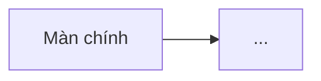

# Thiết kế UX: <tên tính năng>

Trạng thái: Nháp  <!-- Nháp | Đã duyệt -->
Đặc tả: [docs/specs/<tên>.md](../specs/<tên>.md)

## Luồng người dùng



## Danh sách màn hình

| Màn | Mục đích | Vào từ | Ra tới |
|---|---|---|---|

## Wireframe

### <Tên màn>

```
┌──────────────────────────┐
│ Tiêu đề            [⋮]   │
├──────────────────────────┤
│                          │
│                          │
└──────────────────────────┘
```

- Thành phần và hành vi khi chạm.

## Trạng thái

| Màn | Trống | Đang xử lý | Lỗi | Cảnh báo |
|---|---|---|---|---|

## Nội dung chữ

| Vị trí | Chữ hiển thị |
|---|---|

## Kiểm theo nguyên tắc (`docs/design/README.md`)

- [ ] Lời lẽ đúng vai tham chiếu, không viết tắt chuẩn
- [ ] Ẩn số calo được tôn trọng
- [ ] Tối đa 3 lần chạm cho thao tác chính
- [ ] Cỡ chữ 200%, vùng chạm 48 dp, tương phản AA
- [ ] Không quảng cáo ở màn cảnh báo
