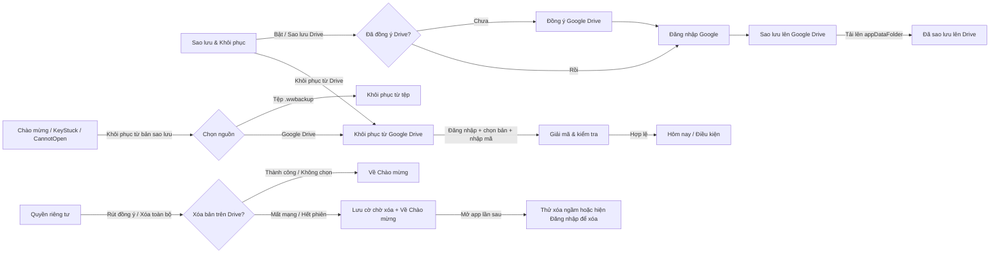

# Thiết kế UX: Sao lưu Google Drive (`appDataFolder`) — Phần 7b

Trạng thái: Đã duyệt (26/11/2026)  <!-- Nháp | Đã duyệt -->
Đặc tả: [docs/specs/backup-drive.md](../specs/backup-drive.md)
Thiết kế khung: [docs/design/mvp-overview.md](mvp-overview.md) (dòng 704, 716, 806)

## Luồng người dùng



## Danh sách màn hình & cập nhật

| Màn / Thành phần | Mục đích | Vào từ | Ra tới |
|---|---|---|---|
| **Chào mừng & Màn lỗi khóa** (cập nhật) | Khi bấm `Khôi phục từ bản sao lưu`, hiện lựa chọn `Từ tệp trên máy (.wwbackup)` hoặc `Từ Google Drive` | Mở app lần đầu, `KeyStuck`, `CannotOpen` | `Khôi phục từ tệp` hoặc `Khôi phục từ Google Drive` |
| **Sao lưu và khôi phục** (cập nhật) | Thay phần chờ bằng khu vực `Google Drive (tùy chọn)`: hiện tài khoản đang nối, mốc sao lưu gần nhất, `[ Sao lưu lên Drive ]`, `[ Khôi phục từ Drive ]`, `[ Ngắt kết nối ]` | Tab `Tôi` | `Đồng ý Google Drive`, `Sao lưu lên Google Drive`, `Khôi phục từ Google Drive` |
| **Đồng ý sao lưu Google Drive** (mới) | Xin đồng ý riêng (`consents.kind = 'drive'`) trước khi nối tài khoản Google lần đầu | Bấm `[ Kết nối Google Drive ]` / `[ Sao lưu lên Drive ]` khi chưa đồng ý | Đăng nhập Google → `Sao lưu lên Google Drive` |
| **Sao lưu lên Google Drive** (mới) | Sinh mã khôi phục 24 ký tự hoặc đặt mật khẩu ≥ 8 ký tự, xác nhận đã giữ mã, mã hóa `Isolate.run` và tải lên `appDataFolder` | `Sao lưu và khôi phục` | `Sao lưu và khôi phục` |
| **Khôi phục từ Google Drive** (mới) | Đăng nhập Google, chọn bản sao lưu (trong tối đa 3 bản gần nhất), nhập mã khôi phục/mật khẩu, khôi phục về máy | `Chào mừng`, `KeyStuck`, `CannotOpen`, `Sao lưu và khôi phục` | `Hôm nay` (hoặc `Điều kiện` nếu đồng ý cũ) |
| **Quyền riêng tư** (cập nhật) | Hiện trạng thái Drive; hộp thoại `Rút đồng ý` & `Xóa toàn bộ` có thêm ô `"Xóa cả bản sao lưu trên Google Drive"` (rút đồng ý: đánh sẵn; xóa toàn bộ: không đánh sẵn) | Tab `Tôi` | `Chào mừng` (kèm nhắc nếu Drive chưa xóa được) |
| **Thẻ nhắc xóa bản Drive đang chờ** (mới) | Hiện khi cờ `DrivePendingDeleteStore` còn chờ và phiên Google hết hạn/thu hồi; có `[ Đăng nhập để xóa ]` và `[ Đã tự xóa / Bỏ qua ]` | Mở app (`Chào mừng` hoặc `Hôm nay`) sau khi xóa cục bộ khi hết phiên | Tự ẩn sau khi xóa xong hoặc bỏ qua |

## Wireframe

### 1. Chọn nguồn khôi phục & Khu vực Drive ở `Sao lưu và khôi phục`

```
  (Sheet từ Chào mừng / Màn lỗi)       (Sao lưu và khôi phục - Phần Drive)
┌──────────────────────────────┐     ┌──────────────────────────────┐
│ Khôi phục từ bản sao lưu     │     │ Google Drive (tùy chọn)      │
│                              │     │  Tài khoản: a...@gmail.com   │
│ [ Từ tệp trên máy (.wwbackup)]│    │  Lần gần nhất: 26/11 20:10   │
│ [     Từ Google Drive       ]│     │ [   Sao lưu lên Drive      ] │
└──────────────────────────────┘     │ [   Khôi phục từ Drive     ] │
                                     │   Ngắt kết nối Google Drive  │
                                     └──────────────────────────────┘
```

- Khi chưa đồng ý / chưa nối Drive: khu vực Drive chỉ hiện mô tả `"Dữ liệu gửi lên thư mục ẩn (appDataFolder) trên Google Drive ở dạng đã mã hóa."` và nút `[ Kết nối Google Drive ]` + `[ Khôi phục từ Drive ]`.
- Bấm `Ngắt kết nối Google Drive`: hiện hộp thoại `"Ngắt kết nối Google Drive?"` kèm ô chọn `"Xóa cả bản sao lưu trên Google Drive"` (không đánh sẵn) → thu hồi `disconnect()` và `withdrawDriveConsent()`.

### 2. Đồng ý Google Drive & Sao lưu lên Google Drive

```
┌──────────────────────────────┐     ┌──────────────────────────────┐
│ ←  Sao lưu Google Drive      │     │ ←  Sao lưu lên Google Drive  │
├──────────────────────────────┤     ├──────────────────────────────┤
│ Dữ liệu trên máy được mã hóa │     │ Tài khoản: a...@gmail.com    │
│ bằng mã do chỉ bạn giữ trước │     │ Khóa bản sao lưu chỉ bạn giữ.│
│ khi tải lên thư mục ẩn của   │     │ Quên mã sẽ không mở lại được.│
│ app trên Google Drive.       │     │                              │
│                              │     │ (•) Mã khôi phục 24 ký tự    │
│ • App chỉ truy cập thư mục   │     │ ( ) Tự đặt mật khẩu          │
│   ẩn riêng, không đọc tệp    │     │ ┌──────────────────────────┐ │
│   khác trên Drive của bạn.   │     │ │ A7K2-M9Q4-... [Sao chép] │ │
│ • Bạn có thể tắt và xóa bản  │     │ └──────────────────────────┘ │
│   sao lưu bất cứ lúc nào.    │     │ ☑ Tôi đã lưu mã ở nơi an toàn│
│                              │     │                              │
│ ☐ Tôi hiểu và đồng ý bật sao │     │ [  Tải bản sao lưu lên    ]  │
│   lưu qua Google Drive.      │     └──────────────────────────────┘
│                              │
│ [   Tiếp tục với Google     ]│
└──────────────────────────────┘
```

### 3. Khôi phục từ Google Drive

```
┌──────────────────────────────┐
│ ←  Khôi phục từ Google Drive │
├──────────────────────────────┤
│ Tài khoản: a...@gmail.com    │
│                 [ Đổi tài khoản ]
│                              │
│ Chọn bản sao lưu (tối đa 3): │
│ (•) 26/11/2026 20:10 (42 KB) │
│ ( ) 25/11/2026 19:05 (40 KB) │
│                              │
│ Mã khôi phục / mật khẩu      │
│ [                          ] │
│                              │
│ (Nếu đang có dữ liệu máy:)   │
│ ⓘ Khôi phục sẽ thay dữ liệu  │
│   hiện tại trên máy này.     │
│ [        Khôi phục         ] │
└──────────────────────────────┘
```

- Khi chưa đăng nhập ở màn `Khôi phục từ Google Drive`: hiện nút `[ Đăng nhập Google ]`; đăng nhập xong tự tải `listBackups()`.

### 4. Hộp thoại Xóa ở Quyền riêng tư & Thẻ nhắc chờ xóa Drive

```
  (Hộp thoại Rút đồng ý / Xóa)        (Thẻ nhắc khi hết phiên Google)
┌──────────────────────────────┐     ┌──────────────────────────────┐
│ Rút đồng ý? / Xóa toàn bộ?   │     │ ⓘ Chưa xóa được bản trên     │
│                              │     │   Google Drive do hết phiên  │
│ Rút đồng ý sẽ xóa mọi dữ liệu│     │   hoặc mất kết nối.          │
│ trên máy này...              │     │                              │
│                              │     │ Bạn có thể đăng nhập lại để  │
│ ☑ Xóa cả bản sao lưu trên    │     │ xóa hoặc vào Google Drive →  │
│   Google Drive               │     │ Cài đặt → Quản lý ứng dụng.  │
│   (Xóa toàn bộ: bỏ đánh sẵn) │     │                              │
│                              │     │ [ Đăng nhập để xóa ]         │
│ Tệp sao lưu bạn đã xuất ra   │     │   Đã tự xóa / Bỏ qua         │
│ ngoài thì app không xóa được.│     └──────────────────────────────┘
│ [ Hủy ]        [ Rút đồng ý ]│
└──────────────────────────────┘
```

## Trạng thái

| Màn | Trống / Ban đầu | Đang xử lý | Lỗi | Cảnh báo / Xác nhận |
|---|---|---|---|---|
| **Sao lưu & khôi phục (Drive)** | Chưa nối: nút `[ Kết nối Google Drive ]` | `"Đang kết nối Google..."` | Hủy đăng nhập: giữ nguyên trạng thái; lỗi cấu hình/mạng: `"Chưa kết nối được Google Drive. Kiểm tra mạng và thử lại."` | Hỏi xóa bản Drive khi ngắt kết nối |
| **Sao lưu lên Drive** | Chưa xác nhận đã lưu mã: nút tải lên tắt | `"Đang mã hóa và tải lên Drive..."` | Mất mạng / tải lên lỗi: `"Chưa tải được bản sao lưu lên Google Drive. Kiểm tra mạng và thử lại."` | Quên mã khôi phục không mở lại được |
| **Khôi phục từ Drive** | Tài khoản chưa có bản nào: `"Chưa có bản sao lưu nào trên tài khoản Google này."` | `"Đang tải và giải mã..."` | Sai mã/hỏng: `"Mã khôi phục không đúng hoặc tệp đã bị hỏng."` · Bản app mới hơn: thông báo cập nhật | Hỏi xác nhận thay dữ liệu cũ nếu máy đang mở DB |
| **Quyền riêng tư (Drive)** | `Google Drive: Đang bật (<email>)` hoặc `Chưa bật` | `"Đang xóa dữ liệu..."` | Mất mạng khi xóa Drive: xóa máy ngay + `"Chưa xóa được bản trên Google Drive. App sẽ thử lại khi có mạng."` | Ô `"Xóa cả bản sao lưu trên Google Drive"` + lưu ý tệp ngoài app không xóa được |

## Nội dung chữ

| Vị trí | Chữ hiển thị |
|---|---|
| Đồng ý Drive | `Tôi hiểu và đồng ý bật sao lưu qua Google Drive.` · `Tiếp tục với Google` |
| Sao lưu Drive | `Dữ liệu gửi lên thư mục ẩn (appDataFolder) trên Google Drive ở dạng đã mã hóa.` · `Tải bản sao lưu lên` · `Đã sao lưu lên Google Drive.` · `Chưa tải được bản sao lưu lên Google Drive. Kiểm tra mạng và thử lại.` |
| Khôi phục Drive | `Từ tệp trên máy (.wwbackup)` · `Từ Google Drive` · `Chọn bản sao lưu` · `Chưa có bản sao lưu nào trên tài khoản Google này.` · `Chưa kết nối được Google Drive. Kiểm tra mạng và thử lại.` |
| Xóa & cờ chờ xóa | `Xóa cả bản sao lưu trên Google Drive` · `Tệp sao lưu bạn đã xuất ra ngoài thì app không xóa được.` · `Chưa xóa được bản trên Google Drive. App sẽ thử lại khi có mạng.` · `Đăng nhập để xóa` · `Đã tự xóa / Bỏ qua` · `Cài đặt → Quản lý ứng dụng` |

## Kiểm theo nguyên tắc (`docs/design/README.md`)

- [x] Lời lẽ đúng vai tham chiếu, không viết tắt chuẩn, minh bạch về mã hóa Argon2id và phạm vi `appDataFolder`
- [x] Ẩn số calo được tôn trọng
- [x] Tối đa 3 lần chạm cho thao tác chính (`Tôi → Sao lưu và khôi phục → Sao lưu lên Drive`)
- [x] Cỡ chữ 200%, vùng chạm ≥ 48 dp, tương phản AA (nút hành động chính `48 dp`, không đánh sẵn ô đồng ý Drive)
- [x] Không quảng cáo ở màn cảnh báo (MVP không có quảng cáo)
