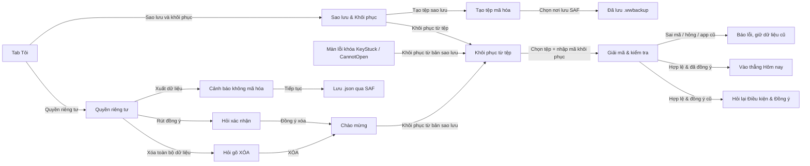

# Thiết kế UX: Sao lưu tệp mã hóa, khôi phục và Quyền riêng tư

Trạng thái: Đã duyệt (26/11/2026)  <!-- Nháp | Đã duyệt -->
Đặc tả: [docs/specs/backup.md](../specs/backup.md)
Thiết kế khung: [docs/design/mvp-overview.md](mvp-overview.md)

## Luồng người dùng



## Danh sách màn hình & cập nhật

| Màn / Thành phần | Mục đích | Vào từ | Ra tới |
|---|---|---|---|
| **Chào mừng & Màn lỗi khóa** (cập nhật) | Bật lại nút `Khôi phục từ bản sao lưu` ở Chào mừng, `KeyStuck`, `CannotOpen` | Mở app lần đầu hoặc lỗi Keystore | Màn Khôi phục từ tệp |
| **Tab Tôi** (cập nhật) | Bổ sung `Sao lưu và khôi phục ›`, `Quyền riêng tư ›` (chuyển `Xóa toàn bộ dữ liệu` vào trong `Quyền riêng tư` theo `mvp-overview.md`) | Thanh dưới (`Tôi`) | Sao lưu và khôi phục, Quyền riêng tư |
| **Sao lưu và khôi phục** (mới) | Tạo tệp sao lưu mã hóa (`.wwbackup`), khôi phục từ tệp, hiện trạng thái Google Drive (chờ Phần 7b) | Tab Tôi | Tạo tệp sao lưu, Khôi phục từ tệp |
| **Tạo tệp sao lưu mã hóa** (sheet/màn, mới) | Sinh mã khôi phục 24 ký tự (hoặc nhập mật khẩu riêng ≥ 8 ký tự), yêu cầu xác nhận đã lưu mã rồi lưu `.wwbackup` qua SAF | Sao lưu và khôi phục | Sao lưu và khôi phục |
| **Khôi phục từ tệp** (mới) | Chọn tệp `.wwbackup` qua SAF, nhập mã khôi phục/mật khẩu, xác nhận ghi đè (nếu đang có dữ liệu), khôi phục an toàn | Chào mừng, Màn lỗi khóa, Sao lưu và khôi phục | Hôm nay (hoặc Điều kiện nếu đồng ý cũ) |
| **Quyền riêng tư** (mới) | Xem ngày giờ đồng ý `Xử lý dữ liệu sức khỏe`, trạng thái Drive, `[Rút đồng ý]`, `[Xuất dữ liệu]` JSON, `[Xóa toàn bộ dữ liệu]` | Tab Tôi | Chào mừng (sau khi xóa/rút đồng ý), SAF lưu JSON |

## Wireframe

### 1. Chào mừng, Màn lỗi khóa & Tab Tôi

```
  (Chào mừng)                        (Tab Tôi)
┌──────────────────────────────┐   ┌──────────────────────────────┐
│          WholeWell           │   │ Tôi                          │
│ • Chỉ để tham khảo...        │   ├──────────────────────────────┤
│ • Dữ liệu chỉ nằm trên máy   │   │ Hồ sơ                      › │
│ • Không cần mạng             │   │ Hiển thị                   › │
│ [        Bắt đầu          ]  │   │ Giờ trong ngày             › │
│  Khôi phục từ bản sao lưu    │   │ Nhắc giờ                   › │
└──────────────────────────────┘   │ Sao lưu và khôi phục       › │
                                   │  Chưa sao lưu qua tệp        │
  (KeyStuck / CannotOpen)          │ Quyền riêng tư             › │
┌──────────────────────────────┐   │ Nguồn số liệu              › │
│ Không mở được dữ liệu đã lưu │   └──────────────────────────────┘
│ trên máy.                    │
│ [ Khôi phục từ bản sao lưu ] │
│ [       Bắt đầu lại        ] │
└──────────────────────────────┘
```

### 2. Sao lưu và khôi phục & Tạo tệp mã hóa

```
┌──────────────────────────────┐   ┌──────────────────────────────┐
│ ←  Sao lưu và khôi phục      │   │ ←  Tạo tệp sao lưu mã hóa    │
├──────────────────────────────┤   ├──────────────────────────────┤
│ Tệp mã hóa trên máy          │   │ Khóa bản sao lưu chỉ bạn giữ.│
│ Xuất ra tệp .wwbackup để tự  │   │ Quên mã/mật khẩu sẽ không mở │
│ giữ hoặc chép sang máy khác. │   │ lại được tệp sao lưu.        │
│ [    Tạo tệp sao lưu      ]  │   │                              │
│ [    Khôi phục từ tệp     ]  │   │ Cách bảo vệ:                 │
│ ──────────────────────────── │   │ (•) Mã khôi phục 24 ký tự    │
│ Google Drive (tùy chọn)      │   │ ( ) Tự đặt mật khẩu          │
│ Chưa bật · Sẽ hỗ trợ sau khi │   │                              │
│ hoàn tất cấu hình Google     │   │ ┌──────────────────────────┐ │
│ Cloud.                       │   │ │ A7K2-M9Q4-P3W8-...       │ │
└──────────────────────────────┘   │ │            [ Sao chép ]  │ │
                                   │ └──────────────────────────┘ │
                                   │ ☐ Tôi đã lưu mã này ở nơi an │
                                   │   toàn.                      │
                                   │ [    Chọn nơi lưu tệp     ]  │
                                   └──────────────────────────┘
```

- **Chế độ "Tự đặt mật khẩu":** 2 ô nhập mật khẩu + nhập lại mật khẩu (tối thiểu 8 ký tự, có nút hiện/ẩn), nút `[ Chọn nơi lưu tệp ]` bật khi 2 ô khớp và đạt ≥ 8 ký tự.
- **Đang xử lý (`Isolate.run` Argon2id):** nút chính hiện vòng xoay + dòng `"Đang mã hóa bản sao lưu..."`, không treo giao diện.

### 3. Khôi phục từ tệp & Quyền riêng tư

```
┌──────────────────────────────┐   ┌──────────────────────────────┐
│ ←  Khôi phục từ tệp          │   │ ←  Quyền riêng tư            │
├──────────────────────────────┤   ├──────────────────────────────┤
│ Chọn tệp .wwbackup và nhập   │   │ Đồng ý đã cho                │
│ mã khôi phục hoặc mật khẩu.  │   │  Xử lý dữ liệu sức khỏe      │
│                              │   │  26/11/2026 16:25            │
│ Tệp: wholewell-20261126...   │   │  [ Rút đồng ý ]              │
│ [   Chọn tệp sao lưu      ]  │   │                              │
│                              │   │ Sao lưu đám mây              │
│ Mã khôi phục / mật khẩu      │   │  Google Drive: chưa bật      │
│ [                         ]  │   │                              │
│                              │   │ Dữ liệu của bạn              │
│ (Nếu đang có dữ liệu máy:)   │   │ [     Xuất dữ liệu         ] │
│ ⓘ Khôi phục sẽ thay dữ liệu  │   │ [ Xóa toàn bộ dữ liệu      ] │ ← màu error
│   hiện tại trên máy này.     │   └──────────────────────────────┘
│ [       Khôi phục         ]  │
└──────────────────────────────┘
```

- **Xuất dữ liệu (`[ Xuất dữ liệu ]`):** luôn mở hộp thoại cảnh báo trước khi tạo/lưu JSON qua SAF: `"Tệp này không được mã hóa. Ai có tệp đều đọc được."` (`[ Hủy ]` / `[ Tiếp tục xuất ]`).
- **Rút đồng ý (`[ Rút đồng ý ]`):** mở hộp thoại xác nhận: `"Rút đồng ý sẽ xóa mọi dữ liệu trên máy này. Nếu có bản sao lưu, bạn có thể khôi phục sau."` (`[ Hủy ]` / `[ Rút đồng ý ]` màu `error`).
- **Xóa toàn bộ (`[ Xóa toàn bộ dữ liệu ]`):** hộp thoại gõ `XÓA` với lời văn: `"Mọi dữ liệu trên máy này sẽ bị xóa và không lấy lại được, trừ khi bạn có bản sao lưu. Gõ XÓA để xác nhận."`.

## Trạng thái

| Màn | Trống / Ban đầu | Đang xử lý | Lỗi | Cảnh báo / Xác nhận |
|---|---|---|---|---|
| **Sao lưu và khôi phục** | Chưa từng sao lưu: `"Chưa sao lưu qua tệp"` | Vòng xoay `"Đang mã hóa bản sao lưu..."` | Không ghi được tệp / hủy chọn SAF: `"Chưa lưu được tệp sao lưu."` | Lưu ý quên mã khôi phục không mở lại được tệp |
| **Khôi phục từ tệp** | Chưa chọn tệp: nút `[ Khôi phục ]` tắt | `"Đang giải mã và kiểm tra..."` | Sai mã/hỏng: `"Mã khôi phục không đúng hoặc tệp đã bị hỏng."` · Bản app cũ: `"Tệp sao lưu được tạo bởi phiên bản WholeWell mới hơn. Hãy cập nhật app trước khi khôi phục."` | Hỏi xác nhận thay dữ liệu cũ nếu máy đang có CSDL mở |
| **Quyền riêng tư** | Chưa bật Drive: `"Google Drive: chưa bật"` | Đang tạo JSON / đang xóa | Không xuất được tệp: `"Chưa xuất được dữ liệu."` | Cảnh báo JSON không mã hóa; gõ `XÓA` khi xóa toàn bộ |

## Nội dung chữ

| Vị trí | Chữ hiển thị |
|---|---|
| Tạo tệp sao lưu | `Khóa bản sao lưu chỉ bạn giữ. Quên mã hoặc mật khẩu sẽ không mở lại được tệp.` · `Mã khôi phục 24 ký tự` · `Tự đặt mật khẩu` · `Tôi đã lưu mã này ở nơi an toàn.` · `Chọn nơi lưu tệp` · `Đã lưu bản sao lưu mã hóa.` |
| Khôi phục từ tệp | `Khôi phục từ bản sao lưu` · `Chọn tệp sao lưu` · `Mã khôi phục / mật khẩu` · `Khôi phục` · `Mã khôi phục không đúng hoặc tệp đã bị hỏng.` · `Tệp sao lưu được tạo bởi phiên bản WholeWell mới hơn. Hãy cập nhật app trước khi khôi phục.` |
| Quyền riêng tư | `Đồng ý đã cho` · `Xử lý dữ liệu sức khỏe` · `Rút đồng ý sẽ xóa mọi dữ liệu trên máy này. Nếu có bản sao lưu, bạn có thể khôi phục sau.` · `Xuất dữ liệu` · `Tệp này không được mã hóa. Ai có tệp đều đọc được.` · `Mọi dữ liệu trên máy này sẽ bị xóa và không lấy lại được, trừ khi bạn có bản sao lưu. Gõ XÓA để xác nhận.` |

## Kiểm theo nguyên tắc (`docs/design/README.md`)

- [x] Lời lẽ đúng vai tham chiếu, không viết tắt chuẩn, minh bạch về mã hóa và quyền riêng tư
- [x] Ẩn số calo được tôn trọng (không liên quan calo ở màn sao lưu/quyền riêng tư)
- [x] Tối đa 3 lần chạm cho thao tác chính (`Tôi → Sao lưu và khôi phục → Tạo tệp sao lưu`)
- [x] Cỡ chữ 200%, vùng chạm 48 dp, tương phản AA (mọi nút và ô chọn ≥ 48 dp, cảnh báo nút xóa dùng chữ + xác nhận `XÓA`)
- [x] Không quảng cáo ở màn cảnh báo (MVP không có quảng cáo)
