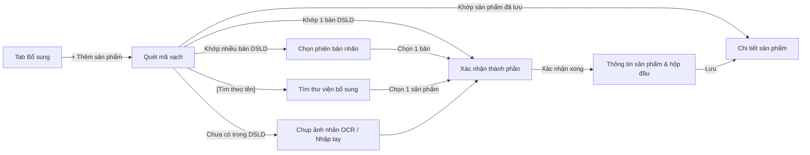

# Thiết kế UX: Thư viện thực phẩm bổ sung NIH DSLD

Trạng thái: Đã duyệt (26/11/2026)  <!-- Nháp | Đã duyệt -->
Đặc tả: [docs/specs/dsld-library.md](../specs/dsld-library.md)
Thiết kế nền tảng: [docs/design/label-scan-inventory.md](label-scan-inventory.md)

## Luồng người dùng



## Danh sách màn hình

| Màn / Thành phần | Mục đích | Vào từ | Ra tới |
|---|---|---|---|
| **Quét mã vạch** (cập nhật) | Tra tuần tự: tủ cá nhân → thư viện DSLD; thêm lối vào tìm theo tên | Tab Bổ sung | Chi tiết sản phẩm, Xác nhận thành phần, Chọn phiên bản nhãn, Tìm thư viện, Chụp nhãn OCR |
| **Tìm thư viện bổ sung** (mới) | Tìm offline theo tên sản phẩm hoặc tên hãng trong 94.612 nhãn DSLD | Quét mã vạch | Xác nhận thành phần |
| **Chọn phiên bản nhãn** (sheet, mới) | Chọn khi 1 mã vạch có nhiều bản ghi DSLD khác nhau | Quét mã vạch | Xác nhận thành phần |
| **Xác nhận thành phần** (cập nhật) | Rà soát thành phần nạp từ DSLD; thêm nút `[Xác nhận tất cả]` để duyệt nhanh | Quét mã vạch, Tìm thư viện, Chọn phiên bản | Thông tin sản phẩm |
| **Chi tiết sản phẩm** (cập nhật) | Hiển thị thêm mục tham khảo `Thành phần khác (theo nhãn)` (tá dược) và `Cách dùng trên nhãn` | Tab Bổ sung, Quét mã vạch | Quản lý hộp, Ghi bổ sung, Xác nhận thành phần |

## Wireframe

### 1. Quét mã vạch (cập nhật từ `label-scan-inventory.md`)

```
┌──────────────────────────────┐
│ ←  Thêm sản phẩm             │
├──────────────────────────────┤
│ ┌──────────────────────────┐ │
│ │                          │ │
│ │   Khung quét mã vạch     │ │
│ │                          │ │
│ └──────────────────────────┘ │
│ Đưa mã vạch vào khung để tìm │
│ sản phẩm đã lưu hoặc trong   │
│ thư viện nhãn.               │
│                              │
│ [ Tìm theo tên sản phẩm ]    │
│ [ Chụp ảnh bảng thành phần ] │
│ [ Chọn ảnh từ thư viện ]     │
│      Nhập tay từng dòng      │
└──────────────────────────────┘
```

- Khi quét trúng mã vạch:
  1. Nếu đã có trong tủ cá nhân → mở thẳng **Chi tiết sản phẩm**.
  2. Nếu có 1 bản trong DSLD → mở **Xác nhận thành phần** (đã điền sẵn dữ liệu DSLD).
  3. Nếu có >1 bản trong DSLD cùng mã vạch → mở sheet **Chọn phiên bản nhãn**.
  4. Nếu chưa có trong DSLD → giữ nguyên trên màn quét với thông báo ngắn: `"Chưa thấy trong thư viện nhãn. Hãy chụp bảng thành phần hoặc nhập tay."` (giữ sẵn `barcode` để gắn khi lưu).
- Nếu thư viện DSLD đang giải nén lần đầu ở nền: hiện thanh tiến độ nhỏ `"Đang chuẩn bị thư viện nhãn (lần đầu)..."`, các nút chụp nhãn / nhập tay vẫn bấm được ngay không bị chặn.

### 2. Tìm thư viện bổ sung (mới)

```
┌──────────────────────────────┐
│ ←  Tìm trong thư viện        │
├──────────────────────────────┤
│ [🔍 Tìm tên hoặc hãng...   ] │
├──────────────────────────────┤
│ Vitamin D3 + K2              │
│ Sports Research · 1 viên   › │
│ ──────────────────────────── │
│ Vitamin D3 5000 IU           │
│ Sports Research · 1 viên   › │
│ ──────────────────────────── │
│ High Potency CLA 1250        │
│ SR Sports Research · 1 viên› │
└──────────────────────────────┘
```

- Gõ từ khóa (tên sản phẩm hoặc tên hãng, tối thiểu 2 ký tự) → truy vấn FTS5 trên `dsld_library.db`, giới hạn 30 kết quả.
- Chạm 1 dòng → tải chi tiết thành phần (`getDetail(dsldId)`) → mở **Xác nhận thành phần** (điền sẵn đầy đủ).
- Cuối danh sách luôn có dòng phụ: `"Không thấy sản phẩm? Chụp ảnh bảng thành phần"` để chuyển thẳng sang OCR không bị cụt luồng.

### 3. Sheet Chọn phiên bản nhãn (khi 1 mã vạch có nhiều bản ghi DSLD)

```
┌──────────────────────────────┐
│ Chọn phiên bản nhãn          │
│ Mã 0 23249 01011 1 có 2 bản: │
├──────────────────────────────┤
│ Tart Cherry Fruit Complex    │
│ 800 mg · 1 Softgel(s)      › │
│ ──────────────────────────── │
│ Tart Cherry Fruit Complex    │
│ 1 Softgel(s)               › │
├──────────────────────────────┤
│         [ Đóng ]             │
└──────────────────────────────┘
```

### 4. Xác nhận thành phần (cập nhật khi điền từ DSLD)

```
┌──────────────────────────────┐
│ ←  Xác nhận thành phần       │
├──────────────────────────────┤
│ ℹ Điền sẵn từ thư viện nhãn  │
│   Mỹ (NIH DSLD). Kiểm tra lại│
│   trước khi lưu.             │
│                              │
│ Vitamin D3                   │
│ 125 mcg · Dạng: D3           │
│ [Sửa]            [✓ Đã đúng] │
│ ──────────────────────────── │
│ Vitamin K2                   │
│ 100 mcg · Ngoài gói chuẩn    │
│ [Sửa]            [✓ Đã đúng] │
│                              │
│ [   Xác nhận tất cả (2)    ] │
└──────────────────────────────┘
```

- Nút `[Xác nhận tất cả]` chỉ hiện khi nguồn là thư viện DSLD và không có dòng nào bị lỗi đơn vị/vượt ngưỡng bất hợp lý (`checkIngredientSanity`). Chạm 1 lần để xác nhận toàn bộ các dòng đã khớp sạch và chuyển sang **Thông tin sản phẩm & hộp đầu**.
- Nếu có dòng dạng chưa rõ (`form = unknown`, ví dụ Vitamin E chưa rõ tự nhiên/tổng hợp) hoặc chất cần kiểm tra lại: đánh dấu `"Chưa rõ dạng · Tính theo mức thận trọng"` để người dùng chú ý hoặc bấm `[Sửa]`.

### 5. Chi tiết sản phẩm (bổ sung mục tham khảo nhãn)

- Dưới danh sách thành phần chính và thông tin hộp, thêm mục thu gọn (mặc định mở hoặc thu gọn 1 chạm):
  - **`Cách dùng trên nhãn`** (chỉ hiện nếu `suggested_use` không rỗng): hiển thị nguyên văn hướng dẫn trên nhãn để người dùng đối chiếu.
  - **`Thành phần khác (theo nhãn)`** (chỉ hiện nếu `other_ingredients` không rỗng): hiển thị nguyên văn danh sách tá dược từ nhãn (ví dụ: *Tapioca starch, vegetable glycerin, purified water...*). **Không** gắn nhãn cảnh báo độc tính hay đánh giá tốt/xấu.

## Trạng thái

| Màn | Trống | Đang xử lý | Lỗi | Cảnh báo |
|---|---|---|---|---|
| **Quét mã vạch** | Chưa quét mã nào: hiện hướng dẫn đưa mã vào khung | `"Đang chuẩn bị thư viện nhãn (lần đầu)..."` | Thư viện DSLD lỗi/hỏng: hiện dòng nhỏ `"Thư viện nhãn tạm thời không khả dụng, vẫn dùng được chụp nhãn."` | Không có (chỉ chuyển bước) |
| **Tìm thư viện bổ sung** | Chưa nhập từ khóa: `"Nhập tên sản phẩm hoặc tên hãng (tiếng Anh trên nhãn)."` | Vòng xoay nhẹ khi đang tìm | Không tìm thấy: `"Không thấy kết quả phù hợp."` + nút `[Chụp ảnh bảng thành phần]` | Không |
| **Xác nhận thành phần** | Không áp dụng | Đang đọc chi tiết nhãn DSLD | Thiếu/lỗi đơn vị ở 1 dòng: bắt buộc `[Sửa]` dòng đó trước khi xác nhận tất cả | Dòng chưa rõ dạng: `"Chưa rõ dạng · Tính theo mức thận trọng"` |
| **Chi tiết sản phẩm** | Nếu `other_ingredients` rỗng thì ẩn mục `Thành phần khác` | Không | Không | Không gắn cảnh báo trên tá dược |

## Nội dung chữ

| Vị trí | Chữ hiển thị |
|---|---|
| Hướng dẫn màn Quét mã vạch | `Đưa mã vạch vào khung để tìm sản phẩm đã lưu hoặc trong thư viện nhãn.` |
| Nút tìm theo tên | `Tìm theo tên sản phẩm` |
| Trạng thái giải nén lần đầu | `Đang chuẩn bị thư viện nhãn (lần đầu)...` |
| Không thấy mã vạch trong DSLD | `Chưa thấy trong thư viện nhãn. Hãy chụp bảng thành phần hoặc nhập tay.` |
| Lỗi mở thư viện DSLD | `Thư viện nhãn tạm thời không khả dụng, vẫn dùng được chụp nhãn.` |
| Banner màn Xác nhận | `Điền sẵn từ thư viện nhãn Mỹ (NIH DSLD). Kiểm tra lại trước khi lưu.` |
| Nút duyệt nhanh | `Xác nhận tất cả ({n})` |
| Dòng dạng chưa rõ | `Chưa rõ dạng · Tính theo mức thận trọng` |
| Nhãn mục tá dược | `Thành phần khác (theo nhãn)` |
| Nhãn mục cách dùng | `Cách dùng trên nhãn` |

## Kiểm theo nguyên tắc (`docs/design/README.md`)

- [x] Lời lẽ đúng vai tham chiếu, không viết tắt chuẩn (không hiện RDA, UL, EER, AMDR; không phán xét tá dược)
- [x] Ẩn số calo được tôn trọng (không liên quan calo ở màn bổ sung)
- [x] Tối đa 3 lần chạm cho thao tác chính (Quét mã → `[Xác nhận tất cả]` → `[Lưu]`)
- [x] Cỡ chữ 200%, vùng chạm 48 dp, tương phản AA (mọi nút danh sách/hành động ≥ 48 dp, hỗ trợ cuộn và xuống dòng)
- [x] Không quảng cáo ở màn cảnh báo (không có quảng cáo ở MVP)
