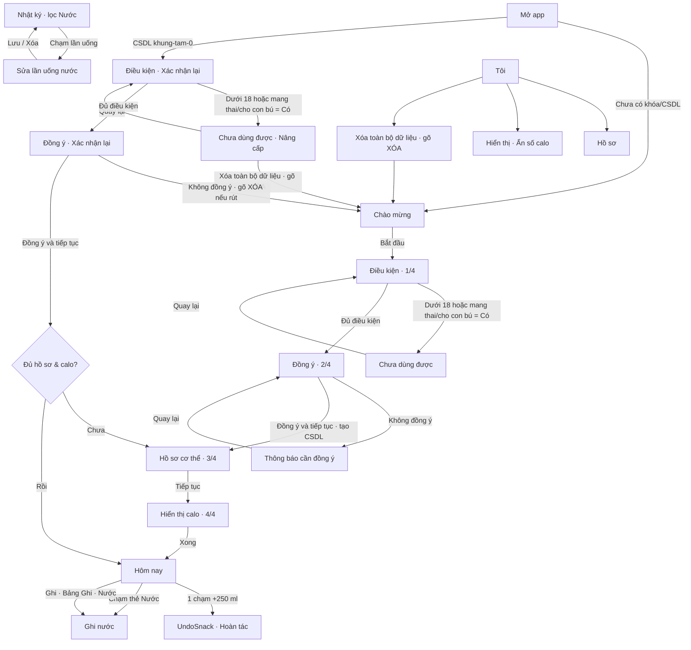

# Thiết kế UX: Điều kiện dùng app, chế độ thận trọng và nhập nước

Trạng thái: Đã duyệt  <!-- Nháp | Đã duyệt -->
Đặc tả: [docs/specs/eligibility-caution-water.md](../specs/eligibility-caution-water.md)
Khung tổng thể: [docs/design/mvp-overview.md](mvp-overview.md)

Thiết kế này cụ thể hóa **việc 4** trên khung [mvp-overview.md](mvp-overview.md), gồm: luồng lần đầu (**Chào mừng**, **Điều kiện**, **Chưa dùng được**, **Đồng ý**, **Hồ sơ cơ thể**, **Hiển thị calo**), luồng **nâng cấp từ `khung-tam-0`**, hiển thị **chế độ thận trọng** và thông báo **tự cập nhật tuổi** trên **Hôm nay**, luồng **nhập/sửa/xóa nước** (`Hôm nay`, `Bảng Ghi`, `Ghi nước`, `Nhật ký`), cùng tab **Tôi** (`Hồ sơ`, `Hiển thị`, `Xóa toàn bộ dữ liệu`).

---

## Luồng người dùng



- **Đếm chạm cho thao tác chính:**
  - Ghi nhanh lượng nước quen dùng trên `Hôm nay`: `1` chạm `[+{lastWaterMl} ml]` → xong (**1 lần chạm**).
  - Ghi lượng nước tùy chọn từ `Hôm nay`: `1` (chạm thẻ `Nước`) → `2` (chọn `150/250/500 ml` hoặc nhập) → `3` (`Lưu`) → xong (**3 lần chạm**).
  - Sửa hoặc xóa một lần uống nước trong `Nhật ký`: chạm dòng lần uống ở nhóm `Nước` → sửa ml/giờ hoặc chạm `Xóa khỏi nhật ký` (xác nhận).

---

## Danh sách màn hình

| Màn | Mục đích | Vào từ | Ra tới |
|---|---|---|---|
| **Chào mừng** | Giới thiệu vai trò tham chiếu và lưu trữ tại máy | Mở app lần đầu hoặc sau khi xóa toàn bộ | `Điều kiện (1/4)` |
| **Điều kiện (`1/4` / Nâng cấp)** | Nhập tuổi (`1–120`), hỏi mang thai/cho con bú và thuốc/bệnh mạn tính (`Có`/`Không`) | `Chào mừng`; mở app với CSDL `khung-tam-0` | `Chưa dùng được`; `Đồng ý` |
| **Chưa dùng được** | Báo giới hạn MVP (18+, không mang thai/cho con bú); thêm nút xóa dữ liệu nếu từ `khung-tam-0` | `Điều kiện` khi `< 18` hoặc mang thai/cho con bú | `Điều kiện`; `Chào mừng` (nếu xóa hết ở nâng cấp) |
| **Đồng ý (`2/4` / Nâng cấp)** | Xin đồng ý xử lý dữ liệu sức khỏe trước khi tạo CSDL (hoặc ghi nhận đồng ý mới cho `khung-tam-0`) | `Điều kiện` khi đủ điều kiện | `Hồ sơ cơ thể (3/4)`; `Hôm nay` (nếu nâng cấp đã có hồ sơ) |
| **Hồ sơ cơ thể (`3/4`)** | Nhập giới tính sinh học, chiều cao, cân nặng, mức vận động | `Đồng ý`; mở app khi `onboarding_step = body_profile` | `Hiển thị calo (4/4)` |
| **Hiển thị calo (`4/4`)** | Chọn hiện hoặc ẩn số calo (không chọn sẵn) | `Hồ sơ cơ thể`; mở app khi `onboarding_step = calorie_display` | `Hôm nay` |
| **Hôm nay** | Bổ sung `SafetyNote` thận trọng, nhắc tuổi tự cập nhật, thẻ `Nước` 1 chạm, nút `[+ Ghi]` mở `Bảng Ghi` | Mở app khi `ready`; thanh dưới | `Bảng Ghi`, `Ghi nước`, `Hồ sơ` (từ dòng `Sửa`) |
| **Bảng Ghi (`LogSheet`)** | Chọn nhanh `Món ăn`, `Bổ sung`, `Nước`, `Buổi tập` cho ngày đang xem | Nút `[+ Ghi]` trên `Hôm nay` và `Nhật ký` | `Ghi món`, `Ghi bổ sung`, `Ghi nước`, `Ghi buổi tập` |
| **Ghi nước / Sửa lần uống nước** | Ghi mới một lần uống (`150/250/500 ml` hoặc số khác, đổi giờ) hoặc sửa/xóa lần đã ghi | Thẻ `Nước` (`Hôm nay`); `Bảng Ghi`; chạm lần uống trong `Nhật ký` | Màn trước kèm `UndoSnack` (khi thêm mới) hoặc `Nhật ký` |
| **Nhật ký** | Bổ sung lọc `Nước`, hiển thị dòng tổng + từng lần uống để chạm sửa/xóa | Thanh dưới | `Sửa lần uống nước`, `Bảng Ghi` |
| **Tôi** | Điều hướng `Hồ sơ`, `Hiển thị`, `Xóa toàn bộ dữ liệu` | Thanh dưới | `Hồ sơ`, `Hiển thị`, hộp thoại `Xóa toàn bộ dữ liệu` |
| **Hồ sơ (từ `Tôi`)** | Sửa tuổi (`≥ 18`), thông số cơ thể, câu Có/Không chế độ thận trọng, thẻ nhắc thai kỳ | `Tôi → Hồ sơ`; dòng `Sửa` ở thông báo tuổi trên `Hôm nay` | `Tôi` / `Hôm nay` (cập nhật ngay cờ thận trọng và chỉ số); `Xóa toàn bộ dữ liệu` |
| **Hiển thị (từ `Tôi`)** | Bật/tắt công tắc `Ẩn số calo` | `Tôi → Hiển thị` | `Tôi` |

---

## Wireframe

Khung ~360 dp, tuân thủ `StepScaffold` cho các bước `1/4`–`4/4` (nút chính luôn thấy khi mở bàn phím), mọi vùng chạm `≥ 48 dp`.

### Chào mừng, Điều kiện (`1/4`), Chưa dùng được

```
┌──────────────────────────────┐  ┌──────────────────────────────┐
│          WholeWell           │  │ ←                       1/4  │
│                              │  ├──────────────────────────────┤
│ So lượng vi chất bạn nạp từ  │  │ Vài câu để chọn mức tham     │
│ bữa ăn và thực phẩm bổ sung  │  │ chiếu phù hợp.               │
│ với mức khuyến nghị.         │  │                              │
│ • Chỉ để tham khảo, không    │  │ Tuổi  [ 35   ]               │
│   thay lời khuyên của bác sĩ │  │                              │
│ • Dữ liệu chỉ nằm trên máy   │  │ Đang mang thai hoặc cho con  │
│   này, không gửi đi đâu      │  │ bú?                          │
│ • Không cần mạng             │  │  [  Có  ]       [ Không ]    │
│                              │  │                              │
│                              │  │ Đang dùng thuốc theo chỉ định│
│                              │  │ của bác sĩ, hoặc có bệnh mạn │
│                              │  │ tính (vd. thận, gan, tim,    │
│                              │  │ tiểu đường)?                 │
│ [         Bắt đầu          ] │  │  [  Có  ]       [ Không ]    │
└──────────────────────────────┘  │ [        Tiếp tục          ] │
                                  └──────────────────────────────┘

┌──────────────────────────────┐  ┌──────────────────────────────┐
│ Chưa dùng được (lần đầu)     │  │ Chưa dùng được (nâng cấp)    │
│                              │  │                              │
│ WholeWell hiện dành cho người│  │ WholeWell hiện dành cho người│
│ từ 18 tuổi, không mang thai, │  │ từ 18 tuổi, không mang thai, │
│ không cho con bú. Hãy hỏi bác│  │ không cho con bú. Hãy hỏi bác│
│ sĩ hoặc dược sĩ về dinh dưỡng│  │ sĩ hoặc dược sĩ về dinh dưỡng│
│ và thực phẩm bổ sung.        │  │ và thực phẩm bổ sung.        │
│                              │  │                              │
│                              │  │ Trên máy vẫn còn dữ liệu cũ. │
│ [         Quay lại         ] │  │ [         Quay lại         ] │
└──────────────────────────────┘  │  Xóa toàn bộ dữ liệu         │
                                  └──────────────────────────────┘
```

- **Chào mừng:** Theo thiết kế đã chốt ở đặc tả, tạm ẩn nút `Khôi phục từ bản sao lưu` cho tới việc 7.
- **Điều kiện (`1/4`):** Bàn phím số nguyên cho ô `Tuổi` (`1–120`). Hai cặp nút `Có` / `Không` **không chọn sẵn**. Nút `[Tiếp tục]` chỉ bật khi đã nhập tuổi hợp lệ (`1–120`) và đã chọn cả hai câu; chạm `[Tiếp tục]` không đóng băng bàn phím nếu lỗi, giữ nguyên giá trị trong RAM nếu quay lại từ `Chưa dùng được` hay `Đồng ý`.
- **Nâng cấp `khung-tam-0`:** Thanh trên thay `←  1/4` bằng tiêu đề `Xác nhận điều kiện` (không có nút quay lại ra khỏi luồng nâng cấp), điền sẵn ô `Tuổi` từ hồ sơ cũ nhưng **không chọn sẵn** 2 câu `Có` / `Không`. Nếu `< 18` hoặc chọn mang thai/cho con bú `Có`, màn `Chưa dùng được` hiện thêm nút chữ đỏ (`error`) `Xóa toàn bộ dữ liệu` (mở hộp thoại gõ `XÓA` gọi `withdrawConsentAndReset()`).

### Đồng ý (`2/4` và Nâng cấp), Hồ sơ cơ thể (`3/4`), Hiển thị calo (`4/4`)

```
┌──────────────────────────────┐  ┌──────────────────────────────┐
│ ←                       2/4  │  │ ←                       3/4  │
├──────────────────────────────┤  ├──────────────────────────────┤
│ Dữ liệu sức khỏe của bạn     │  │ Giới tính sinh học           │
│ App lưu tuổi, chiều cao, cân │  │ ( ) Nam     (•) Nữ           │
│ nặng, món ăn, bổ sung bạn    │  │                              │
│ ghi để so với mức tham chiếu.│  │ Chiều cao   [ 160 ]  cm      │
│ • Lưu mã hóa trên máy này    │  │ Cân nặng    [ 55  ]  kg      │
│ • Không gửi cho ai, kể cả    │  │                              │
│   nhóm phát triển            │  │ Mức vận động                 │
│ • Xem, sửa ở Tôi → Hồ sơ;    │  │ [ Vận động nhẹ           ▾ ] │
│   xóa ở tab Tôi              │  │                              │
│                              │  │                              │
│ ☐ Tôi đồng ý cho app xử lý   │  │                              │
│   dữ liệu sức khỏe của tôi   │  │                              │
│   cho mục đích trên.         │  │                              │
│   Đọc đầy đủ                 │  │                              │
│ [    Đồng ý và tiếp tục    ] │  │ [        Tiếp tục          ] │
│  Không đồng ý                │  └──────────────────────────────┘
└──────────────────────────────┘

┌──────────────────────────────┐
│ ←                       4/4  │
├──────────────────────────────┤
│ Bạn muốn thấy số calo không? │
│                              │
│ ( ) Hiện số calo             │
│                              │
│ ( ) Ẩn số calo               │
│     App vẫn tính, chỉ không  │
│     hiện con số.             │
│                              │
│ Đổi ở Tôi → Hiển thị.        │
│ [          Xong            ] │
└──────────────────────────────┘
```

- **Đồng ý (`2/4` và Nâng cấp `khung-tam-0`):**
  - Khi nâng cấp `khung-tam-0`, thanh trên đổi `←  2/4` thành tiêu đề `Xác nhận đồng ý` (không quay lại ra khỏi luồng nâng cấp; người nâng cấp đã có hồ sơ sẽ vào thẳng `Hôm nay` sau khi đồng ý, không đi qua `3/4`, `4/4`).
  - Ô đánh dấu mặc định tắt; `[Đồng ý và tiếp tục]` tắt tới khi đánh dấu. Đang gọi `createNew(...)` hoặc `upgradeHealthConsent(...)`: nút chính hiện vòng xoay, vô hiệu hóa chạm lặp.
  - Chạm `Đọc đầy đủ`: mở hộp thoại/bottom sheet tóm tắt đầy đủ mục đích xử lý, các nhóm dữ liệu lưu trên máy, không chia sẻ bên thứ ba, và cách xem/sửa/rút đồng ý.
  - Chạm `Không đồng ý`:
    - Lần đầu: mở hộp thoại `"App cần đồng ý này để tính toán. Bạn có thể quay lại bất cứ lúc nào."` với nút `[Quay lại]` (giữ ở màn `Đồng ý`) và `[Về màn Chào mừng]`.
    - Nâng cấp `khung-tam-0`: mở hộp thoại cùng câu trên, gồm `[Quay lại]` và nút chữ `error` `[Rút đồng ý và xóa dữ liệu]` (chuyển xác nhận gõ `XÓA` để xóa khóa/tệp cũ và về `Chào mừng`).
- **Hồ sơ cơ thể (`3/4`):** Không hiển thị lại ô `Tuổi` hay câu mang thai vì đã thu thập ở `1/4`. Trống / không phải số / `<= 0` / `> 300`: chặn lưu với lỗi đỏ dưới ô (`"Nhập chiều cao hợp lệ (1–300 cm)."` / `"Nhập cân nặng hợp lệ (1–300 kg)."`). Chiều cao ngoài `120–220 cm` hoặc cân nặng ngoài `30–250 kg` (trong `1–300`): hiện dòng nhắc kiểm tra lại màu trung tính dưới ô, **không chặn** bấm `[Tiếp tục]`.
- **Hiển thị calo (`4/4`):** Không chọn sẵn. Nút `[Xong]` tắt cho tới khi người dùng chọn một trong hai phương án.

### Hôm nay (thận trọng, tuổi tự cập nhật, thẻ Nước) & Bảng Ghi

```
┌──────────────────────────────┐  ┌──────────────────────────────┐
│ Hôm nay          ‹ 25/11 ›   │  │ Ghi cho hôm nay, 25/11       │
├──────────────────────────────┤  ├──────────────────────────────┤
│ ┌ ⚠ Magie ─────────────────┐ │  │ [ 🍜 Món ăn  ] [ 💊 Bổ sung] │
│ │ ...                      │ │  │ [ 💧 Nước    ] [ 🏃 Buổi tập]│
│ └────────────────────────────┘ │  └──────────────────────────────┘
│ ┌ ⓘ Lưu ý ─────────────────┐ │
│ │ Các mức trong app dành   │ │
│ │ cho người khỏe mạnh. Với │ │
│ │ tình trạng của bạn, mức  │ │
│ │ phù hợp có thể khác; hãy │ │
│ │ hỏi bác sĩ.              │ │
│ └──────────────────────────┘ │
│ Tuổi trong hồ sơ đã được cập │
│ nhật thành 36.          Sửa  │
│                              │
│ ┌ Mức calo tham chiếu ─────┐ │
│ │ 1.150 / 2.000 kcal       │ │
│ │ ...                      │ │
│ └──────────────────────────┘ │
│ Vi chất                      │
│ ... 77% mức tham chiếu       │
│ ┌ Nước ────────────────────┐ │
│ │ Đã uống 1.250 ml         │ │
│ │                 [+250 ml]│ │
│ └──────────────────────────┘ │
│                      [+ Ghi] │
├──────────────────────────────┤
│ Hôm nay    Nhật ký       Tôi │
└──────────────────────────────┘
```

- **Thứ tự đầu màn `Hôm nay`:** `WarningCard` (nếu vượt UL) → `SafetyNote` thận trọng (khi `caution == true`, màu trung tính, **không** có nút thu gọn) → dòng nhắc `"Tuổi trong hồ sơ đã được cập nhật thành {n}. Sửa"` (khi có `age_bumped_notice`; chạm `Sửa` mở màn `Hồ sơ` và xóa thông báo; có nút đóng `×` nhỏ nếu người dùng chỉ muốn tắt).
- **Chế độ thận trọng trên `Hôm nay`:** Áp dụng bộ đổi chữ `CautionLabels`: `"Mục tiêu calo"` → `"Mức calo tham chiếu"`, `"Mục tiêu là mức giữ cân, đã tính mức vận động trong hồ sơ."` → `"Mức calo tham chiếu là mức giữ cân, đã tính mức vận động trong hồ sơ."`, `"mức khuyến nghị"` → `"mức tham chiếu"`, `"Chưa có mục tiêu calo cho người 18 tuổi."` → `"Chưa có mức calo tham chiếu cho người 18 tuổi."`, giữ nguyên `"mức ước tính"` và `"Chưa đủ dữ liệu để đặt mức khuyến nghị chính thức; đây là mức ước tính."`.
- **Thẻ `Nước`:** Luôn hiển thị trên `Hôm nay` (kể cả khi chưa ghi: `"Chưa ghi nước hôm nay"`). Bên phải là nút `[+{lastWaterMl} ml]` (chạm 1 lần ghi ngay vào **ngày đang xem** — giờ hiện tại nếu là hôm nay, `12:00` nếu đang xem ngày cũ — và hiện `UndoSnack` `"Đã ghi {ml} ml nước · Hoàn tác"` 7 giây). Chạm phần thân thẻ mở `Ghi nước`. Ở cỡ chữ lớn (200%), nút `[+{lastWaterMl} ml]` tự xuống dòng dưới chữ `"Đã uống ..."` để không tràn ngang.
- **Bảng Ghi (`LogSheet`):** Mở từ nút nổi `[+ Ghi]` trên cả `Hôm nay` và `Nhật ký`. Tiêu đề `"Ghi cho hôm nay, {dd/MM}"` hoặc in đậm ngày khác nếu đang xem ngày cũ. Bốn ô lưới 2×2 có chiều cao tối thiểu `96 dp`: `Món ăn`, `Bổ sung`, `Nước`, `Buổi tập`.

### Ghi nước, Sửa lần uống nước, Nhật ký (phần Nước)

```
┌──────────────────────────────┐  ┌──────────────────────────────┐
│ ←  Ghi nước                  │  │ Nhật ký        ‹ 25/11 ›   │
├──────────────────────────────┤  │ [Tất cả][Món][Bổ sung][Nước]│
│ (Ngày cũ: Đang ghi cho 24/11)│  │ [Buổi tập]                   │
│                              │  ├──────────────────────────────┤
│ Chọn nhanh                   │  │ ...                          │
│ [150 ml] [250 ml✓] [500 ml]  │  │ Nước         1.250 ml (5 lần)│
│                              │  │  💧 250 ml            14:05  │
│ Số khác   [        ] ml      │  │  💧 500 ml            12:15  │
│ Giờ       [ 14:05  ]         │  │  ...                         │
│                              │  ├──────────────────────────────┤
│ [          Lưu             ] │  │ Hôm nay    Nhật ký       Tôi │
└──────────────────────────────┘  └──────────────────────────────┘

┌──────────────────────────────┐
│ ←  Sửa lần uống nước         │
├──────────────────────────────┤
│ Chọn nhanh                   │
│ [150 ml] [250 ml✓] [500 ml]  │
│ Số khác   [        ] ml      │
│ Giờ       [ 14:05  ]         │
│                              │
│ [          Lưu             ] │
│  Xóa khỏi nhật ký            │
└──────────────────────────────┘
```

- **Ghi nước & Sửa lần uống nước:**
  - Hàng `Giờ  [ 14:05 ]` nằm trong thân màn (dạng `ListTile` / hàng chạm cao `≥ 48 dp` giống `Sửa mục` của món ăn, có nhãn đọc rõ cho trình đọc màn hình) để chạm đổi giờ trong ngày đang xem.
  - Ba nút chọn nhanh (`Wrap` tự xuống dòng ở cỡ chữ lớn): mặc định chọn nút khớp `lastWaterMl` (nếu nằm trong `{150, 250, 500}`) hoặc điền vào `Số khác` nếu `lastWaterMl` là số khác; chưa ghi lần nào thì mặc định chọn `250 ml`. Gõ vào `Số khác` sẽ bỏ chọn 3 nút nhanh; chạm nút nhanh sẽ xóa ô `Số khác`.
  - Lưu thành công khi thêm mới: đóng màn, cập nhật `lastWaterMl`, hiện `UndoSnack` `"Đã ghi {ml} ml nước · Hoàn tác"`.
- **Nhật ký:** Thanh lọc cuộn ngang / `Wrap` gồm `Tất cả`, `Món ăn`, `Bổ sung`, `Nước`, `Buổi tập`. Mục `Nước` hiển thị tiêu đề `"Nước  {tổng ml} ({n} lần)"` và liệt kê các lần uống trong ngày (`EntryTile` không có kcal), chạm từng lần mở `Sửa lần uống nước`.
- **Sửa lần uống nước:** Tái sử dụng cùng widget nhập của `Ghi nước`, thêm nút `Xóa khỏi nhật ký` (màu `error`) mở hộp thoại `"Xóa lần uống {ml} ml khỏi nhật ký?"` `[Hủy]` `[Xóa]`.

### Tab Tôi, Hồ sơ (từ Tôi), Hiển thị, Xóa toàn bộ dữ liệu

```
┌──────────────────────────────┐  ┌──────────────────────────────┐
│ Tôi                          │  │ ←  Hồ sơ                     │
├──────────────────────────────┤  ├──────────────────────────────┤
│ Hồ sơ                      › │  │ Tuổi        [ 35   ]         │
│  Nữ · 35 tuổi · 160 cm · 55kg│  │ Giới tính sinh học           │
│                              │  │ ( ) Nam     (•) Nữ           │
│ Hiển thị                   › │  │ Chiều cao   [ 160  ] cm      │
│  Đang hiện số calo           │  │ Cân nặng    [ 55   ] kg      │
│                              │  │ Mức vận động                 │
│ Xóa toàn bộ dữ liệu          │  │ [ Vận động nhẹ           ▾ ] │
│                              │  │                              │
│                              │  │ Đang dùng thuốc theo chỉ định│
│                              │  │ của bác sĩ, hoặc có bệnh mạn │
│                              │  │ tính (vd. thận, gan, tim,    │
│                              │  │ tiểu đường)?                 │
│                              │  │  [  Có✓ ]       [ Không ]    │
│                              │  │ [          Lưu             ] │
│                              │  │                              │
│                              │  │ ┌──────────────────────────┐ │
│                              │  │ │ Nếu bạn mang thai hoặc   │ │
│                              │  │ │ cho con bú, bản này của  │ │
│                              │  │ │ WholeWell chưa hỗ trợ.   │ │
│                              │  │ │ Xuất dữ liệu sẽ có ở bản │ │
│                              │  │ │ cập nhật sau.            │ │
│                              │  │ │ Xóa toàn bộ dữ liệu      │ │
│                              │  │ └──────────────────────────┘ │
├──────────────────────────────┤  └──────────────────────────────┘
│ Hôm nay    Nhật ký       Tôi │
└──────────────────────────────┘

┌──────────────────────────────┐  ┌──────────────────────────────┐
│ ←  Hiển thị                  │  │ Xóa toàn bộ dữ liệu?         │
├──────────────────────────────┤  │ Mọi dữ liệu trên máy này sẽ  │
│ Ẩn số calo             [ ○ ] │  │ bị xóa và không lấy lại được.│
│ App vẫn tính, chỉ không hiện │  │ Gõ XÓA để xác nhận.          │
│ con số.                      │  │ [ XÓA                      ] │
└──────────────────────────────┘  │ [Hủy]         [Xóa toàn bộ]  │
                                  └──────────────────────────────┘
```

- **Hồ sơ (từ `Tôi`):** Tuổi tối thiểu `18` (`pack.minProfileAge`), tối đa `120`. Bỏ hoàn toàn hai câu mang thai/cho con bú của khung tạm; thay bằng câu Có/Không chế độ thận trọng ở cuối biểu mẫu và khung nhắc thai kỳ với `[Xóa toàn bộ dữ liệu]` + ghi chú xuất dữ liệu sẽ có ở bản cập nhật sau. Bấm `[Lưu]` kiểm lại báo cáo/cờ, xóa cờ `age_bumped_notice` (`clearAgeBumpedNotice()`), hiện snackbar `"Đã lưu hồ sơ."` và quay về màn trước.
- **Xóa toàn bộ dữ liệu:** Nút màu `error`; hộp thoại chỉ bật nút xác nhận màu `error` khi người dùng nhập chính xác chữ `XÓA` (không phân biệt khoảng trắng đầu/cuối). Thực hiện `withdrawConsentAndReset()` và đưa về `Chào mừng`.

---

## Trạng thái

| Màn | Trống | Đang xử lý | Lỗi | Cảnh báo |
|---|---|---|---|---|
| **Điều kiện (`1/4` / nâng cấp)** | Hai câu `Có`/`Không` chưa chọn sẵn; nút `[Tiếp tục]` tắt | – | Nhập tuổi `< 1` hoặc `> 120` hoặc không nguyên: dòng lỗi đỏ dưới ô tuổi (`"Nhập tuổi từ 1 đến 120."`) | – |
| **Chưa dùng được** | – | Vòng xoay nếu đang xóa dữ liệu cũ | Lỗi xóa: `"Chưa xóa được. Thử lại"` | – |
| **Đồng ý (`2/4` / nâng cấp)** | Ô đồng ý tắt; nút chính tắt | Vòng xoay trên nút `[Đồng ý và tiếp tục]`, khóa nút | Lỗi tạo CSDL / hết bộ nhớ: `"Chưa lưu được. Thử lại"` (hoặc màn `lowStorage` nếu không đủ chỗ) | – |
| **Hồ sơ cơ thể (`3/4`) / Hồ sơ (`Tôi`)** | `3/4`: chưa chọn giới tính/mức vận động, nút tắt | Vòng xoay khi đang lưu | Trống, không phải số, `<= 0` hoặc `> 300`: chặn lưu (`"Nhập chiều cao hợp lệ (1–300 cm)."` / `"Nhập cân nặng hợp lệ (1–300 kg)."`). Ngoài khoảng hợp lý (cao `< 120` hoặc `> 220`; nặng `< 30` hoặc `> 250`, trong `1–300`): nhắc trung tính `"Kiểm tra lại chiều cao."` / `"Kiểm tra lại cân nặng."` (vẫn cho lưu). Tuổi `< 18` hoặc `> 120` ở `Hồ sơ`: chặn lưu (`"WholeWell hiện chỉ hỗ trợ từ 18 tuổi."` / `"Nhập tuổi từ 18 đến 120."`) | – |
| **Hiển thị calo (`4/4`)** | Chưa chọn sẵn phương án; nút `[Xong]` tắt | Vòng xoay khi lưu | `"Chưa lưu được. Thử lại"` | – |
| **Hôm nay (Nước / Thận trọng / Tuổi)** | Thẻ Nước: `"Chưa ghi nước hôm nay"` + `[+250 ml]` | Khung tải cùng `TodayScreen` | `"Chưa lưu được. Thử lại"` khi chạm `+ml` thất bại | `SafetyNote` thận trọng đầu màn (khi `caution == true`); tuyệt đối **không** có cảnh báo thiếu nước |
| **Ghi nước / Sửa nước** | Mặc định chọn mức gần nhất (`250 ml` nếu chưa có) | Khóa nút `[Lưu]` khi đang ghi | `ml <= 0` hoặc `ml > 5000`: `"Nhập lượng nước từ 1 đến 5.000 ml."`; lỗi ghi: `"Chưa lưu được. Thử lại"` | – |
| **Nhật ký (Nước)** | Lọc riêng `Nước` khi trống: `"Chưa ghi nước trong ngày này."` | – | `"Chưa lưu được. Thử lại"` khi xóa/sửa lỗi | – |
| **Xóa toàn bộ dữ liệu** | Ô xác nhận trống, nút xóa tắt | Vòng xoay khi xóa khóa và tệp | Khác `"XÓA"`: nút xóa vẫn tắt | Hộp thoại nhấn mạnh xóa vĩnh viễn trên máy |

---

## Nội dung chữ

| Vị trí | Chữ hiển thị |
|---|---|
| **Thanh dưới** | `Hôm nay` · `Nhật ký` · `Tôi` |
| **Chào mừng** | `So lượng vi chất bạn nạp từ bữa ăn và thực phẩm bổ sung với mức khuyến nghị.` · `Chỉ để tham khảo, không thay lời khuyên của bác sĩ` · `Dữ liệu chỉ nằm trên máy này, không gửi đi đâu` · `Không cần mạng` · `Bắt đầu` |
| **Điều kiện** | `Vài câu để chọn mức tham chiếu phù hợp.` · `Xác nhận điều kiện` (khi nâng cấp) · `Tuổi` · `Đang mang thai hoặc cho con bú?` · `Đang dùng thuốc theo chỉ định của bác sĩ, hoặc có bệnh mạn tính (vd. thận, gan, tim, tiểu đường)?` · `Có` · `Không` · `Tiếp tục` |
| **Chưa dùng được** | `WholeWell hiện dành cho người từ 18 tuổi, không mang thai, không cho con bú. Hãy hỏi bác sĩ hoặc dược sĩ về dinh dưỡng và thực phẩm bổ sung.` · `Quay lại` · `Trên máy vẫn còn dữ liệu cũ.` · `Xóa toàn bộ dữ liệu` |
| **Đồng ý** | `Dữ liệu sức khỏe của bạn` · `Xác nhận đồng ý` (khi nâng cấp) · `App lưu tuổi, chiều cao, cân nặng, món ăn, bổ sung bạn ghi để so với mức tham chiếu.` · `Lưu mã hóa trên máy này` · `Không gửi cho ai, kể cả nhóm phát triển` · `Xem, sửa ở Tôi → Hồ sơ; xóa ở tab Tôi` · `Tôi đồng ý cho app xử lý dữ liệu sức khỏe của tôi cho mục đích trên.` · `Đọc đầy đủ` · `Đồng ý và tiếp tục` · `Không đồng ý` · `App cần đồng ý này để tính toán. Bạn có thể quay lại bất cứ lúc nào.` · `Về màn Chào mừng` · `Rút đồng ý và xóa dữ liệu` |
| **Hồ sơ cơ thể / Hồ sơ** | `Giới tính sinh học` · `Nam` · `Nữ` · `Chiều cao` · `Cân nặng` · `Mức vận động` · `Đã lưu hồ sơ.` · `Nhập chiều cao hợp lệ (1–300 cm).` · `Nhập cân nặng hợp lệ (1–300 kg).` · `Kiểm tra lại chiều cao.` · `Kiểm tra lại cân nặng.` · `WholeWell hiện chỉ hỗ trợ từ 18 tuổi.` · `Nếu bạn mang thai hoặc cho con bú, bản này của WholeWell chưa hỗ trợ. Xuất dữ liệu sẽ có ở bản cập nhật sau.` · `Xóa toàn bộ dữ liệu` |
| **Hiển thị calo / Hiển thị** | `Bạn muốn thấy số calo không?` · `Hiện số calo` · `Ẩn số calo` · `App vẫn tính, chỉ không hiện con số.` · `Đổi ở Tôi → Hiển thị.` · `Xong` |
| **Chế độ thận trọng (`CautionLabels`)** | Dòng nhắc: `Các mức trong app dành cho người khỏe mạnh. Với tình trạng của bạn, mức phù hợp có thể khác; hãy hỏi bác sĩ.` · Đổi từ thường → thận trọng: `Mục tiêu calo` → `Mức calo tham chiếu`; `Mục tiêu là mức giữ cân, đã tính mức vận động trong hồ sơ.` → `Mức calo tham chiếu là mức giữ cân, đã tính mức vận động trong hồ sơ.`; `{x}% mức khuyến nghị` → `{x}% mức tham chiếu`; `mức khuyến nghị {g}` → `mức tham chiếu {g}`; `So với khoảng khuyến nghị (% năng lượng)` → `So với khoảng tham chiếu (% năng lượng)`; `% so với mức khuyến nghị hằng ngày. "ước tính" là chất chưa có mức khuyến nghị chính thức.` → `% so với mức tham chiếu hằng ngày. "ước tính" là chất chưa có mức tham chiếu chính thức.`; `Chưa có mục tiêu calo cho người 18 tuổi.` → `Chưa có mức calo tham chiếu cho người 18 tuổi.` · Giữ nguyên: `ước tính`, `mức ước tính`, `Chưa đủ dữ liệu để đặt mức khuyến nghị chính thức; đây là mức ước tính.` |
| **Hồ sơ tự cập nhật** | `Tuổi trong hồ sơ đã được cập nhật thành {n}.` · `Sửa` |
| **Nước uống** | `Nước` · `Chưa ghi nước hôm nay` · `Đã uống {ml} ml` · `+{ml} ml` · `Ghi nước` · `Sửa lần uống nước` · `Giờ` · `Chọn nhanh` · `150 ml` · `250 ml` · `500 ml` · `Số khác` · `Đã ghi {ml} ml nước` · `Hoàn tác` · `Nước  {tổng} ml ({n} lần)` · `Chưa ghi nước trong ngày này.` · `Xóa lần uống {ml} ml khỏi nhật ký?` |
| **Xóa toàn bộ** | `Xóa toàn bộ dữ liệu?` · `Mọi dữ liệu trên máy này sẽ bị xóa và không lấy lại được.` · `Gõ XÓA để xác nhận.` · `Xóa toàn bộ` |

*(Không dùng ở đâu: "bạn bị thiếu", "nên uống", "nên ăn thêm", "nên giảm", "tốt", "xấu", "tuyệt vời", "chuỗi ngày", "đốt", "được ăn thêm", "điều trị", "ngừng uống".)*

---

## Kiểm theo nguyên tắc (`docs/design/README.md`)

- [x] Lời lẽ đúng vai tham chiếu, dùng lời thường tiếng Việt, không hiện viết tắt `RDA`, `UL`, `EER`, `AMDR`; thẻ Nước không có mục tiêu hay cảnh báo.
- [x] Công tắc `Ẩn số calo` hoạt động xuyên suốt (chọn ở `4/4`, đổi lại ở `Tôi → Hiển thị`), mọi `kcal` đi qua `CalorieText`.
- [x] Tối đa 3 lần chạm cho thao tác chính: ghi nước nhanh 1 chạm trên `Hôm nay`; ghi nước tùy chọn 3 chạm từ thẻ `Nước`.
- [x] Cỡ chữ 200% (`Wrap` cho chip chọn nhanh, nút `+ml` tự xuống hàng), vùng chạm `≥ 48 dp` (nút chọn, hàng danh sách, ô `Bảng Ghi` `≥ 96 dp`), tương phản AA (`SafetyNote` trung tính, chỉ `error` cho lỗi và nút xóa).
- [x] Không quảng cáo ở mọi màn hình, đặc biệt màn cảnh báo / thận trọng / chi tiết.
