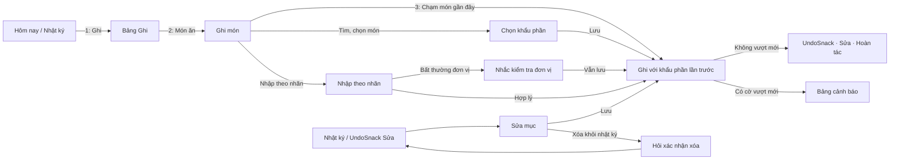

# Thiết kế UX: Thư viện món và Ghi món

Trạng thái: Đã duyệt  <!-- Nháp | Đã duyệt -->
Đặc tả: [docs/specs/food-library.md](../specs/food-library.md)
Khung tổng thể: [docs/design/mvp-overview.md](mvp-overview.md)

Thiết kế này cụ thể hóa **việc 3** trên khung đã duyệt ở `mvp-overview.md`, bao gồm 4 màn hình thuộc luồng ăn uống: **Ghi món**, **Chọn khẩu phần**, **Nhập theo nhãn**, **Sửa mục** (món ăn), cùng các bảng/hộp thoại đi kèm (chỉ dẫn khi nghi sai đơn vị, xóa món, bỏ lưu món tự nhập, màn chặn khi thư viện món hỏng).

---

## Luồng người dùng



- **Đếm chạm cho thao tác chính:**
  - Ghi lại món gần đây: `1` (Ghi) → `2` (Món ăn) → `3` (chạm món trong Gần đây) → xong, **3 lần chạm**.
  - Ghi món từ tìm kiếm hoặc món đã lưu: `Ghi` → `Món ăn` → gõ tìm / chạm món → `Chọn khẩu phần` → `Lưu`.
- **Giờ và ngày ghi mới:** dùng **ngày đang xem** (từ `Hôm nay` / `Nhật ký`). Nếu đang xem hôm nay, giờ mặc định là giờ hiện tại; nếu đang xem ngày cũ, giờ mặc định là giờ đại diện của bữa đang chọn (Sáng `07:00`, Trưa `12:00`, Tối `19:00`, Phụ `15:00` — lấy từ `Giờ trong ngày` nếu là bữa chính), và **khi người dùng đổi bữa** trên `Ghi món` hoặc `Nhập theo nhãn` ở ngày cũ thì giờ mặc định tự cập nhật sang giờ của bữa đó.

---

## Danh sách màn hình

| Màn | Mục đích | Vào từ | Ra tới |
|---|---|---|---|
| **Ghi món** | Chọn bữa, chạm món gần đây / món đã lưu, hoặc gõ tìm trong thư viện | `Bảng Ghi → Món ăn` | `Chọn khẩu phần`; `Nhập theo nhãn`; quay về `Hôm nay` / `Nhật ký` |
| **Chọn khẩu phần** | Chọn đơn vị (`bát`, `gram`…), số lượng, xem nhanh lưu ý nguồn của món rồi lưu | Chạm kết quả tìm / món đã lưu ở `Ghi món` | Màn trước (`Hôm nay` / `Nhật ký`) kèm phản hồi; nếu vượt giới hạn mở `Bảng cảnh báo` |
| **Nhập theo nhãn** | Ghi món theo nhãn dinh dưỡng, tùy chọn lưu lại vào kho cá nhân để dùng sau | Nút `[ Nhập theo nhãn ]` ở `Ghi món` | Màn trước kèm phản hồi / `Bảng cảnh báo` |
| **Sửa mục (món ăn)** | Sửa khẩu phần, bữa, giờ, ngày hoặc xóa món đã ghi | Chạm món trong `Nhật ký` hoặc chạm `Sửa` trên `UndoSnack` | `Nhật ký` (hoặc màn trước) kèm phản hồi / `Bảng cảnh báo` |
| **Màn chặn thư viện hỏng** | Chặn an toàn khi `food_library.db` thiếu hoặc sai mã kiểm tra toàn vẹn | Mở `Ghi món` / khởi tạo thư viện bị lỗi cài đặt | Không tự ghi món thư viện; gợi ý cài lại app từ cửa hàng |

*(Ghi chú: trong phạm vi việc 3, biểu tượng micro `🎤` và mã vạch `▥` ở ô tìm của `Ghi món` chưa hiển thị theo quy tắc `mvp-overview.md` — "chỉ hiện khi tính năng có và máy hỗ trợ".)*

---

## Wireframe

Khung tham chiếu ~360 dp; dữ liệu mẫu khớp [mvp-overview.md](mvp-overview.md) (Thứ Hai 23/11/2026). Các ký hiệu: `[ ]` nút, `( )` chọn một, `☐` đánh dấu, `CalorieText` tôn trọng công tắc **Ẩn số calo**.

### 1. Ghi món

```
┌──────────────────────────────┐
│ ←  Ghi món · 23/11           │
│ [Sáng] [Trưa✓] [Tối] [Phụ]   │
│ [ 🔍 Tìm món...            ] │
├──────────────────────────────┤
│ Gần đây                       │
│  Cơm trắng · 1 bát     195   │
│  Phở bò · 1 bát  ước tính    │
│                        450   │
│  Sữa chua uống · 180 ml      │
│  tự nhập               120   │
├──────────────────────────────┤
│ Món bạn đã lưu               │
│  Sữa chua uống (100 ml)   [⋮]│
├──────────────────────────────┤
│ Không thấy món?              │
│ [ Nhập theo nhãn ]           │
└──────────────────────────────┘
```

- **Tiêu đề:** `Ghi món · {ngày}` nếu đang xem ngày khác hôm nay; hoặc `Ghi món` khi đang xem hôm nay (`Bảng Ghi` đã báo ngày ở bước trước).
- **Thanh chọn bữa `[Sáng] [Trưa] [Tối] [Phụ]`:** tự chọn sẵn theo `Giờ trong ngày` (trong ±1,5 giờ quanh giờ Sáng/Trưa/Tối; ngoài khoảng đó chọn `Phụ`). Người dùng chạm để đổi bất kỳ lúc nào.
- **Ô tìm kiếm:**
  - Gõ tiếng Việt có dấu, không dấu (`pho bo`), hoặc tiếng Anh đều khớp ngay.
  - Khi ô tìm trống: hiện **Gần đây** (tối đa 5–8 món dùng gần nhất, cả thư viện lẫn món tự lưu) + **Món bạn đã lưu** (nếu đã lưu món từ Nhập theo nhãn) + nút `[ Nhập theo nhãn ]` ở cuối.
  - Khi gõ từ khóa: ẩn hai nhóm mặc định, hiện danh sách kết quả tìm (kết quả `Món bạn đã lưu` khớp tên hiện trước với nhãn `tự nhập`, tiếp theo là kết quả thư viện `recipe` gắn `EstimateChip` `"ước tính"` và món tham chiếu chuẩn). Dòng cuối danh sách luôn có `Không thấy món? [ Nhập theo nhãn ]` kèm nút điền sẵn tên đang tìm vào ô Tên món.
- **Chạm món ở Gần đây:** ghi ngay cho bữa và ngày đang xem với **khẩu phần lần trước** (nếu là món thư viện thì tính lại theo gói dữ liệu hiện hành; nếu là món tự nhập giữ nguyên số nhãn). Đóng `Ghi món`, hiện `UndoSnack` 7 giây (`"Đã ghi Cơm trắng, 1 bát · Sửa · Hoàn tác"`) hoặc `Bảng cảnh báo` nếu vượt giới hạn mới.
- **Chạm kết quả tìm / món trong `Món bạn đã lưu`:** mở `Chọn khẩu phần` (với món tự nhập đã lưu, mở ngay màn chọn lượng dùng theo đơn vị gốc của nhãn để chỉnh số lượng rồi lưu).
- **Nút `[⋮]` ở `Món bạn đã lưu`:** chỉ có một hành động `Bỏ lưu món này` (gọi `archiveCustomFood`; hỏi xác nhận nhẹ `"Bỏ lưu “{tên}” khỏi danh sách?"` — món đã ghi trước đó trong `Nhật ký` vẫn giữ nguyên).
- **Số kcal bên phải mỗi dòng (`195`, `450`, `120`):** hiển thị qua `CalorieText`, biến mất hoàn toàn (không chừa khoảng trống) khi bật `Ẩn số calo`.

---

### 2. Chọn khẩu phần

```
┌──────────────────────────────┐
│ ←  Phở bò                    │
├──────────────────────────────┤
│ Phở bò              ước tính │
│ Khẩu phần                    │
│ [ Bát lớn ] [ Bát vừa✓]      │
│ [ Gram ]                     │
│                              │
│ Số lượng                     │
│  [ − ]     1      [ + ]      │
│  (= 450 g)                   │
│                              │
│ Khoảng 450 kcal              │
│ Đạm 22 g · Béo 11 g ·        │
│ Bột đường 65 g               │
│ Đường bổ sung: 0 g           │
│                              │
│ [           Lưu            ] │
└──────────────────────────────┘
```

*Trạng thái khi món có lưu ý dữ liệu (ví dụ món USDA thiếu tách nguồn):*
```
│ ⓘ Chưa rõ đường bổ sung (nguồn│
│   dữ liệu không tách riêng).  │
│ ⓘ Folate tổng, chưa tách riêng│
│   phần tăng cường.            │
```

- **Đầu màn:** tên món tiếng Việt (kèm tên tiếng Anh nhỏ bên dưới nếu là món USDA, để người dùng đối chiếu khi cần), `EstimateChip` `"ước tính"` khi `is_estimate = true`.
- **Chọn đơn vị:** nhóm chip xuống dòng linh hoạt (`Wrap`) gồm các khẩu phần quen thuộc trong `food_portions` (đặt sẵn `default_portion_id`) và luôn có `[ Gram ]`.
  - Khi chọn đơn vị khác `Gram`: mặc định số lượng là `1`, bên dưới hiện quy đổi khối lượng `(= 450 g)` theo trọng lượng thật của khẩu phần.
  - Khi chọn `Gram`: mặc định số lượng là `100`.
- **Bộ chỉnh `[ − ]  {số lượng}  [ + ]`:**
  - Nút `[ − ]` và `[ + ]` đạt tối thiểu `48 × 48 dp`; chạm thẳng vào số ở giữa để nhập tự do mọi số `> 0` (vd. `0,25` hay `1,5`).
  - Với đơn vị khẩu phần (`bát`, `ly`, `khúc`…): bước nhảy `0,5` (tối thiểu `0,5` khi bấm `−`).
  - Với `Gram`: bấm `+` tăng `10 g` khi `< 100 g` và tăng `50 g` khi `>= 100 g`; bấm `−` giảm `50 g` khi `> 100 g` và giảm `10 g` khi `<= 100 g` (tối thiểu `10 g`).
- **Tóm tắt dinh dưỡng theo khẩu phần đang chọn (cập nhật tức thì):**
  - Dòng `Khoảng {x} kcal` (dùng `CalorieText`, **ẩn hoàn toàn** khi bật `Ẩn số calo`).
  - Dòng tóm tắt ngắn: `Đạm {g} · Béo {g} · Bột đường {g}` và `Đường bổ sung: {g}` (nếu `added_sugar_known = true`) hoặc dòng thông tin trung tính (`SafetyNote` nhỏ):
    - Nếu `added_sugar_known = false`: `"Chưa rõ đường bổ sung (nguồn dữ liệu không tách riêng)."`
    - Nếu `totalSugar` có giá trị và khác đường bổ sung: hiện thêm dòng phụ `"Đường tổng: {g}"` để tham khảo.
    - Nếu `folate_unseparated = true`: `"Folate tổng, chưa tách riêng phần tăng cường."`
    - Nếu `niacin_fortified_unseparated = true`: `"Niacin tăng cường chưa tách riêng khỏi thực phẩm."`
- **Ghi chú món tự lưu (khi vào `Chọn khẩu phần` từ `Món bạn đã lưu`):** chỉ giữ đúng một đơn vị là `{đơn vị trên nhãn}` (`label_basis_unit`, vd. `ml`, `g`, `gói`, `viên`), mặc định số lượng bằng `label_basis_qty` (vd. `100 ml`, hoặc `1 gói`); người dùng chỉnh thẳng lượng đã dùng (vd. `180 ml`, `2 gói`), lưu đúng `portion_unit = label_basis_unit` để đồng nhất 100% với `scaleLabelFoodPortion` khi sửa sau này. Bước nhảy `[ − ]` / `[ + ]` dùng `10` khi đơn vị là `g`/`ml` và `1` (hoặc `0,5` nếu `label_basis_qty < 5`) với đơn vị đếm; chạm số để nhập tự do.
- **Nút `[ Lưu ]`:** ghim ở vùng dễ chạm cuối màn; lưu món vào `Nhật ký` với bữa đã chọn ở `Ghi món`.

---

### 3. Nhập theo nhãn

```
┌──────────────────────────────┐
│ ←  Nhập theo nhãn · 23/11    │
├──────────────────────────────┤
│ Tên món  [ Sữa chua uống   ] │
│ Bữa      [Sáng][Trưa][Tối][Phụ✓]│
│                              │
│ Số trên nhãn tính cho        │
│ [ 100 ] [ ml ▾ ]             │
│ Bạn đã dùng  [ 180 ] ml      │
│                              │
│ Năng lượng    [  115 ] kcal  │
│ Đạm           [  3,2 ] g     │
│ Béo           [  1,8 ] g     │
│ Bột đường     [ 18,0 ] g     │
│ Đường (tổng)  [ 15,0 ] g     │
│ Đường bổ sung [      ] g     │
│  Chỉ nhập nếu nhãn ghi riêng;│
│  bỏ trống nếu chỉ ghi đường  │
│  tổng (nhập 0 nếu là 0 g).   │
│ Natri         [   45 ] mg    │
│                              │
│ Vi chất khác trên nhãn       │
│  Canxi (nguyên tố)           │
│   [ 120 ] [ mg ▾ ]      [✕]  │
│  Vitamin E                   │
│   [ 15  ] [ mg ▾ ]      [✕]  │
│   Dạng [ Tự nhiên (d-alpha)▾]│
│  Folate                      │
│   [ 100 ] [ µg (đã quy đổi)▾]│
│   Dạng [ Nhãn ghi axit folic▾]│
│ [ + Thêm vi chất trên nhãn ] │
│                              │
│ ☐ Lưu để dùng lại            │
│ [           Lưu            ] │
└──────────────────────────────┘
```

*Bảng chọn khi bấm `[ + Thêm vi chất trên nhãn ]`:*
```
┌──────────────────────────────┐
│ Chọn chất trên nhãn          │
│ [ 🔍 Tìm vitamin, khoáng... ]│
├──────────────────────────────┤
│ Vitamin A                    │
│ Vitamin C                    │
│ Vitamin D                    │
│ Vitamin E                    │
│ Vitamin B3 (Niacin)          │
│ Folate / Axit folic          │
│ Canxi (nhập lượng nguyên tố) │
│ Sắt (nhập lượng nguyên tố)   │
│ ...                          │
└──────────────────────────────┘
```

- **Tiêu đề:** `Nhập theo nhãn · {ngày}` khi đang xem ngày khác hôm nay (giống `Ghi món · {ngày}`); hoặc `Nhập theo nhãn` khi xem hôm nay.
- **Quy mô nhãn và lượng đã dùng:**
  - Ô `Số trên nhãn tính cho`: số dương + đơn vị chọn (`g`, `ml`, `khẩu phần`, `gói`, `hộp`, `viên`, `lọ`).
  - Ô `Bạn đã dùng`: mặc định bằng giá trị `Số trên nhãn tính cho` (nhưng người dùng tự sửa thành số đã ăn/uống thật, vd. nhãn tính cho `100 ml`, dùng `180 ml` → app tự nhân tỷ lệ `180 / 100`). Đơn vị ở `Bạn đã dùng` tự khớp với đơn vị trên nhãn để tránh lệch đơn vị.
- **Ẩn số calo:** trong `Nhập theo nhãn`, người dùng vẫn nhập được số `Năng lượng (kcal)` ghi trên bao bì để app lưu và tính tỷ lệ năng lượng ở hậu cảnh đúng theo quy tắc *"App vẫn tính, chỉ không hiện con số"* (`mvp-overview.md`); nếu có hiển thị dòng quy đổi kết quả dự kiến trước khi lưu thì **ẩn số kcal** qua `CalorieText`. (Hoặc nếu người dùng bật `Ẩn số calo`, giữ nguyên ô nhập liệu tùy chọn — bỏ trống vẫn lưu được bình thường).
- **Quy tắc Đường bổ sung:**
  - Nếu nhãn chỉ ghi `Đường (Sugars)` không tách riêng `Đường bổ sung`: để trống ô `Đường bổ sung` → lưu `added_sugar_known = false`.
  - Nếu nhãn ghi rõ `Đường bổ sung: 0 g`: người dùng gõ `0` → lưu `added_sugar_known = true` (`0 g`), **kể cả khi tick `Lưu để dùng lại`** (ghi dòng `addedSugar = 0` để lần sau dùng lại vẫn giữ trạng thái đã biết `0 g`).
- **Thêm vi chất trên nhãn (khóa phạm vi theo đặc tả):**
  - Chỉ cho chọn các chất có trong gói dữ liệu chuẩn (không cho nhập tên chất tự do).
  - Các khoáng chất hiện nhắc ngắn `"Nhập theo lượng nguyên tố ghi trên nhãn"` (vd. Canxi, Sắt, Kẽm, Magie).
  - Các chất có đơn vị / dạng ảnh hưởng tới phép tính hiện thêm ô chọn đơn vị và ô **Dạng** ngay trong dòng:
    - **Vitamin A:** chọn đơn vị `µg` hoặc `IU`; **ô Dạng luôn hiện cho cả `µg` và `IU`** (vì chọn dạng quyết định lượng cộng vào giới hạn retinol): `Retinol / từ động vật` (`retinol`), `Beta-caroten / từ thực vật` (`beta_carotene`), hoặc `Nhãn không ghi rõ` (`unknown`, mặc định).
    - **Vitamin D:** chọn đơn vị `µg` hoặc `IU`.
    - **Vitamin E:** chọn đơn vị `mg` hoặc `IU`; **ô Dạng luôn hiện cho cả `mg` và `IU`** (tự gán `source = fortified`):
      - Khi chọn `IU`: `Tự nhiên (d-alpha)` (`natural_2r`), `Tổng hợp (dl-alpha)` (`synthetic_2r`), `Nhãn không ghi rõ` (`unknown`, mặc định).
      - Khi chọn `mg`: `Tự nhiên (d-alpha)` (`natural_2r`, tính 1×), `Tổng hợp (dl-alpha, theo hoạt lực)` (`synthetic_2r`), `Tổng hợp (dl-alpha, theo khối lượng)` (`synthetic_mass`), `Nhãn không ghi rõ` (`unknown`, mặc định).
    - **Vitamin B3 (Niacin):** đơn vị `mg`; tự gán `source = fortified`.
    - **Folate / Axit folic:** chọn một trong ba cách ghi phổ biến trên bao bì để người dùng không phải tự nhân:
      1. Nhãn ghi `Axit folic` (`µg`) → tự gán `source = fortified`, tính cả vào giới hạn an toàn lẫn mức khuyến nghị.
      2. Nhãn ghi `Folate tổng` có tách riêng `(… µg axit folic)` → nhập lượng tổng theo `µg (đã quy đổi trên nhãn)` + ô phụ `Trong đó axit folic (µg)` bên cạnh (`secondaryFolicAcidUg`); phần chênh lệch coi là folate tự nhiên trong thực phẩm (`source = food`), phần axit folic coi là `source = fortified`.
      3. Nhãn ghi `Folate` không tách riêng axit folic → cho chọn rõ một trong 2 đơn vị: `µg (lượng thực tế)` *(ánh xạ `ug`, nhân 1,7 nếu là axit folic)* hoặc `µg (đã quy đổi trên nhãn)` *(ánh xạ `ugDfe`)*; kèm ô **Dạng**: `Nhãn ghi là axit folic` *(tự gán `source = fortified`)* hoặc `Không rõ nguồn` *(mặc định, tính thận trọng vào giới hạn)*.
  - Không dùng từ viết tắt `RAE`, `DFE`, `NE`, `RDA`, `UL` trong tên ô nhập ở màn này.
- **Kiểm hợp lý đơn vị trước khi bấm `[ Lưu ]`:**
  - Khi bấm `[ Lưu ]`, nếu có chất vượt ngưỡng cảnh báo nhầm đơn vị (`> 100%` giới hạn an toàn hoặc `> 10×` mức khuyến nghị/ước tính), giữ nguyên dữ liệu đang nhập, đánh dấu nhẹ dưới ô có số cao và mở hộp thoại xác nhận:
    ```
    ┌──────────────────────────────┐
    │ Kiểm tra lại đơn vị          │
    │                              │
    │ Vitamin D: 4.000 µg          │
    │ Số liệu cao bất thường, kiểm │
    │ tra lại mg và µg.            │
    │                              │
    │ [ Kiểm tra lại ] [ Vẫn lưu ] │
    └──────────────────────────────┘
    ```
  - `[ Kiểm tra lại ]`: đóng hộp thoại, cuộn tới ô cần xem. `[ Vẫn lưu ]`: ghi bình thường (và chuyển qua `Bảng cảnh báo` nếu có cờ vượt giới hạn mới).
- **`☐ Lưu để dùng lại`:** không đánh sẵn; khi đánh dấu sẽ lưu vào `Món bạn đã lưu` cùng lúc với việc ghi vào `Nhật ký`.

---

### 4. Sửa mục (món ăn)

```
┌──────────────────────────────┐
│ ←  Phở bò                    │
├──────────────────────────────┤
│ Phở bò              ước tính │
│                              │
│ Khẩu phần                    │
│ [ Bát lớn ] [ Bát vừa✓]      │
│ [ Gram ]                     │
│ Số lượng  [ − ]  1  [ + ]    │
│ Khoảng 450 kcal              │
│                              │
│ Bữa                          │
│ [Sáng✓][Trưa][Tối][Phụ]      │
│                              │
│ Ngày  [ Thứ Hai, 23/11     ] │
│ Giờ   [ 07:30              ] │
│                              │
│ [           Lưu            ] │
│     Xóa khỏi nhật ký         │
└──────────────────────────────┘
```

- **Đổi khẩu phần:**
  - Nếu món thuộc thư viện (`usda:` / `recipe:`): dùng lại bộ chọn đơn vị (`food_portions` + `Gram`) và `[ − ] số lượng [ + ]`, bấm `[ Lưu ]` sẽ tính lại toàn bộ vi chất theo gói dữ liệu hiện tại (`replaceFoodLines`).
  - Nếu món thư viện cũ không còn trong bản `food_library.db` đang cài: ẩn nút đổi đơn vị khác, giữ nguyên đơn vị đã ghi kèm `[ − ] số lượng [ + ]` để nhân tỷ lệ an toàn từ dữ liệu đã lưu và hiện ghi chú `SafetyNote`: *"Món không còn trong thư viện hiện tại; chỉnh số lượng sẽ nhân theo tỷ lệ cũ."*
  - Nếu món ghi từ `Nhập theo nhãn`: hiển thị đúng đơn vị đã lưu (`portion_unit`, vd. `ml`, `g`, `gói`, `lọ`), cho chỉnh số lượng (`[ − ] 180 ml [ + ]` hoặc chạm vào số để nhập tự do); khi lưu gọi `scaleLabelFoodPortion`, giữ nguyên số liệu gốc trên nhãn.
- **Đổi bữa, ngày, giờ:**
  - Chạm `Ngày` mở bộ chọn ngày (chỉ tới hôm nay, không chọn ngày tương lai).
  - Chạm `Giờ` mở bộ chọn giờ 24 giờ.
  - Bấm `[ Lưu ]` cập nhật đồng thời khẩu phần (nếu đổi), bữa, ngày, giờ trong một giao dịch; nếu đổi sang ngày khác thì tính lại tổng kết và cờ cho **cả ngày cũ lẫn ngày mới**.
- **Xóa khỏi nhật ký:**
  - Chữ màu đỏ (`error`), tối thiểu vùng chạm 48 dp.
  - Chạm mở hộp thoại xác nhận: `"Xóa “{tên}” khỏi nhật ký?"` với `[ Hủy ]` và `[ Xóa ]` (màu `error`). Xóa xong quay về `Nhật ký` kèm thông báo nhỏ `"Đã xóa {tên}"`.

---

### 5. Màn chặn khi thư viện món lỗi cài đặt

```
┌──────────────────────────────┐
│ ←  Ghi món                   │
├──────────────────────────────┤
│                              │
│              ⚠               │
│ Không đọc được thư viện món  │
│ ăn. Hãy cài lại WholeWell từ │
│ cửa hàng ứng dụng.           │
│                              │
│     [ Nhập theo nhãn ]       │
└──────────────────────────────┘
```

- Khi `food_library.db` thiếu, không giải nén được, hoặc sai SHA-256 trên tệp cục bộ: không hiển thị dữ liệu món có thể bị hỏng; người dùng vẫn có thể bấm `[ Nhập theo nhãn ]` để ghi món thủ công nếu muốn, hoặc cài lại app.

---

## Trạng thái

| Màn | Trống | Đang xử lý | Lỗi | Cảnh báo |
|---|---|---|---|---|
| **Ghi món** | Chưa có món gần đây & chưa lưu món nào: chỉ hiện ô tìm + `[ Nhập theo nhãn ]` + chữ hướng dẫn ngắn *"Gõ tên món để tìm trong thư viện hoặc tự nhập từ nhãn."* | Vòng xoay nhỏ bên phải ô tìm (chỉ hiện nếu truy vấn > 200 ms) | Không thấy kết quả: `"Không thấy “{từ khóa}”. Thử tên khác hoặc nhập theo nhãn."` + nút `[ Nhập theo nhãn ]`. Thư viện hỏng: màn chặn không hiện số món hỏng | Vượt giới hạn mới sau chạm món gần đây: mở `Bảng cảnh báo` |
| **Chọn khẩu phần** | Món không có khẩu phần riêng: chỉ hiện chip `[ Gram ]` được chọn sẵn (`100 g`) | Đang nạp chi tiết món (> 200 ms): khung xám ngắn | Món không mở được hoặc lỗi lưu: `"Chưa lưu được. Thử lại"` | `SafetyNote` trung tính khi thiếu đường bổ sung hoặc chưa tách nguồn folate/niacin; vượt giới hạn sau khi lưu → `Bảng cảnh báo` |
| **Nhập theo nhãn** | Tên món trống hoặc số lượng ≤ 0 → nhắc dưới ô khi bấm Lưu; vi chất khác trống → hiện nút `[ + Thêm vi chất trên nhãn ]` | Nút `[ Lưu ]` hiện vòng xoay, khóa bấm đúp | Nghi sai đơn vị: hộp thoại `"Số liệu cao bất thường, kiểm tra lại mg và µg"` (không chặn nếu bấm `[ Vẫn lưu ]`). Lỗi lưu: thông báo nhỏ `"Chưa lưu được. Thử lại"` | Bữa quá `10 g` đường bổ sung hoặc chất vẫn vượt: gộp vào `UndoSnack`. Vượt mới → `Bảng cảnh báo` |
| **Sửa mục** | – | Nút `[ Lưu ]` hiện vòng xoay | Món nguồn không còn trong thư viện mới: `SafetyNote` + nhân tỷ lệ an toàn. Lỗi lưu: `"Chưa lưu được. Thử lại"` | Sửa làm vượt giới hạn mới hoặc quá 10 g đường/bữa: áp đúng quy tắc *"mỗi lần ghi/sửa chỉ một phản hồi"* |

---

## Nội dung chữ

| Vị trí | Chữ hiển thị |
|---|---|
| Tiêu đề | `Ghi món` · `Ghi món · {ngày}` · `Nhập theo nhãn` · `Nhập theo nhãn · {ngày}` |
| Bữa | `Sáng` · `Trưa` · `Tối` · `Phụ` |
| Tìm kiếm | `Tìm món...` · `Gần đây` · `Món bạn đã lưu` · `tự nhập` · `Không thấy món?` · `Nhập theo nhãn` · `Không thấy “{từ khóa}”. Thử tên khác hoặc nhập theo nhãn.` |
| Bỏ lưu món tự nhập | `Bỏ lưu món này` · `Bỏ lưu “{tên}” khỏi danh sách?` · `Bỏ lưu` · `Hủy` |
| Khẩu phần & tóm tắt | `Khẩu phần` · `Gram` · `Số lượng` · `Khoảng {x} kcal` · `ước tính` · `Đường bổ sung: {g}` · `Đường tổng: {g}` |
| Lưu ý dữ liệu món | `Chưa rõ đường bổ sung (nguồn dữ liệu không tách riêng).` · `Folate tổng, chưa tách riêng phần tăng cường.` · `Niacin tăng cường chưa tách riêng khỏi thực phẩm.` |
| Nhập theo nhãn | `Tên món` · `Số trên nhãn tính cho` · `Bạn đã dùng` · `Năng lượng` · `Đạm` · `Béo` · `Bột đường` · `Đường (tổng)` · `Đường bổ sung` · `Chỉ nhập nếu nhãn ghi riêng; bỏ trống nếu chỉ ghi đường tổng (nhập 0 nếu là 0 g).` · `Natri` · `Vi chất khác trên nhãn` · `Thêm vi chất trên nhãn` · `Nhập theo lượng nguyên tố ghi trên nhãn` · `Lưu để dùng lại` · `Lưu` |
| Nhãn folate / dạng | `Axit folic` · `Folate tổng (có tách axit folic)` · `Folate` · `Trong đó axit folic` · `µg (lượng thực tế)` · `µg (đã quy đổi trên nhãn)` · `Nhãn ghi là axit folic` · `Không rõ nguồn` · `Tự nhiên (d-alpha)` · `Tổng hợp (dl-alpha)` · `Tổng hợp (dl-alpha, theo hoạt lực)` · `Tổng hợp (dl-alpha, theo khối lượng)` · `Retinol / từ động vật` · `Beta-caroten / từ thực vật` · `Nhãn không ghi rõ` |
| Kiểm hợp lý đơn vị | `Kiểm tra lại đơn vị` · `Số liệu cao bất thường, kiểm tra lại mg và µg.` · `Kiểm tra lại` · `Vẫn lưu` |
| Sửa & Xóa mục | `Ngày` · `Giờ` · `Món không còn trong thư viện hiện tại; chỉnh số lượng sẽ nhân theo tỷ lệ cũ.` · `Xóa khỏi nhật ký` · `Xóa “{tên}” khỏi nhật ký?` · `Xóa` · `Đã xóa {tên}` |
| Phản hồi & lỗi | `Đã ghi {tên}, {khẩu phần}` · `Sửa` · `Hoàn tác` · `Chưa lưu được. Thử lại` · `Không đọc được thư viện món ăn. Hãy cài lại WholeWell từ cửa hàng ứng dụng.` |

*Không dùng ở bất kỳ chỗ nào trên các màn trên: tên viết tắt chuẩn (`RDA`, `UL`, `EER`, `AMDR`, `DFE`, `RAE`, `NE`), "bạn bị thiếu", "tốt/xấu", "nên ăn", "được ăn thêm".*

---

## Kiểm theo nguyên tắc (`docs/design/README.md`)

- [x] Lời lẽ đúng vai tham chiếu, tiếng Việt thường ngày, không viết tắt chuẩn trên giao diện
- [x] Ẩn số calo được tôn trọng ở mọi chỗ hiển thị kcal (`CalorieText`, biến mất hoàn toàn khi bật)
- [x] Tối đa 3 lần chạm cho thao tác chính (`Ghi` → `Món ăn` → chạm món `Gần đây`)
- [x] Cỡ chữ 200% tách dòng hợp lý (`Wrap` cho chip bữa/đơn vị, tên món + kcal tách dòng), vùng chạm ≥ 48 dp, độ tương phản AA, mọi trạng thái đều có chữ kèm biểu tượng
- [x] Không quảng cáo, hoạt động hoàn toàn không cần mạng
