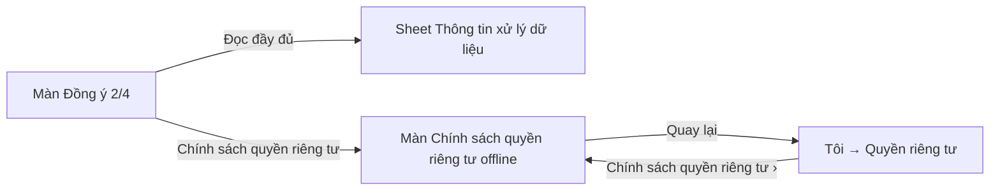

# Thiết kế UX: Cổng 2 — Lời văn đồng ý & Màn Chính sách quyền riêng tư

Trạng thái: Đã duyệt (26/11/2026)  <!-- Nháp | Đã duyệt -->
Đặc tả: [docs/specs/gate-2.md](../specs/gate-2.md)
Thiết kế khung: [docs/design/mvp-overview.md](mvp-overview.md)

## Luồng người dùng



## Danh sách màn hình & cập nhật

| Màn / Thành phần | Mục đích | Vào từ | Ra tới |
|---|---|---|---|
| **Màn Đồng ý (2/4)** & **Nâng cấp đồng ý** (cập nhật) | Cập nhật đúng đường dẫn `"xóa ở Tôi → Quyền riêng tư"` trong danh sách tóm tắt và sheet `"Đọc đầy đủ"`; thêm nút mở `Chính sách quyền riêng tư` | Điều kiện (1/4) hoặc nâng cấp `khung-tam-0` | Hồ sơ cơ thể (3/4), Sheet Đọc đầy đủ, Chính sách quyền riêng tư |
| **Quyền riêng tư** (cập nhật) | Bổ sung mục `Chính sách quyền riêng tư ›` (ngay sau phần `Đồng ý đã cho` / trước `Dữ liệu của bạn`) | Tab `Tôi` | Màn `Chính sách quyền riêng tư` |
| **Chính sách quyền riêng tư** (mới) | Hiển thị toàn văn Chính sách quyền riêng tư của WholeWell trên máy (offline 100%, không cần mạng), gồm mục đích xử lý, lưu trữ mã hóa, quyền người dùng, Google Drive tùy chọn, thông tin liên hệ `Đặng Thế Anh` (`wholewell.apps@gmail.com`) | Màn Đồng ý (2/4), `Tôi → Quyền riêng tư` | Quay lại màn trước |

## Wireframe

### 1. Màn Đồng ý (cập nhật) & Quyền riêng tư (cập nhật)

```
  (Màn Đồng ý 2/4)                       (Tôi → Quyền riêng tư)
┌──────────────────────────────────┐   ┌──────────────────────────────────┐
│ ←  2/4                           │   │ ←  Quyền riêng tư                │
├──────────────────────────────────┤   ├──────────────────────────────────┤
│ Dữ liệu sức khỏe của bạn         │   │ Đồng ý đã cho                    │
│ App lưu tuổi, chiều cao, cân     │   │  Xử lý dữ liệu sức khỏe          │
│ nặng, món ăn, bổ sung bạn ghi để │   │  26/11/2026 20:15                │
│ so với mức tham chiếu.           │   │  [        Rút đồng ý         ]   │
│                                  │   │ ──────────────────────────────── │
│ • Lưu mã hóa trên máy này        │   │ Sao lưu đám mây                  │
│ • Không gửi cho ai, kể cả nhóm   │   │  Google Drive: chưa bật / Đang   │
│   phát triển                     │   │ ──────────────────────────────── │
│ • Xem, sửa ở Tôi → Hồ sơ;        │   │ Tài liệu                         │
│   xóa ở Tôi → Quyền riêng tư     │   │  Chính sách quyền riêng tư     › │
│                                  │   │ ──────────────────────────────── │
│ ☐ Tôi đồng ý cho app xử lý dữ    │   │ Dữ liệu của bạn                  │
│   liệu sức khỏe của tôi cho mục  │   │  [         Xuất dữ liệu        ] │
│   đích trên.                     │   │  [    Xóa toàn bộ dữ liệu     ] │
│ [ Đọc đầy đủ ]                   │   └──────────────────────────────────┘
│ [ Chính sách quyền riêng tư ]    │
│                                  │
│ [     Đồng ý và tiếp tục      ]  │
│          Không đồng ý            │
└──────────────────────────────────┘
```

### 2. Màn Chính sách quyền riêng tư (offline)

```
┌──────────────────────────────────┐
│ ←  Chính sách quyền riêng tư     │
├──────────────────────────────────┤
│ Chính sách quyền riêng tư        │
│ Cập nhật: 26/11/2026             │
│                                  │
│ 1. Giới thiệu & vai trò tham     │
│    chiếu                         │
│ WholeWell là công cụ tham chiếu  │
│ dinh dưỡng cá nhân hóa...        │
│                                  │
│ 2. Dữ liệu bạn nhập & mục đích   │
│ ...                              │
│                                  │
│ 3. Lưu trữ mã hóa trên máy       │
│ ...                              │
│                                  │
│ 4. Quyền xem, sửa, xuất, xóa &   │
│    rút đồng ý                    │
│ ...                              │
│                                  │
│ 5. Sao lưu tùy chọn (tệp mã hóa  │
│    và Google Drive appDataFolder)│
│ ...                              │
│                                  │
│ 6. Không thu thập, không quảng   │
│    cáo                           │
│ ...                              │
│                                  │
│ 7. Liên hệ                       │
│ Nhà phát triển: Đặng Thế Anh     │
│ Email: wholewell.apps@gmail.com  │
└──────────────────────────────────┘
```

## Trạng thái

| Màn | Trống / Ban đầu | Đang xử lý | Lỗi | Cảnh báo / Xác nhận |
|---|---|---|---|---|
| **Màn Đồng ý (2/4)** | Ô tích đồng ý không đánh sẵn, nút chính tắt | Vòng xoay lúc tạo khóa & CSDL | `"Chưa lưu được. Thử lại"` | Hỏi lại nếu bấm `Không đồng ý` |
| **Chính sách quyền riêng tư** | Hiện đầy đủ văn bản từ gói dữ liệu/asset hoặc chuỗi tích hợp ngay lập tức | Không có (offline 100%) | Không có (không phụ thuộc mạng) | Không có |

## Nội dung chữ

| Vị trí | Chữ hiển thị |
|---|---|
| Màn Đồng ý (2/4) | `Xem, sửa ở Tôi → Hồ sơ; xóa ở Tôi → Quyền riêng tư` · `Bạn có thể sửa hồ sơ ở Tôi → Hồ sơ hoặc rút đồng ý và xóa toàn bộ dữ liệu bất cứ lúc nào ở Tôi → Quyền riêng tư.` · `Chính sách quyền riêng tư` |
| Quyền riêng tư | `Chính sách quyền riêng tư` |
| Chính sách quyền riêng tư | Tiêu đề `Chính sách quyền riêng tư`, 7 mục theo đúng [docs/privacy-policy.md](../privacy-policy.md), thông tin liên hệ `Đặng Thế Anh` · `wholewell.apps@gmail.com` |

## Kiểm theo nguyên tắc (`docs/design/README.md`)

- [x] Lời lẽ đúng vai tham chiếu, minh bạch dữ liệu nhạy cảm theo Luật 91/2025/QH15 & Nghị định 356/2025/NĐ-CP
- [x] Ẩn số calo được tôn trọng
- [x] Tối đa 2 chạm từ `Tôi → Quyền riêng tư` tới toàn văn Chính sách quyền riêng tư
- [x] Cỡ chữ 200%, vùng chạm ≥ 48 dp (`ListTile(minTileHeight: 56)` trên `Quyền riêng tư`, `TextButton` ≥ 48 dp trên màn Đồng ý), tương phản AA
- [x] Không quảng cáo (MVP không có quảng cáo)
