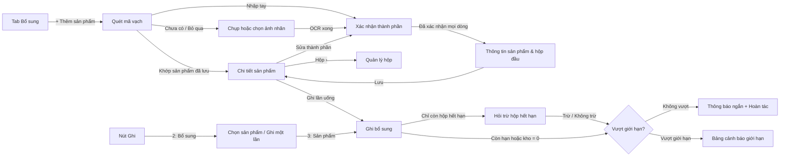

# Thiết kế UX: Chụp nhãn, mã vạch, kho, hạn dùng

Trạng thái: Đã duyệt (25/11/2026)  <!-- Nháp | Đã duyệt -->
Đặc tả: [docs/specs/label-scan-inventory.md](../specs/label-scan-inventory.md)

## Luồng người dùng



## Danh sách màn hình

| Màn | Mục đích | Vào từ | Ra tới |
|---|---|---|---|
| **Bổ sung** (Tab 3/4) | Xem danh sách sản phẩm trong tủ, số còn lại, sắp hết, hết hạn | Thanh điều hướng dưới | Quét mã vạch, Chi tiết sản phẩm |
| **Quét mã vạch** | Tìm nhanh sản phẩm đã lưu bằng mã vạch | Tab Bổ sung | Chi tiết sản phẩm, Chụp/chọn ảnh nhãn, Xác nhận thành phần |
| **Chụp / chọn ảnh nhãn** | Chụp bằng camera hoặc chọn ảnh bảng thành phần từ thư viện | Quét mã vạch, Chi tiết sản phẩm | Xác nhận thành phần |
| **Xác nhận thành phần** | Rà soát dòng OCR / nhập tay, sửa chất-dạng-lượng-đơn vị, xác nhận từng dòng | Ảnh nhãn, Nhập tay, Chi tiết sản phẩm | Thông tin sản phẩm, Chi tiết sản phẩm |
| **Thông tin sản phẩm** | Nhập tên, đơn vị đếm, số đơn vị/khẩu phần, hộp đầu tiên | Xác nhận thành phần, Chi tiết sản phẩm | Chi tiết sản phẩm |
| **Chi tiết sản phẩm** | Xem thành phần chuẩn hóa + số gốc, hộp, ghi lần uống, lưu trữ | Tab Bổ sung, Quét mã vạch | Xác nhận thành phần, Quản lý hộp, Ghi bổ sung |
| **Quản lý hộp** | Xem, thêm, sửa, xóa hộp (số còn lại, hạn dùng `MM/YYYY`) | Chi tiết sản phẩm | Chi tiết sản phẩm |
| **Ghi bổ sung / Sửa lần uống** | Ghi nhanh 1 lần uống (sản phẩm có sẵn hoặc ghi một lần) hoặc sửa trong Nhật ký | Bảng `Ghi`, Chi tiết sản phẩm, Nhật ký | Màn trước; Bảng cảnh báo (nếu vượt) |

## Wireframe

### 1. Tab Bổ sung & Thanh điều hướng 4 tab

```
┌──────────────────────────────┐
│ Bổ sung                      │
├──────────────────────────────┤
│ Canxi D3                     │
│ Còn 42 viên · HSD 08/2027  › │
│ ──────────────────────────── │
│ Vitamin tổng hợp             │
│ Còn 5 viên · Sắp hết       › │
│ ──────────────────────────── │
│ Magie                        │
│ Kho đã hết · Đã hết hạn: 10› │
│                              │
│             [+ Thêm sản phẩm]│
├──────────────────────────────┤
│ Hôm nay  Nhật ký  Bổ sung Tôi│
└──────────────────────────────┘
```

- Nhãn thanh điều hướng dưới giữ ≤7 ký tự (`Hôm nay`, `Nhật ký`, `Bổ sung`, `Tôi`).
- Khi chưa có sản phẩm nào: hiện `EmptyState` `"Chưa có sản phẩm bổ sung nào."` + nút `[+ Thêm sản phẩm]`.
- Sản phẩm còn hạn: hiện `"Còn {n} {đơn vị}"`; nếu có dự kiến ngày hết ≤7 ngày hiện kèm `"· Sắp hết"`; nếu chưa đủ dữ liệu ước lượng (chưa có lịch & 14 ngày qua chưa uống) thì chỉ hiện `"Còn {n} {đơn vị}"` và HSD sớm nhất (nếu có).
- Nếu có hộp đã hết hạn: hiện `"Đã hết hạn: {n} {đơn vị}"` bằng chữ; không dùng link cửa hàng.

### 2. Quét mã vạch & Lấy ảnh nhãn

```
┌──────────────────────────────┐
│ ←  Thêm sản phẩm             │
├──────────────────────────────┤
│ ┌──────────────────────────┐ │
│ │                          │ │
│ │   Khung quét mã vạch     │ │
│ │                          │ │
│ └──────────────────────────┘ │
│ Đưa mã vạch vào khung để tìm │
│ sản phẩm đã lưu.             │
│                              │
│ [ Chụp ảnh bảng thành phần ] │
│ [ Chọn ảnh từ thư viện ]     │
│      Nhập tay từng dòng      │
└──────────────────────────────┘
```

- Quét trúng mã vạch khớp `productByBarcode`: mở ngay **Chi tiết sản phẩm** (hiện dòng ngắn `"Đã tìm thấy sản phẩm đã lưu."`, người dùng có thể bấm `Hộp ›` để thêm hộp mới).
- Quét chưa thấy sản phẩm: hiện dòng `"Chưa có sản phẩm với mã vạch này. Hãy chụp hoặc chọn ảnh nhãn."` (giữ lại chuỗi `barcode` để gắn khi lưu sản phẩm mới).
- **Từ chối quyền Camera:** Không kẹt màn hình; hiện thông báo ngắn `"Chưa có quyền máy ảnh."` kèm nút `[Mở cài đặt]`, giữ nguyên hai nút `[Chọn ảnh từ thư viện]` và `Nhập tay từng dòng`.
- Bấm `[Chụp ảnh bảng thành phần]` → mở camera chụp nhãn → chạy OCR trên máy (`Đang đọc chữ trên nhãn...`). Bấm `[Chọn ảnh từ thư viện]` → chọn ảnh → chạy OCR tương tự.

### 3. Xác nhận thành phần (từng dòng)

```
┌──────────────────────────────┐
│ ←  Xác nhận thành phần       │
├──────────────────────────────┤
│ Kiểm tra và đánh dấu xác nhận│
│ từng dòng trước khi lưu.     │
│                              │
│ [✓] Vitamin D3               │
│     25 µg (nhãn: 1.000 IU)   │
│     cholecalciferol      Sửa │
│ ──────────────────────────── │
│ [ ] Canxi                    │
│     Nhãn: canxi carbonat     │
│     1.250 mg → nguyên tố     │
│     500 mg               Sửa │
│ ──────────────────────────── │
│ [ ] Sắt (⚠ Kiểm lại đơn vị)  │
│     100 mg · cao hơn giới    │
│     hạn an toàn 1 lần    Sửa │
│ ──────────────────────────── │
│ [+ Thêm dòng thành phần]     │
│                              │
│ [ Tiếp tục (1/3 đã xác nhận) ]│
└──────────────────────────────┘
```

- **Chạm `Sửa` hoặc `[+ Thêm dòng thành phần]`** mở bảng sửa dòng:
  - Chọn chất trong danh sách gói dữ liệu hoặc chọn `"Chất khác (không tính giới hạn)"` để nhập tên tự do (`free_name`).
  - Lượng trên nhãn + Đơn vị (`mg`, `µg`, `IU`, `g`).
  - Loại số trên nhãn (khi chất là khoáng chất có bảng hợp chất, hoặc vitamin E/A):
    - `Nguyên tố` (`CompoundKind.elemental`)
    - `Hợp chất` (`CompoundKind.compound` → chọn dạng như `Canxi carbonat (40%)`, `Sắt fumarat (33%)`, ...)
    - `Chưa rõ dạng` (`CompoundKind.unknown` → ghi chú `"Tính giới hạn theo cách thận trọng nhất; so mức khuyến nghị là chưa chắc."`)
  - Nếu nghi nhầm `mg` ↔ `µg` hoặc 1 khẩu phần vượt giới hạn an toàn: hiện cảnh báo vàng hổ phách ngay trong dòng và bảng sửa `"Số này khá lớn so với mức thông thường, hãy kiểm lại đơn vị mg/µg trên nhãn."` (không tự ý sửa số, vẫn cho lưu nếu người dùng xác nhận).
- Nút chính `[Tiếp tục]` **chỉ bật** khi có ít nhất 1 dòng và **mọi dòng đều đã được đánh dấu xác nhận `[✓]`**.

### 4. Thông tin sản phẩm & hộp đầu tiên

```
┌──────────────────────────────┐
│ ←  Thông tin sản phẩm        │
├──────────────────────────────┤
│ Tên sản phẩm *               │
│ [ Vitamin tổng hợp         ] │
│ Mã vạch (tùy chọn)           │
│ [ 8935...                  ] │
│ Đơn vị đếm                   │
│ [ Viên ▾ ]                   │
│ Số đơn vị mỗi khẩu phần *    │
│ [ 1                        ] │
│                              │
│ Hộp đang mở (tùy chọn)       │
│ Số còn lại       Hạn dùng    │
│ [ 60         ]   [ 08/2027 ] │
│                              │
│ [ Lưu sản phẩm ]             │
└──────────────────────────────┘
```

- Đơn vị đếm (`CountUnit`): `Viên`, `Viên nang`, `Viên nang mềm`, `Gói`, `Giọt`, `ml`, `g`.
- Hạn dùng nhập `MM/YYYY` (kiểm hợp lệ tháng `01..12`, năm 4 chữ số), đổi sang `YYYY-MM` khi lưu. Để trống nếu không ghi hạn dùng.

### 5. Chi tiết sản phẩm & Quản lý hộp

```
┌──────────────────────────────┐  ┌──────────────────────────────┐
│ ←  Canxi D3              [⋮] │  │ ←  Hộp: Canxi D3             │
├──────────────────────────────┤  ├──────────────────────────────┤
│ 1 khẩu phần = 1 viên         │  │ Còn hạn                      │
│ Còn 42 viên · HSD 08/2027  › │  │  Hộp #1 · Còn 42 viên        │
│ (Chạm để xem / thêm hộp)     │  │  HSD 08/2027          Sửa ›  │
│                              │  │ ──────────────────────────── │
│ Thành phần mỗi khẩu phần (2) │  │ Đã hết hạn                   │
│ Canxi               500 mg   │  │  Hộp #2 · Còn 10 viên        │
│  canxi carbonat (nhãn 1.250) │  │  HSD 09/2026          Sửa ›  │
│ Vitamin D3          10 µg    │  │                              │
│  nhãn 400 IU                 │  │                              │
│                              │  │                              │
│ [ Sửa thành phần ]           │  │                              │
│ [ Ghi lần uống ]             │  │ [+ Thêm hộp]                 │
└──────────────────────────────┘  └──────────────────────────────┘
```

- Menu `[⋮]` của Chi tiết sản phẩm: `Sửa thông tin sản phẩm`, `Lưu trữ sản phẩm` (hỏi xác nhận `"Ẩn sản phẩm khỏi danh sách? Dữ liệu lịch sử đã uống vẫn được giữ."`).
- Không có nút `Ảnh nhãn ›` (ngoài phạm vi Việc 5).
- Sửa thành phần có ghi chú nhỏ: `"Thay đổi thành phần chỉ áp dụng cho lần uống mới."`
- Bấm `Sửa ›` trên hộp cho phép sửa số còn lại (≥ 0), sửa hạn dùng `MM/YYYY`, hoặc xóa hộp.

### 6. Ghi bổ sung / Ghi một lần & Sửa lần uống

```
┌──────────────────────────────┐
│ ←  Ghi bổ sung               │
├──────────────────────────────┤
│ Chọn sản phẩm                │
│  Canxi D3 (Còn 42 viên)    › │
│  Vitamin tổng hợp (Còn 5)  › │
│  Magie (Kho đã hết)        › │
│ ──────────────────────────── │
│  Ghi một lần (không lưu tủ)› │
└──────────────────────────────┘
```

- Chạm một sản phẩm → màn xác nhận ngắn (mặc định `1 khẩu phần`, `Giờ [ 14:05 ]` là một hàng chạm ≥ 48 dp trong thân màn giống Ghi nước) → bấm `[Lưu]` (đủ **3 chạm** từ nút nổi `Ghi`: `Ghi` → `Bổ sung` → chọn sản phẩm & `Lưu` hoặc `Ghi bổ sung`).
- Nếu `recordDose` / `updateDose` trả về `NeedsExpiredChoice`: hiện hộp thoại:
  - Tiêu đề: `"Trừ vào hộp đã hết hạn?"`
  - Nội dung: `"Sản phẩm này không còn hộp còn hạn. Bạn muốn trừ vào hộp đã hết hạn hay chỉ ghi lần uống?"`
  - Nút: `[Không trừ]` (`ExpiredBoxChoice.skip`), `[Trừ]` (`ExpiredBoxChoice.deduct`).
- Phản hồi sau khi lưu (`DoseRecorded`):
  - Không vượt giới hạn & `shortfall == 0`: `UndoSnack` `"Đã ghi {tên}"` + `[Hoàn tác]`.
  - Không vượt giới hạn & `shortfall > 0`: `UndoSnack` `"Đã ghi {tên} · Kho đã hết"` + `[Thêm hộp]` + `[Hoàn tác]`.
  - **Vượt giới hạn an toàn (kể cả khi `shortfall > 0`):** chỉ hiện **1 phản hồi chính** là bảng cảnh báo giới hạn an toàn (`FoodFeedbackSheet`); nếu `shortfall > 0`, chèn thêm một hàng nhắc trung tính `"Kho đã hết · Thêm hộp"` (kèm nút chữ `Thêm hộp`) gọn bên trong bảng cảnh báo.
- Sửa / Xóa lần uống từ **Nhật ký**: cho sửa số khẩu phần (`updateDose`), giờ uống (`Giờ [ HH:mm ]` trong thân màn), hoặc xóa (`deleteDose`, hoàn trả số viên đã trừ vào hộp).

## Trạng thái

| Màn | Trống | Đang xử lý | Lỗi | Cảnh báo |
|---|---|---|---|---|
| Bổ sung | `"Chưa có sản phẩm bổ sung nào."` + `[+ Thêm sản phẩm]` | Khung tải | `ErrorState` + `[Thử lại]` | Chữ `"Sắp hết"`, `"Đã hết hạn"` |
| Quét mã vạch / Ảnh nhãn | Chưa quét: khung hướng dẫn | `"Đang đọc chữ trên nhãn..."` | Không có quyền camera → nút `[Chọn ảnh từ thư viện]` / `Nhập tay`; OCR không đọc được chữ → `"Không đọc được chữ rõ trên ảnh. Hãy chụp lại hoặc nhập tay."` | Trùng mã vạch đã lưu → mở ngay Chi tiết sản phẩm |
| Xác nhận thành phần | `"Chưa có dòng thành phần nào."` + `[+ Thêm dòng thành phần]` | — | Chưa xác nhận hết dòng → nút Tiếp tục vô hiệu + nhắc `"Hãy đánh dấu xác nhận từng dòng."` | Nghi nhầm `mg`/`µg` hoặc vượt UL 1 khẩu phần → màu vàng hổ phách trên dòng |
| Quản lý hộp | `"Chưa có hộp nào."` + `[+ Thêm hộp]` | — | Hạn dùng sai định dạng → `"Nhập hạn dùng theo tháng/năm (MM/YYYY), tháng từ 01 đến 12."`; số lượng âm → `"Số còn lại không được âm."` | Tách nhóm `Đã hết hạn` |
| Ghi bổ sung | `"Chưa có sản phẩm nào trong tủ."` + nút `Ghi một lần` | `"Đang lưu..."` | Số khẩu phần ≤ 0 → `"Nhập số khẩu phần lớn hơn 0."` | Hộp thoại `Trừ vào hộp đã hết hạn?`; Bảng cảnh báo vượt giới hạn (kèm `"Kho đã hết · Thêm hộp"` nếu `shortfall > 0`) |

## Nội dung chữ

| Vị trí | Chữ hiển thị |
|---|---|
| Tab dưới 3/4 | `Bổ sung` |
| Chưa xác nhận hết dòng | `Kiểm tra và đánh dấu xác nhận từng dòng trước khi lưu.` |
| Cảnh báo đơn vị / UL ở dòng OCR | `Số này khá lớn so với mức thông thường, hãy kiểm lại đơn vị mg/µg trên nhãn.` |
| Hỏi trừ hộp hết hạn | `Trừ vào hộp đã hết hạn?` / `Sản phẩm này không còn hộp còn hạn. Bạn muốn trừ vào hộp đã hết hạn hay chỉ ghi lần uống?` / `[Không trừ]` / `[Trừ]` |
| Kho hết (không vượt giới hạn) | `Đã ghi {tên} · Kho đã hết` (`[Thêm hộp]`, `[Hoàn tác]`) |
| Kho hết (trong bảng cảnh báo vượt giới hạn) | `Kho đã hết · Thêm hộp` |
| Lưu ý sửa thành phần | `Thay đổi thành phần chỉ áp dụng cho lần uống mới.` |
| Dòng chưa rõ dạng | `Chưa rõ dạng: tính giới hạn theo cách thận trọng nhất; so mức khuyến nghị là chưa chắc.` |

## Kiểm theo nguyên tắc (`docs/design/README.md`)

- [x] Lời lẽ đúng vai tham chiếu, không viết tắt chuẩn (không hiện RDA, UL, EER, AMDR trên màn hình)
- [x] Ẩn số calo được tôn trọng (bổ sung không hiện calo)
- [x] Tối đa 3 lần chạm cho thao tác chính (`Ghi` → `Bổ sung` → chọn sản phẩm & `Lưu`)
- [x] Cỡ chữ 200%, vùng chạm 48 dp (`Giờ [ HH:mm ]` là hàng chạm riêng trong thân màn), tương phản AA, không dùng chỉ màu truyền nghĩa
- [x] Không quảng cáo ở màn cảnh báo
