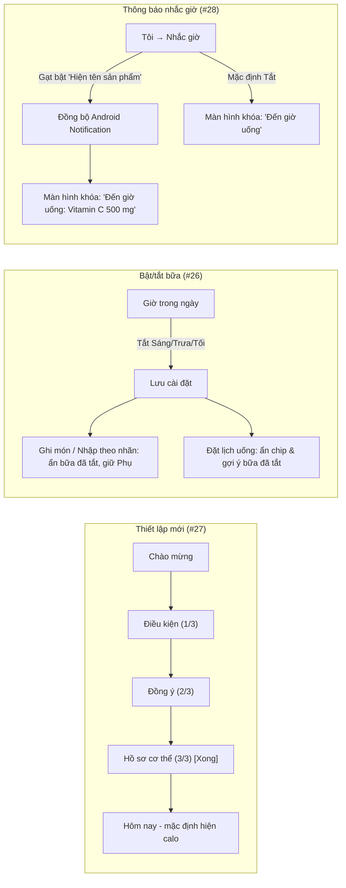

# Thiết kế UX: Bật/tắt từng bữa (#26), Onboarding 3 bước (#27) và Hiện tên sản phẩm trên thông báo (#28)

Trạng thái: Đã duyệt (27/11/2026)  <!-- Nháp | Đã duyệt -->
Đặc tả: [docs/specs/meal-toggles-and-reminder-details.md](../specs/meal-toggles-and-reminder-details.md)

## Luồng người dùng



## Danh sách màn hình thay đổi

| Màn | Mục đích thay đổi | Vào từ | Ra tới |
|---|---|---|---|
| Điều kiện / Đồng ý / Hồ sơ cơ thể | Đánh số `1/3`, `2/3`, `3/3`; bỏ bước `4/4 Hiển thị calo` | Chào mừng | Hôm nay |
| Giờ trong ngày | Thêm công tắc bật/tắt `Bữa sáng`, `Bữa trưa`, `Bữa tối` | `Tôi → Giờ trong ngày` hoặc lần đầu Đặt lịch | Quay lại |
| Đặt lịch uống | Chỉ hiện chip chọn nhanh cho các bữa đang bật | Chi tiết sản phẩm | Nhắc giờ / Chi tiết |
| Ghi món & Nhập theo nhãn | `SegmentedButton` chỉ hiện bữa đang bật + `Phụ` | Nút `Ghi` → `Món ăn` | Chọn khẩu phần / Nhật ký |
| Sửa món | Hiện bữa đang bật + `Phụ` (giữ thêm segment cũ nếu món trước đây ghi vào bữa nay đã tắt) | Chạm món ở Nhật ký | Nhật ký |
| Tôi (tab) | Phụ đề `Giờ trong ngày` chỉ liệt kê các bữa đang bật hoặc `"Chỉ bữa phụ"` | Thanh điều hướng | Các màn con |
| Nhắc giờ (`Tôi → Nhắc giờ`) | Thêm công tắc `"Hiện tên sản phẩm trên thông báo"` (mặc định tắt) + lưu ý lộ trên màn hình khóa | `Tôi → Nhắc giờ` | Quay lại |

## Wireframe

### 1. Luồng Onboarding 3 bước (`1/3`, `2/3`, `3/3`) — #27

```
┌──────────────────────────────────┐
│  1/3 Điều kiện  ...  →  2/3 Đồng ý  │
├──────────────────────────────────┤
│  3/3                             │
│  Thông tin cơ thể                │
│                                  │
│  Giới tính:  [ Nam ]   [ Nữ ]    │
│  Chiều cao:  [ 172 cm        ]   │
│  Cân nặng:   [ 68 kg         ]   │
│  Vận động:   [ Vận động vừa ▼]   │
│                                  │
│  (Mặc định hiện số calo;         │
│   có thể tắt ở Tôi → Hiển thị)   │
│                                  │
│  [          Xong               ] │
└──────────────────────────────────┘
```

- Nút `[Xong]` ở bước `3/3` lưu hồ sơ, đặt `hideCalories = false` và vào thẳng màn `Hôm nay`.

### 2. Màn Giờ trong ngày — #26

```
┌──────────────────────────────────┐
│ ← Giờ trong ngày                 │
├──────────────────────────────────┤
│ Dùng để tự chọn bữa ăn và gợi ý  │
│ xếp lịch vitamin D, canxi.       │
│                                  │
│ Thức dậy                [06:00]  │
│ ──────────────────────────────── │
│ Bữa sáng                  [●  ]  │  ← Switch tắt: ẩn nút giờ
│ (Chưa bật — không ăn sáng)       │
│ ──────────────────────────────── │
│ Bữa trưa         [12:00]  [  ●]  │  ← Switch bật: hiện nút giờ
│ ──────────────────────────────── │
│ Bữa tối          [19:00]  [  ●]  │  ← Switch bật: hiện nút giờ
│ ──────────────────────────────── │
│ Đi ngủ                  [22:30]  │
│                                  │
│ [             Lưu              ] │
└──────────────────────────────────┘
```

- Cho phép tắt 1, 2 hoặc cả 3 bữa chính (`Bữa sáng`, `Bữa trưa`, `Bữa tối`); luôn còn `Phụ` khi ghi món.
- Khi bật lại một bữa đã tắt, giờ gần nhất của bữa đó được giữ nguyên và hiện lại để chỉnh nếu muốn.

### 3. Màn Ghi món / Nhập theo nhãn / Đặt lịch khi tắt Bữa sáng — #26

```
Ghi món (khi tắt Bữa sáng):
┌──────────────────────────────────┐
│  [  Trưa  |  Tối  |  Phụ  ]      │
└──────────────────────────────────┘

Ghi món (khi tắt cả 3 bữa chính):
┌──────────────────────────────────┐
│  [            Phụ             ]  │
└──────────────────────────────────┘

Đặt lịch (khi tắt Bữa sáng):
┌──────────────────────────────────┐
│ Giờ uống                 [12:00] │
│ [Trưa 12:00]  [Tối 19:00]        │
└──────────────────────────────────┘
```

### 4. Màn Nhắc giờ (`Tôi → Nhắc giờ`) — #28 (Phương án B)

```
┌──────────────────────────────────┐
│ ← Nhắc giờ                       │
├──────────────────────────────────┤
│ Nhận thông báo khi tới giờ uống  │
│ bổ sung.                         │
│                                  │
│ Thông báo nhắc giờ         [  ●] │
│ ──────────────────────────────── │
│ Hiện tên sản phẩm trên           │
│ thông báo                  [●  ] │  ← Mặc định Tắt
│ Kèm tên sản phẩm (vd. Vitamin C) │
│ ngay trên thông báo.             │
│                                  │
│ ℹ Nếu bật, tên sản phẩm sẽ hiện  │
│   trực tiếp trên thanh thông báo │
│   và màn hình khóa của máy.      │
│   Bấm "Đã uống" vẫn cần mở khóa  │
│   máy trước khi ghi.             │
└──────────────────────────────────┘
```

- Thông báo Android khi **tắt** (mặc định):
  - Tiêu đề: `WholeWell · 07:00`
  - Nội dung: `Đến giờ uống` (hoặc `Đến giờ uống, 2 loại`)
- Thông báo Android khi **bật**:
  - Tiêu đề: `WholeWell · 07:00`
  - Nội dung: `Đến giờ uống: Vitamin C 500 mg` (hoặc `Đến giờ uống: Vitamin C 500 mg, DHC Zinc`, hỗ trợ `BigTextStyle` nếu dài).

## Trạng thái

| Màn | Trống / Mặc định | Đang xử lý | Lỗi | Cảnh báo |
|---|---|---|---|---|
| Onboarding `3/3` | Chưa chọn giới tính/vận động, nút `Xong` vô hiệu | Nút `Xong` hiện spinner | `"Chưa lưu được. Thử lại"` | Giữ cảnh báo mềm chiều cao/cân nặng |
| Giờ trong ngày | Mặc định bật đủ 3 bữa (`07:00`, `12:00`, `19:00`) | Nút `Lưu` vô hiệu khi đang ghi | Không thoát màn nếu lưu lỗi | Khi tắt hết cả 3 bữa chính: ghi chú `"Đã tắt hết bữa chính — món mới ghi vào Phụ."` |
| Ghi món / Nhập theo nhãn | Mặc định chọn bữa đang bật khớp giờ hoặc `Phụ` | Loading danh sách FTS5 | Snackbar nếu ghi lỗi | Cảnh báo đường bổ sung > 10 g/bữa như cũ |
| Nhắc giờ | `Thông báo` tắt hoặc bật; `Hiện tên sản phẩm` mặc định Tắt | Khóa công tắc khi đang đồng bộ | Giữ nguyên trạng thái cũ | Hộp thông tin rõ rủi ro hiển thị trên màn hình khóa |

## Nội dung chữ

| Vị trí | Chữ hiển thị |
|---|---|
| Bước `3/3` nút chính & chú thích | `Xong` · `"Mặc định hiện số calo; bạn có thể tắt trong Tôi → Hiển thị."` |
| `Giờ trong ngày` khi tắt một bữa | `"Đã tắt bữa này"` |
| `Giờ trong ngày` khi tắt cả 3 bữa | `"Đã tắt hết bữa chính — món mới mặc định vào Phụ."` |
| Tab `Tôi` phụ đề `Giờ trong ngày` (khi tắt hết 3) | `"Chỉ bữa phụ"` |
| `Nhắc giờ` công tắc chi tiết | Tiêu đề: `"Hiện tên sản phẩm trên thông báo"` · Phụ đề: `"Khi bật, tên sản phẩm sẽ hiện trên thanh thông báo và màn hình khóa."` |
| `Nhắc giờ` hộp giải thích | `"• Mặc định màn hình khóa chỉ hiện \"Đến giờ uống\".\n• Nếu bật hiện tên sản phẩm, thông tin sản phẩm sẽ lộ trên màn hình khóa.\n• Bấm \"Đã uống\" vẫn cần mở khóa máy trước khi ghi."` |
| Nội dung thông báo khi bật | `"Đến giờ uống: <tên sản phẩm 1>, <tên sản phẩm 2>"` |

## Kiểm theo nguyên tắc (`docs/design/README.md`)

- [x] Lời lẽ đúng vai tham chiếu, không viết tắt chuẩn (RDA, UL, EER, AMDR).
- [x] Tùy chọn ẩn số calo vẫn giữ nguyên ở `Tôi → Hiển thị` và tôn trọng trên mọi màn hình.
- [x] Tối đa 3 lần chạm cho thao tác chính (bỏ 1 bước setup thừa giúp vào app nhanh hơn).
- [x] Cỡ chữ 200%, vùng chạm 48 dp (`SwitchListTile`, `SegmentedButton`, `ActionChip`), tương phản AA.
- [x] Không quảng cáo ở màn cảnh báo và thông báo.
- [x] **Ngoại lệ riêng tư đã chốt của chủ dự án (#28 Phương án B):** mặc định vẫn ẩn tên sản phẩm; chỉ hiện tên sản phẩm (không hiện tên chất khi chưa có, và giữ ẩn thông báo cảnh báo giới hạn) sau khi người dùng chủ động bật công tắc kèm cảnh báo rõ trên màn hình khóa.
