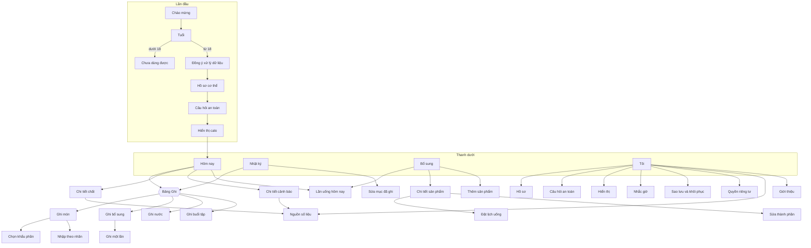
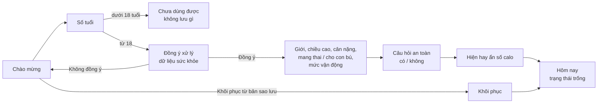
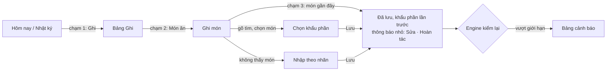
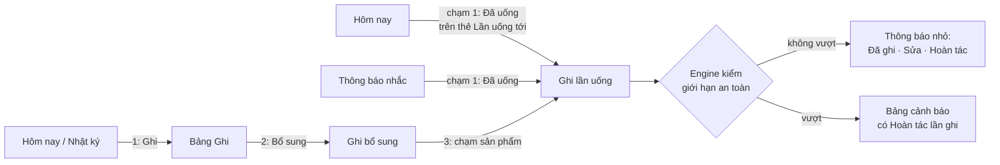
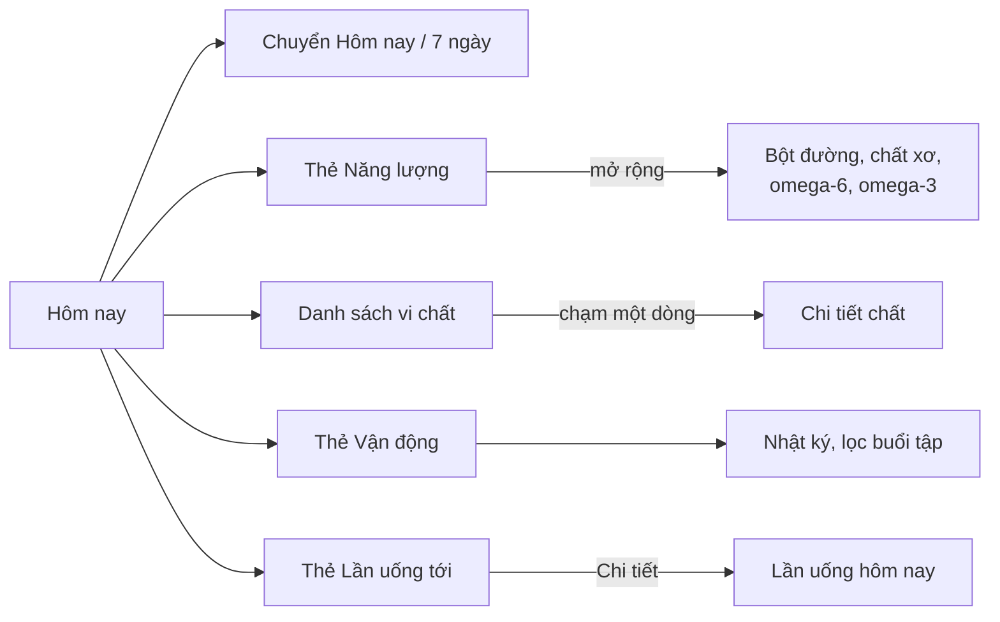
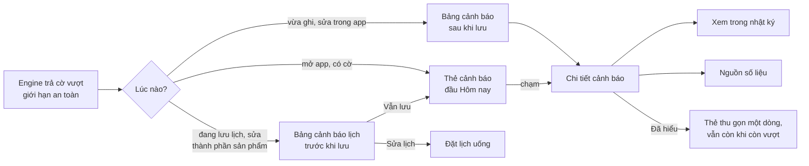

# Thiết kế UX: Tổng thể MVP

Trạng thái: Nháp  <!-- Nháp | Đã duyệt -->
Đặc tả: không có đặc tả riêng (tài liệu khung). Căn cứ: [docs/plan.md](../plan.md) (Phạm vi, Thực phẩm bổ sung, An toàn người dùng, Pháp lý), [docs/status.md](../status.md), code engine trong `packages/health_engine`.

Tài liệu này chốt **khung chung** cho mọi màn của MVP: sơ đồ màn hình, điều hướng, năm luồng chính, quy tắc cảnh báo, cách hiện thành phần bổ sung, bộ thành phần dùng chung và quy ước chữ, số. Mỗi tính năng (thư viện món, khảo sát, chụp nhãn và kho, lịch uống, sao lưu) vẫn có đặc tả và thiết kế UX riêng; tệp đó chỉ thêm chi tiết, không đổi khung ở đây khi chưa sửa tệp này.

## Quyết định chính

| Chủ đề | Quyết định |
|---|---|
| Điều hướng | Thanh dưới 4 mục: **Hôm nay · Nhật ký · Bổ sung · Tôi**. Nút nổi **Ghi** ở Hôm nay và Nhật ký |
| Ghi nhanh | Nút Ghi mở bảng chọn: Món ăn, Bổ sung, Nước, Buổi tập. Món ghi gần đây, lần uống theo lịch và nước ghi được trong ≤3 lần chạm |
| Ngày đang xem | Hôm nay và Nhật ký dùng chung một ngày đang xem; ghi mới vào ngày đó, tiêu đề bảng ghi luôn hiện ngày |
| Cảnh báo giới hạn an toàn | Chỉ khi **vượt** giới hạn (lớn hơn, không tính bằng). Ba loại: theo lịch uống, trong ngày, trung bình 7 ngày. Luôn đứng đầu Hôm nay, còn vượt thì còn hiện. Không chặn việc ghi hay lưu lịch, chỉ cảnh báo |
| Thành phần bổ sung | Lưu và tính **theo từng chất, từng dạng**; mọi phép so chạy trên từng dòng sau khi đổi đơn vị theo dạng |
| Ẩn số calo | Một công tắc chung (Tôi → Hiển thị, và biểu tượng mắt trên thẻ Năng lượng). Khi bật, **không màn nào hiện số kcal** |
| Quảng cáo | **MVP không có quảng cáo** và không cài SDK quảng cáo. Bố cục chừa ô (`AdSlot`, cao 0) ở cuối danh sách Nhật ký và cuối danh sách Kho. Không bao giờ ở Chi tiết chất, Chi tiết cảnh báo, các bảng ghi, lần đầu mở app, thông báo. Có đặt ở Hôm nay hay không: quyết định khi bật quảng cáo |
| Mạng | Không màn nào cần mạng; không có trạng thái "mất mạng" trừ sao lưu Google Drive |

## Dữ liệu mẫu dùng cho mọi wireframe

Mọi số trong wireframe lấy từ một tình huống duy nhất, để các màn khớp nhau. Số dinh dưỡng của món ăn là số minh họa, không phải số USDA.

- **Người dùng:** nữ, 35 tuổi, 160 cm, 55 kg, vận động nhẹ, không mang thai, không cho con bú. Nhóm tham chiếu: nữ 31–50 tuổi. Mục tiêu calo (minh họa): 2.000 kcal.
- **Thời điểm:** Thứ Hai 23/11/2026, 14:05.
- **Kho và lịch:**

  | Sản phẩm | Thành phần mỗi viên (đã chuẩn hóa) | Lịch | Kho |
  |---|---|---|---|
  | Canxi D3 | Canxi 500 mg (nhãn ghi canxi carbonat 1.250 mg); vitamin D3 10 µg | 1 viên 08:00, 1 viên 20:00 | Còn 42 viên, hết khoảng 14/12, HSD 06/2027 |
  | Vitamin tổng hợp | Vitamin A 750 µg (retinyl palmitat); vitamin A 300 µg (nhãn ghi 600 µg beta-caroten); vitamin D3 25 µg (1.000 IU); vitamin E 15 mg (d-alpha-tocopherol, 22,4 IU); niacin 20 mg (niacinamid); axit folic 400 µg; canxi 100 mg (nhãn ghi canxi citrat 476 mg); magie 150 mg (magie oxit); coenzyme Q10 30 mg | 1 viên 08:00 | Còn 30 viên, hết khoảng 23/12, HSD 03/2027 |
  | Magie | Magie 250 mg (magie citrat) | 1 viên 20:00 | Còn 5 viên, sắp hết |

- **Lịch vượt giới hạn:** magie từ bổ sung theo lịch = 150 + 250 = **400 mg/ngày**, giới hạn an toàn 350 mg/ngày. Người dùng đã chọn "Vẫn lưu" khi thêm Magie vào lịch.
- **Đã ghi tới 14:05:** đi bộ nhanh 30 phút (06:30); phở bò 1 bát (07:30); cà phê sữa 1 ly (08:00, 18 g đường bổ sung); Canxi D3 và Vitamin tổng hợp mỗi loại 1 viên (08:05); cơm trắng 1 bát, cá kho 1 khúc (12:10); nước 5 lần × 250 ml.
- **Tổng tới 14:05:** 1.150 kcal; đạm 62 g (22% năng lượng); béo 30%; bột đường 138 g (48%); chất xơ 9 g; đường bổ sung 18 g (6% năng lượng, bữa sáng quá 10 g). Canxi 770 mg (thực phẩm 170, bổ sung 600). Vitamin D 37 µg (thực phẩm 2, bổ sung 35). Magie từ bổ sung 150 mg (chưa vượt). Kali 1.400 mg.
- **Lúc 20:05** (sau khi bấm "Đã uống" lần 20:00): magie từ bổ sung **400 mg** → cờ vượt trong ngày.

## Sơ đồ màn hình



Màn thuộc tính năng sau (Thêm sản phẩm, Sửa thành phần, Đặt lịch uống, Nhắc giờ, Sao lưu và khôi phục) chỉ vẽ khung hoặc quy tắc ở đây; chi tiết ở thiết kế của tính năng đó.

## Luồng người dùng

### 1. Lần đầu mở app



- Hỏi tuổi **trước** màn đồng ý để không nhận đồng ý của người dưới 18 tuổi. Tuổi chỉ giữ trong bộ nhớ tới khi đồng ý; người dưới 18 không có gì được lưu.
- Thoát trước khi đồng ý: lần sau bắt đầu lại từ Chào mừng. Thoát sau khi đồng ý: lần sau mở lại đúng bước đang dở (phần đã nhập được lưu).
- Mỗi bước có nút Quay lại và thanh bước "n/5".
- Khôi phục từ bản sao lưu: vào thẳng Hôm nay. Nếu bản sao lưu chứa đồng ý theo phiên bản nội dung cũ hơn bản hiện tại, hiện lại màn đồng ý trước khi vào Hôm nay.

### 2. Ghi món



- Bữa (Sáng, Trưa, Tối, Phụ) tự chọn theo giờ; đổi bằng chip ở đầu màn.
- Món trong thư viện món Việt và món chọn "gần nhất" hiện nhãn **ước tính**.
- Giọng nói và mã vạch là biểu tượng trong ô tìm, chỉ hiện khi tính năng đó đã có và máy hỗ trợ.
- Món ăn cũng có thể làm vượt giới hạn (vd. retinol trong gan); khi đó Bảng cảnh báo thay cho thông báo nhỏ.

### 3. Ghi bổ sung



- Ghi một lần uống: trừ kho đúng hộp (hộp hết hạn sớm trước), cộng vào tổng nạp, kiểm lại giới hạn an toàn. Sửa hay xóa lần uống thì trả lại kho.
- **Gắn với lịch:** ghi cho hôm nay một sản phẩm đang có lần uống theo lịch **chưa đánh dấu** trong ngày → tự gắn vào lần chưa đánh dấu gần giờ hiện tại nhất, thông báo nhỏ ghi rõ "Đã ghi lần uống 20:00 theo lịch · Sửa · Hoàn tác". Không có lần nào chưa đánh dấu → ghi thành lần uống thêm. Ghi cho ngày khác hôm nay → luôn là lần uống thêm.
- Kho trống: màn Ghi bổ sung có "Thêm sản phẩm" và "Ghi một lần, không lưu kho".
- Bấm "Đã uống" từ thông báo mà làm vượt giới hạn: app gửi thêm thông báo chung "Có thông tin mới cần xem trong WholeWell" (không tên chất, không số); chạm vào mở Chi tiết cảnh báo. Thẻ cảnh báo chờ sẵn ở Hôm nay.

### 4. Xem tổng kết



- **Trung bình 7 ngày** (mọi chỗ trong app): chỉ chia cho **số ngày có ghi**, tức ngày có ít nhất một món ăn hoặc một lần uống, trong 7 ngày tới ngày đang xem. Luôn ghi rõ "Trung bình {n} ngày có ghi trong 7 ngày qua". Không có ngày nào: "Chưa có ngày nào được ghi trong 7 ngày qua."

### 5. Nhận cảnh báo



**Ba loại cờ** (đều so với giới hạn an toàn của nhóm tham chiếu hiện tại, đúng phạm vi từng chất):

| Cờ | Cách tính | Hiện ở |
|---|---|---|
| Lịch uống vượt | Tổng mỗi ngày theo mọi mục lịch của người đó: liều mỗi lần × số lần × hàm lượng mỗi đơn vị | Bảng cảnh báo lịch; thẻ ở Hôm nay; dòng cảnh báo ở sản phẩm trong Bổ sung |
| Vượt trong ngày | Tổng đã ghi thực tế trong ngày đang xem | Bảng cảnh báo sau khi lưu; thẻ ở Hôm nay |
| Trung bình 7 ngày vượt | Trung bình các ngày có ghi trong 7 ngày qua | Thẻ ở Hôm nay (cả hai chế độ) |

- **Mỗi chất một thẻ.** Một chất có nhiều loại cờ thì thẻ của chất đó liệt kê đủ các loại, theo thứ tự: trong ngày, 7 ngày, lịch. Các thẻ xếp theo mức vượt (% so với giới hạn) giảm dần.
- Chất có giới hạn tính mọi nguồn (vd. canxi, vitamin D): cờ lịch chỉ gồm bổ sung, nên ghi thêm "Chưa tính thức ăn; thức ăn sẽ cộng thêm khi bạn ghi nhật ký."
- Không có mức "sắp vượt" (app không tự đặt ngưỡng). Không có nút tắt cảnh báo vĩnh viễn. Cờ hết khi số liệu hết vượt (vd. xóa mục ghi nhầm, sửa lịch).

**Kiểm lại sau mọi thay đổi có thể làm vượt giới hạn:**

| Thay đổi | Cách báo |
|---|---|
| Lưu lịch mới, sửa lịch (đổi liều, số lần, thêm sản phẩm vào lịch) | Bảng cảnh báo lịch **trước khi lưu**: [Sửa lịch] (nút chính) · Vẫn lưu |
| Sửa thành phần sản phẩm đang có trong lịch (vd. sửa dòng nhãn đọc sai) | Bảng cảnh báo lịch trước khi lưu |
| Ghi, sửa lần uống hoặc món ăn | Bảng cảnh báo sau khi lưu |
| Sửa hồ sơ làm đổi nhóm tham chiếu (tuổi, giới tính, mang thai, cho con bú) | Bảng cảnh báo sau khi lưu hồ sơ, liệt kê mọi chất mới vượt |
| Tuổi, tuần thai, tháng sau sinh tự tăng | Thẻ cảnh báo ở Hôm nay |

**Các lưu ý không phải giới hạn an toàn** (kiểu khác, không dùng màu cảnh báo):

| Loại | Ví dụ | Hiện ở | Chi tiết ở |
|---|---|---|---|
| Lưu ý an toàn (theo câu hỏi an toàn) | Đang dùng thuốc kê đơn → hỏi bác sĩ hoặc dược sĩ trước khi dùng bổ sung; hút thuốc và dùng beta-caroten liều cao; bệnh về máu và sản phẩm có sắt | Ngay dưới các thẻ cảnh báo ở Hôm nay; trong Chi tiết sản phẩm liên quan | Thiết kế Khảo sát ban đầu |
| Lưu ý lịch (quy tắc có nguồn) | Canxi quá 500 mg một lần; canxi và sắt cùng một giờ | Trong màn Đặt lịch uống, trước khi lưu | Thiết kế Lịch uống |

## Danh sách màn hình

| Màn | Mục đích | Vào từ | Ra tới |
|---|---|---|---|
| Chào mừng | Nói app là công cụ tham chiếu, dữ liệu ở trên máy | Mở app lần đầu | Tuổi; Khôi phục |
| Tuổi | Số tuổi; chặn dưới 18 | Chào mừng | Đồng ý; Chưa dùng được |
| Chưa dùng được | Báo app dành cho người từ 18 tuổi | Tuổi | Đóng app |
| Đồng ý xử lý dữ liệu | Đồng ý riêng cho mục đích lưu và tính dữ liệu sức khỏe trên máy | Tuổi; khôi phục bản sao lưu cũ | Hồ sơ cơ thể; Chào mừng |
| Hồ sơ cơ thể | Giới, chiều cao, cân nặng, mang thai / cho con bú, mức vận động | Đồng ý | Câu hỏi an toàn |
| Câu hỏi an toàn | Câu có / không cho tầng an toàn | Hồ sơ cơ thể; Tôi | Hiển thị calo; Tôi |
| Hiển thị calo | Chọn hiện hay ẩn số calo | Câu hỏi an toàn | Hôm nay |
| **Hôm nay** | Cảnh báo, lưu ý, lần uống tới, năng lượng, vi chất, nước, vận động của ngày đang xem hoặc 7 ngày | Thanh dưới | Bảng Ghi, Chi tiết chất, Chi tiết cảnh báo, Lần uống hôm nay |
| **Nhật ký** | Mọi mục đã ghi của ngày đang xem, theo bữa | Thanh dưới | Bảng Ghi, Sửa mục |
| **Bổ sung** | Lần uống hôm nay và kho sản phẩm | Thanh dưới | Lần uống hôm nay, Chi tiết sản phẩm, Thêm sản phẩm |
| **Tôi** | Hồ sơ và cài đặt | Thanh dưới | Các màn cài đặt |
| Bảng Ghi | Chọn loại cần ghi | Nút Ghi | Ghi món / bổ sung / nước / buổi tập |
| Ghi món | Tìm món, món gần đây | Bảng Ghi | Chọn khẩu phần; Nhập theo nhãn; màn trước |
| Chọn khẩu phần | Đơn vị quen thuộc hoặc gram, số lượng | Ghi món | Màn trước |
| Nhập theo nhãn | Món không có trong thư viện: nhập số trên nhãn dinh dưỡng | Ghi món | Màn trước |
| Ghi bổ sung | Chọn sản phẩm trong kho | Bảng Ghi | Màn trước; Bảng cảnh báo; Ghi một lần; Thêm sản phẩm |
| Ghi một lần | Lần uống không lưu kho: nhập từng dòng thành phần | Ghi bổ sung | Màn trước; Bảng cảnh báo |
| Ghi nước | Lượng nước uống | Bảng Ghi | Màn trước |
| Ghi buổi tập | Hoạt động, giờ bắt đầu, thời lượng | Bảng Ghi | Màn trước |
| Sửa mục đã ghi | Sửa khẩu phần / liều, giờ, bữa; xóa | Nhật ký; thông báo nhỏ "Sửa" | Nhật ký |
| Lần uống hôm nay | Các lần uống theo lịch, đánh dấu từng loại | Hôm nay; Bổ sung; thông báo "Mở app" | Màn trước |
| Chi tiết chất | Lượng nạp so với mức khuyến nghị, giới hạn và phạm vi, đóng góp theo sản phẩm và dạng, 7 ngày | Hôm nay | Nguồn số liệu; Sửa mục |
| Chi tiết cảnh báo | Chất, lượng, giới hạn, phạm vi, mục góp vào, lời hỏi bác sĩ | Thẻ / bảng cảnh báo; thông báo chung | Nhật ký; Nguồn số liệu |
| Chi tiết sản phẩm | Thành phần mỗi khẩu phần theo từng chất và dạng, kho, lịch | Bổ sung | Đặt lịch uống; Sửa thành phần |
| Thêm sản phẩm | Quét mã / chụp nhãn / nhập tay → xác nhận từng dòng | Bổ sung; Ghi bổ sung | Chi tiết sản phẩm |
| Hồ sơ | Sửa tuổi và hồ sơ cơ thể | Tôi | Tôi; Bảng cảnh báo |
| Hiển thị | Ẩn số calo; sáng / tối | Tôi | Tôi |
| Quyền riêng tư | Xem và rút đồng ý, xuất dữ liệu, xóa toàn bộ | Tôi | Tôi; Chào mừng |
| Nguồn số liệu | Chuẩn, tổ chức, ngày tra, link, phiên bản gói dữ liệu | Tôi; Chi tiết chất; Chi tiết cảnh báo | Màn trước |
| Giới thiệu | Vai trò tham chiếu, phiên bản, giấy phép dữ liệu | Tôi | Tôi |

## Wireframe

Khung chiều rộng ~360 dp. `[ ]` là nút, `( )` là lựa chọn, `▓▒░` là thanh tiến độ. Số lấy từ mục Dữ liệu mẫu.

### Chào mừng

```
┌──────────────────────────────┐
│                              │
│          WholeWell           │
│                              │
│ So lượng vi chất bạn nạp từ  │
│ bữa ăn và thực phẩm bổ sung  │
│ với mức khuyến nghị.         │
│                              │
│ • Chỉ để tham khảo, không    │
│   thay lời khuyên của bác sĩ │
│ • Dữ liệu chỉ nằm trên máy   │
│   này, không gửi đi đâu      │
│ • Không cần mạng             │
│                              │
│ [      Bắt đầu            ]  │
│  Khôi phục từ bản sao lưu    │
└──────────────────────────────┘
```

### Tuổi

```
┌──────────────────────────────┐
│ ←                       1/5  │
├──────────────────────────────┤
│ Bạn bao nhiêu tuổi?          │
│                              │
│ Tuổi [ 35   ]                │
│                              │
│ Dùng để chọn mức tham chiếu  │
│ theo nhóm tuổi.              │
│                              │
│ [      Tiếp tục           ]  │
└──────────────────────────────┘
```

- Ô nhập số (bàn phím số), 1–120. Không hỏi năm, tháng, ngày sinh.
- App lưu số tuổi và ngày nhập. Cứ đủ 12 tháng kể từ ngày nhập, app tự cộng 1 tuổi và hiện một dòng ở đầu Hôm nay: "Tuổi trong hồ sơ đã được cập nhật thành 36. [Sửa]". Nhóm tham chiếu đổi theo, mọi cờ được kiểm lại.
- Dưới 18 → Chưa dùng được. Đúng 18 → đi tiếp; Hôm nay hiện "Chưa có mục tiêu calo cho người 18 tuổi" (xem Trạng thái).

### Chưa dùng được

```
┌──────────────────────────────┐
│                              │
│ WholeWell dành cho người từ  │
│ 18 tuổi.                     │
│                              │
│ [         Đóng            ]  │
└──────────────────────────────┘
```

- Không có nút Quay lại. Không lưu gì.

### Đồng ý xử lý dữ liệu

```
┌──────────────────────────────┐
│ ←                       2/5  │
├──────────────────────────────┤
│ Dữ liệu sức khỏe của bạn     │
│                              │
│ App lưu tuổi, chiều cao, cân │
│ nặng, món ăn, thực phẩm bổ   │
│ sung bạn ghi, để tính và so  │
│ với mức tham chiếu.          │
│                              │
│ • Lưu mã hóa trên máy này    │
│ • Không gửi cho ai, kể cả    │
│   nhóm phát triển            │
│ • Xem, sửa, xuất, xóa bất cứ │
│   lúc nào ở Tôi → Quyền      │
│   riêng tư                   │
│                              │
│ ☐ Tôi đồng ý cho app xử lý   │
│   dữ liệu sức khỏe của tôi   │
│   cho mục đích trên.         │
│   Đọc đầy đủ                 │
│                              │
│ [ Đồng ý và tiếp tục ]       │
│  Không đồng ý                │
└──────────────────────────────┘
```

- Ô đánh dấu không đánh sẵn; nút "Đồng ý và tiếp tục" tắt tới khi đánh dấu. Lưu ngày giờ và phiên bản nội dung đồng ý trên máy.
- Đồng ý cho nhắc giờ (quyền thông báo) và sao lưu Google Drive hỏi riêng lúc bật tính năng đó.
- "Không đồng ý": về Chào mừng, kèm dòng "App cần đồng ý này để tính toán. Bạn có thể quay lại bất cứ lúc nào."
- Lời văn đầy đủ ("Đọc đầy đủ") viết ở đặc tả Quyền riêng tư; căn cứ pháp lý ở [docs/plan.md](../plan.md), mục Pháp lý. Tài liệu này chỉ chốt yêu cầu giao diện: đồng ý riêng từng mục đích, ô không đánh sẵn, lưu bằng chứng trên máy, rút được bất cứ lúc nào.

### Hồ sơ cơ thể (và Hồ sơ từ Tôi)

```
┌──────────────────────────────┐
│ ←                       3/5  │
├──────────────────────────────┤
│ (chỉ ở Hồ sơ từ Tôi)         │
│ Tuổi       [ 35  ]           │
│                              │
│ Giới tính sinh học           │
│ ( ) Nam   (•) Nữ             │
│                              │
│ Chiều cao  [ 160 ] cm        │
│ Cân nặng   [ 55  ] kg        │
│                              │
│ (chỉ khi chọn Nữ)            │
│ Hiện tại                     │
│ (•) Không                    │
│ ( ) Đang mang thai           │
│     Tuần thai      [   ]     │
│     Cân nặng trước khi       │
│     mang thai      [   ] kg  │
│ ( ) Đang cho con bú          │
│     Số tháng sau sinh [   ]  │
│                              │
│ Mức vận động                 │
│ [ Vận động nhẹ          ▾ ]  │
│                              │
│ [      Tiếp tục           ]  │
└──────────────────────────────┘
```

- Ở Hồ sơ từ Tôi: có thêm ô Tuổi (tối thiểu 18), nút chính là "Lưu". Lưu xong kiểm lại mọi cờ; có chất mới vượt thì hiện Bảng cảnh báo.
- **Mang thai:** bắt buộc nhập tuần thai (1–42) và cân nặng trước khi mang thai (kg). App tự tính phân loại cân nặng trước khi mang thai từ số này và chiều cao, **không hiện tên phân loại**.
- **Cho con bú:** bắt buộc nhập số tháng sau sinh (0–36).
- **Tuần thai và tháng sau sinh tự tăng** theo ngày nhập (giống tuổi):
  - Qua tuần 42: Hôm nay hiện câu hỏi "Bạn đã sinh chưa?" với [Đã sinh, đang cho con bú] [Đã sinh, không cho con bú] [Sửa tuần thai]. Chọn "đang cho con bú" thì số tháng sau sinh bắt đầu từ 0.
  - Cho con bú đủ 12 tháng, sau đó cứ mỗi 6 tháng: hỏi "Bạn còn cho con bú không?" với [Còn] [Không].
- Mỗi lựa chọn mức vận động có một dòng mô tả bằng lời thường. Có buổi tập trong 7 ngày thì Hôm nay có thể hiện gợi ý đổi mức; người dùng xác nhận.
- Kiểm hợp lý: chiều cao 120–220 cm, cân nặng 30–250 kg; ngoài khoảng thì nhắc "Bạn kiểm tra lại số này nhé", không chặn cứng.

### Câu hỏi an toàn

```
┌──────────────────────────────┐
│ ←                       4/5  │
├──────────────────────────────┤
│ Vài câu hỏi có / không       │
│ Để app nhắc bạn hỏi bác sĩ   │
│ khi cần. Không hỏi tên bệnh  │
│ hay tên thuốc.               │
│                              │
│ Đang dùng thuốc kê đơn?      │
│ [ Có ] [ Không ] [ Không rõ ]│
│ ...                          │
│                              │
│ [      Tiếp tục           ]  │
└──────────────────────────────┘
```

- Danh sách câu hỏi, cách xử lý "Không rõ" và nội dung Lưu ý an toàn thuộc thiết kế Khảo sát ban đầu. Khi tính năng khảo sát chưa xong, bước này được bỏ qua và thanh bước là "n/4".

### Hiển thị calo

```
┌──────────────────────────────┐
│ ←                       5/5  │
├──────────────────────────────┤
│ Bạn muốn thấy số calo không? │
│                              │
│ ( ) Hiện số calo             │
│ ( ) Ẩn số calo               │
│     App vẫn tính, chỉ không  │
│     hiện con số.             │
│                              │
│ Đổi lại bất cứ lúc nào ở     │
│ Tôi → Hiển thị.              │
│                              │
│ [      Xong               ]  │
└──────────────────────────────┘
```

- Không chọn sẵn; nút Xong tắt cho tới khi chọn. Câu hỏi trung tính.

### Hôm nay

```
┌──────────────────────────────┐
│ Hôm nay      ‹ 23/11 ›       │
│ [ Hôm nay | 7 ngày ]         │
├──────────────────────────────┤
│ ┌ ⚠ Magie ─────────────────┐ │
│ │ Lịch uống vượt giới hạn  │ │
│ │ an toàn                  │ │
│ │ Theo lịch: 400 mg/ngày   │ │
│ │ từ bổ sung               │ │
│ │ Giới hạn: 350 mg/ngày    │ │
│ │ Hỏi bác sĩ hoặc dược sĩ  │ │
│ │              [Xem thêm ›]│ │
│ └──────────────────────────┘ │
│ ┌ Lần uống tới · 20:00 ────┐ │
│ │ Canxi D3, Magie · 2 loại │ │
│ │ [ Đã uống ]  [ Chi tiết ]│ │
│ └──────────────────────────┘ │
│ ┌ Năng lượng          [👁] ┐ │
│ │ 1.150 / 2.000 kcal       │ │
│ │ ▓▓▓▓▓▓░░░░               │ │
│ │ Đạm 62 g · mức khuyến    │ │
│ │ nghị 44 g                │ │
│ │ Đạm 22% · trong khoảng   │ │
│ │ 10–35%                   │ │
│ │ Béo 30% · trong khoảng   │ │
│ │ 20–35%                   │ │
│ │ Bột đường 48% · trong    │ │
│ │ khoảng 45–65%            │ │
│ │ Đường bổ sung: đến giờ   │ │
│ │ 18 g · 6% năng lượng     │ │
│ │ Bữa sáng có 18 g, quá    │ │
│ │ giới hạn 10 g mỗi bữa    │ │
│ │ [ Thêm ▾ ]               │ │
│ └──────────────────────────┘ │
│ Vi chất          [Tất cả ▾]  │
│ Canxi          770/1.000 mg  │
│ ▓▓▒▒▒▒▒▒░░ 77%               │
│ ▓ thực phẩm  ▒ bổ sung       │
│ Vitamin D         37/15 µg   │
│ ▒▒▒▒▒▒▒▒▒▒ 247%              │
│ Kali         1.400/2.600 mg  │
│ ▓▓▓▓▓░░░░░ 54% mức ước tính  │
│ ...                          │
│ ┌ Nước ────────────────────┐ │
│ │ Đã uống 1.250 ml [+250ml]│ │
│ └──────────────────────────┘ │
│ ┌ Vận động 7 ngày qua ─────┐ │
│ │ 120 phút vừa · 20 phút   │ │
│ │ mạnh · 1 ngày tập tăng cơ│ │
│ └──────────────────────────┘ │
│                      [+ Ghi] │
├──────────────────────────────┤
│ Hôm nay Nhật ký Bổ sung  Tôi │
└──────────────────────────────┘
```

- **Thứ tự cố định:** thẻ cảnh báo → lưu ý an toàn → dòng nhắc (tuổi tự cập nhật, câu hỏi thai kỳ, gợi ý mức vận động) → lần uống tới → năng lượng → vi chất → nước → vận động. Thẻ không có dữ liệu thì ẩn (trừ Năng lượng và Vi chất, hiện trạng thái trống).
- **‹ 23/11 ›**: lùi, tiến ngày; chạm vào ngày mở lịch chọn ngày; không tiến quá hôm nay. Tiêu đề đổi thành "Hôm qua" hoặc "Thứ Bảy, 21/11".
- **Chế độ 7 ngày:** mọi số là trung bình theo quy tắc ở luồng 4, kèm dòng "Trung bình {n} ngày có ghi trong 7 ngày qua"; thẻ Lần uống tới ẩn.
- **Thẻ Năng lượng:**
  - Calo: thanh một màu trung tính, không đổi màu khi vượt mục tiêu; không có chữ "còn được ăn". Ẩn số calo: bỏ dòng kcal và thanh; các dòng khác giữ nguyên (không có số kcal).
  - Đạm: gram so với mức khuyến nghị, và % năng lượng so với khoảng.
  - Tỷ lệ đạm, béo, bột đường ghi chữ "trong khoảng" / "dưới khoảng" / "trên khoảng"; không dùng màu xanh / đỏ.
  - **Đường bổ sung:** với hôm nay chỉ ghi "đến giờ: {g} · {x}% năng lượng", không kết luận vượt hằng ngày vì ngày chưa hết. Với ngày đã qua và chế độ 7 ngày: thêm "vượt giới hạn hằng ngày (10% năng lượng)" nếu vượt. Giới hạn mỗi bữa (10 g) báo ngay khi bữa đó vượt. Kiểu chữ cảnh báo nhẹ, không đỏ.
  - "Thêm ▾" mở rộng: bột đường 138 g · mức khuyến nghị 130 g; chất xơ 9 g · mức ước tính 25 g; omega-6, omega-3 so với mức ước tính.
- **Vi chất:** chỉ vitamin và khoáng chất có mức khuyến nghị hoặc mức ước tính, theo thứ tự trong gói dữ liệu; bộ lọc "Tất cả / Có bổ sung / Dưới mức khuyến nghị". Chất chỉ có giới hạn, không có mức (bo, niken, vanadi) chỉ xuất hiện khi có cảnh báo. Thanh chia hai đoạn thực phẩm và bổ sung, phân biệt bằng mật độ và chú thích chữ. Trên 100% thì thanh đầy, số % vẫn ghi đúng, không khen.
- **Nước:** chỉ hiện lượng nước đã uống, **không so với mức nào** (mức tham chiếu của Mỹ là tổng nước gồm cả nước trong thức ăn). Nút nhanh dùng lượng ghi gần nhất (mặc định 250 ml).
- **Vận động:** luôn là 7 ngày gần nhất tới ngày đang xem; chỉ hiện số phút và số ngày, không so với mức nào (xem Câu hỏi còn mở).
- Chạm dòng vi chất → Chi tiết chất. Chạm thẻ Vận động → Nhật ký lọc buổi tập. **Không có ô quảng cáo** ở màn này.

### Bảng Ghi

```
┌──────────────────────────────┐
│ Ghi cho hôm nay, 23/11       │
│ ┌──────────┐ ┌──────────┐    │
│ │  🍜      │ │  💊      │    │
│ │ Món ăn   │ │ Bổ sung  │    │
│ └──────────┘ └──────────┘    │
│ ┌──────────┐ ┌──────────┐    │
│ │  💧      │ │  🏃      │    │
│ │ Nước     │ │ Buổi tập │    │
│ └──────────┘ └──────────┘    │
└──────────────────────────────┘
```

- Bảng trượt từ dưới lên. Đang xem ngày khác hôm nay thì tiêu đề in đậm ngày đó ("Ghi cho thứ Bảy, 21/11").

### Ghi món

```
┌──────────────────────────────┐
│ ←  Ghi món                   │
│ [Sáng] [Trưa✓] [Tối] [Phụ]   │
│ ┌──────────────────────────┐ │
│ │ 🔍 Tìm món...      🎤 ▥  │ │
│ └──────────────────────────┘ │
├──────────────────────────────┤
│ Gần đây                      │
│ Cơm trắng · 1 bát            │
│ Cá kho · 1 khúc      ước tính│
│ Cà phê sữa · 1 ly    ước tính│
│ Phở bò · 1 bát       ước tính│
│ ...                          │
│ Không thấy món?              │
│ [ Nhập theo nhãn ]           │
└──────────────────────────────┘
```

- Chạm một món gần đây: lưu ngay với khẩu phần lần trước, quay về màn trước, hiện thông báo nhỏ "Đã ghi Cơm trắng, 1 bát · Sửa · Hoàn tác" (7 giây).
- Gõ tìm: kết quả thay cho Gần đây; chạm kết quả → Chọn khẩu phần.
- Ẩn số calo bật: không hiện kcal ở kết quả và khẩu phần.

### Chọn khẩu phần

```
┌──────────────────────────────┐
│ Phở bò               ước tính│
│ [ Bát ] [ Gram ]             │
│ Số lượng  [ − ]  1  [ + ]    │
│           (½, 1, 1½, 2…)     │
│ Khoảng 450 kcal              │
│ [         Lưu             ]  │
└──────────────────────────────┘
```

- Bảng trượt lên. Đơn vị quen thuộc lấy từ thư viện món (bát, đĩa, cái…); luôn có Gram. Dòng kcal đi qua `CalorieText`.

### Nhập theo nhãn

```
┌──────────────────────────────┐
│ ←  Nhập theo nhãn            │
├──────────────────────────────┤
│ Tên món   [ Sữa chua uống  ] │
│ Số trên nhãn tính cho        │
│ [ 100 ] [ ml ▾ ]             │
│ Bạn đã dùng [ 180 ] ml       │
│                              │
│ Năng lượng      [  ] kcal    │
│ Đạm             [  ] g       │
│ Béo             [  ] g       │
│ Bột đường       [  ] g       │
│ Đường (tổng)    [  ] g       │
│ Đường bổ sung   [  ] g       │
│  (chỉ khi nhãn ghi riêng)    │
│ Natri           [  ] mg      │
│ [ + Thêm vi chất trên nhãn ] │
│                              │
│ ☐ Lưu để dùng lại            │
│ [         Lưu             ]  │
└──────────────────────────────┘
```

- **Đường tổng không tính là đường bổ sung.** Nhãn không ghi riêng đường bổ sung thì món được đánh dấu "chưa rõ đường bổ sung"; thẻ Năng lượng ghi "Chưa tính đường bổ sung của {n} món" dưới dòng đường bổ sung.
- **Vi chất trên nhãn thực phẩm:** niacin, vitamin E, axit folic có trên nhãn thì được coi là **tăng cường** và tính vào giới hạn an toàn (cách thận trọng), vì nhãn không tách phần tự nhiên.
- Mỗi số qua kiểm hợp lý đơn vị (vd. nghi nhầm mg với µg).

### Ghi bổ sung

```
┌──────────────────────────────┐
│ ←  Ghi bổ sung · 14:05       │
├──────────────────────────────┤
│ Trong kho                    │
│ Canxi D3 · 1 viên            │
│  lần 20:00 chưa đánh dấu     │
│ Magie · 1 viên               │
│  lần 20:00 chưa đánh dấu     │
│ Vitamin tổng hợp · 1 viên    │
│                              │
│ [ Ghi một lần, không lưu kho]│
│ [ + Thêm sản phẩm ]          │
└──────────────────────────────┘
```

- Chạm sản phẩm: lưu với liều theo lịch (không có lịch thì 1 khẩu phần), giờ hiện tại; gắn vào lần chưa đánh dấu theo quy tắc ở luồng 3. Ví dụ chạm "Magie" lúc 14:05: gắn vào lần 20:00, magie từ bổ sung thành 400 mg → Bảng cảnh báo thay cho thông báo nhỏ.
- Chạm "14:05" để đổi giờ (uống muộn, ghi bù).

### Ghi một lần

```
┌──────────────────────────────┐
│ ←  Ghi một lần · 14:05       │
├──────────────────────────────┤
│ Tên (không bắt buộc)         │
│ [ Viên sủi vitamin C       ] │
│                              │
│ Thành phần đã uống           │
│ ┌──────────────────────────┐ │
│ │ Chất  [ Vitamin C     ▾ ]│ │
│ │ Lượng [ 1000 ] [ mg ▾ ]  │ │
│ │ Dạng  [ Nhãn không ghi▾ ]│ │
│ └──────────────────────────┘ │
│ [ + Thêm chất ]              │
│                              │
│ [         Lưu             ]  │
└──────────────────────────────┘
```

- Dùng cùng bộ nhập thành phần với Thêm sản phẩm: mỗi dòng một chất, một dạng; kiểm hợp lý đơn vị; quy tắc hợp chất và dạng chưa rõ như ở Chi tiết sản phẩm. Ô Dạng chỉ hiện với chất mà dạng ảnh hưởng tới phép tính.

### Ghi nước

```
┌──────────────────────────────┐
│ Ghi nước · 14:05             │
│ [150 ml] [250 ml✓] [500 ml]  │
│ Số khác [      ] ml          │
│ [         Lưu             ]  │
└──────────────────────────────┘
```

- Bảng trượt lên. Chạm một lựa chọn rồi Lưu; lần sau lựa chọn gần nhất được chọn sẵn và dùng cho nút nhanh ở Hôm nay.

### Ghi buổi tập

```
┌──────────────────────────────┐
│ ←  Ghi buổi tập              │
├──────────────────────────────┤
│ Hoạt động                    │
│ [ 🔍 Đi bộ nhanh 5,6–6,3 km/h]│
│ Bắt đầu   [ 06:30 ]          │
│ Thời lượng [ 30 ] phút       │
│                              │
│ Khoảng 130 kcal · vận động   │
│ vừa                          │
│ [         Lưu             ]  │
└──────────────────────────────┘
```

- Cường độ nằm trong tên hoạt động (vd. "Chạy 8,0–8,4 km/h", "HIIT mức vừa"), chọn từ danh sách hoạt động có trong gói dữ liệu.
- Dòng kcal đi qua `CalorieText` và ghi "khoảng"; "vận động vừa / mạnh" theo số MET của hoạt động. Không có chữ "đốt", không cộng vào mục tiêu calo.

### Nhật ký

```
┌──────────────────────────────┐
│ Nhật ký      ‹ 23/11 ›       │
├──────────────────────────────┤
│ Sáng                         │
│  Phở bò · 1 bát        07:30 │
│  Cà phê sữa · 1 ly     08:00 │
│ Trưa                         │
│  Cơm trắng · 1 bát     12:10 │
│  Cá kho · 1 khúc       12:10 │
│ Bổ sung                      │
│  Canxi D3 · 1 viên     08:05 │
│  Vitamin tổng hợp ·    08:05 │
│  1 viên                      │
│ Nước  1.250 ml (5 lần)       │
│ Buổi tập                     │
│  Đi bộ nhanh · 30 phút 06:30 │
│                              │
│ ┌ (ô quảng cáo, khi bật) ──┐ │
│ └──────────────────────────┘ │
│                      [+ Ghi] │
├──────────────────────────────┤
│ Hôm nay Nhật ký Bổ sung  Tôi │
└──────────────────────────────┘
```

- Chạm một dòng → Sửa mục đã ghi. Chạm dòng Nước → danh sách từng lần để sửa, xóa.
- kcal bên phải mỗi món và buổi tập chỉ hiện khi không ẩn số calo.
- Ô quảng cáo ở cuối danh sách, cao 0 ở MVP.

### Sửa mục đã ghi

```
┌──────────────────────────────┐
│ ←  Phở bò                    │
├──────────────────────────────┤
│ Khẩu phần [ Bát ] [−] 1 [+]  │
│ Bữa  [Sáng✓] [Trưa] [Tối]    │
│ Giờ  [ 07:30 ]               │
│                              │
│ [         Lưu             ]  │
│                              │
│  Xóa khỏi nhật ký            │
└──────────────────────────────┘
```

- Lần uống bổ sung: sửa liều và giờ; xóa thì trả lại kho và bỏ đánh dấu lần uống theo lịch (nếu có).
- Xóa hỏi lại: "Xóa “Phở bò” khỏi nhật ký? · Xóa · Hủy". Lưu xong kiểm lại mọi cờ.

### Bổ sung

```
┌──────────────────────────────┐
│ Bổ sung                      │
├──────────────────────────────┤
│ Hôm nay              [Xem ›] │
│  ✓ 08:00 Canxi D3, Vitamin   │
│          tổng hợp            │
│  ○ 20:00 Canxi D3, Magie     │
│           [ Đã uống ]        │
│ Kho                          │
│ ┌──────────────────────────┐ │
│ │ Canxi D3                 │ │
│ │ Còn 42 viên · hết khoảng │ │
│ │ 14/12 · HSD 06/2027      │ │
│ └──────────────────────────┘ │
│ ┌──────────────────────────┐ │
│ │ Vitamin tổng hợp         │ │
│ │ Còn 30 viên · hết khoảng │ │
│ │ 23/12 · HSD 03/2027      │ │
│ └──────────────────────────┘ │
│ ┌──────────────────────────┐ │
│ │ Magie                    │ │
│ │ Còn 5 viên · sắp hết     │ │
│ │ ⚠ Lịch vượt giới hạn an  │ │
│ │ toàn (magie)             │ │
│ └──────────────────────────┘ │
│ ┌ (ô quảng cáo, khi bật) ──┐ │
│ └──────────────────────────┘ │
│             [+ Thêm sản phẩm]│
├──────────────────────────────┤
│ Hôm nay Nhật ký Bổ sung  Tôi │
└──────────────────────────────┘
```

- Phần "Hôm nay" chỉ có khi đã đặt lịch. Chưa có lịch: "Chưa có lịch uống. Mở một sản phẩm để đặt lịch."
- Dòng cảnh báo lịch hiện ở **mọi sản phẩm góp vào** chất bị vượt (ở đây Magie và Vitamin tổng hợp; wireframe chỉ vẽ một).
- "Sắp hết", "Sắp hết hạn", "Đã hết hạn" ghi bằng chữ, kèm biểu tượng. Hộp đã hết hạn không vào lịch.
- Không có link cửa hàng, không gợi ý sản phẩm.

### Lần uống hôm nay

```
┌──────────────────────────────┐
│ ←  Lần uống hôm nay          │
├──────────────────────────────┤
│ 08:00                        │
│  ✓ Canxi D3 · 1 viên         │
│    Đã uống 08:05             │
│  ✓ Vitamin tổng hợp · 1 viên │
│    Đã uống 08:05             │
│ 20:00                        │
│  ○ Canxi D3 · 1 viên         │
│    [ Đã uống ] [ Bỏ qua ]    │
│  ○ Magie · 1 viên            │
│    [ Đã uống ] [ Bỏ qua ]    │
│  [ Đã uống cả 2 ]            │
└──────────────────────────────┘
```

- Chạm giờ "Đã uống 08:05" để sửa giờ thực tế (uống muộn). Ba trạng thái: đã uống, bỏ qua, chưa ghi. Bỏ qua không trừ kho.
- Mỗi lần "Đã uống" đi qua kiểm giới hạn như ở luồng 3. Nhắc lại và dời lịch khi uống muộn thuộc thiết kế Lịch uống.

### Chi tiết chất

```
┌──────────────────────────────┐
│ ←  Canxi                     │
│ [ Hôm nay | 7 ngày ]         │
├──────────────────────────────┤
│ 770 mg                       │
│ 77% mức khuyến nghị 1.000 mg │
│ ▓▓▒▒▒▒▒▒░░                   │
│ Từ thực phẩm   170 mg        │
│ Từ bổ sung     600 mg        │
│                              │
│ Giới hạn an toàn             │
│ 2.500 mg/ngày · tính mọi     │
│ nguồn                        │
│                              │
│ Đóng góp hôm nay             │
│  Canxi D3 · 1 viên    500 mg │
│   dạng canxi carbonat        │
│  Vitamin tổng hợp ·   100 mg │
│  1 viên                      │
│   dạng canxi citrat          │
│  Cà phê sữa · 1 ly     90 mg │
│  Phở bò · 1 bát        40 mg │
│  Cá kho · 1 khúc       30 mg │
│  Cơm trắng · 1 bát     10 mg │
│ 7 ngày qua                   │
│  ▁▃▅▂▆▃▄ (cột theo ngày)     │
│                              │
│ Mức này áp dụng cho nữ 31–50 │
│ tuổi. Nguồn số liệu ›        │
└──────────────────────────────┘
```

- Chất dùng mức ước tính: dòng thứ hai là "{x}% mức ước tính {y}" và một câu "Chưa đủ dữ liệu để đặt mức khuyến nghị chính thức; đây là mức ước tính."
- **Đóng góp tách theo từng sản phẩm và từng dạng.** Với vitamin A và folate (giới hạn chỉ tính một dạng), mỗi dòng ghi "tính vào giới hạn" hoặc "không tính vào giới hạn", và màn hiện hai tổng. Ví dụ vitamin A từ Vitamin tổng hợp: "1.050 µg so với mức khuyến nghị · 750 µg retinol tính vào giới hạn 3.000 µg".
- Với niacin, vitamin E, magie (giới hạn tính theo nguồn), mỗi dòng ghi nguồn: "từ bổ sung", "từ thực phẩm tăng cường", "từ thực phẩm".
- Dòng có số đổi từ nhãn (hợp chất, IU) ghi số gốc nhỏ bên dưới. Dòng "chưa rõ dạng" ghi "chưa chắc" cạnh số so với mức khuyến nghị.
- Biểu đồ 7 ngày có bảng số thay thế cho trình đọc màn hình. Không có ô quảng cáo.

### Chi tiết cảnh báo

Ví dụ lúc 20:05, sau khi bấm "Đã uống" lần 20:00.

```
┌──────────────────────────────┐
│ ←  Cảnh báo                  │
├──────────────────────────────┤
│ ⚠ Magie vượt giới hạn an toàn│
│                              │
│ Hôm nay từ bổ sung: 400 mg   │
│ Giới hạn an toàn: 350 mg/ngày│
│ Giới hạn này tính magie từ   │
│ thực phẩm bổ sung và thuốc,  │
│ không tính từ thức ăn. App   │
│ chỉ có phần bổ sung bạn ghi. │
│                              │
│ Lịch uống: 400 mg/ngày, cũng │
│ vượt giới hạn.               │
│                              │
│ Các mục góp vào              │
│  Vitamin tổng hợp ·   150 mg │
│  1 viên · 08:05              │
│  Magie · 1 viên ·     250 mg │
│  20:05                       │
│                              │
│ Hãy hỏi bác sĩ hoặc dược sĩ  │
│ về lượng bạn đang dùng.      │
│                              │
│ [ Xem trong nhật ký ]        │
│ [ Đã hiểu ]                  │
│ Nguồn số liệu ›              │
└──────────────────────────────┘
```

- **Bảng cảnh báo** (sau khi ghi, sửa): cùng nội dung, dạng bảng trượt lên che 3/4 màn, nút [Đã hiểu] [Xem chi tiết] và nút chữ "Hoàn tác lần ghi". Không tự đóng.
- Trung bình 7 ngày: thêm khối "Trung bình {n} ngày có ghi trong 7 ngày qua: {x} mg/ngày".
- Ngày đang xem khác hôm nay: "Hôm nay" đổi thành ngày đó.
- Đang mang thai hoặc cho con bú: thêm câu "Giới hạn này dành cho người đang mang thai" (hoặc cho con bú).
- Không có câu "hãy ngừng", "nên giảm"; không nhắc tên thuốc. Không có ô quảng cáo, không chèn quảng cáo khi đóng bảng.

### Bảng cảnh báo lịch

Ví dụ lúc thêm Magie vào lịch.

```
┌──────────────────────────────┐
│ ⚠ Lịch này vượt giới hạn an  │
│   toàn                       │
│                              │
│ Magie từ bổ sung theo lịch:  │
│ 400 mg/ngày                  │
│ Giới hạn an toàn: 350 mg/ngày│
│ (tính từ thực phẩm bổ sung   │
│ và thuốc)                    │
│                              │
│ Góp vào                      │
│  Vitamin tổng hợp · 1 viên   │
│  × 1 lần/ngày         150 mg │
│  Magie · 1 viên              │
│  × 1 lần/ngày         250 mg │
│                              │
│ Hãy hỏi bác sĩ hoặc dược sĩ  │
│ về lượng bạn định dùng.      │
│                              │
│ [ Sửa lịch ]                 │
│   Vẫn lưu                    │
└──────────────────────────────┘
```

- "Vẫn lưu" là nút chữ, không phải nút chính; không có ô "Không nhắc lại".
- Chất có giới hạn tính mọi nguồn: thêm "Chưa tính thức ăn; thức ăn sẽ cộng thêm khi bạn ghi nhật ký."
- Chất trong lịch mà engine chưa kiểm được (xem Chi tiết sản phẩm, hợp chất không có tỷ lệ): thêm dòng "Chưa kiểm được giới hạn an toàn cho {chất} trong {sản phẩm}."

### Chi tiết sản phẩm

Một sản phẩm bổ sung thường có nhiều chất. App lưu và tính **theo từng chất**: mỗi dòng thành phần có chất, dạng, lượng mỗi khẩu phần, đơn vị. Engine đổi đơn vị theo dạng, xếp từng dòng vào đúng phạm vi giới hạn, rồi mới cộng theo chất; giao diện không tự tính.

```
┌──────────────────────────────┐
│ ←  Vitamin tổng hợp      [⋮] │
├──────────────────────────────┤
│ 1 khẩu phần = 1 viên         │
│ Còn 30 viên · hết khoảng     │
│ 23/12 · HSD 03/2027          │
│ ⚠ Lịch vượt giới hạn an toàn │
│ (magie)                    › │
│                              │
│ Thành phần mỗi viên  (9)     │
│ Vitamin A        750 µg      │
│  dạng retinyl palmitat       │
│  · tính vào giới hạn         │
│ Vitamin A        300 µg      │
│  dạng beta-caroten           │
│  (nhãn ghi 600 µg)           │
│  · không tính vào giới hạn   │
│ Vitamin D3       25 µg       │
│  (nhãn ghi 1.000 IU)         │
│ Vitamin E        15 mg       │
│  dạng d-alpha-tocopherol     │
│  (nhãn ghi 22,4 IU)          │
│ Niacin           20 mg       │
│  dạng niacinamid             │
│ Axit folic       400 µg      │
│  · tính vào giới hạn         │
│ Canxi            100 mg      │
│  dạng canxi citrat           │
│  (nhãn ghi 476 mg)           │
│ Magie            150 mg      │
│  dạng magie oxit             │
│ Coenzyme Q10     30 mg       │
│  không có mức tham chiếu,    │
│  không tính                  │
│ [ Sửa thành phần ]           │
│                              │
│ Lịch uống                    │
│  Mỗi ngày 1 viên · 08:00     │
│  [ Đặt lịch ]                │
│ Ảnh nhãn ›                   │
└──────────────────────────────┘
```

- **Mỗi dòng một chất và một dạng.** Cùng một chất ở hai dạng (retinyl palmitat và beta-caroten) là hai dòng, vì cách đổi đơn vị và phạm vi giới hạn khác nhau.
- **Số hiện là số đã chuẩn hóa** theo đơn vị của app; số gốc trên nhãn ghi nhỏ bên dưới nếu khác.
- **Phạm vi giới hạn:** chỉ vitamin A (chỉ tính retinol) và folate (chỉ tính axit folic) phụ thuộc dạng, nên chỉ hai chất này ghi "tính / không tính vào giới hạn". Niacin, vitamin E, magie tính theo nguồn: mọi lượng trong sản phẩm bổ sung đều tính, kể cả vitamin E dạng tự nhiên.
- **Lượng là lượng nguyên tố** (canxi, sắt, magie, kẽm…). Nhãn chỉ ghi khối lượng hợp chất: engine đổi bằng tỷ lệ nguyên tố có trong gói dữ liệu (lấy từ fact sheet NIH ODS, vd. canxi carbonat 40%, canxi citrat 21%, sắt fumarat 33%, sắt sulfat 20%, sắt gluconat 12%). Hợp chất không có tỷ lệ trong gói: dòng ghi "chưa tính được" kèm lý do, và sản phẩm hiện "Chưa kiểm được giới hạn an toàn cho {chất} trong sản phẩm này."
- **Dạng chưa rõ** (nhãn không ghi dạng, chỉ hỏi với vitamin A, folate, và vitamin E khi nhãn ghi IU): dòng có ⓘ và chữ "chưa rõ dạng". Giới hạn an toàn tính theo **cách thận trọng nhất**: vitamin A coi là retinol, folate coi là axit folic, vitamin E đổi IU theo hệ số dạng tự nhiên (ra số mg lớn hơn). Số so với mức khuyến nghị ghi "chưa chắc". Đây là quy tắc của app, không phải chuẩn.
- **Chất không có trong gói dữ liệu** (CoQ10, collagen, chiết xuất thảo dược…): vẫn lưu đúng như nhãn để người dùng xem, ghi "không có mức tham chiếu, không tính". Không cảnh báo, không giải thích công dụng.
- Beta-caroten "không tính vào giới hạn" không có nghĩa là không có lưu ý: người hút thuốc nhận Lưu ý an toàn (thiết kế Khảo sát).
- **Sửa thành phần** lưu xong thì kiểm lại cờ lịch (Bảng cảnh báo lịch nếu vượt). Không có ô quảng cáo, không link cửa hàng.

### Tôi

```
┌──────────────────────────────┐
│ Tôi                          │
├──────────────────────────────┤
│ Hồ sơ                      › │
│  Nữ · 35 tuổi · 160 cm ·     │
│  55 kg                       │
│ Câu hỏi an toàn            › │
│ Hiển thị                   › │
│  Đang hiện số calo           │
│ Nhắc giờ                   › │
│ Sao lưu và khôi phục       › │
│  Chưa sao lưu                │
│ Quyền riêng tư             › │
│ Nguồn số liệu              › │
│ Giới thiệu                 › │
├──────────────────────────────┤
│ Hôm nay Nhật ký Bổ sung  Tôi │
└──────────────────────────────┘
```

### Hiển thị

```
┌──────────────────────────────┐
│ ←  Hiển thị                  │
├──────────────────────────────┤
│ Ẩn số calo           [  ○ ]  │
│ App vẫn tính, chỉ không hiện │
│ con số.                      │
│                              │
│ Giao diện                    │
│ (•) Theo máy                 │
│ ( ) Sáng                     │
│ ( ) Tối                      │
│                              │
│ Cỡ chữ theo cài đặt của máy. │
└──────────────────────────────┘
```

### Quyền riêng tư

```
┌──────────────────────────────┐
│ ←  Quyền riêng tư            │
├──────────────────────────────┤
│ Đồng ý đã cho                │
│  Xử lý dữ liệu sức khỏe      │
│  23/11/2026 09:12            │
│  [ Rút đồng ý ]              │
│  Nhắc giờ: chưa bật          │
│  Sao lưu Google Drive: chưa  │
│  bật                         │
│                              │
│ [ Xuất dữ liệu ]             │
│ [ Xóa toàn bộ dữ liệu ]      │
└──────────────────────────────┘
```

- **Rút đồng ý xử lý dữ liệu sức khỏe** = xóa toàn bộ dữ liệu và về Chào mừng. Hỏi lại trước: "Rút đồng ý sẽ xóa mọi dữ liệu trên máy này. Bạn có bản sao lưu nếu muốn dùng lại sau."
- **Xuất dữ liệu:** tệp đọc được, không mã hóa; trước khi xuất cảnh báo "Tệp này không được mã hóa. Ai có tệp đều đọc được."
- **Xóa toàn bộ:** gõ "XÓA" để xác nhận. Nút màu đỏ (`error`).

### Nguồn số liệu

```
┌──────────────────────────────┐
│ ←  Nguồn số liệu             │
├──────────────────────────────┤
│ Mức khuyến nghị (RDA) và mức │
│ ước tính (AI)                │
│  NASEM, số liệu qua NIH ODS  │
│  Tra ngày … · Mở link ›      │
│ Giới hạn an toàn (UL)        │
│  NASEM · Tra ngày … · ›      │
│ Mục tiêu calo (EER)          │
│  NASEM 2023 · ›              │
│ Tỷ lệ đạm, béo, bột đường    │
│ (AMDR) · NASEM · ›           │
│ Đường bổ sung · Dietary      │
│ Guidelines 2025–2030 · ›     │
│ Vận động (MET) · 2024 Adult  │
│ Compendium · ›               │
│ Thực phẩm · USDA FoodData    │
│ Central · ›                  │
│                              │
│ Gói dữ liệu phiên bản …      │
└──────────────────────────────┘
```

- Màn duy nhất được ghi tên chuẩn và tên tổ chức, kèm giải thích một câu bằng lời thường cho mỗi chuẩn. Link mở trình duyệt ngoài app. Danh sách lấy từ gói dữ liệu, không viết tay.

### Giới thiệu

```
┌──────────────────────────────┐
│ ←  Giới thiệu                │
├──────────────────────────────┤
│ WholeWell phiên bản …        │
│                              │
│ App để tham khảo: so lượng   │
│ bạn nạp với mức tham chiếu.  │
│ Không chẩn đoán, không kê    │
│ đơn, không gợi ý liều.       │
│                              │
│ Dữ liệu thực phẩm: USDA      │
│ FoodData Central (CC0)       │
│ Giấy phép mã nguồn mở ›      │
└──────────────────────────────┘
```

### Thông báo nhắc giờ (khung)

```
┌──────────────────────────────┐
│ WholeWell · 20:00            │
│ Đến giờ uống, 2 loại         │
│ [ Đã uống ]   [ Mở app ]     │
└──────────────────────────────┘
```

- Màn hình khóa chỉ hiện nội dung chung. "Đã uống" đánh dấu mọi loại trong lần nhắc; "Mở app" mở Lần uống hôm nay để đánh dấu từng loại.
- "Đã uống" làm vượt giới hạn: thêm thông báo chung "Có thông tin mới cần xem trong WholeWell", không tên chất, không số; chạm mở Chi tiết cảnh báo. Đây là thông báo duy nhất về cảnh báo; không có quảng cáo trong thông báo.
- Nhắc lại, số lần nhắc, dời lịch thuộc thiết kế Lịch uống.

## Bộ thành phần dùng chung

Đặt trong `app/lib/ui/common/`. Mọi màn dùng các thành phần này, không tự vẽ lại.

| Thành phần | Dùng ở | Nội dung | Hành vi, trợ năng |
|---|---|---|---|
| `MetricCard` (thẻ chỉ số) | Hôm nay | Tiêu đề, số chính, dòng phụ, nút hành động tùy chọn | Cả thẻ là một vùng chạm ≥48 dp; nhãn đọc màn hình gộp tiêu đề + số |
| `LabeledProgress` (thanh tiến độ có nhãn) | Vi chất, calo, chi tiết chất | Giá trị, mục tiêu, %, tối đa hai đoạn (thực phẩm, bổ sung) | Luôn có số bằng chữ; đoạn phân biệt bằng mật độ + chú thích; không bao giờ đổi màu đỏ; đọc: "Canxi, 770 trên 1.000 miligam, 77 phần trăm mức khuyến nghị" |
| `WarningCard` (thẻ cảnh báo) | Hôm nay, bảng cảnh báo, chi tiết sản phẩm | Biểu tượng ⚠, chất, các loại cờ, lượng, giới hạn, phạm vi, lời hỏi bác sĩ | Màu cảnh báo + biểu tượng + chữ "vượt giới hạn an toàn"; mở / thu gọn một dòng; trình đọc màn hình đọc trước các thẻ khác |
| `SafetyNote` (lưu ý an toàn, lưu ý lịch) | Hôm nay, chi tiết sản phẩm, đặt lịch | Biểu tượng ⓘ, một hai câu | Màu trung tính, không dùng màu cảnh báo; có chữ "Lưu ý" |
| `NutrientRow` (dòng vi chất) | Hôm nay | Tên, số, %, "mức ước tính" nếu là mức ước tính, `LabeledProgress` | Chạm mở Chi tiết chất; cỡ chữ lớn thì số xuống dòng dưới tên |
| `IngredientRow` (dòng thành phần) | Chi tiết sản phẩm, xác nhận nhãn, ghi một lần, chi tiết chất, cảnh báo | Chất, lượng đã chuẩn hóa, số gốc trên nhãn, dạng hoặc nguồn, "tính / không tính vào giới hạn", "chưa rõ dạng", "chưa tính được", "không có mức tham chiếu" | Mọi trạng thái ghi bằng chữ; đọc: "Vitamin A, 750 microgam, dạng retinyl palmitat, tính vào giới hạn an toàn" |
| `EstimateChip` (nhãn ước tính) | Món ăn, mức ước tính | Chữ "ước tính" | Có chữ, không chỉ biểu tượng |
| `CalorieText` | Mọi chỗ có kcal | Số kcal hoặc không gì cả | Đọc công tắc ẩn số calo; khi ẩn không chiếm chỗ, không để "***" |
| `DaySwitcher` (chọn ngày) | Hôm nay, Nhật ký | ‹ ngày › | Hai nút mũi tên 48 dp; chạm ngày mở lịch |
| `LogSheet` (bảng Ghi) | Nút Ghi | 4 ô lựa chọn, tiêu đề có ngày | Ô ≥ 96 dp; đóng bằng vuốt xuống hoặc nút Quay lại |
| `EntryTile` (dòng nhật ký) | Nhật ký, chi tiết | Tên, khẩu phần, giờ, kcal (qua `CalorieText`) | Chạm mở sửa |
| `UndoSnack` (thông báo nhỏ) | Sau khi ghi, xóa | Câu ngắn + Sửa + Hoàn tác | 7 giây; trình đọc màn hình đọc to |
| `EmptyState` | Mọi danh sách | Câu ngắn + một nút hành động | Không hình minh họa kiểu "chưa cố gắng" |
| `ErrorState` | Mọi màn | Chuyện gì xảy ra + việc người dùng làm được | Không hiện mã lỗi kỹ thuật ở dòng chính |
| `AdSlot` (ô quảng cáo) | Cuối Nhật ký, cuối Kho | Chỗ trống | MVP luôn cao 0, không gọi mạng. Khi bật sau: ghi "Quảng cáo", không dùng ở màn có `WarningCard` |
| `StepScaffold` | Lần đầu mở app | Nút quay lại, "n/5", nội dung, nút chính dưới cùng | Nút chính luôn nhìn thấy khi bàn phím mở |

### Quy ước hiển thị

- **Màu:** Material 3, màu gốc teal, có chế độ tối. Màu cảnh báo là **vàng hổ phách**, định nghĩa riêng qua `ThemeExtension` (không đè lên màu `tertiary` sinh từ teal), có bản sáng và tối đạt tương phản AA; chỉ dùng cho cờ giới hạn an toàn và đường bổ sung vượt giới hạn. Màu đỏ (`error`) chỉ dùng cho lỗi và nút xóa.
- **Số:** dấu chấm ngăn hàng nghìn, dấu phẩy thập phân (1.150; 2,5 mg). Làm tròn: ≥100 số nguyên, 10–99 một chữ số thập phân, <10 tối đa hai. Số liệu vận động ghi "khoảng".
- **Đơn vị:** mg, µg, g, ml, kcal. Đơn vị kèm dạng (µg RAE, µg DFE, mg NE) chỉ hiện ở Chi tiết chất, kèm giải thích một dòng; ở danh sách ghi µg, mg.
- **Ngày giờ:** "Hôm nay", "Hôm qua", "Thứ Bảy, 21/11"; giờ 24 giờ (20:00); hạn dùng tháng/năm (06/2027).
- **Cỡ chữ 200%:** dòng "tên · số" tách thành hai dòng; thẻ không cắt chữ; nhãn thanh dưới ≤7 ký tự.

## Trạng thái

| Màn | Trống | Đang xử lý | Lỗi | Cảnh báo |
|---|---|---|---|---|
| Hôm nay | Chưa ghi gì: thẻ Năng lượng hiện mục tiêu calo (nếu có), Vi chất hiện "Chưa có món nào hôm nay" + [Ghi món]. Không ước tính lượng nạp | Khung xám nếu quá 300 ms | Không đọc được dữ liệu: `ErrorState` + [Thử lại] | `WarningCard` đầu màn; đường bổ sung vượt: dòng trong thẻ Năng lượng |
| Hôm nay – 7 ngày | "Chưa có ngày nào được ghi trong 7 ngày qua." | Như trên | Như trên | Cờ 7 ngày và cờ lịch |
| Hôm nay – không tính được calo | 18 tuổi: "Chưa có mục tiêu calo cho người 18 tuổi." Mang thai dưới 19 tuổi: "Chưa có cách tính mục tiêu calo cho người mang thai dưới 19 tuổi." Thiếu tuần thai hoặc cân nặng trước khi mang thai: "Nhập {thông tin} để tính mục tiêu calo" + [Mở hồ sơ] | – | – | Vi chất và giới hạn an toàn vẫn hiện đủ |
| Hôm nay – hồ sơ cần xác nhận | Qua tuần 42: "Bạn đã sinh chưa?"; cho con bú đủ 12 tháng (rồi mỗi 6 tháng): "Bạn còn cho con bú không?"; tuổi tự tăng: "Tuổi trong hồ sơ đã được cập nhật thành {n}. Sửa" | – | – | Đổi nhóm làm có cờ mới: thẻ cảnh báo |
| Nhật ký | "Chưa có gì trong ngày này." + [Ghi] | Khung xám | Lưu thất bại: "Chưa lưu được. Thử lại" | – |
| Bổ sung | "Kho đang trống. Thêm sản phẩm để theo dõi lần uống và ngày hết." + [Thêm sản phẩm] | – | – | "sắp hết", "sắp hết hạn", "đã hết hạn"; dòng cảnh báo lịch ở sản phẩm góp vào |
| Ghi món | Chưa có món gần đây: chỉ ô tìm và [Nhập theo nhãn] | Tìm kiếm: vòng xoay nhỏ trong ô tìm | "Không thấy “bánh đúc”. Thử tên khác hoặc nhập theo nhãn." | Món làm vượt: Bảng cảnh báo |
| Nhập theo nhãn, Ghi một lần | – | – | Số nghi sai đơn vị: dòng nhắc dưới ô, không lưu tới khi xác nhận | Vượt: Bảng cảnh báo |
| Ghi bổ sung | Kho trống: [Thêm sản phẩm] và [Ghi một lần] | – | Lưu thất bại: thông báo nhỏ + Thử lại | Vượt: Bảng cảnh báo |
| Lần uống hôm nay | "Chưa có lịch uống." + [Mở Bổ sung] | – | – | Như Ghi bổ sung |
| Chi tiết chất | "Hôm nay chưa có nguồn canxi nào được ghi." | – | – | Có cờ: `WarningCard` đầu màn |
| Chi tiết sản phẩm | – | – | Dòng "chưa tính được": ghi lý do | Lịch vượt: `WarningCard`; chưa kiểm được: `SafetyNote` |
| Chi tiết cảnh báo | – (chỉ mở khi có cờ) | – | Cờ đã hết: "Hiện không còn vượt giới hạn." + [Về Hôm nay] | Chính là màn cảnh báo |
| Lần đầu mở app | – | Lưu hồ sơ: nút chính hiện vòng xoay | Dưới 18: Chưa dùng được. Số ngoài khoảng hợp lý: dòng nhắc dưới ô | – |
| Toàn app | – | – | Gói dữ liệu tham chiếu hỏng (kiểm toàn vẹn thất bại): màn chặn "Không đọc được dữ liệu tham chiếu. Hãy cài lại WholeWell từ cửa hàng ứng dụng." Không tính, không hiện số nào. Không mở được CSDL (mất khóa): "Không mở được dữ liệu đã lưu trên máy." + [Khôi phục từ bản sao lưu] [Bắt đầu lại] | – |

## Nội dung chữ

| Vị trí | Chữ hiển thị |
|---|---|
| Thanh dưới | Hôm nay · Nhật ký · Bổ sung · Tôi |
| Nút nổi | Ghi |
| Chào mừng | So lượng vi chất bạn nạp từ bữa ăn và thực phẩm bổ sung với mức khuyến nghị. · Chỉ để tham khảo, không thay lời khuyên của bác sĩ · Dữ liệu chỉ nằm trên máy này, không gửi đi đâu · Không cần mạng |
| Chưa dùng được | WholeWell dành cho người từ 18 tuổi. |
| Đồng ý, ô đánh dấu | Tôi đồng ý cho app xử lý dữ liệu sức khỏe của tôi cho mục đích trên. |
| Không đồng ý | App cần đồng ý này để tính toán. Bạn có thể quay lại bất cứ lúc nào. |
| Hiển thị calo | Bạn muốn thấy số calo không? · Hiện số calo · Ẩn số calo · App vẫn tính, chỉ không hiện con số. |
| Thẻ Năng lượng | Mục tiêu calo · Đạm {g} · mức khuyến nghị {g} · Đạm / Béo / Bột đường {x}% · trong khoảng / dưới khoảng / trên khoảng |
| Đường bổ sung, hôm nay | Đường bổ sung: đến giờ {g} · {x}% năng lượng |
| Đường bổ sung, ngày đã qua / 7 ngày | Đường bổ sung {g} · {x}% năng lượng · vượt giới hạn hằng ngày (10% năng lượng) |
| Đường bổ sung, theo bữa | Bữa {sáng} có {g} đường bổ sung, quá giới hạn 10 g mỗi bữa. |
| Đường bổ sung, chưa rõ | Chưa tính đường bổ sung của {n} món (nhãn không ghi riêng). |
| Dòng vi chất | {x}% mức khuyến nghị · {x}% mức ước tính |
| Trung bình 7 ngày | Trung bình {n} ngày có ghi trong 7 ngày qua · Chưa có ngày nào được ghi trong 7 ngày qua. |
| Nước | Đã uống {ml} |
| Vận động | Vận động 7 ngày qua · {n} phút vừa · {n} phút mạnh · {n} ngày tập tăng cơ |
| Gợi ý mức vận động | Theo các buổi tập 7 ngày qua, mức vận động của bạn gần với "{mức}". [Dùng mức này] [Giữ mức hiện tại] |
| Thẻ cảnh báo | {Chất} · Vượt giới hạn an toàn hôm nay · Trung bình 7 ngày vượt giới hạn an toàn · Lịch uống vượt giới hạn an toàn |
| Lời khuyên trong cảnh báo | Hãy hỏi bác sĩ hoặc dược sĩ về lượng bạn đang dùng. (lịch: "bạn định dùng") |
| Phạm vi giới hạn | Tính mọi nguồn · Tính từ thực phẩm bổ sung và thuốc, không tính từ thức ăn · Tính từ thực phẩm bổ sung và thực phẩm tăng cường · Chỉ tính retinol (vitamin A dạng có sẵn) · Chỉ tính axit folic · Chưa xác định giới hạn an toàn |
| Magie, giải thích thêm | App chỉ có phần bổ sung bạn ghi. |
| Cờ lịch, chất tính mọi nguồn | Chưa tính thức ăn; thức ăn sẽ cộng thêm khi bạn ghi nhật ký. |
| Chưa kiểm được | Chưa kiểm được giới hạn an toàn cho {chất} trong {sản phẩm}. |
| Dạng chưa rõ | chưa rõ dạng · chưa chắc |
| Mức ước tính, giải thích | Chưa đủ dữ liệu để đặt mức khuyến nghị chính thức; đây là mức ước tính. |
| Sau khi ghi | Đã ghi {tên}, {khẩu phần} · Đã ghi lần uống {giờ} theo lịch · Sửa · Hoàn tác |
| Bảng cảnh báo | Đã hiểu · Xem chi tiết · Hoàn tác lần ghi |
| Bảng cảnh báo lịch | Lịch này vượt giới hạn an toàn · {Chất} từ bổ sung theo lịch: {x}/ngày · Sửa lịch · Vẫn lưu |
| Thông báo nhắc | Đến giờ uống, {n} loại · Đã uống · Mở app |
| Thông báo sau cảnh báo | Có thông tin mới cần xem trong WholeWell |
| Hồ sơ tự cập nhật | Tuổi trong hồ sơ đã được cập nhật thành {n}. Sửa · Bạn đã sinh chưa? · Bạn còn cho con bú không? |
| Xóa mục | Xóa “{tên}” khỏi nhật ký? · Xóa · Hủy |
| Rút đồng ý | Rút đồng ý sẽ xóa mọi dữ liệu trên máy này. Bạn có bản sao lưu nếu muốn dùng lại sau. |
| Xuất dữ liệu | Tệp này không được mã hóa. Ai có tệp đều đọc được. |
| Xóa toàn bộ | Mọi dữ liệu trên máy này sẽ bị xóa và không lấy lại được, trừ khi bạn có bản sao lưu. Gõ XÓA để xác nhận. |
| Lỗi lưu | Chưa lưu được. Thử lại |
| Gói dữ liệu hỏng | Không đọc được dữ liệu tham chiếu. Hãy cài lại WholeWell từ cửa hàng ứng dụng. |

Không dùng ở bất kỳ đâu: "bạn bị thiếu", "nên uống", "nên ăn thêm", "tốt", "xấu", "tuyệt vời", "chuỗi ngày", "đốt", "được ăn thêm", "điều trị", "ngừng uống", "nên giảm".

## Kiểm theo nguyên tắc (`docs/design/README.md`)

- [x] Lời lẽ đúng vai tham chiếu, không viết tắt chuẩn: tên chuẩn chỉ ở màn Nguồn số liệu; danh sách từ cấm ở trên.
- [x] Ẩn số calo được tôn trọng: một công tắc chung, mọi kcal đi qua `CalorieText` (Hôm nay, Ghi món, Chọn khẩu phần, Ghi buổi tập, Nhật ký).
- [x] Tối đa 3 lần chạm cho thao tác chính: món gần đây (Ghi → Món ăn → món), bổ sung (Ghi → Bổ sung → sản phẩm, hoặc 1 chạm "Đã uống"), nước (1 chạm nút nhanh ở Hôm nay). Món mới cần gõ tìm nên vượt 3 chạm.
- [x] Cỡ chữ 200%, vùng chạm 48 dp, tương phản AA: quy ước ở mục Bộ thành phần; nghĩa luôn có chữ, không chỉ màu.
- [x] Không quảng cáo ở màn cảnh báo: MVP không có quảng cáo; ô chừa sẵn chỉ ở cuối Nhật ký và cuối Kho.

## Đã chốt với chủ dự án (23/11/2026)

1. Thanh dưới 4 mục: Hôm nay, Nhật ký, Bổ sung, Tôi.
2. Nhập số tuổi, không hỏi năm sinh; tự cộng 1 tuổi mỗi 12 tháng kể từ ngày nhập.
3. "Đã uống" từ thông báo làm vượt giới hạn: gửi thêm thông báo chung, không tên chất, không số.
4. Hôm nay chỉ có "Hôm nay | 7 ngày"; trung bình 30 ngày để sau.
5. Cân nặng trước khi mang thai hỏi bằng kg; không hiện tên phân loại.
6. Giữ "Ghi một lần, không lưu kho".
7. Cảnh báo theo lịch uống, trước khi lưu; kiểm lại sau mọi thay đổi có thể làm vượt.
8. Rút đồng ý thì xóa toàn bộ; xuất dữ liệu ra tệp đọc được, có cảnh báo.
9. MVP không có quảng cáo, chỉ chừa chỗ.
10. Không dẫn luật trong tài liệu thiết kế.
11. Chỉ cảnh báo khi **vượt** giới hạn (lớn hơn), theo định nghĩa của NASEM; plan đã sửa lời.
12. Đường bổ sung tính trên năng lượng đã ăn; hôm nay chỉ ghi "đến giờ", kết luận vượt hằng ngày chỉ cho ngày đã qua và 7 ngày; giới hạn mỗi bữa báo ngay.
13. Đường bổ sung: món FNDDS lấy từ USDA FPED (sau khi kiểm giấy phép); món tự soạn tính từ nguyên liệu; nhãn chỉ ghi đường tổng thì không tính, ghi "chưa rõ".
14. Nước: chỉ hiện lượng đã uống, không so.
15. Trung bình 7 ngày chia cho số ngày có ghi, ghi rõ số ngày.
16. Ghi bổ sung tự gắn vào lần uống theo lịch chưa đánh dấu gần nhất trong ngày.
17. Tuần thai và tháng sau sinh tự tăng; hỏi lại qua tuần 42 và sau 12 tháng cho con bú (rồi mỗi 6 tháng).
18. Thực phẩm tăng cường: niacin tăng cường trong món USDA chưa tính vào giới hạn (ghi rõ); món nhập theo nhãn có niacin, vitamin E, axit folic thì coi là tăng cường.
19. Nhãn ghi khối lượng hợp chất: đổi bằng tỷ lệ nguyên tố theo NIH ODS trong gói dữ liệu; không có tỷ lệ thì "chưa tính được" và báo "chưa kiểm được giới hạn".
20. Nhãn không ghi dạng: giới hạn tính theo cách thận trọng nhất, số so với mức khuyến nghị ghi "chưa chắc".

## Câu hỏi còn mở

1. **Mức tham chiếu vận động.** Plan (mục Năng lượng và vận động) so số phút với Physical Activity Guidelines của HHS (150–300 phút vừa mỗi tuần), nhưng bảng chuẩn trong AGENTS.md **không có** chuẩn này. Bản này chỉ hiện số phút, không so. Muốn hiện "Mức tham chiếu: 150–300 phút vừa mỗi tuần" thì cần thêm chuẩn này vào AGENTS.md và gói dữ liệu.

## Ghi cho đặc tả sau

**Hồ sơ**
- Lưu số tuổi, tuần thai, số tháng sau sinh, mỗi số kèm ngày nhập; giá trị hiện tại tự tính từ ngày nhập.
- Engine nhận cân nặng trước khi mang thai (kg) và tự tính phân loại; không nhận phân loại từ giao diện.
- Cho con bú thì bắt buộc số tháng sau sinh; engine không được mặc định 0 khi thiếu (hiện đang mặc định), mà trả `NotComputed`.

**Engine**
- Trả **đủ** các cờ của mỗi chất (trong ngày, 7 ngày, lịch); `dailyReport` hiện chỉ giữ một cờ mỗi chất.
- Hàm kiểm giới hạn cho lịch uống: tổng mỗi ngày theo lịch, đúng phạm vi từng chất.
- Trung bình 7 ngày: nhận danh sách ngày có ghi, trả kèm số ngày.
- Đường bổ sung: trả trạng thái "ngày chưa hết" để giao diện không kết luận vượt hằng ngày cho hôm nay; danh sách món "chưa rõ đường bổ sung".
- Ngưỡng cờ giữ là "lớn hơn giới hạn" (đang đúng).
- Mọi thay đổi engine: sửa cả `tools/reference_engine.py` và sinh lại fixtures.

**Sản phẩm và thành phần**
- Lược đồ: Sản phẩm → nhiều Thành phần {chất (id trong gói, hoặc tên tự do nếu ngoài gói), dạng (hoặc "nhãn không ghi"), lượng mỗi khẩu phần, đơn vị gốc, lượng gốc trên nhãn, là nguyên tố hay hợp chất, nguồn dòng (mã vạch / nhãn / nhập tay), đã xác nhận}.
- Engine nhận từng dòng, tự đổi đơn vị theo dạng, tự xếp phạm vi giới hạn; với dạng chưa rõ thì trả hai số: số tính giới hạn (thận trọng) và số so với mức khuyến nghị (đánh dấu chưa chắc).
- `build_pack.py`: thêm tỷ lệ nguyên tố của hợp chất phổ biến theo fact sheet NIH ODS, mỗi số có nguồn và ô đối chiếu trong `verify_pack.py`.

**Thực phẩm**
- Kiểm giấy phép USDA FPED trước khi dùng làm nguồn đường bổ sung.
- Dùng trường axit folic và vitamin E bổ sung (added) của USDA cho phần tăng cường; niacin tăng cường không tách được, ghi rõ chưa tính.

**Lịch uống**
- Liên kết lần ghi với lần uống theo lịch; xóa lần ghi thì bỏ đánh dấu và trả kho.
- Quy tắc lịch chỉ lấy từ nguồn được phép, nói rõ điều kiện liều; mỗi quy tắc lưu trong `build_pack.py` kèm link, đoạn trích ngắn, ngày tra. **Không có quy tắc canxi–magie** (chưa nguồn được phép nào nói); tra lại mục tương tác trong báo cáo DRI của NASEM trước khi đóng câu này.

**Quảng cáo (trước khi bật)**
- Cập nhật chính sách quyền riêng tư, mục An toàn dữ liệu trên Google Play, bảng tự kiểm tra pháp lý; quyết định ô quảng cáo ở Hôm nay.
