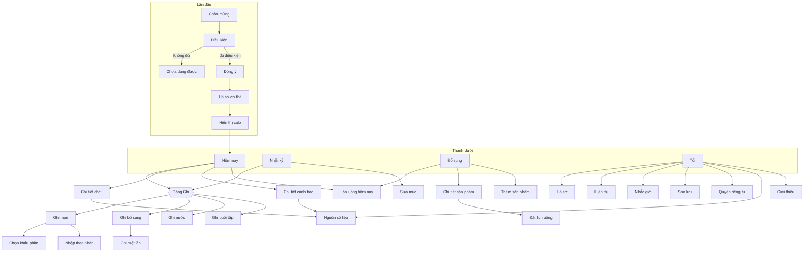
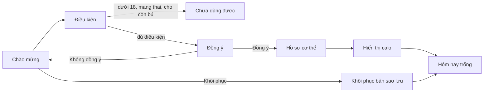
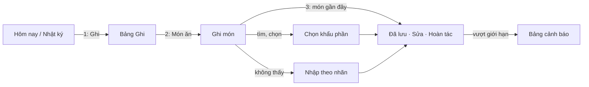
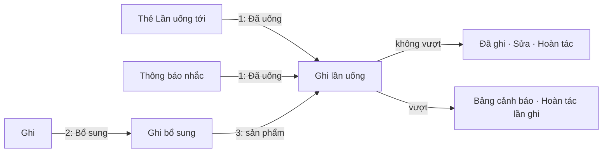
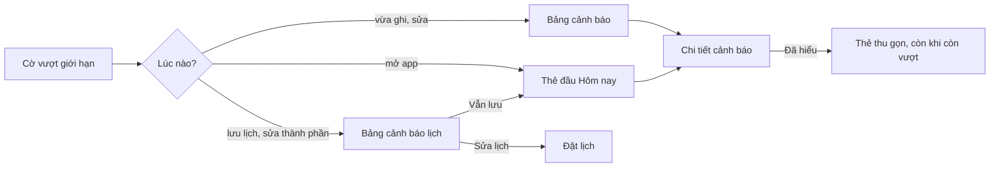

# Thiết kế UX: Tổng thể MVP

Trạng thái: Nháp  <!-- Nháp | Đã duyệt -->
Đặc tả: không có đặc tả riêng (tài liệu khung). Quy tắc tính toán và quyết định sản phẩm ở [plan.md](../plan.md); nguyên tắc thiết kế ở [README.md](README.md).

Tài liệu này chốt **khung giao diện** cho mọi màn của MVP: điều hướng, luồng chính, màn hình, trạng thái, chữ, thành phần dùng chung. Thiết kế của từng tính năng chỉ thêm chi tiết, không đổi khung này khi chưa sửa tệp này.

## Quyết định giao diện

| Chủ đề | Quyết định |
|---|---|
| Đối tượng | Màn Điều kiện trước màn Đồng ý: dưới 18 tuổi, mang thai, cho con bú thì Chưa dùng được; dùng thuốc theo chỉ định hoặc có bệnh mạn tính thì dùng ở chế độ thận trọng (plan, mục 1) |
| Chế độ thận trọng | Dòng nhắc cố định ở Hôm nay ngay sau thẻ cảnh báo; "mục tiêu", "mức khuyến nghị" đổi thành "mức tham chiếu cho người khỏe mạnh"; ẩn ODA; cảnh báo giữ nguyên |
| Điều hướng | Thanh dưới 4 mục: **Hôm nay · Nhật ký · Bổ sung · Tôi**. Nút nổi **Ghi** ở Hôm nay và Nhật ký mở bảng chọn: Món ăn, Bổ sung, Nước, Buổi tập |
| Ngày đang xem | Hôm nay và Nhật ký dùng chung một ngày đang xem; ghi mới vào ngày đó; tiêu đề bảng ghi luôn hiện ngày |
| Cảnh báo | Thẻ cảnh báo luôn đứng đầu Hôm nay, còn vượt thì còn hiện; vừa ghi mà vượt thì mở bảng cảnh báo; lịch vượt thì báo trước khi lưu. Không chặn việc ghi hay lưu |
| Ẩn số calo | Một công tắc chung (Tôi → Hiển thị, biểu tượng mắt trên thẻ Năng lượng); khi bật, không màn nào hiện số kcal |
| Mạng | Không màn nào cần mạng; chỉ sao lưu Google Drive có trạng thái mất mạng |
| Quảng cáo | Không có trong MVP, không chừa chỗ (plan, mục 1) |

## Dữ liệu mẫu

Mọi số trong wireframe lấy từ một tình huống để các màn khớp nhau. Số dinh dưỡng của món là minh họa.

- **Người dùng:** nữ, 35 tuổi, 160 cm, 55 kg, vận động nhẹ. Nhóm tham chiếu nữ 31–50. Mục tiêu calo minh họa 2.000 kcal.
- **Thời điểm:** Thứ Hai 23/11/2026, 14:05.
- **Kho và lịch:**

  | Sản phẩm | Thành phần mỗi viên (đã chuẩn hóa) | Lịch | Kho |
  |---|---|---|---|
  | Canxi D3 | Canxi 500 mg (nhãn: canxi carbonat 1.250 mg); vitamin D3 10 µg | 08:00, 20:00 | Còn 42, hết khoảng 14/12, HSD 06/2027 |
  | Vitamin tổng hợp | Vitamin A 750 µg (retinyl palmitat); vitamin A 300 µg (nhãn: 600 µg beta-caroten); vitamin D3 25 µg (1.000 IU); vitamin E 15 mg (d-alpha-tocopherol, 22,4 IU); niacin 20 mg (niacinamid); axit folic 400 µg; canxi 100 mg (nhãn: canxi citrat 476 mg); magie 150 mg (magie oxit); coenzyme Q10 30 mg | 08:00 | Còn 30, hết khoảng 23/12, HSD 03/2027 |
  | Magie | Magie 250 mg (magie citrat) | 20:00 | Còn 5, sắp hết |

- **Lịch vượt:** magie từ bổ sung theo lịch 150 + 250 = **400 mg/ngày**, giới hạn 350 mg; người dùng đã chọn "Vẫn lưu".
- **Đã ghi tới 14:05:** đi bộ nhanh 30 phút (06:30); phở bò 1 bát (07:30); cà phê sữa 1 ly (08:00, 18 g đường bổ sung); Canxi D3 và Vitamin tổng hợp mỗi loại 1 viên (08:05); cơm trắng 1 bát, cá kho 1 khúc (12:10); nước 5 × 250 ml.
- **Tổng tới 14:05:** 1.150 kcal; đạm 62 g (22%); béo 30%; bột đường 138 g (48%); chất xơ 9 g; đường bổ sung 18 g (6%). Canxi 770 mg (thực phẩm 170, bổ sung 600). Vitamin D 37 µg. Magie 240 mg (thực phẩm 90, bổ sung 150). Kali 1.400 mg. Vận động 7 ngày: 120 phút vừa, 20 phút mạnh, 1 ngày tập tăng cơ.
- **Lúc 20:05**, sau khi bấm "Đã uống" lần 20:00: magie từ bổ sung **400 mg** → cờ vượt trong ngày.

## Sơ đồ màn hình



Thêm sản phẩm, Sửa thành phần, Đặt lịch uống, Nhắc giờ, Sao lưu chỉ có khung ở đây; chi tiết ở thiết kế của tính năng đó.

## Luồng chính

### 1. Lần đầu mở app



- Hỏi điều kiện (tuổi, hai câu có/không) trước màn đồng ý; câu trả lời chỉ giữ trong bộ nhớ tới khi đồng ý, sau đó lưu tuổi và câu trả lời Có/Không về thuốc, bệnh (không lưu tên bệnh, tên thuốc). Thoát trước khi đồng ý thì lần sau bắt đầu lại; thoát sau thì mở lại đúng bước đang dở.
- Mỗi bước có Quay lại và thanh "n/4".
- Khôi phục: vào thẳng Hôm nay; bản sao lưu có đồng ý theo phiên bản nội dung cũ thì hỏi đồng ý lại trước.

### 2. Ghi món



### 3. Ghi bổ sung



- Ghi cho hôm nay một sản phẩm còn lần uống theo lịch chưa đánh dấu thì tự gắn vào lần gần giờ hiện tại nhất ("Đã ghi lần uống 20:00 theo lịch"); không có thì là lần uống thêm (plan, mục Thực phẩm bổ sung).
- "Đã uống" từ thông báo mà vượt giới hạn: gửi thêm thông báo chung "Có thông tin mới cần xem trong WholeWell"; chạm mở Chi tiết cảnh báo.

### 4. Xem tổng kết

Hôm nay có hai chế độ: **Hôm nay** và **7 ngày**. Chế độ 7 ngày dùng trung bình các ngày có ghi và luôn ghi "Trung bình {n} ngày có ghi trong 7 ngày qua". Chạm dòng vi chất mở Chi tiết chất; chạm thẻ Vận động mở Nhật ký lọc buổi tập.

### 5. Nhận cảnh báo



Ba loại cờ và cách tính ở plan (mục Cảnh báo giới hạn an toàn). Cách hiện:

- **Mỗi chất một thẻ,** liệt kê đủ các loại cờ của chất đó (trong ngày, 7 ngày, lịch); thẻ xếp theo % vượt giảm dần.
- **Thay đổi làm vượt** (đổi hồ sơ, tuổi tự tăng): lưu xong hiện bảng cảnh báo liệt kê mọi chất mới vượt, hoặc thẻ ở Hôm nay nếu là thay đổi tự động.
- **Không có nút tắt vĩnh viễn;** "Đã hiểu" chỉ thu gọn thẻ thành một dòng.
- **Lưu ý không phải cờ vượt** dùng `SafetyNote`, màu trung tính: *lưu ý lịch* theo quy tắc lịch (trong Đặt lịch uống, ở sản phẩm liên quan, ở Hôm nay khi lịch dính quy tắc; nội dung ở thiết kế Lịch uống).

## Danh sách màn hình

| Màn | Mục đích | Vào từ | Ra tới |
|---|---|---|---|
| Chào mừng | Vai tham chiếu, dữ liệu ở máy | Mở app lần đầu | Điều kiện; Khôi phục |
| Điều kiện | Tuổi; mang thai hoặc cho con bú; thuốc theo chỉ định của bác sĩ hoặc bệnh mạn tính | Chào mừng | Đồng ý; Chưa dùng được |
| Chưa dùng được | Báo bản này chưa hỗ trợ dưới 18 tuổi, mang thai, cho con bú | Điều kiện | Đóng app |
| Đồng ý | Đồng ý xử lý dữ liệu sức khỏe trên máy | Điều kiện; khôi phục bản cũ | Hồ sơ cơ thể; Chào mừng |
| Hồ sơ cơ thể / Hồ sơ | Giới, chiều cao, cân nặng, mức vận động (Hồ sơ từ Tôi có thêm tuổi, câu thuốc và bệnh, dòng nhắc thai kỳ) | Đồng ý; Tôi | Hiển thị calo; Tôi |
| Hiển thị calo | Hiện hay ẩn số calo | Hồ sơ cơ thể | Hôm nay |
| **Hôm nay** | Cảnh báo, lưu ý, lần uống tới, năng lượng, vi chất, nước, vận động, Bạn có biết | Thanh dưới | Bảng Ghi, Chi tiết chất, Chi tiết cảnh báo, Lần uống hôm nay |
| **Nhật ký** | Mục đã ghi của ngày đang xem | Thanh dưới | Bảng Ghi, Sửa mục |
| **Bổ sung** | Lần uống hôm nay, kho | Thanh dưới | Lần uống hôm nay, Chi tiết sản phẩm, Thêm sản phẩm |
| **Tôi** | Hồ sơ, cài đặt | Thanh dưới | Các màn cài đặt |
| Bảng Ghi | Chọn loại cần ghi | Nút Ghi | 4 màn ghi |
| Ghi món, Chọn khẩu phần, Nhập theo nhãn | Ghi món ăn | Bảng Ghi | Màn trước |
| Ghi bổ sung, Ghi một lần | Ghi lần uống | Bảng Ghi | Màn trước; Bảng cảnh báo |
| Ghi nước, Ghi buổi tập | Ghi nước, buổi tập | Bảng Ghi; thẻ Nước | Màn trước |
| Sửa mục | Sửa, xóa mục đã ghi | Nhật ký; "Sửa" | Nhật ký |
| Lần uống hôm nay | Đánh dấu từng loại | Hôm nay; Bổ sung; thông báo | Màn trước |
| Chi tiết chất | So với mức khuyến nghị, giới hạn, đóng góp, 7 ngày | Hôm nay | Nguồn số liệu; Sửa mục |
| Chi tiết cảnh báo, Bảng cảnh báo, Bảng cảnh báo lịch | Cờ vượt giới hạn | Thẻ; sau khi lưu; thông báo | Nhật ký; Đặt lịch; Nguồn số liệu |
| Chi tiết sản phẩm | Thành phần theo chất và dạng, kho, lịch | Bổ sung | Đặt lịch uống; Sửa thành phần |
| Hiển thị, Quyền riêng tư, Nguồn số liệu, Giới thiệu | Cài đặt, thông tin | Tôi | Tôi |

## Wireframe

Khung ~360 dp. `[ ]` nút, `( )` lựa chọn, `▓▒░` thanh tiến độ.

### Chào mừng, Điều kiện, Chưa dùng được

```
┌──────────────────────────────┐  ┌──────────────────────────────┐
│          WholeWell           │  │ ←                       1/4  │
│                              │  ├──────────────────────────────┤
│ So lượng vi chất bạn nạp từ  │  │ Vài câu để chọn mức tham     │
│ bữa ăn và thực phẩm bổ sung  │  │ chiếu phù hợp.               │
│ với mức khuyến nghị.         │  │ Tuổi [ 35   ]                │
│ • Chỉ để tham khảo, không    │  │ Đang mang thai hoặc cho con  │
│   thay lời khuyên của bác sĩ │  │ bú?          [ Có ] [Không✓] │
│ • Dữ liệu chỉ nằm trên máy   │  │ Đang dùng thuốc theo chỉ định│
│ • Không cần mạng             │  │ của bác sĩ, hoặc có bệnh mạn │
│ [      Bắt đầu            ]  │  │ tính (vd. thận, gan, tim,    │
│  Khôi phục từ bản sao lưu    │  │ tiểu đường)?                 │
└──────────────────────────────┘  │              [ Có ] [Không✓] │
                                  │ [      Tiếp tục           ]  │
                                  └──────────────────────────────┘
┌──────────────────────────────┐
│ WholeWell hiện dành cho người│
│ từ 18 tuổi, không mang thai, │
│ không cho con bú. Hãy hỏi bác│
│ sĩ hoặc dược sĩ về dinh dưỡng│
│ và thực phẩm bổ sung.        │
│                 [   Đóng   ] │
└──────────────────────────────┘
```

- Điều kiện: tuổi bàn phím số, 1–120; hai câu bắt buộc chọn, không chọn sẵn. Dưới 18 hoặc đang mang thai, cho con bú thì sang Chưa dùng được. Câu thứ hai trả lời "Có" thì vào app ở chế độ thận trọng. App lưu tuổi và ngày nhập, tự cộng 1 mỗi 12 tháng và báo ở Hôm nay ("Tuổi trong hồ sơ đã được cập nhật thành 36. Sửa").
- Chưa dùng được: không có Quay lại, không lưu gì.

### Đồng ý

```
┌──────────────────────────────┐
│ ←                       2/4  │
├──────────────────────────────┤
│ Dữ liệu sức khỏe của bạn     │
│ App lưu tuổi, chiều cao, cân │
│ nặng, món ăn, bổ sung bạn    │
│ ghi để so với mức tham chiếu.│
│ • Lưu mã hóa trên máy này    │
│ • Không gửi cho ai, kể cả    │
│   nhóm phát triển            │
│ • Xem, sửa, xuất, xóa ở      │
│   Tôi → Quyền riêng tư       │
│ ☐ Tôi đồng ý cho app xử lý   │
│   dữ liệu sức khỏe của tôi   │
│   cho mục đích trên.         │
│   Đọc đầy đủ                 │
│ [ Đồng ý và tiếp tục ]       │
│  Không đồng ý                │
└──────────────────────────────┘
```

- Ô không đánh sẵn; nút chính tắt tới khi đánh dấu; lưu ngày giờ và phiên bản nội dung. Đồng ý cho nhắc giờ và Google Drive hỏi riêng khi bật. Lời văn đầy đủ ở đặc tả Quyền riêng tư.

### Hồ sơ cơ thể

```
┌──────────────────────────────┐
│ ←                       3/4  │
├──────────────────────────────┤
│ Giới tính sinh học           │
│ ( ) Nam   (•) Nữ             │
│ Chiều cao  [ 160 ] cm        │
│ Cân nặng   [ 55  ] kg        │
│ Mức vận động                 │
│ [ Vận động nhẹ          ▾ ]  │
│ [      Tiếp tục           ]  │
└──────────────────────────────┘
```

- Hồ sơ từ Tôi: thêm ô Tuổi (tối thiểu 18), nút "Lưu"; lưu xong kiểm lại mọi cờ. Cuối màn có câu Có/Không về thuốc theo chỉ định, bệnh mạn tính (đổi thì bật, tắt chế độ thận trọng) và dòng nhắc thai kỳ kèm [Xuất dữ liệu] [Xóa toàn bộ dữ liệu] (mở Quyền riêng tư).
- Ngoài khoảng hợp lý (chiều cao 120–220 cm, cân nặng 30–250 kg): nhắc kiểm lại, không chặn.

### Hiển thị calo

```
┌──────────────────────────────┐
│ ←                       4/4  │
├──────────────────────────────┤
│ Bạn muốn thấy số calo không? │
│ ( ) Hiện số calo             │
│ ( ) Ẩn số calo               │
│     App vẫn tính, chỉ không  │
│     hiện con số.             │
│ Đổi ở Tôi → Hiển thị.        │
│ [      Xong               ]  │
└──────────────────────────────┘
```

- Không chọn sẵn.

### Hôm nay

```
┌──────────────────────────────┐
│ Hôm nay      ‹ 23/11 ›       │
│ [ Hôm nay | 7 ngày ]         │
├──────────────────────────────┤
│ ┌ ⚠ Magie ─────────────────┐ │
│ │ Lịch uống vượt giới hạn  │ │
│ │ an toàn                  │ │
│ │ Theo lịch: 400 mg/ngày   │ │
│ │ Giới hạn: 350 mg/ngày    │ │
│ │ Vượt: 50 mg/ngày (14%)   │ │
│ │ Hỏi bác sĩ hoặc dược sĩ  │ │
│ │ nếu cần.                 │ │
│ │              [Xem thêm ›]│ │
│ └──────────────────────────┘ │
│ ┌ Lần uống tới · 20:00 ────┐ │
│ │ Canxi D3, Magie · 2 loại │ │
│ │ [ Đã uống ]  [ Chi tiết ]│ │
│ └──────────────────────────┘ │
│ ┌ Năng lượng          [👁] ┐ │
│ │ 1.150 / 2.000 kcal       │ │
│ │ ▓▓▓▓▓▓░░░░               │ │
│ │ Đạm 62 g · mức khuyến    │ │
│ │ nghị 44 g                │ │
│ │ Đạm 22% · Béo 30% ·      │ │
│ │ Bột đường 48% · trong    │ │
│ │ khoảng                   │ │
│ │ Đường bổ sung: đến giờ   │ │
│ │ 18 g · 6% năng lượng     │ │
│ │ Bữa sáng có 18 g, quá    │ │
│ │ giới hạn 10 g mỗi bữa    │ │
│ │ [ Thêm ▾ ]               │ │
│ └──────────────────────────┘ │
│ Vi chất          [Tất cả ▾]  │
│ Canxi          770/1.000 mg  │
│ ▓▓▒▒▒▒▒▒░░ 77%               │
│ ▓ thực phẩm  ▒ bổ sung       │
│ Vitamin D         37/15 µg   │
│ ▒▒▒▒▒▒▒▒▒▒ 247%              │
│ Kali         1.400/2.600 mg  │
│ ▓▓▓▓▓░░░░░ 54% mức ước tính  │
│ ...                          │
│ ┌ Nước ────────────────────┐ │
│ │ Đã uống 1.250 ml [+250ml]│ │
│ └──────────────────────────┘ │
│ ┌ Vận động 7 ngày qua ─────┐ │
│ │ Tương đương 160 phút vừa │ │
│ │ ▓▓▓▓▓▓▓▓░░ mức tham chiếu│ │
│ │ 150–300 phút mỗi tuần    │ │
│ │ Tập tăng cơ: 1 ngày ·    │ │
│ │ mức tham chiếu từ 2 ngày │ │
│ └──────────────────────────┘ │
│                      [+ Ghi] │
├──────────────────────────────┤
│ Hôm nay Nhật ký Bổ sung  Tôi │
└──────────────────────────────┘
```

- **Thứ tự cố định:** cảnh báo → dòng thận trọng (nếu có) → dòng nhắc hồ sơ (tuổi, gợi ý mức vận động) → lần uống tới → năng lượng → vi chất → nước → vận động → Bạn có biết. Thẻ không có dữ liệu thì ẩn, trừ Năng lượng và Vi chất.
- **‹ ngày ›:** không tiến quá hôm nay; tiêu đề "Hôm qua", "Thứ Bảy, 21/11". Chế độ 7 ngày ẩn thẻ Lần uống tới.
- **Năng lượng:** thanh calo một màu trung tính, không đổi màu khi vượt, không "còn được ăn". Tỷ lệ ghi chữ trong / dưới / trên khoảng, không xanh đỏ. Đường bổ sung: số gam và % năng lượng, không có ngưỡng trong ngày; giới hạn 10 g mỗi bữa báo ngay. "Thêm ▾": bột đường so với mức khuyến nghị, chất xơ, omega-6, omega-3 so với mức ước tính.
- **Vi chất:** vitamin và khoáng chất có mức khuyến nghị hoặc ước tính; lọc Tất cả / Có bổ sung / Dưới mức khuyến nghị. Thanh hai đoạn thực phẩm và bổ sung phân biệt bằng mật độ và chú thích; trên 100% thì thanh đầy, không khen. Chất chỉ có giới hạn (bo, niken, vanadi) chỉ xuất hiện khi có cảnh báo.
- **Nước:** chỉ lượng đã uống, không so. Nút nhanh dùng lượng ghi gần nhất.
- **Vận động:** 7 ngày gần nhất; phút tương đương vừa và ngày tập tăng cơ so với mức tham chiếu; thanh trung tính, không khen chê; ghi "theo các buổi bạn đã ghi".
- **Bạn có biết** (`TipCard`): một câu của quy tắc lịch trong gói dữ liệu, chữ đứng yên.
  - Chỉ lấy quy tắc mà mọi chất của nó có trong ít nhất một sản phẩm ở kho (vd. quy tắc sắt–kẽm cần cả sắt và kẽm). Mỗi ngày một câu, lần lượt theo thứ tự trong gói; không có quy tắc phù hợp thì ẩn thẻ.
  - Chỉ hiện ở chế độ Hôm nay của ngày hôm nay. Ẩn khi đang có cờ vượt giới hạn (wireframe trên có cờ magie nên không có thẻ).
  - "Nguồn: NIH ODS ›" mở Nguồn số liệu tại quy tắc đó; "Ẩn" chỉ ẩn trong hôm nay; tắt hẳn ở Tôi → Hiển thị.

```
┌ Bạn có biết ─────────────┐
│ Canxi hấp thu tốt nhất   │
│ khi mỗi lần không quá    │
│ 500 mg.                  │
│ Nguồn: NIH ODS ›    Ẩn   │
└──────────────────────────┘
```

### Bảng Ghi

```
┌──────────────────────────────┐
│ Ghi cho hôm nay, 23/11       │
│ [ 🍜 Món ăn ] [ 💊 Bổ sung ] │
│ [ 💧 Nước   ] [ 🏃 Buổi tập ]│
└──────────────────────────────┘
```

- Ô ≥96 dp. Đang xem ngày khác thì tiêu đề in đậm ngày đó.

### Ghi món, Chọn khẩu phần

```
┌──────────────────────────────┐  ┌──────────────────────────────┐
│ ←  Ghi món                   │  │ Phở bò               ước tính│
│ [Sáng] [Trưa✓] [Tối] [Phụ]   │  │ [ Bát ] [ Gram ]             │
│ [ 🔍 Tìm món...      🎤 ▥ ]  │  │ Số lượng  [ − ]  1  [ + ]    │
├──────────────────────────────┤  │ Khoảng 450 kcal              │
│ Gần đây                      │  │ [         Lưu             ]  │
│ Cơm trắng · 1 bát            │  └──────────────────────────────┘
│ Cá kho · 1 khúc      ước tính│
│ Phở bò · 1 bát       ước tính│
│ Không thấy món?              │
│ [ Nhập theo nhãn ]           │
└──────────────────────────────┘
```

- Bữa tự chọn theo giờ. Chạm món gần đây: lưu với khẩu phần lần trước, thông báo nhỏ "Đã ghi Cơm trắng, 1 bát · Sửa · Hoàn tác" (7 giây). 🎤 ▥ chỉ hiện khi tính năng có và máy hỗ trợ.

### Nhập theo nhãn

```
┌──────────────────────────────┐
│ ←  Nhập theo nhãn            │
├──────────────────────────────┤
│ Tên món   [ Sữa chua uống  ] │
│ Số trên nhãn tính cho        │
│ [ 100 ] [ ml ▾ ]             │
│ Bạn đã dùng [ 180 ] ml       │
│ Năng lượng      [  ] kcal    │
│ Đạm / Béo / Bột đường [  ] g │
│ Đường (tổng)    [  ] g       │
│ Đường bổ sung   [  ] g       │
│  (chỉ khi nhãn ghi riêng)    │
│ Natri           [  ] mg      │
│ [ + Thêm vi chất trên nhãn ] │
│ ☐ Lưu để dùng lại            │
│ [         Lưu             ]  │
└──────────────────────────────┘
```

- Nhãn không ghi riêng đường bổ sung: món là "chưa rõ đường bổ sung", thẻ Năng lượng ghi "Chưa tính đường bổ sung của {n} món". Niacin, vitamin E, axit folic trên nhãn được coi là tăng cường (plan). Kiểm hợp lý đơn vị.

### Ghi bổ sung, Ghi một lần

```
┌──────────────────────────────┐  ┌──────────────────────────────┐
│ ←  Ghi bổ sung · 14:05       │  │ ←  Ghi một lần · 14:05       │
├──────────────────────────────┤  ├──────────────────────────────┤
│ Trong kho                    │  │ Tên (không bắt buộc)         │
│ Canxi D3 · 1 viên            │  │ Thành phần đã uống           │
│  lần 20:00 chưa đánh dấu     │  │ Chất  [ Vitamin C     ▾ ]    │
│ Magie · 1 viên               │  │ Lượng [ 1000 ] [ mg ▾ ]      │
│  lần 20:00 chưa đánh dấu     │  │ Dạng  [ Nhãn không ghi▾ ]    │
│ Vitamin tổng hợp · 1 viên    │  │ [ + Thêm chất ]              │
│ [ Ghi một lần, không lưu kho]│  │ [         Lưu             ]  │
│ [ + Thêm sản phẩm ]          │  └──────────────────────────────┘
└──────────────────────────────┘
```

- Chạm sản phẩm: liều theo lịch (không có lịch thì 1 khẩu phần), giờ hiện tại. Ví dụ chạm Magie lúc 14:05: gắn vào lần 20:00, magie thành 400 mg → Bảng cảnh báo. Chạm giờ để đổi.
- Ghi một lần dùng cùng bộ nhập thành phần với Thêm sản phẩm; ô Dạng chỉ hiện với chất mà dạng ảnh hưởng tới phép tính.

### Ghi nước, Ghi buổi tập

```
┌──────────────────────────────┐  ┌──────────────────────────────┐
│ Ghi nước · 14:05             │  │ ←  Ghi buổi tập              │
│ [150 ml] [250 ml✓] [500 ml]  │  │ Hoạt động                    │
│ Số khác [      ] ml          │  │ [ 🔍 Đi bộ nhanh 5,6–6,3 km/h]│
│ [         Lưu             ]  │  │ Bắt đầu [ 06:30 ]            │
└──────────────────────────────┘  │ Thời lượng [ 30 ] phút       │
                                  │ Khoảng 130 kcal · vận động   │
                                  │ vừa                          │
                                  │ [         Lưu             ]  │
                                  └──────────────────────────────┘
```

- Cường độ nằm trong tên hoạt động. kcal qua `CalorieText`, ghi "khoảng"; không "đốt", không cộng vào mục tiêu calo.

### Nhật ký, Sửa mục

```
┌──────────────────────────────┐  ┌──────────────────────────────┐
│ Nhật ký      ‹ 23/11 ›       │  │ ←  Phở bò                    │
├──────────────────────────────┤  ├──────────────────────────────┤
│ Sáng                         │  │ Khẩu phần [Bát] [−] 1 [+]    │
│  Phở bò · 1 bát        07:30 │  │ Bữa [Sáng✓] [Trưa] [Tối]     │
│  Cà phê sữa · 1 ly     08:00 │  │ Giờ [ 07:30 ]                │
│ Trưa                         │  │ [         Lưu             ]  │
│  Cơm trắng · 1 bát     12:10 │  │  Xóa khỏi nhật ký            │
│  Cá kho · 1 khúc       12:10 │  └──────────────────────────────┘
│ Bổ sung                      │
│  Canxi D3 · 1 viên     08:05 │
│  Vitamin tổng hợp ·    08:05 │
│ Nước  1.250 ml (5 lần)       │
│ Buổi tập                     │
│  Đi bộ nhanh · 30 phút 06:30 │
│                      [+ Ghi] │
├──────────────────────────────┤
│ Hôm nay Nhật ký Bổ sung  Tôi │
└──────────────────────────────┘
```

- kcal bên phải chỉ hiện khi không ẩn số calo. Xóa hỏi lại. Lần uống bổ sung: sửa liều, giờ; xóa thì trả kho và bỏ đánh dấu lần uống theo lịch. Lưu xong kiểm lại mọi cờ.

### Bổ sung, Lần uống hôm nay

```
┌──────────────────────────────┐  ┌──────────────────────────────┐
│ Bổ sung                      │  │ ←  Lần uống hôm nay          │
├──────────────────────────────┤  ├──────────────────────────────┤
│ Hôm nay              [Xem ›] │  │ 08:00                        │
│  ✓ 08:00 Canxi D3, Vitamin   │  │  ✓ Canxi D3 · Đã uống 08:05  │
│          tổng hợp            │  │  ✓ Vitamin tổng hợp · 08:05  │
│  ○ 20:00 Canxi D3, Magie     │  │ 20:00                        │
│           [ Đã uống ]        │  │  ○ Canxi D3 · 1 viên         │
│ Kho                          │  │    [ Đã uống ] [ Bỏ qua ]    │
│ Canxi D3 · còn 42 · hết      │  │  ○ Magie · 1 viên            │
│  khoảng 14/12 · HSD 06/2027  │  │    [ Đã uống ] [ Bỏ qua ]    │
│ Vitamin tổng hợp · còn 30 ·  │  │  [ Đã uống cả 2 ]            │
│  hết khoảng 23/12            │  └──────────────────────────────┘
│  ⚠ Lịch vượt giới hạn (magie)│
│ Magie · còn 5 · sắp hết      │
│  ⚠ Lịch vượt giới hạn (magie)│
│             [+ Thêm sản phẩm]│
├──────────────────────────────┤
│ Hôm nay Nhật ký Bổ sung  Tôi │
└──────────────────────────────┘
```

- Chưa có lịch: "Chưa có lịch uống. Mở một sản phẩm để đặt lịch." Dòng cảnh báo lịch hiện ở mọi sản phẩm góp vào chất bị vượt. "Sắp hết", "Đã hết hạn" ghi bằng chữ. Không link cửa hàng.
- Lần uống: chạm giờ để sửa giờ thực tế; bỏ qua không trừ kho. Nhắc lại, dời lịch ở thiết kế Lịch uống.

### Chi tiết chất

```
┌──────────────────────────────┐
│ ←  Canxi                     │
│ [ Hôm nay | 7 ngày ]         │
├──────────────────────────────┤
│ Tổng mọi nguồn: 770 mg       │
│ 77% mức khuyến nghị 1.000 mg │
│ ▓▓▒▒▒▒▒▒░░                   │
│ Thực phẩm 170 · bổ sung 600  │
│ Tính vào giới hạn an toàn:   │
│ 770 / 2.500 mg · mọi nguồn   │
│ Đóng góp hôm nay             │
│  Canxi D3 · 1 viên    500 mg │
│   dạng canxi carbonat        │
│  Vitamin tổng hợp     100 mg │
│   dạng canxi citrat          │
│  Cà phê sữa · 1 ly     90 mg │
│  Phở bò · 1 bát        40 mg │
│  Cá kho · 1 khúc       30 mg │
│  Cơm trắng · 1 bát     10 mg │
│ 7 ngày qua  ▁▃▅▂▆▃▄          │
│ Mức cho nữ 31–50 tuổi.       │
│ Nguồn số liệu ›              │
└──────────────────────────────┘
```

- Mức ước tính: "{x}% mức ước tính", kèm "Chưa đủ dữ liệu để đặt mức khuyến nghị chính thức; đây là mức ước tính."
- **Luôn hiện hai tổng** ở mọi chất: "Tổng mọi nguồn" (thực phẩm, tăng cường, bổ sung) so với mức khuyến nghị, và "Tính vào giới hạn an toàn" theo phạm vi của chất (plan, mục Cảnh báo giới hạn an toàn). Chất tính mọi nguồn thì hai tổng bằng nhau, vẫn hiện cả hai.
- Đóng góp tách theo sản phẩm và dạng. Chất có phạm vi riêng (magie, niacin, vitamin E, vitamin A, folate): mỗi dòng ghi nguồn và "tính / không tính vào giới hạn". Số đổi từ nhãn ghi số gốc nhỏ bên dưới; dạng chưa rõ ghi "chưa chắc".
- Ví dụ chất có phạm vi riêng (số thực phẩm là minh họa):

```
┌──────────────────────────────┐
│ ←  Magie                     │
│ [ Hôm nay | 7 ngày ]         │
├──────────────────────────────┤
│ Tổng mọi nguồn: 240 mg       │
│ 75% mức khuyến nghị 320 mg   │
│ ▓▓▓▒▒▒▒░░░                   │
│ Thực phẩm 90 · bổ sung 150   │
│ Tính vào giới hạn an toàn:   │
│ 150 / 350 mg · chỉ bổ sung   │
│ và thuốc, không tính thức ăn │
│ Đóng góp hôm nay             │
│  Vitamin tổng hợp     150 mg │
│   bổ sung · tính vào giới hạn│
│  Phở bò · 1 bát        30 mg │
│  Cá kho · 1 khúc       30 mg │
│  Cơm trắng · 1 bát     30 mg │
│   3 món trên không tính vào  │
│   giới hạn                   │
│ Nguồn số liệu ›              │
└──────────────────────────────┘
```
- Biểu đồ có bảng số cho trình đọc màn hình. Sắt: thêm dòng thông tin vitamin C tăng hấp thu sắt không heme (không phải gợi ý).

### Chi tiết cảnh báo, Bảng cảnh báo lịch

```
┌──────────────────────────────┐  ┌──────────────────────────────┐
│ ←  Cảnh báo                  │  │ ⚠ Lịch này vượt giới hạn an  │
├──────────────────────────────┤  │   toàn                       │
│ ⚠ Magie vượt giới hạn an toàn│  │ Magie từ bổ sung theo lịch:  │
│ Hôm nay từ bổ sung: 400 mg   │  │ 400 mg/ngày                  │
│ Giới hạn an toàn: 350 mg/ngày│  │ Giới hạn: 350 mg/ngày        │
│ Vượt: 50 mg (14%)            │  │ Vượt: 50 mg/ngày (14%)       │
│ Tính từ thực phẩm bổ sung và │  │ Góp vào                      │
│ thuốc, không tính từ thức ăn.│  │  Vitamin tổng hợp · 1 viên   │
│ Lịch uống: 400 mg/ngày, cũng │  │  × 1 lần/ngày         150 mg │
│ vượt giới hạn.               │  │  Magie · 1 viên              │
│ Các mục góp vào              │  │  × 1 lần/ngày         250 mg │
│  Vitamin tổng hợp ·   150 mg │  │ Hỏi bác sĩ hoặc dược sĩ nếu  │
│  08:05                       │  │ cần.                         │
│  Magie · 20:05        250 mg │  │ [ Sửa lịch ]                 │
│ Hỏi bác sĩ hoặc dược sĩ nếu  │  │   Vẫn lưu                    │
│ cần.                         │  └──────────────────────────────┘
│ [ Xem trong nhật ký ]        │
│ [ Đã hiểu ]                  │
│ Nguồn số liệu ›              │
└──────────────────────────────┘
```

- **Bảng cảnh báo** (sau khi ghi, sửa): cùng nội dung, trượt lên che 3/4 màn; [Đã hiểu] [Xem chi tiết] và nút chữ "Hoàn tác lần ghi"; không tự đóng.
- Cờ 7 ngày: thêm "Trung bình {n} ngày có ghi trong 7 ngày qua: {x}/ngày". Ngày đang xem khác hôm nay thì đổi chữ "Hôm nay".
- **Nội dung chỉ là số** (plan, mục Cảnh báo giới hạn an toàn); mỗi loại cờ có dòng "Vượt" riêng, % làm tròn số nguyên.
- Chất tính mọi nguồn, cờ lịch: thêm "Chưa tính thức ăn; thức ăn sẽ cộng thêm khi bạn ghi nhật ký." Chất chưa kiểm được: "Chưa kiểm được giới hạn an toàn cho {chất} trong {sản phẩm}."
- Bảng cảnh báo lịch: "Vẫn lưu" là nút chữ; không có "Không nhắc lại". Không câu "hãy ngừng", "nên giảm"; không nhắc tên thuốc.

### Chi tiết sản phẩm

```
┌──────────────────────────────┐
│ ←  Vitamin tổng hợp      [⋮] │
├──────────────────────────────┤
│ 1 khẩu phần = 1 viên         │
│ Còn 30 · hết khoảng 23/12 ·  │
│ HSD 03/2027                  │
│ ⚠ Lịch vượt giới hạn (magie)›│
│ Thành phần mỗi viên  (9)     │
│ Vitamin A        750 µg      │
│  retinyl palmitat · tính vào │
│  giới hạn                    │
│ Vitamin A        300 µg      │
│  beta-caroten (nhãn 600 µg)  │
│  · không tính vào giới hạn   │
│ Vitamin D3       25 µg       │
│  (nhãn 1.000 IU)             │
│ Vitamin E        15 mg       │
│  d-alpha-tocopherol (22,4 IU)│
│ Niacin           20 mg       │
│ Axit folic       400 µg      │
│  · tính vào giới hạn         │
│ Canxi            100 mg      │
│  canxi citrat (nhãn 476 mg)  │
│ Magie            150 mg      │
│  magie oxit                  │
│ Coenzyme Q10     30 mg       │
│  không có mức tham chiếu     │
│ [ Sửa thành phần ]           │
│ Lịch: mỗi ngày 1 viên 08:00  │
│ [ Đặt lịch ]   Ảnh nhãn ›    │
└──────────────────────────────┘
```

- Mỗi dòng một chất, một dạng; số đã chuẩn hóa, số gốc nhỏ bên dưới. Cách đổi đơn vị, hợp chất, dạng chưa rõ, chất ngoài gói theo plan (mục Thực phẩm bổ sung).
- Dòng "chưa rõ dạng" có ⓘ; dòng "chưa tính được" ghi lý do.
- Sửa thành phần lưu xong thì kiểm lại cờ lịch. Không link cửa hàng.

### Tôi và cài đặt

```
┌──────────────────────────────┐  ┌──────────────────────────────┐
│ Tôi                          │  │ ←  Quyền riêng tư            │
├──────────────────────────────┤  ├──────────────────────────────┤
│ Hồ sơ                      › │  │ Đồng ý đã cho                │
│  Nữ · 35 tuổi · 160 cm · 55kg│  │  Xử lý dữ liệu sức khỏe      │
│ Hiển thị                   › │  │  23/11/2026 09:12            │
│ Nhắc giờ                   › │  │  [ Rút đồng ý ]              │
│ Sao lưu và khôi phục       › │  │  Nhắc giờ: chưa bật          │
│  Chưa sao lưu                │  │  Google Drive: chưa bật      │
│ Quyền riêng tư             › │  │ [ Xuất dữ liệu ]             │
│ Nguồn số liệu              › │  │ [ Xóa toàn bộ dữ liệu ]      │
│ Giới thiệu                 › │  └──────────────────────────────┘
├──────────────────────────────┤
│ Hôm nay Nhật ký Bổ sung  Tôi │
└──────────────────────────────┘
```

- **Hiển thị:** công tắc Ẩn số calo; công tắc thẻ "Bạn có biết" (mặc định bật); giao diện Theo máy / Sáng / Tối; cỡ chữ theo máy.
- **Quyền riêng tư:** rút đồng ý = xóa toàn bộ và về Chào mừng (hỏi lại trước); xuất ra tệp đọc được, cảnh báo không mã hóa; xóa toàn bộ phải gõ "XÓA", nút màu `error`.
- **Nguồn số liệu:** màn duy nhất ghi tên chuẩn (RDA, AI, UL, EER, AMDR, MET, Physical Activity Guidelines, FDA) và tổ chức, mỗi chuẩn một câu giải thích, ngày tra, link mở trình duyệt; danh sách quy tắc lịch kèm nguồn; phiên bản gói dữ liệu. Lấy từ gói dữ liệu, không viết tay.
- **Giới thiệu:** phiên bản, vai tham chiếu (không chẩn đoán, không kê đơn, không gợi ý liều), giấy phép dữ liệu (USDA CC0…), giấy phép mã nguồn mở.

### Thông báo nhắc giờ

```
┌──────────────────────────────┐
│ WholeWell · 20:00            │
│ Đến giờ uống, 2 loại         │
│ [ Đã uống ]   [ Mở app ]     │
└──────────────────────────────┘
```

- Màn hình khóa chỉ nội dung chung. "Đã uống" đánh dấu mọi loại trong lần nhắc; "Mở app" mở Lần uống hôm nay.

## Thành phần dùng chung

Đặt trong `app/lib/ui/common/`; mọi màn dùng lại, không vẽ riêng.

| Thành phần | Nội dung | Hành vi, trợ năng |
|---|---|---|
| `MetricCard` | Tiêu đề, số chính, dòng phụ, nút tùy chọn | Cả thẻ một vùng chạm ≥48 dp; đọc gộp tiêu đề + số |
| `LabeledProgress` | Giá trị, mức, %, tối đa hai đoạn | Luôn có số bằng chữ; đoạn phân biệt bằng mật độ + chú thích; không đổi màu đỏ; đọc: "Canxi, 770 trên 1.000 miligam, 77 phần trăm mức khuyến nghị" |
| `WarningCard` | ⚠, chất, các loại cờ, lượng, giới hạn, vượt bao nhiêu (đơn vị và %), phạm vi, dòng hỏi bác sĩ | Màu cảnh báo + biểu tượng + chữ; mở / thu gọn; được đọc trước các thẻ khác |
| `SafetyNote` | ⓘ, "Lưu ý", một hai câu (lưu ý lịch, dòng thận trọng) | Màu trung tính |
| `TipCard` | "Bạn có biết", một câu quy tắc, link nguồn, nút Ẩn | Màu trung tính; chữ đứng yên, không tự chuyển, không hoạt ảnh; đọc cả câu |
| `NutrientRow` | Tên, số, %, "mức ước tính", `LabeledProgress` | Chạm mở Chi tiết chất; chữ lớn thì số xuống dòng |
| `IngredientRow` | Chất, lượng chuẩn hóa, số gốc, dạng hoặc nguồn, các trạng thái (tính / không tính vào giới hạn, chưa rõ dạng, chưa tính được, không có mức tham chiếu) | Mọi trạng thái bằng chữ |
| `EstimateChip` | Chữ "ước tính" | Có chữ, không chỉ biểu tượng |
| `CalorieText` | Số kcal hoặc không gì | Đọc công tắc ẩn số calo; khi ẩn không chiếm chỗ |
| `DaySwitcher` | ‹ ngày › | Mũi tên 48 dp; chạm ngày mở lịch |
| `LogSheet` | 4 ô, tiêu đề có ngày | Ô ≥96 dp |
| `EntryTile` | Tên, khẩu phần, giờ, kcal | Chạm mở sửa |
| `UndoSnack` | Câu ngắn + Sửa + Hoàn tác | 7 giây; được đọc to |
| `EmptyState`, `ErrorState` | Câu ngắn + một hành động | Không mã lỗi kỹ thuật, không hình kiểu "chưa cố gắng" |
| `StepScaffold` | Quay lại, "n/4", nút chính dưới cùng | Nút chính luôn thấy khi bàn phím mở |

**Quy ước:**
- **Màu:** Material 3, gốc teal, có chế độ tối. Màu cảnh báo vàng hổ phách qua `ThemeExtension` (không đè `tertiary`), đạt AA ở cả hai chế độ, chỉ cho cờ giới hạn và đường bổ sung vượt mỗi bữa. Đỏ (`error`) chỉ cho lỗi và nút xóa.
- **Số:** chấm ngăn nghìn, phẩy thập phân (1.150; 2,5 mg); ≥100 số nguyên, 10–99 một số lẻ, <10 tối đa hai. Vận động ghi "khoảng".
- **Đơn vị:** mg, µg, g, ml, kcal; µg RAE, µg DFE, mg NE chỉ ở Chi tiết chất kèm một dòng giải thích.
- **Ngày giờ:** "Hôm nay", "Hôm qua", "Thứ Bảy, 21/11"; 24 giờ; hạn dùng tháng/năm.
- **Cỡ chữ 200%:** "tên · số" tách hai dòng; không cắt chữ; nhãn thanh dưới ≤7 ký tự.

## Trạng thái

| Màn | Trống | Đang xử lý | Lỗi | Cảnh báo |
|---|---|---|---|---|
| Hôm nay | Chưa ghi: Năng lượng hiện mục tiêu calo, Vi chất "Chưa có món nào hôm nay" + [Ghi món]; 7 ngày: "Chưa có ngày nào được ghi trong 7 ngày qua." | Khung xám nếu >300 ms | `ErrorState` + [Thử lại] | `WarningCard` đầu màn; dòng đường bổ sung |
| Hôm nay – không có mục tiêu calo | 18 tuổi: "Chưa có mục tiêu calo cho người 18 tuổi." | – | – | Vi chất, giới hạn vẫn đủ |
| Nhật ký | "Chưa có gì trong ngày này." + [Ghi] | Khung xám | "Chưa lưu được. Thử lại" | – |
| Bổ sung | "Kho đang trống. Thêm sản phẩm để theo dõi lần uống và ngày hết." | – | – | Sắp hết, hết hạn, lịch vượt |
| Ghi món | Chỉ ô tìm và [Nhập theo nhãn] | Vòng xoay trong ô tìm | "Không thấy “bánh đúc”. Thử tên khác hoặc nhập theo nhãn." | Bảng cảnh báo |
| Nhập theo nhãn, Ghi một lần | – | – | Nghi sai đơn vị: nhắc dưới ô, chưa lưu tới khi xác nhận | Bảng cảnh báo |
| Ghi bổ sung | Kho trống: [Thêm sản phẩm] [Ghi một lần] | – | Thông báo nhỏ + Thử lại | Bảng cảnh báo |
| Lần uống hôm nay | "Chưa có lịch uống." + [Mở Bổ sung] | – | – | Bảng cảnh báo |
| Chi tiết chất | "Hôm nay chưa có nguồn canxi nào được ghi." | – | – | `WarningCard` |
| Chi tiết sản phẩm | – | – | Dòng "chưa tính được" có lý do | Lịch vượt; `SafetyNote` khi chưa kiểm được |
| Chi tiết cảnh báo | – | – | Cờ đã hết: "Hiện không còn vượt giới hạn." + [Về Hôm nay] | – |
| Lần đầu | – | Nút chính có vòng xoay | Không đủ điều kiện: Chưa dùng được; số ngoài khoảng: nhắc dưới ô | – |
| Toàn app | – | – | Gói dữ liệu hỏng: màn chặn "Không đọc được dữ liệu tham chiếu. Hãy cài lại WholeWell từ cửa hàng ứng dụng.", không hiện số nào. Không mở được CSDL: "Không mở được dữ liệu đã lưu trên máy." + [Khôi phục từ bản sao lưu] [Bắt đầu lại] | – |

## Nội dung chữ

| Vị trí | Chữ |
|---|---|
| Thanh dưới, nút nổi | Hôm nay · Nhật ký · Bổ sung · Tôi · Ghi |
| Chào mừng | So lượng vi chất bạn nạp từ bữa ăn và thực phẩm bổ sung với mức khuyến nghị. · Chỉ để tham khảo, không thay lời khuyên của bác sĩ · Dữ liệu chỉ nằm trên máy này, không gửi đi đâu · Không cần mạng |
| Điều kiện | Vài câu để chọn mức tham chiếu phù hợp. · Đang mang thai hoặc cho con bú? · Đang dùng thuốc theo chỉ định của bác sĩ, hoặc có bệnh mạn tính (vd. thận, gan, tim, tiểu đường)? · Có · Không |
| Chưa dùng được | WholeWell hiện dành cho người từ 18 tuổi, không mang thai, không cho con bú. Hãy hỏi bác sĩ hoặc dược sĩ về dinh dưỡng và thực phẩm bổ sung. |
| Thai kỳ (Hồ sơ) | Nếu bạn mang thai hoặc cho con bú, bản này của WholeWell chưa hỗ trợ. · Xuất dữ liệu · Xóa toàn bộ dữ liệu |
| Chế độ thận trọng | Các mức trong app dành cho người khỏe mạnh. Với tình trạng của bạn, mức phù hợp có thể khác; hãy hỏi bác sĩ. · mức tham chiếu cho người khỏe mạnh |
| Đồng ý | Tôi đồng ý cho app xử lý dữ liệu sức khỏe của tôi cho mục đích trên. · Không đồng ý: App cần đồng ý này để tính toán. Bạn có thể quay lại bất cứ lúc nào. |
| Hiển thị calo | Bạn muốn thấy số calo không? · Hiện số calo · Ẩn số calo · App vẫn tính, chỉ không hiện con số. |
| Năng lượng | Mục tiêu calo · Đạm {g} · mức khuyến nghị {g} · {x}% · trong khoảng / dưới khoảng / trên khoảng |
| Đường bổ sung | Đường bổ sung: đến giờ {g} · {x}% năng lượng · Bữa {sáng} có {g} đường bổ sung, quá giới hạn 10 g mỗi bữa. · Chưa tính đường bổ sung của {n} món (nhãn không ghi riêng). |
| Vi chất | {x}% mức khuyến nghị · {x}% mức ước tính · Chưa đủ dữ liệu để đặt mức khuyến nghị chính thức; đây là mức ước tính. · Tổng mọi nguồn: {lượng} · Thực phẩm {lượng} · bổ sung {lượng} · Tính vào giới hạn an toàn: {lượng} / {giới hạn} · tính vào giới hạn · không tính vào giới hạn |
| Trung bình 7 ngày | Trung bình {n} ngày có ghi trong 7 ngày qua · Chưa có ngày nào được ghi trong 7 ngày qua. |
| Nước, vận động | Đã uống {ml} · Vận động 7 ngày qua · tương đương {n} phút vừa · mức tham chiếu 150–300 phút vừa mỗi tuần · Tập tăng cơ: {n} ngày · mức tham chiếu từ 2 ngày · theo các buổi bạn đã ghi |
| Gợi ý mức vận động | Theo các buổi tập 7 ngày qua, mức vận động của bạn gần với "{mức}". [Dùng mức này] [Giữ mức hiện tại] |
| Cảnh báo | Vượt giới hạn an toàn hôm nay · Trung bình 7 ngày vượt giới hạn an toàn · Lịch uống vượt giới hạn an toàn · Vượt: {lượng} ({x}%) · Hỏi bác sĩ hoặc dược sĩ nếu cần. · Đã hiểu · Xem chi tiết · Hoàn tác lần ghi · Sửa lịch · Vẫn lưu |
| Phạm vi giới hạn | Tính mọi nguồn · Tính từ thực phẩm bổ sung và thuốc, không tính từ thức ăn · Tính từ thực phẩm bổ sung và thực phẩm tăng cường · Chỉ tính retinol (vitamin A dạng có sẵn) · Chỉ tính axit folic · Chưa xác định giới hạn an toàn |
| Giải thích thêm | Chưa tính thức ăn; thức ăn sẽ cộng thêm khi bạn ghi nhật ký. · Chưa kiểm được giới hạn an toàn cho {chất} trong {sản phẩm}. · chưa rõ dạng · chưa chắc |
| Lưu ý lịch | Canxi hấp thu tốt nhất khi mỗi lần không quá 500 mg. · Canxi carbonat hấp thu tốt hơn khi uống cùng bữa ăn. · Canxi có thể làm giảm hấp thu sắt (chưa chắc chắn); có thể xếp hai loại vào giờ khác nhau. · Sắt từ 25 mg trở lên uống cùng lúc với kẽm làm giảm hấp thu kẽm. · Vitamin D hấp thu tốt hơn khi uống cùng bữa có chút chất béo. |
| Bạn có biết | Bạn có biết · {câu ở dòng Lưu ý lịch} · Nguồn: NIH ODS · Ẩn · Thẻ "Bạn có biết" |
| Ghi | Ghi cho hôm nay, {ngày} · Đã ghi {tên}, {khẩu phần} · Đã ghi lần uống {giờ} theo lịch · Sửa · Hoàn tác |
| Thông báo | Đến giờ uống, {n} loại · Đã uống · Mở app · Có thông tin mới cần xem trong WholeWell |
| Hồ sơ tự cập nhật | Tuổi trong hồ sơ đã được cập nhật thành {n}. Sửa |
| Xóa, quyền riêng tư | Xóa “{tên}” khỏi nhật ký? · Rút đồng ý sẽ xóa mọi dữ liệu trên máy này. Bạn có bản sao lưu nếu muốn dùng lại sau. · Tệp này không được mã hóa. Ai có tệp đều đọc được. · Mọi dữ liệu trên máy này sẽ bị xóa và không lấy lại được, trừ khi bạn có bản sao lưu. Gõ XÓA để xác nhận. |
| Lỗi | Chưa lưu được. Thử lại · Không đọc được dữ liệu tham chiếu. Hãy cài lại WholeWell từ cửa hàng ứng dụng. |

Không dùng ở đâu: "bạn bị thiếu", "nên uống", "nên ăn thêm", "nên giảm", "tốt", "xấu", "tuyệt vời", "chuỗi ngày", "đốt", "được ăn thêm", "điều trị", "ngừng uống".

## Kiểm theo nguyên tắc (`README.md`)

- [x] Lời lẽ đúng vai tham chiếu; tên chuẩn chỉ ở màn Nguồn số liệu.
- [x] Ẩn số calo: một công tắc, mọi kcal qua `CalorieText`.
- [x] ≤3 lần chạm: món gần đây (Ghi → Món ăn → món), bổ sung (Ghi → Bổ sung → sản phẩm, hoặc 1 chạm "Đã uống"), nước (1 chạm). Món mới phải gõ tìm.
- [x] Cỡ chữ 200%, vùng chạm 48 dp, tương phản AA; nghĩa luôn có chữ.
- [x] Không quảng cáo: MVP không có quảng cáo.
