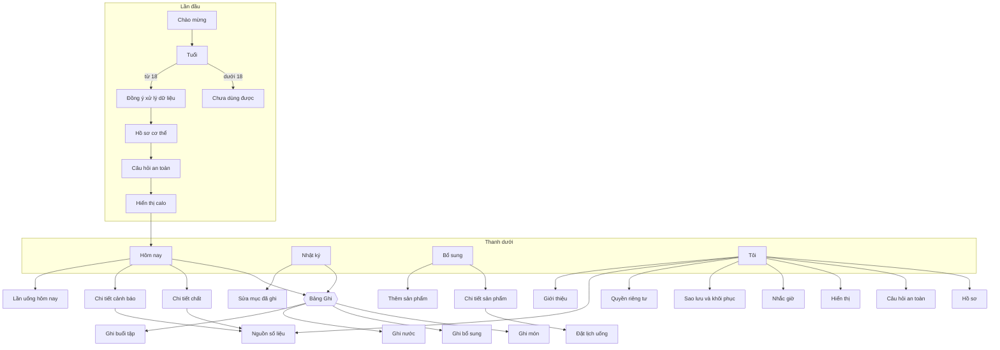
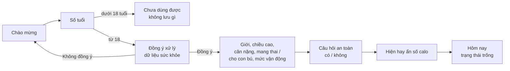
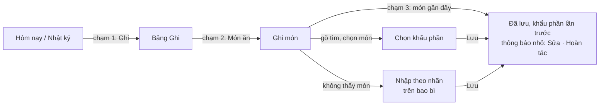
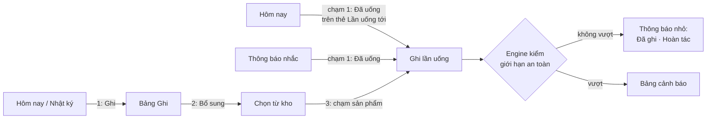
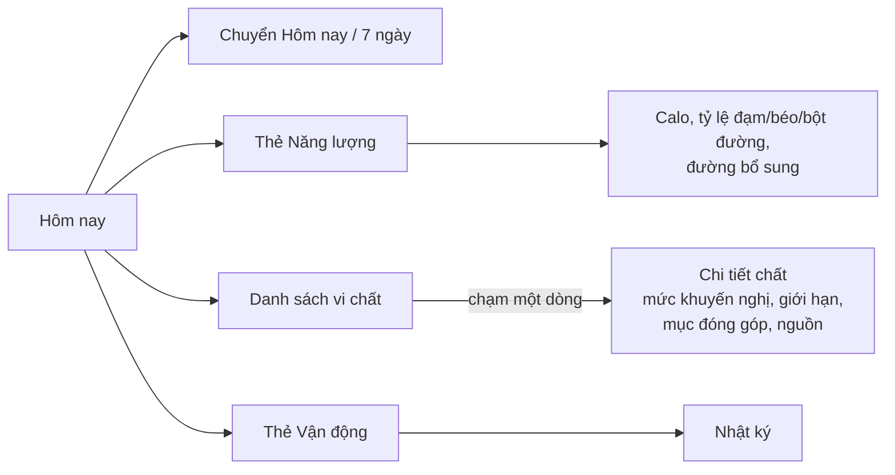
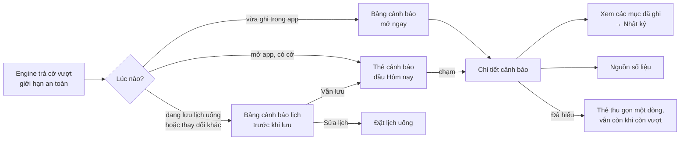

# Thiết kế UX: Tổng thể MVP

Trạng thái: Đã duyệt  <!-- Nháp | Đã duyệt -->
Đặc tả: không có đặc tả riêng (tài liệu khung). Căn cứ: [docs/plan.md](../plan.md) (Phạm vi, Thực phẩm bổ sung, An toàn người dùng, Pháp lý), [docs/status.md](../status.md) mục "Việc tiếp theo" 1.

Tài liệu này chốt **khung chung** cho mọi màn của MVP: sơ đồ màn hình, điều hướng, năm luồng chính, bộ thành phần dùng chung và quy ước chữ, số. Mỗi tính năng (thư viện món, khảo sát, chụp nhãn và kho, lịch uống, sao lưu) vẫn có đặc tả và thiết kế UX riêng; tệp đó chỉ được thêm chi tiết, không được đổi khung ở đây khi chưa sửa tệp này.

## Quyết định chính

| Chủ đề | Quyết định |
|---|---|
| Điều hướng | Thanh dưới 4 mục: **Hôm nay · Nhật ký · Bổ sung · Tôi**. Nút nổi **Ghi** ở Hôm nay và Nhật ký |
| Ghi nhanh | Nút Ghi mở bảng chọn: Món ăn, Bổ sung, Nước, Buổi tập. Món ghi gần đây và lần uống theo lịch ghi được trong ≤3 lần chạm |
| Ngày đang xem | Hôm nay và Nhật ký dùng chung một ngày đang xem; ghi mới vào ngày đó, tiêu đề bảng ghi luôn hiện ngày |
| Cảnh báo giới hạn an toàn | Luôn đứng đầu màn Hôm nay, còn vượt thì còn hiện; chạm vào mở màn Chi tiết cảnh báo. Ghi một lần uống làm vượt giới hạn thì mở ngay bảng cảnh báo sau khi lưu. Không chặn việc ghi (nhật ký là việc đã xảy ra) |
| Ẩn số calo | Một công tắc chung (Tôi → Hiển thị, và biểu tượng mắt trên thẻ Năng lượng). Khi bật, **không màn nào hiện số kcal** |
| Quảng cáo | **MVP không có quảng cáo** và không cài SDK quảng cáo. Bố cục chỉ chừa ô (`AdSlot`, cao 0) ở cuối danh sách Nhật ký và cuối danh sách Kho để bật sau không phải làm lại. Không bao giờ ở Chi tiết chất, Chi tiết cảnh báo, các bảng ghi, lần đầu mở app, thông báo. Có đặt ở Hôm nay hay không: quyết định khi bật quảng cáo |
| Mạng | Không màn nào cần mạng; không có trạng thái "mất mạng" trừ sao lưu Google Drive |

## Sơ đồ màn hình



Màn thuộc tính năng sau (Thêm sản phẩm, Đặt lịch uống, Nhắc giờ, Sao lưu) chỉ được vẽ khung ở đây; chi tiết ở thiết kế của tính năng đó.

## Luồng người dùng

### 1. Lần đầu mở app



- Hỏi tuổi **trước** màn đồng ý để không nhận đồng ý của người dưới 18 tuổi. Người dưới 18: không lưu tuổi, không tạo hồ sơ.
- Mỗi bước có nút Quay lại; thoát giữa chừng thì lần sau mở lại đúng bước đó (dữ liệu đã nhập chỉ lưu sau màn đồng ý).
- Có thanh bước "2/5" ở đầu mỗi màn.

### 2. Ghi món



- Bữa (Sáng, Trưa, Tối, Phụ) tự chọn theo giờ; đổi được bằng chip ở đầu màn.
- Món trong thư viện món Việt và món chọn "gần nhất" hiện nhãn **ước tính**.
- Giọng nói và mã vạch là biểu tượng trong ô tìm, chỉ hiện khi máy hỗ trợ (thuộc tính năng sau).

### 3. Ghi bổ sung



- Ghi một lần uống: trừ kho đúng hộp, cộng vào tổng nạp, kiểm lại giới hạn an toàn (theo plan, mục Nhắc giờ và đánh dấu đã uống).
- Kho trống: màn Chọn từ kho có nút "Thêm sản phẩm" và "Ghi một lần, không lưu vào kho" (nhập tay chất, lượng, đơn vị).
- Bấm "Đã uống" từ thông báo mà làm vượt giới hạn: app gửi thêm một thông báo chung "Có thông tin mới cần xem trong WholeWell" (không tên chất, không số); chạm vào mở Chi tiết cảnh báo. Thẻ cảnh báo chờ sẵn ở Hôm nay.

### 4. Xem tổng kết



### 5. Nhận cảnh báo



- Ba loại cờ: **lịch uống vượt** (tổng mỗi ngày theo lịch đã đặt), **vượt trong ngày** (đã ghi thực tế) và **trung bình 7 ngày vượt**. Nhiều loại cùng có thì cùng hiện, mỗi chất một thẻ.
- **Lịch uống vượt:** engine cộng hàm lượng mỗi chất trong một ngày theo mọi mục lịch của người đó (liều mỗi lần × số lần × hàm lượng mỗi đơn vị), đúng phạm vi giới hạn từng chất, rồi so với giới hạn an toàn. Chất có giới hạn tính mọi nguồn (vd. canxi, vitamin D): lịch chỉ gồm bổ sung, nên cảnh báo ghi thêm "Chưa tính thức ăn; thức ăn sẽ cộng thêm khi bạn ghi nhật ký."
- **Kiểm lại sau mọi thay đổi có thể làm vượt giới hạn:**

  | Thay đổi | Cách báo |
  |---|---|
  | Lưu lịch mới, sửa lịch (đổi liều, số lần, thêm sản phẩm vào lịch) | Bảng cảnh báo lịch **trước khi lưu**: [Sửa lịch] (nút chính) · [Vẫn lưu] |
  | Sửa thành phần sản phẩm đang có trong lịch (vd. sửa dòng nhãn đọc sai) | Bảng cảnh báo lịch trước khi lưu |
  | Thêm hộp mới khác hàm lượng vào sản phẩm đang có lịch | Bảng cảnh báo lịch trước khi lưu |
  | Sửa hồ sơ làm đổi nhóm tham chiếu (tuổi, mang thai, cho con bú) | Bảng cảnh báo sau khi lưu hồ sơ, liệt kê mọi chất mới vượt |
  | Tuổi tự cộng 1 | Thẻ cảnh báo ở Hôm nay |
  | Ghi, sửa lần uống hoặc món ăn | Bảng cảnh báo sau khi lưu (như trên) |

- Người dùng quyết định: app không chặn việc lưu lịch, chỉ cảnh báo. Đã lưu lịch vượt thì thẻ "Lịch uống vượt giới hạn an toàn" ở Hôm nay và dòng cảnh báo ở sản phẩm đó trong Bổ sung còn hiện tới khi lịch hết vượt.
- Cảnh báo chỉ xuất hiện khi đạt hoặc vượt giới hạn; không có mức "sắp vượt" (app không tự đặt ngưỡng).
- Không có nút tắt cảnh báo vĩnh viễn. Cờ hết khi số liệu hết vượt (vd. xóa mục ghi nhầm).

## Danh sách màn hình

| Màn | Mục đích | Vào từ | Ra tới |
|---|---|---|---|
| Chào mừng | Nói app là công cụ tham chiếu, dữ liệu ở trên máy | Mở app lần đầu | Tuổi |
| Tuổi | Số tuổi; chặn dưới 18 | Chào mừng | Đồng ý; Chưa dùng được |
| Chưa dùng được | Báo app dành cho người từ 18 tuổi | Tuổi | Đóng app |
| Đồng ý xử lý dữ liệu | Đồng ý riêng cho mục đích lưu và tính dữ liệu sức khỏe trên máy | Tuổi | Hồ sơ cơ thể; Chào mừng |
| Hồ sơ cơ thể | Giới, chiều cao, cân nặng, mang thai / cho con bú, mức vận động | Đồng ý; Tôi | Câu hỏi an toàn; Tôi |
| Câu hỏi an toàn | Câu có/không cho tầng an toàn (chi tiết ở thiết kế Khảo sát) | Hồ sơ cơ thể; Tôi | Hiển thị calo; Tôi |
| Hiển thị calo | Chọn hiện hay ẩn số calo | Câu hỏi an toàn | Hôm nay |
| **Hôm nay** | Cảnh báo, lần uống tới, năng lượng, vi chất, nước, vận động của ngày đang xem hoặc 7 ngày | Thanh dưới | Bảng Ghi, Chi tiết chất, Chi tiết cảnh báo, Lần uống hôm nay |
| **Nhật ký** | Mọi mục đã ghi của ngày đang xem, theo bữa | Thanh dưới | Bảng Ghi, Sửa mục |
| **Bổ sung** | Lần uống hôm nay và kho sản phẩm | Thanh dưới | Chi tiết sản phẩm, Thêm sản phẩm |
| **Tôi** | Hồ sơ và cài đặt | Thanh dưới | Các màn cài đặt |
| Bảng Ghi | Chọn loại cần ghi | Nút Ghi | Ghi món / bổ sung / nước / buổi tập |
| Ghi món | Tìm món, món gần đây, khẩu phần | Bảng Ghi | Nhật ký (lưu xong quay về màn trước) |
| Ghi bổ sung | Chọn sản phẩm trong kho hoặc ghi một lần | Bảng Ghi | Màn trước; Bảng cảnh báo |
| Ghi nước | Chọn nhanh 150 / 250 / 500 ml hoặc nhập số | Bảng Ghi; thẻ Nước | Màn trước |
| Ghi buổi tập | Hoạt động, giờ bắt đầu, thời lượng, cường độ | Bảng Ghi | Màn trước |
| Sửa mục đã ghi | Sửa khẩu phần, giờ, bữa; xóa | Nhật ký | Nhật ký |
| Lần uống hôm nay | Danh sách các lần uống theo lịch, đánh dấu từng loại | Hôm nay; Bổ sung; thông báo | Màn trước |
| Chi tiết chất | Lượng nạp so với mức khuyến nghị, giới hạn an toàn và phạm vi tính, mục đóng góp, 7 ngày | Hôm nay | Nguồn số liệu; Sửa mục |
| Chi tiết cảnh báo | Chất nào, bao nhiêu, giới hạn, tính từ nguồn nào, mục đóng góp, gợi ý hỏi bác sĩ | Thẻ / bảng cảnh báo | Nhật ký; Nguồn số liệu |
| Chi tiết sản phẩm | Thành phần mỗi khẩu phần theo từng chất và dạng, hộp trong kho, lịch | Bổ sung | Đặt lịch uống; Sửa thành phần |
| Thêm sản phẩm | Quét mã / chụp nhãn / nhập tay → xác nhận từng dòng | Bổ sung; Ghi bổ sung | Chi tiết sản phẩm |
| Hiển thị | Ẩn số calo; giao diện sáng/tối theo hệ thống | Tôi | Tôi |
| Quyền riêng tư | Xem và rút đồng ý, xuất dữ liệu, xóa toàn bộ | Tôi | Tôi |
| Nguồn số liệu | Danh sách nguồn, tên chuẩn, ngày tra, link | Tôi; Chi tiết chất; Chi tiết cảnh báo | Màn trước |
| Giới thiệu | Vai trò tham chiếu, phiên bản, giấy phép dữ liệu | Tôi | Tôi |

## Wireframe

Khung chiều rộng ~360 dp. `[ ]` là nút, `( )` là lựa chọn, `▓░` là thanh tiến độ. Số trong ví dụ là số minh họa.

### Chào mừng

```
┌──────────────────────────────┐
│                              │
│          WholeWell           │
│                              │
│ So lượng vi chất bạn nạp từ  │
│ bữa ăn và thực phẩm bổ sung  │
│ với mức khuyến nghị.         │
│                              │
│ • Chỉ để tham khảo, không    │
│   thay lời khuyên của bác sĩ │
│ • Dữ liệu chỉ nằm trên máy   │
│   này, không gửi đi đâu      │
│ • Không cần mạng             │
│                              │
│ [      Bắt đầu            ]  │
│  Khôi phục từ bản sao lưu    │
└──────────────────────────────┘
```

- "Khôi phục từ bản sao lưu" dẫn tới luồng khôi phục (thiết kế Sao lưu); khôi phục xong vào thẳng Hôm nay.

### Tuổi

```
┌──────────────────────────────┐
│ ←                       1/5  │
├──────────────────────────────┤
│ Bạn bao nhiêu tuổi?          │
│                              │
│ Tuổi [ 36   ]                │
│                              │
│ Dùng để chọn mức tham chiếu  │
│ theo nhóm tuổi.              │
│                              │
│ [      Tiếp tục           ]  │
└──────────────────────────────┘
```

- Ô nhập số (bàn phím số), 1–120. Không hỏi năm, tháng, ngày sinh.
- App lưu số tuổi và ngày nhập. Cứ đủ 12 tháng kể từ ngày nhập, app tự cộng 1 tuổi và hiện một dòng ở đầu Hôm nay: "Tuổi trong hồ sơ đã được cập nhật thành 37. [Sửa]". Nhóm tham chiếu đổi theo, mọi cảnh báo được kiểm lại.
- Dưới 18 tuổi → màn Chưa dùng được: "WholeWell dành cho người từ 18 tuổi." Nút "Đóng". Không lưu gì.
- Đúng 18 tuổi: đi tiếp bình thường; ở Hôm nay hiện ghi chú "chưa có mục tiêu calo" (xem Trạng thái).

### Đồng ý xử lý dữ liệu

```
┌──────────────────────────────┐
│ ←                       2/5  │
├──────────────────────────────┤
│ Dữ liệu sức khỏe của bạn     │
│                              │
│ App lưu tuổi, chiều cao, cân │
│ nặng, món ăn, thực phẩm bổ   │
│ sung bạn ghi, để tính và so  │
│ với mức tham chiếu.          │
│                              │
│ • Lưu mã hóa trên máy này    │
│ • Không gửi cho ai, kể cả    │
│   nhóm phát triển            │
│ • Xem, sửa, xuất, xóa bất cứ │
│   lúc nào ở Tôi → Quyền      │
│   riêng tư                   │
│                              │
│ ☐ Tôi đồng ý cho app xử lý   │
│   dữ liệu sức khỏe của tôi   │
│   cho mục đích trên.         │
│   Đọc đầy đủ                 │
│                              │
│ [ Đồng ý và tiếp tục ] (tắt  │
│   khi chưa đánh dấu)         │
│  Không đồng ý                │
└──────────────────────────────┘
```

- Ô đánh dấu không được đánh sẵn. Lưu ngày giờ và phiên bản nội dung đồng ý trên máy.
- Đồng ý cho nhắc giờ (quyền thông báo) và sao lưu Google Drive hỏi riêng lúc người dùng bật tính năng đó, không hỏi ở đây.
- "Không đồng ý": về Chào mừng, kèm dòng "App cần đồng ý này để tính toán. Bạn có thể quay lại bất cứ lúc nào."
- Lời văn đầy đủ ("Đọc đầy đủ") viết ở đặc tả Quyền riêng tư; căn cứ pháp lý đã có ở [docs/plan.md](../plan.md), mục Pháp lý. Tài liệu này chỉ chốt yêu cầu giao diện: đồng ý riêng từng mục đích, ô không đánh sẵn, lưu bằng chứng trên máy, rút được bất cứ lúc nào.

### Hồ sơ cơ thể

```
┌──────────────────────────────┐
│ ←                       3/5  │
├──────────────────────────────┤
│ Giới tính sinh học           │
│ ( ) Nam   ( ) Nữ             │
│                              │
│ Chiều cao  [ 160 ] cm        │
│ Cân nặng   [ 55  ] kg        │
│                              │
│ (chỉ khi chọn Nữ)            │
│ Hiện tại                     │
│ ( ) Không                    │
│ ( ) Đang mang thai           │
│     Tuần thai [ 20 ]         │
│     Cân nặng trước khi mang  │
│     thai [ 52 ] kg           │
│ ( ) Đang cho con bú          │
│                              │
│ Mức vận động                 │
│ [ Vận động nhẹ          ▾ ]  │
│ Ít vận động: ngồi nhiều...   │
│                              │
│ [      Tiếp tục           ]  │
└──────────────────────────────┘
```

- Mỗi lựa chọn mức vận động có một dòng mô tả bằng lời thường. Sau khi có buổi tập 7 ngày, Hôm nay hiện gợi ý đổi mức (người dùng xác nhận).
- Không hiện phân loại cân nặng (thiếu cân, béo phì…) cho người dùng; app tự tính từ chiều cao và cân nặng trước khi mang thai.
- Kiểm hợp lý: chiều cao 120–220 cm, cân nặng 30–250 kg; ngoài khoảng thì hỏi lại "Bạn kiểm tra lại số này nhé", không chặn cứng.

### Câu hỏi an toàn

```
┌──────────────────────────────┐
│ ←                       4/5  │
├──────────────────────────────┤
│ Vài câu hỏi có / không       │
│ Để app nhắc bạn hỏi bác sĩ   │
│ khi cần. Không hỏi tên bệnh  │
│ hay tên thuốc.               │
│                              │
│ Đang dùng thuốc kê đơn?      │
│ [ Có ] [ Không ] [ Không rõ ]│
│ ...                          │
│                              │
│ [      Tiếp tục           ]  │
└──────────────────────────────┘
```

- Danh sách câu hỏi và cách xử lý "Không rõ" thuộc thiết kế Khảo sát ban đầu. Ở MVP khung, bước này có thể bỏ qua nếu tính năng khảo sát chưa xong.

### Hiển thị calo

```
┌──────────────────────────────┐
│ ←                       5/5  │
├──────────────────────────────┤
│ Bạn muốn thấy số calo không? │
│                              │
│ ( ) Hiện số calo             │
│ ( ) Ẩn số calo               │
│     App vẫn tính, chỉ không  │
│     hiện con số.             │
│                              │
│ Đổi lại bất cứ lúc nào ở     │
│ Tôi → Hiển thị.              │
│                              │
│ [      Xong               ]  │
└──────────────────────────────┘
```

- Không chọn sẵn; nút Xong tắt cho tới khi chọn. Câu hỏi trung tính, không giải thích lý do sức khỏe tâm lý.

### Hôm nay

```
┌──────────────────────────────┐
│ Hôm nay      ‹ 23/11 ›   [⋮] │
│ [ Hôm nay | 7 ngày ]         │
├──────────────────────────────┤
│ ┌ ⚠ Vượt giới hạn an toàn ─┐ │
│ │ Magie từ bổ sung: 500 mg │ │
│ │ Giới hạn: 350 mg/ngày    │ │
│ │ Hỏi bác sĩ hoặc dược sĩ  │ │
│ │              [Xem thêm ›]│ │
│ └──────────────────────────┘ │
│ ┌ Lần uống tới · 20:00 ────┐ │
│ │ Canxi, Vitamin D   2 loại│ │
│ │ [ Đã uống ]  [ Chi tiết ]│ │
│ └──────────────────────────┘ │
│ ┌ Năng lượng          [👁] ┐ │
│ │ 1.650 / 2.100 kcal       │ │
│ │ ▓▓▓▓▓▓▓▓▓░░░             │ │
│ │ Đạm 18% · khoảng 10–35%  │ │
│ │ Béo 30% · khoảng 20–35%  │ │
│ │ Bột đường 52% · 45–65%   │ │
│ │ Đường bổ sung 22 g       │ │
│ │ · giới hạn 52 g          │ │
│ └──────────────────────────┘ │
│ Vi chất          [Tất cả ▾]  │
│ Canxi        620/1.000 mg 62%│
│ ▓▓▓▓▓▒▒░░░  ▓ ăn ▒ bổ sung   │
│ Vitamin D    15/15 µg   100% │
│ ▓▓▓▒▒▒▒▒▒▒                   │
│ Kali (ước tính) 1.900/2.600  │
│ ...                          │
│ ┌ Nước ────────────────────┐ │
│ │ 1.250 ml        [+250 ml]│ │
│ └──────────────────────────┘ │
│ ┌ Vận động tuần này ───────┐ │
│ │ 90 phút vừa · 20 phút    │ │
│ │ mạnh · 1 ngày tập cơ     │ │
│ └──────────────────────────┘ │
│                      [+ Ghi] │
├──────────────────────────────┤
│ Hôm nay Nhật ký Bổ sung  Tôi │
└──────────────────────────────┘
```

- **Thứ tự cố định:** cảnh báo → lần uống tới → năng lượng → vi chất → nước → vận động. Thẻ không có dữ liệu thì ẩn (trừ Năng lượng và Vi chất, hiện trạng thái trống).
- **‹ 23/11 ›**: lùi, tiến ngày; chạm vào ngày mở lịch chọn ngày; không tiến quá hôm nay. Tiêu đề đổi thành "Hôm qua" hoặc "Thứ Bảy, 21/11".
- **7 ngày:** số là trung bình mỗi ngày của 7 ngày tới ngày đang xem; thẻ Lần uống tới ẩn; cảnh báo trung bình 7 ngày hiện ở đây và ở chế độ Hôm nay.
- **Năng lượng:** thanh calo một màu trung tính, không đổi màu khi vượt mục tiêu; không có chữ "còn được ăn". Tỷ lệ đạm, béo, bột đường ghi chữ "trong khoảng" / "dưới khoảng" / "trên khoảng" cạnh số, không dùng màu xanh/đỏ. Đường bổ sung vượt giới hạn: thêm dòng "vượt giới hạn hằng ngày" (cảnh báo nhẹ, không đỏ). Biểu tượng mắt bật/tắt ẩn số calo.
- **Vi chất:** mặc định hiện các chất có mục tiêu, sắp theo thứ tự trong gói dữ liệu; bộ lọc "Tất cả / Có bổ sung / Dưới mức khuyến nghị". Thanh chia hai đoạn thực phẩm và bổ sung, phân biệt bằng mật độ và chú thích chữ, không chỉ bằng màu. Trên 100% thì thanh đầy, số % vẫn ghi đúng, không khen.
- Chạm một dòng vi chất → Chi tiết chất. Chạm thẻ Năng lượng → mở rộng tại chỗ. Chạm thẻ Vận động → Nhật ký lọc buổi tập.
- **Không có ô quảng cáo** ở màn này.

### Bảng Ghi

```
┌──────────────────────────────┐
│ Ghi cho hôm nay, 23/11       │
│ ┌──────────┐ ┌──────────┐    │
│ │  🍜      │ │  💊      │    │
│ │ Món ăn   │ │ Bổ sung  │    │
│ └──────────┘ └──────────┘    │
│ ┌──────────┐ ┌──────────┐    │
│ │  💧      │ │  🏃      │    │
│ │ Nước     │ │ Buổi tập │    │
│ └──────────┘ └──────────┘    │
└──────────────────────────────┘
```

- Bảng trượt từ dưới lên. Đang xem ngày khác hôm nay thì tiêu đề in đậm ngày đó ("Ghi cho thứ Bảy, 21/11").

### Ghi món

```
┌──────────────────────────────┐
│ ←  Ghi món                   │
│ [Sáng] [Trưa✓] [Tối] [Phụ]   │
│ ┌──────────────────────────┐ │
│ │ 🔍 Tìm món...      🎤 ▥  │ │
│ └──────────────────────────┘ │
├──────────────────────────────┤
│ Gần đây                      │
│ Phở bò · 1 bát       ước tính│
│ Cơm trắng · 1 bát            │
│ Sữa tươi · 220 ml            │
│ ...                          │
│ Không thấy món?              │
│ [ Nhập theo nhãn bao bì ]    │
└──────────────────────────────┘
```

- Chạm một món gần đây: lưu ngay với khẩu phần lần trước, quay về màn trước, hiện thông báo nhỏ "Đã ghi Phở bò, 1 bát · Sửa · Hoàn tác" (7 giây).
- Gõ tìm: danh sách kết quả thay cho Gần đây; chạm kết quả → bảng Chọn khẩu phần (đơn vị quen thuộc: bát, đĩa, cái; hoặc gram) → Lưu.
- Ẩn số calo bật: không hiện kcal ở kết quả và khẩu phần.
- 🎤 (giọng nói) và ▥ (mã vạch) chỉ hiện khi tính năng đó đã có và máy hỗ trợ.

### Ghi bổ sung

```
┌──────────────────────────────┐
│ ←  Ghi bổ sung · 14:05       │
├──────────────────────────────┤
│ Trong kho                    │
│ Canxi D3 · 1 viên            │
│ Magie · 1 viên               │
│ Vitamin tổng hợp · 1 viên    │
│                              │
│ [ Ghi một lần, không lưu kho]│
│ [ + Thêm sản phẩm ]          │
└──────────────────────────────┘
```

- Chạm sản phẩm: lưu với liều mặc định theo lịch (hoặc 1 khẩu phần), giờ hiện tại; thông báo nhỏ "Đã ghi · Sửa · Hoàn tác". Vượt giới hạn → Bảng cảnh báo thay cho thông báo nhỏ.
- Chạm "14:05" để đổi giờ (uống muộn, ghi bù).

### Nhật ký

```
┌──────────────────────────────┐
│ Nhật ký      ‹ 23/11 ›       │
├──────────────────────────────┤
│ Sáng                         │
│  Phở bò · 1 bát        07:30 │
│  Cà phê sữa · 1 ly     08:00 │
│ Trưa                         │
│  Cơm trắng · 1 bát     12:10 │
│ Bổ sung                      │
│  Canxi D3 · 1 viên     08:05 │
│ Nước  1.250 ml               │
│ Buổi tập                     │
│  Chạy bộ · 30 phút     18:00 │
│                              │
│ ┌ (ô quảng cáo, khi bật) ──┐ │
│ └──────────────────────────┘ │
│                      [+ Ghi] │
├──────────────────────────────┤
│ Hôm nay Nhật ký Bổ sung  Tôi │
└──────────────────────────────┘
```

- Chạm một dòng → Sửa mục đã ghi (sửa khẩu phần, giờ, bữa; nút Xóa ở cuối, hỏi lại trước khi xóa).
- Hiện kcal bên phải mỗi món chỉ khi không ẩn số calo. Buổi tập không hiện kcal khi ẩn số calo.
- Ô quảng cáo ở cuối danh sách, chiều cao 0 khi quảng cáo tắt.

### Bổ sung

```
┌──────────────────────────────┐
│ Bổ sung                      │
├──────────────────────────────┤
│ Hôm nay                      │
│  ✓ 08:00 Canxi D3            │
│  ○ 20:00 Canxi D3, Magie     │
│           [ Đã uống ]        │
│ Kho                          │
│ ┌──────────────────────────┐ │
│ │ Canxi D3                 │ │
│ │ Còn 42 viên · hết khoảng │ │
│ │ 15/12 · HSD 06/2027      │ │
│ └──────────────────────────┘ │
│ ┌──────────────────────────┐ │
│ │ Magie                    │ │
│ │ Còn 5 viên · sắp hết     │ │
│ └──────────────────────────┘ │
│ ┌ (ô quảng cáo, khi bật) ──┐ │
│ └──────────────────────────┘ │
│              [+ Thêm sản phẩm│
├──────────────────────────────┤
│ Hôm nay Nhật ký Bổ sung  Tôi │
└──────────────────────────────┘
```

- Phần "Hôm nay" chỉ có khi đã đặt lịch. Chưa có lịch: dòng "Chưa có lịch uống. Mở một sản phẩm để đặt lịch."
- "Sắp hết", "Sắp hết hạn", "Đã hết hạn" ghi bằng chữ, kèm biểu tượng. Hộp đã hết hạn không vào lịch.
- Không có link cửa hàng, không gợi ý sản phẩm.

### Chi tiết chất

```
┌──────────────────────────────┐
│ ←  Canxi                     │
│ [ Hôm nay | 7 ngày ]         │
├──────────────────────────────┤
│ 620 mg                       │
│ 62% mức khuyến nghị 1.000 mg │
│ ▓▓▓▓▓▒▒░░░                   │
│ Từ thực phẩm   420 mg        │
│ Từ bổ sung     200 mg        │
│                              │
│ Giới hạn an toàn 2.500 mg/ngày│
│ Tính mọi nguồn               │
│                              │
│ Đóng góp hôm nay             │
│  Canxi D3 · 1 viên    200 mg │
│   dạng canxi carbonat        │
│  Vitamin tổng hợp     100 mg │
│   dạng canxi citrat          │
│  Sữa tươi · 220 ml    264 mg │
│  ...                         │
│ 7 ngày qua                   │
│  ▁▃▅▂▆▃▄ (cột theo ngày)     │
│                              │
│ Mức này áp dụng cho nữ 31–50 │
│ tuổi. Nguồn số liệu ›        │
└──────────────────────────────┘
```

- Chất dùng mức ước tính: dòng thứ hai là "62% mức ước tính 1.000 mg" và một câu giải thích ngắn "Chưa đủ dữ liệu để đặt mức khuyến nghị chính thức; đây là mức ước tính."
- Phạm vi giới hạn viết bằng lời: "Tính mọi nguồn", "Chỉ tính từ bổ sung và thuốc", "Chỉ tính dạng tổng hợp (bổ sung và thực phẩm tăng cường)", "Chỉ tính retinol", "Chỉ tính axit folic". Chất không có giới hạn: "Chưa xác định giới hạn an toàn".
- Biểu đồ 7 ngày có bảng số thay thế cho trình đọc màn hình.
- **Đóng góp tách theo từng sản phẩm và từng dạng**, kể cả khi một sản phẩm có nhiều chất. Chất có giới hạn chỉ tính một số dạng (vitamin A, folate, niacin, vitamin E, magie) thì mỗi dòng có thêm chữ "tính vào giới hạn" hoặc "không tính vào giới hạn", và màn hiện hai tổng: tổng so với mức khuyến nghị, phần tính vào giới hạn. Ví dụ vitamin A từ viên tổng hợp bên dưới: "1.050 µg so với mức khuyến nghị · 750 µg retinol tính vào giới hạn 3.000 µg".
- Không có ô quảng cáo.

### Chi tiết cảnh báo (và Bảng cảnh báo)

```
┌──────────────────────────────┐
│ ←  Cảnh báo                  │
├──────────────────────────────┤
│ ⚠ Magie vượt giới hạn an toàn│
│                              │
│ Hôm nay từ bổ sung: 500 mg   │
│ Giới hạn an toàn: 350 mg/ngày│
│ Giới hạn này chỉ tính magie  │
│ từ bổ sung và thuốc, không   │
│ tính từ thức ăn.             │
│                              │
│ Các mục góp vào              │
│  Magie · 1 viên       250 mg │
│  Vitamin tổng hợp     250 mg │
│                              │
│ Hãy hỏi bác sĩ hoặc dược sĩ  │
│ về lượng bạn đang dùng.      │
│                              │
│ [ Xem trong nhật ký ]        │
│ [ Đã hiểu ]                  │
│ Nguồn số liệu ›              │
└──────────────────────────────┘
```

- **Bảng cảnh báo** (sau khi ghi): cùng nội dung, dạng bảng trượt lên che 3/4 màn, nút "Đã hiểu" và "Xem chi tiết". Không tự đóng.
- Trung bình 7 ngày: dòng đầu là "Trung bình 7 ngày qua từ bổ sung: 420 mg/ngày".
- **Bảng cảnh báo lịch** (trước khi lưu lịch):

```
┌──────────────────────────────┐
│ ⚠ Lịch này vượt giới hạn an  │
│   toàn                       │
│                              │
│ Magie từ bổ sung theo lịch:  │
│ 500 mg/ngày                  │
│ Giới hạn an toàn: 350 mg/ngày│
│ (chỉ tính từ bổ sung và      │
│ thuốc)                       │
│                              │
│ Góp vào                      │
│  Magie · 1 viên × 1 lần      │
│                       250 mg │
│  Vitamin tổng hợp · 1 viên   │
│  × 1 lần              250 mg │
│                              │
│ Hãy hỏi bác sĩ hoặc dược sĩ  │
│ về lượng bạn định dùng.      │
│                              │
│ [ Sửa lịch ]                 │
│   Vẫn lưu                    │
└──────────────────────────────┘
```

- "Vẫn lưu" là nút chữ, không phải nút chính; không có ô "Không nhắc lại".
- Đang mang thai hoặc cho con bú: thêm câu "Giới hạn này dành cho người đang mang thai" (hoặc cho con bú).
- Không có câu "hãy ngừng", "nên giảm"; không nhắc tên thuốc. Không có ô quảng cáo. Không chèn quảng cáo khi đóng bảng.

### Chi tiết sản phẩm

Một sản phẩm bổ sung thường có nhiều chất. App lưu và tính **theo từng chất**: mỗi dòng thành phần có chất, lượng mỗi khẩu phần, đơn vị, dạng. Mọi phép so (mức khuyến nghị, giới hạn an toàn, sau này mức tham khảo) đều chạy trên từng dòng sau khi đã đổi đơn vị theo dạng, rồi mới cộng theo chất.

```
┌──────────────────────────────┐
│ ←  Vitamin tổng hợp      [⋮] │
├──────────────────────────────┤
│ 1 khẩu phần = 1 viên         │
│ Hộp 60 viên · còn 42         │
│ Hết khoảng 15/12 · HSD 06/27 │
│                              │
│ Thành phần mỗi viên  (12)    │
│ Vitamin A        750 µg      │
│  dạng retinyl palmitat       │
│  · tính vào giới hạn         │
│ Vitamin A        300 µg      │
│  dạng beta-caroten           │
│  · không tính vào giới hạn   │
│ Vitamin D3       25 µg       │
│  (nhãn ghi 1.000 IU)         │
│ Canxi            100 mg      │
│  dạng canxi citrat           │
│ Axit folic       400 µg      │
│ Magie            250 mg      │
│  dạng magie oxit             │
│ Coenzyme Q10     30 mg       │
│  không có mức tham chiếu,    │
│  không tính                  │
│ ...                          │
│ [ Sửa thành phần ]           │
│                              │
│ Lịch uống                    │
│  Mỗi ngày 1 viên · 08:00     │
│  [ Đặt lịch ]                │
│ Ảnh nhãn ›                   │
└──────────────────────────────┘
```

- **Mỗi dòng một chất và một dạng.** Cùng một chất ở hai dạng (retinyl palmitat và beta-caroten) là hai dòng, vì cách đổi đơn vị và phạm vi giới hạn khác nhau.
- **Số hiện là số đã chuẩn hóa** theo đơn vị của app; số gốc trên nhãn ghi nhỏ bên dưới nếu khác ("nhãn ghi 1.000 IU").
- **Lượng là lượng nguyên tố** (canxi, sắt, magie, kẽm…). Nhãn chỉ ghi khối lượng hợp chất ("canxi carbonat 1.250 mg") thì xem Câu hỏi 11.
- **Chất không có trong gói dữ liệu** (CoQ10, collagen, chiết xuất thảo dược…): vẫn lưu đúng như nhãn để người dùng xem, ghi "không có mức tham chiếu, không tính". Không tính, không cảnh báo, không giải thích công dụng.
- **Dạng chưa rõ** (nhãn không ghi dạng ở chất mà dạng ảnh hưởng tới phép tính): dòng có biểu tượng ⓘ và chữ "chưa rõ dạng"; cách tính xem Câu hỏi 12.
- **Sửa thành phần** mở danh sách các dòng để sửa; lưu xong thì kiểm lại giới hạn cho lịch (bảng cảnh báo lịch nếu vượt).
- Không có ô quảng cáo, không link cửa hàng.

### Tôi

```
┌──────────────────────────────┐
│ Tôi                          │
├──────────────────────────────┤
│ Hồ sơ                      › │
│  Nữ · 35 tuổi · 160 cm       │
│ Câu hỏi an toàn            › │
│ Hiển thị                   › │
│  Đang ẩn số calo             │
│ Nhắc giờ                   › │
│ Sao lưu và khôi phục       › │
│  Lần cuối: 20/11             │
│ Quyền riêng tư             › │
│ Nguồn số liệu              › │
│ Giới thiệu                 › │
├──────────────────────────────┤
│ Hôm nay Nhật ký Bổ sung  Tôi │
└──────────────────────────────┘
```

- **Quyền riêng tư:** danh sách đồng ý đã cho (ngày giờ) với nút Rút đồng ý; Xuất dữ liệu (tệp đọc được, cảnh báo tệp không mã hóa); Xóa toàn bộ dữ liệu (gõ "XÓA" để xác nhận). Rút đồng ý xử lý dữ liệu sức khỏe = xóa toàn bộ và về Chào mừng; app báo rõ trước.
- **Nguồn số liệu:** màn duy nhất được ghi tên chuẩn (RDA, AI, UL, EER, AMDR, MET) và tên tổ chức, kèm giải thích bằng lời thường, ngày tra và link mở trình duyệt.

### Thông báo nhắc giờ (khung)

```
┌──────────────────────────────┐
│ WholeWell · 20:00            │
│ Đến giờ uống, 2 loại         │
│ [ Đã uống ]   [ Mở app ]     │
└──────────────────────────────┘
```

- Màn hình khóa chỉ hiện nội dung chung. Nếu "Đã uống" làm vượt giới hạn an toàn: thêm thông báo chung "Có thông tin mới cần xem trong WholeWell", không tên chất, không số; chạm mở Chi tiết cảnh báo. Đây là thông báo duy nhất về cảnh báo; không có quảng cáo trong thông báo.
- Đánh dấu từng loại và nhắc lại thuộc thiết kế Lịch uống.

## Bộ thành phần dùng chung

Đặt trong `app/lib/ui/common/`. Mọi màn dùng các thành phần này, không tự vẽ lại.

| Thành phần | Dùng ở | Nội dung | Hành vi, trợ năng |
|---|---|---|---|
| `MetricCard` (thẻ chỉ số) | Hôm nay | Tiêu đề, số chính, dòng phụ, nút hành động tùy chọn | Cả thẻ là một vùng chạm ≥48 dp; nhãn đọc màn hình gộp tiêu đề + số |
| `LabeledProgress` (thanh tiến độ có nhãn) | Vi chất, calo, chi tiết chất | Giá trị, mục tiêu, %, tối đa hai đoạn (thực phẩm, bổ sung) | Luôn có số bằng chữ; đoạn phân biệt bằng mật độ + chú thích; thanh không bao giờ đổi màu đỏ; đọc: "Canxi, 620 trên 1.000 miligam, 62 phần trăm mức khuyến nghị" |
| `WarningCard` (thẻ cảnh báo) | Hôm nay, bảng cảnh báo | Biểu tượng ⚠, chất, lượng, giới hạn, phạm vi, lời hỏi bác sĩ | Màu nền cảnh báo (vàng hổ phách, không đỏ) + biểu tượng + chữ "Vượt giới hạn an toàn"; trạng thái mở / thu gọn một dòng; trình đọc màn hình đọc trước các thẻ khác |
| `NutrientRow` (dòng vi chất) | Hôm nay | Tên, nhãn ước tính, số, %, `LabeledProgress` | Chạm mở Chi tiết chất; cỡ chữ lớn thì số xuống dòng dưới tên |
| `IngredientRow` (dòng thành phần) | Chi tiết sản phẩm, xác nhận nhãn, chi tiết chất, chi tiết cảnh báo | Chất, lượng đã chuẩn hóa, số gốc trên nhãn, dạng, "tính / không tính vào giới hạn", "chưa rõ dạng", "không có mức tham chiếu" | Mọi trạng thái ghi bằng chữ; đọc màn hình: "Vitamin A, 750 microgam, dạng retinyl palmitat, tính vào giới hạn an toàn" |
| `EstimateChip` (nhãn ước tính) | Vi chất, món ăn | Chữ "ước tính" | Có chữ, không chỉ biểu tượng |
| `CalorieText` | Mọi chỗ có kcal | Số kcal hoặc không gì cả | Đọc công tắc ẩn số calo; khi ẩn trả về khoảng trống, không để "***" |
| `DaySwitcher` (chọn ngày) | Hôm nay, Nhật ký | ‹ ngày › | Hai nút mũi tên 48 dp; chạm ngày mở lịch |
| `LogSheet` (bảng Ghi) | Nút Ghi | 4 ô lựa chọn, tiêu đề có ngày | Ô ≥ 96 dp; đóng bằng vuốt xuống hoặc nút Quay lại |
| `EntryTile` (dòng nhật ký) | Nhật ký, chi tiết | Tên, khẩu phần, giờ, kcal (qua `CalorieText`) | Chạm mở sửa |
| `UndoSnack` (thông báo nhỏ có hoàn tác) | Sau khi ghi, xóa | Câu ngắn + Sửa + Hoàn tác | 7 giây; trình đọc màn hình đọc to |
| `EmptyState` | Mọi danh sách | Câu ngắn + một nút hành động | Không hình minh họa vui nhộn kiểu "chưa cố gắng" |
| `ErrorState` | Mọi màn | Câu nói chuyện gì xảy ra + việc người dùng làm được | Không hiện mã lỗi kỹ thuật ở dòng chính |
| `AdSlot` (ô quảng cáo) | Cuối Nhật ký, cuối Kho | Chỗ trống | MVP luôn cao 0, không gọi mạng. Khi bật sau: ghi "Quảng cáo", không dùng ở màn có `WarningCard` |
| `StepScaffold` | Lần đầu mở app | Nút quay lại, "n/5", nội dung, nút chính dưới cùng | Nút chính luôn nhìn thấy khi bàn phím mở |

### Quy ước hiển thị

- **Màu:** Material 3, màu gốc teal, có chế độ tối. Màu cảnh báo là vàng hổ phách (`tertiaryContainer` tùy chỉnh), dành riêng cho giới hạn an toàn và đường bổ sung vượt giới hạn. Màu đỏ (`error`) chỉ dùng cho lỗi và nút Xóa.
- **Số:** dấu chấm ngăn hàng nghìn, dấu phẩy thập phân (1.650; 2,5 mg). Làm tròn: ≥100 số nguyên, 10–99 một chữ số thập phân, <10 tối đa hai. Số liệu vận động ghi "khoảng".
- **Đơn vị:** mg, µg, g, ml, kcal. Đơn vị kèm dạng (µg RAE, µg DFE, mg NE) chỉ hiện ở Chi tiết chất, kèm giải thích một dòng; ở danh sách ghi µg, mg.
- **Ngày giờ:** "Hôm nay", "Hôm qua", "Thứ Bảy, 21/11"; giờ 24 giờ (20:00).
- **Cỡ chữ 200%:** dòng "tên · số" tách thành hai dòng; thẻ không cắt chữ; thanh dưới giữ nhãn ngắn (≤7 ký tự).

## Trạng thái

| Màn | Trống | Đang xử lý | Lỗi | Cảnh báo |
|---|---|---|---|---|
| Hôm nay | Chưa ghi gì hôm nay: thẻ Năng lượng hiện mục tiêu calo (nếu có), Vi chất hiện "Chưa có món nào hôm nay" + [Ghi món]. Không ước tính lượng nạp | Khung xám nếu quá 300 ms | Không đọc được dữ liệu: `ErrorState` + [Thử lại] | `WarningCard` đầu màn; đường bổ sung vượt: dòng trong thẻ Năng lượng |
| Hôm nay – không tính được calo | 18 tuổi: "Chưa có mục tiêu calo cho người 18 tuổi." Mang thai thiếu tuần thai: "Nhập tuần thai để tính mục tiêu calo" + [Mở hồ sơ]. Mang thai dưới 19 tuổi: "Chưa có cách tính mục tiêu calo cho người mang thai dưới 19 tuổi." | – | – | Vi chất và giới hạn an toàn vẫn hiện đủ |
| Nhật ký | "Chưa có gì trong ngày này." + [Ghi] | Khung xám | Lưu thất bại: thông báo nhỏ "Chưa lưu được. Thử lại" | – |
| Bổ sung | "Kho đang trống. Thêm sản phẩm để theo dõi lần uống và ngày hết." + [Thêm sản phẩm] | – | – | Dòng chữ "sắp hết", "sắp hết hạn", "đã hết hạn" |
| Ghi món | Chưa có món gần đây: chỉ hiện ô tìm và [Nhập theo nhãn bao bì] | Tìm kiếm: vòng xoay nhỏ trong ô tìm | Không thấy kết quả: "Không thấy “bánh đúc”. Thử tên khác hoặc nhập theo nhãn." | – |
| Ghi bổ sung | Kho trống: [Thêm sản phẩm] và [Ghi một lần] | – | Lưu thất bại: thông báo nhỏ + Thử lại | Vượt giới hạn: Bảng cảnh báo |
| Chi tiết chất | Chưa có mục nào: "Hôm nay chưa có nguồn canxi nào được ghi." | – | – | Có cờ: `WarningCard` đầu màn |
| Chi tiết cảnh báo | – (chỉ mở khi có cờ) | – | Cờ đã hết (người dùng vừa xóa mục): "Hiện không còn vượt giới hạn." + [Về Hôm nay] | Chính là màn cảnh báo |
| Lần đầu mở app | – | Lưu hồ sơ: nút chính hiện vòng xoay | Dưới 18: màn Chưa dùng được. Số ngoài khoảng hợp lý: dòng nhắc dưới ô | – |
| Toàn app | – | – | Gói dữ liệu tham chiếu hỏng (kiểm toàn vẹn thất bại): màn chặn "Không đọc được dữ liệu tham chiếu. Hãy cài lại WholeWell từ cửa hàng ứng dụng." Không tính, không hiện số nào. Không mở được CSDL (mất khóa): "Không mở được dữ liệu đã lưu trên máy." + [Khôi phục từ bản sao lưu] [Bắt đầu lại] | – |

## Nội dung chữ

| Vị trí | Chữ hiển thị |
|---|---|
| Thanh dưới | Hôm nay · Nhật ký · Bổ sung · Tôi |
| Nút nổi | Ghi |
| Chào mừng, dòng chính | So lượng vi chất bạn nạp từ bữa ăn và thực phẩm bổ sung với mức khuyến nghị. |
| Chào mừng, gạch đầu dòng | Chỉ để tham khảo, không thay lời khuyên của bác sĩ · Dữ liệu chỉ nằm trên máy này, không gửi đi đâu · Không cần mạng |
| Chưa dùng được | WholeWell dành cho người từ 18 tuổi. |
| Đồng ý, ô đánh dấu | Tôi đồng ý cho app xử lý dữ liệu sức khỏe của tôi cho mục đích trên. |
| Hiển thị calo | Bạn muốn thấy số calo không? · Hiện số calo · Ẩn số calo · App vẫn tính, chỉ không hiện con số. |
| Thẻ Năng lượng | Mục tiêu calo · Đạm / Béo / Bột đường · trong khoảng / dưới khoảng / trên khoảng · Đường bổ sung · giới hạn |
| Thẻ Năng lượng, đường vượt | Đường bổ sung vượt giới hạn hằng ngày. |
| Thẻ Năng lượng, đường theo bữa | Bữa trưa có 14 g đường bổ sung, quá giới hạn 10 g mỗi bữa. |
| Dòng vi chất | 62% mức khuyến nghị · 62% mức ước tính |
| Gợi ý mức vận động | Theo các buổi tập 7 ngày qua, mức vận động của bạn gần với "Vận động vừa". [Dùng mức này] [Giữ mức hiện tại] |
| Vận động | phút vận động vừa · phút vận động mạnh · ngày tập tăng cơ · Mức tham chiếu: 150–300 phút vừa mỗi tuần |
| Thẻ cảnh báo, tiêu đề | Vượt giới hạn an toàn |
| Thẻ cảnh báo, lời khuyên | Hãy hỏi bác sĩ hoặc dược sĩ về lượng bạn đang dùng. |
| Cảnh báo, 7 ngày | Trung bình 7 ngày qua từ bổ sung: {x}/ngày |
| Phạm vi giới hạn | Tính mọi nguồn · Chỉ tính từ bổ sung và thuốc · Chỉ tính dạng tổng hợp (bổ sung và thực phẩm tăng cường) · Chỉ tính retinol · Chỉ tính axit folic · Chưa xác định giới hạn an toàn |
| Mức ước tính, giải thích | Chưa đủ dữ liệu để đặt mức khuyến nghị chính thức; đây là mức ước tính. |
| Sau khi ghi | Đã ghi {tên}, {khẩu phần} · Sửa · Hoàn tác |
| Thông báo nhắc | Đến giờ uống, {n} loại · Đã uống · Mở app |
| Thông báo sau cảnh báo | Có thông tin mới cần xem trong WholeWell |
| Bảng cảnh báo lịch | Lịch này vượt giới hạn an toàn · {chất} từ bổ sung theo lịch: {x}/ngày · Chưa tính thức ăn; thức ăn sẽ cộng thêm khi bạn ghi nhật ký. · Sửa lịch · Vẫn lưu |
| Thẻ lịch vượt ở Hôm nay | Lịch uống vượt giới hạn an toàn |
| Tuổi tự cập nhật | Tuổi trong hồ sơ đã được cập nhật thành {n}. Sửa |
| Xóa mục | Xóa “{tên}” khỏi nhật ký? · Xóa · Hủy |
| Xóa toàn bộ | Mọi dữ liệu trên máy này sẽ bị xóa và không lấy lại được, trừ khi bạn có bản sao lưu. Gõ XÓA để xác nhận. |
| Lỗi lưu | Chưa lưu được. Thử lại |
| Gói dữ liệu hỏng | Không đọc được dữ liệu tham chiếu. Hãy cài lại WholeWell từ cửa hàng ứng dụng. |

Không dùng ở bất kỳ đâu: "bạn bị thiếu", "nên uống", "nên ăn thêm", "tốt", "xấu", "tuyệt vời", "chuỗi ngày", "đốt", "được ăn thêm", "điều trị", "ngừng uống".

## Kiểm theo nguyên tắc (`docs/design/README.md`)

- [x] Lời lẽ đúng vai tham chiếu, không viết tắt chuẩn: tên chuẩn chỉ ở màn Nguồn số liệu; danh sách từ cấm ở trên.
- [x] Ẩn số calo được tôn trọng: một công tắc chung, mọi kcal đi qua `CalorieText`; Nhật ký, Ghi món, buổi tập đều tuân.
- [x] Tối đa 3 lần chạm cho thao tác chính: ghi món gần đây (Ghi → Món ăn → món), ghi bổ sung (Ghi → Bổ sung → sản phẩm, hoặc 1 chạm "Đã uống"), ghi nước (1 chạm "+250 ml" trên Hôm nay). Món mới cần gõ tìm nên vượt 3 chạm.
- [x] Cỡ chữ 200%, vùng chạm 48 dp, tương phản AA: quy ước ở mục Bộ thành phần; nghĩa luôn có chữ, không chỉ màu.
- [x] Không quảng cáo ở màn cảnh báo: MVP không có quảng cáo; ô chừa sẵn chỉ ở cuối Nhật ký và cuối Kho.

## Đã chốt với chủ dự án (23/11/2026)

1. **Thanh dưới 4 mục:** Hôm nay, Nhật ký, Bổ sung, Tôi.
2. **Nhập số tuổi,** không hỏi năm sinh; app tự cộng 1 tuổi mỗi 12 tháng kể từ ngày nhập.
3. **Bấm "Đã uống" từ thông báo mà làm vượt giới hạn:** gửi thêm một thông báo chung "Có thông tin mới cần xem trong WholeWell", không tên chất, không số.
4. **Màn Hôm nay chỉ có "Hôm nay | 7 ngày"** ở MVP; trung bình 30 ngày để sau.
5. **Cân nặng trước khi mang thai hỏi bằng số kg;** app tự phân loại, không hiện tên phân loại. Việc cần làm: thêm vào đặc tả hồ sơ (engine nhận cân nặng, tự suy ra phân loại).
6. **Giữ "Ghi một lần, không lưu kho"** cho bổ sung ở MVP.
7. **Cảnh báo theo lịch uống:** khi lưu lịch, app cộng hàm lượng mỗi chất trong một ngày theo lịch và cảnh báo nếu vượt giới hạn an toàn. Mọi thay đổi khác có thể làm vượt (sửa sản phẩm, thêm hộp, đổi hồ sơ, ghi nhật ký) cũng được kiểm lại và cảnh báo.
8. **Rút đồng ý** thì xóa toàn bộ dữ liệu; **xuất dữ liệu** ra tệp đọc được, có cảnh báo.
9. **MVP không có quảng cáo,** chỉ chừa chỗ trong bố cục; bật dần về sau.
10. **Không dẫn luật trong tài liệu thiết kế;** căn cứ pháp lý nằm ở plan, lời văn đồng ý ở đặc tả Quyền riêng tư.

## Chưa chốt, chuyển sang đặc tả chụp nhãn

11. **Nhãn chỉ ghi khối lượng hợp chất** (vd. "canxi carbonat 1.250 mg", "sắt fumarat 200 mg"), không ghi lượng nguyên tố. Đề xuất: thêm vào `build_pack.py` tỷ lệ nguyên tố cho các dạng phổ biến có trong fact sheet NIH ODS (vd. canxi carbonat 40%, canxi citrat 21%; sắt fumarat 33%, sắt sulfat 20%, sắt gluconat 12%), mỗi số kèm nguồn và ô đối chiếu. Dạng không có tỷ lệ trong nguồn: chất đó "chưa tính được" kèm lý do, và màn sản phẩm báo rõ "chưa kiểm được giới hạn an toàn cho chất này". Cách khác: bắt người dùng tự nhập lượng nguyên tố (dễ sai).
12. **Nhãn không ghi dạng** ở chất mà dạng ảnh hưởng tới phép tính (vitamin A, folate, niacin, vitamin E). Đề xuất: khi xác nhận nhãn, hỏi dạng với lựa chọn "Nhãn không ghi"; nếu không ghi thì **giới hạn an toàn tính theo dạng bị giới hạn** (vd. coi là retinol, là axit folic) vì tầng an toàn chỉ được thận trọng hơn, còn phần so với mức khuyến nghị ghi "chưa chắc". Đây là quy tắc của app, không phải chuẩn; cần anh đồng ý.

## Ghi cho đặc tả sau

- Lược đồ sản phẩm: Sản phẩm → nhiều Thành phần {chất (id trong gói, hoặc tên tự do nếu ngoài gói), dạng, lượng mỗi khẩu phần, đơn vị gốc, lượng gốc trên nhãn, là nguyên tố hay hợp chất, nguồn dòng (mã vạch / nhãn / nhập tay), đã xác nhận}. Engine nhận từng dòng và tự đổi đơn vị, tự xếp phạm vi giới hạn theo dạng; giao diện không tự tính.
- Hồ sơ lưu số tuổi kèm ngày nhập (để tự cộng tuổi).
- Engine nhận cân nặng trước khi mang thai thay cho phân loại.
- Engine thêm hàm kiểm giới hạn an toàn cho lịch uống (tổng mỗi ngày theo lịch, đúng phạm vi từng chất); đổi cả `tools/reference_engine.py` và fixtures.
- Trước khi bật quảng cáo: cập nhật chính sách quyền riêng tư, mục An toàn dữ liệu trên Google Play, bảng tự kiểm tra pháp lý; quyết định ô quảng cáo ở Hôm nay.
