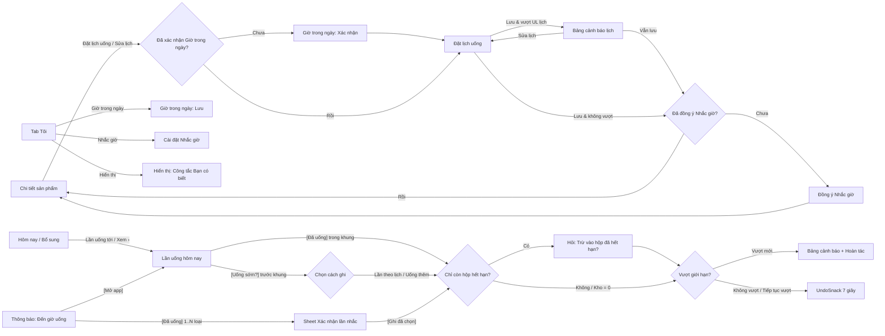

# Thiết kế UX: Lịch uống, nhắc giờ Android, nút "Đã uống"

Trạng thái: Đã duyệt (26/11/2026)  <!-- Nháp | Đã duyệt -->
Đặc tả: [docs/specs/schedule-reminders.md](../specs/schedule-reminders.md)
Thiết kế khung: [docs/design/mvp-overview.md](mvp-overview.md)

## Luồng người dùng



## Danh sách màn hình & cập nhật

| Màn / Thành phần | Mục đích | Vào từ | Ra tới |
|---|---|---|---|
| **Chi tiết sản phẩm** (cập nhật) | Hiện tóm tắt lịch hiện tại (`Lịch: mỗi ngày ...` hoặc `Chưa có lịch uống`) và nút `[ Đặt lịch ]` / `[ Sửa lịch ]` | Tab Bổ sung | Đặt lịch uống |
| **Tab Tôi & Hiển thị** (cập nhật) | Thêm `Giờ trong ngày ›`, `Nhắc giờ ›` ở Tab Tôi; thêm công tắc `Hiện thẻ "Bạn có biết"` ở `Tôi → Hiển thị` (mặc định bật, gắn `settings.show_tip_card`) | Thanh dưới (`Tôi`) | Giờ trong ngày, Nhắc giờ, Hiển thị |
| **Giờ trong ngày** | Xem/chỉnh giờ thức dậy, 3 bữa chính, đi ngủ; nút `[ Xác nhận và tiếp tục ]` (lần đầu đặt lịch) hoặc `[ Lưu ]` (từ `Tôi`) | Lần đầu Đặt lịch; Tab Tôi | Đặt lịch uống, Tab Tôi |
| **Đặt lịch uống** | Thêm, sửa, hoặc xóa lịch (`Xóa lịch này` chỉ hiện khi sửa lịch cũ, hỏi xác nhận trước khi gọi `endSchedule`); hiện lưu ý & gợi ý 5 quy tắc theo giờ chọn | Chi tiết sản phẩm; Bảng cảnh báo lịch | Bảng cảnh báo lịch, Chi tiết sản phẩm |
| **Bảng cảnh báo lịch** | Cảnh báo chất vượt UL theo tổng lịch hằng ngày (kèm câu `"Chưa tính thức ăn..."` với chất mọi nguồn và dòng thận trọng nếu đang bật) | Đặt lịch uống, Sửa thành phần | Đặt lịch uống (`Sửa lịch`), Chi tiết sản phẩm (`Vẫn lưu`) |
| **Nhắc giờ** | Lần đầu: màn xin đồng ý riêng (`consents.kind = 'notifications'`, checkbox không đánh sẵn + `[ Bật nhắc giờ ]`). Đã đồng ý (`Tôi → Nhắc giờ`): công tắc bật/tắt | Sau khi lưu lịch đầu; Tab Tôi | Tab Tôi, Cài đặt hệ thống |
| **Lần uống hôm nay** | Danh sách các khung giờ uống trong ngày, trạng thái từng sản phẩm (`Đã uống`, `Chưa đánh dấu`, `Đang trong khung`, `Uống sớm?`, `Đã bỏ qua`) | Thẻ Lần uống tới, Tab Bổ sung, `[Mở app]` trên thông báo | Hỏi trừ hộp hết hạn, Bảng cảnh báo, Nhật ký (Sửa mục) |
| **Sheet Xác nhận lần nhắc** | Mở khi bấm `[Đã uống]` từ thông báo (kể cả cold start): cho ghi 1 chạm các loại trong khung | Nút `[Đã uống]` trên thông báo Android | Hỏi trừ hộp hết hạn, Bảng cảnh báo, Hôm nay |
| **Hôm nay** (cập nhật thẻ) | Thẻ `Lần uống tới`; `SafetyNote` lưu ý lịch có nút `Đã hiểu` thu gọn thành 1 dòng (lưu `ui_state`, tự mở lại khi lịch đổi); `TipCard` (`Bạn có biết`, bấm `Xem nguồn ›` mở Nguồn số liệu) | Thanh dưới | Lần uống hôm nay, Nguồn số liệu |

## Wireframe

### 1. Giờ trong ngày & Nhắc giờ

```
┌──────────────────────────────┐  ┌──────────────────────────────┐
│ ←  Giờ trong ngày            │  │ ←  Nhắc giờ                  │
├──────────────────────────────┤  ├──────────────────────────────┤
│ Dùng để tự chọn bữa ăn và gợi│  │ Nhận thông báo khi tới giờ   │
│ ý xếp lịch vitamin D, canxi. │  │ uống bổ sung.                │
│                              │  │ • Màn hình khóa chỉ hiện     │
│ Thức dậy           [ 06:00 ] │  │   "Đến giờ uống", không hiện │
│ Bữa sáng           [ 07:00 ] │  │   tên chất hay sản phẩm.     │
│ Bữa trưa           [ 12:00 ] │  │ • Bấm "Đã uống" cần mở khóa  │
│ Bữa tối            [ 19:00 ] │  │   máy trước khi ghi.         │
│ Đi ngủ             [ 22:30 ] │  │                              │
│                              │  │ (Lần đầu chưa đồng ý:)       │
│ (Lần đầu từ Đặt lịch:)       │  │ ☐ Tôi đồng ý bật thông báo   │
│ [    Xác nhận và tiếp tục  ] │  │   nhắc giờ trên máy này      │
│                              │  │ [      Bật nhắc giờ        ] │
│ (Mở từ Tôi → Giờ trong ngày:)│  │                              │
│ [           Lưu            ] │  │ (Đã đồng ý, vào từ Tôi:)     │
└──────────────────────────────┘  │ Thông báo nhắc giờ    [ ◯─ ] │
                                  └──────────────────────────────┘
```

- **Màn Nhắc giờ:** lần đầu đặt lịch hoặc khi chưa từng đồng ý (`consents.kind = 'notifications'`), checkbox đồng ý **không đánh sẵn**, nút `[ Bật nhắc giờ ]` chỉ bật sau khi người dùng đánh dấu. Khi đã có đồng ý và mở từ `Tôi → Nhắc giờ`, hiển thị công tắc bật/tắt nhắc giờ.
- Khi chưa cấp quyền `POST_NOTIFICATIONS` (Android 13+): hiện thẻ trung tính `"Chưa có quyền gửi thông báo trên máy này."` + nút `[ Mở cài đặt ]`.
- Khi thiếu quyền `SCHEDULE_EXACT_ALARM` (Android 14+): nhắc nhẹ `"Thông báo có thể đến lệch vài phút theo chế độ tiết kiệm pin."` (vẫn cho bật nhắc giờ với fallback).

### 2. Chi tiết sản phẩm (cập nhật phần lịch), Đặt lịch uống & Bảng cảnh báo lịch

```
  (Trong Chi tiết sản phẩm)
  ┌────────────────────────────┐
  │ Lịch: mỗi ngày 1 viên 08:00│
  │ [ Sửa lịch ]   [+ Thêm lịch]│
  └────────────────────────────┘

┌──────────────────────────────┐  ┌──────────────────────────────┐
│ ←  Đặt lịch: Canxi D3        │  │ ⚠ Lịch này vượt giới hạn an  │
├──────────────────────────────┤  │   toàn                       │
│ Giờ uống           [ 08:00 ] │  │ ⓘ (Nếu bật chế độ thận trọng:│
│ Số lượng mỗi lần             │  │   dòng nhắc thận trọng)      │
│   [ − ]   1   [ + ]  viên    │  │ Magie từ bổ sung theo lịch:  │
│                              │  │ 400 mg/ngày                  │
│ ⓘ Lưu ý lịch                 │  │ Giới hạn: 350 mg/ngày        │
│ Canxi hấp thu tốt nhất khi   │  │ Vượt: 50 mg/ngày (14%)       │
│ mỗi lần không quá 500 mg.    │  │ Chưa tính thức ăn; thức ăn sẽ│ ← (nếu chất tính
│                              │  │ cộng thêm khi ghi nhật ký.   │    UL mọi nguồn)
│ 💡 Gợi ý                     │  │ Góp vào                      │
│ Canxi carbonat hấp thu tốt   │  │  Vitamin tổng hợp · 1 viên   │
│ hơn khi uống cùng bữa ăn.    │  │  × 1 lần/ngày         150 mg │
│                              │  │  Magie · 1 viên              │
│ [       Lưu lịch          ]  │  │  × 1 lần/ngày         250 mg │
│                              │  │ Hỏi bác sĩ hoặc dược sĩ nếu  │
│ (Chỉ hiện khi sửa lịch cũ:)  │  │ cần.                         │
│      Xóa lịch này            │  │ [ Sửa lịch ]                 │
└──────────────────────────────┘  │   Vẫn lưu                    │
                                  └──────────────────────────────┘
```

- Nút `Xóa lịch này` **chỉ hiện khi đang sửa lịch cũ**, chạm vào mở hộp thoại xác nhận `"Kết thúc lịch uống lúc {giờ}?"` (`[ Hủy ]` / `[ Xóa lịch ]`) trước khi gọi `endSchedule`.
- **Bảng cảnh báo lịch:** nếu chất vượt UL thuộc nhóm tính mọi nguồn (vd. canxi, sắt, kẽm...), hiện thêm câu `"Chưa tính thức ăn; thức ăn sẽ cộng thêm khi bạn ghi nhật ký."` (chất chỉ tính bổ sung như magie thì không hiện câu này). Nếu đang bật chế độ thận trọng, hiện dòng nhắc chế độ thận trọng ngay dưới tiêu đề.

### 3. Lần uống hôm nay (4 trạng thái tách riêng) & Sheet Xác nhận từ thông báo

```
┌──────────────────────────────┐  ┌──────────────────────────────┐
│ ←  Lần uống hôm nay          │  │ Đến giờ uống · 19:00         │
├──────────────────────────────┤  ├──────────────────────────────┤
│ 08:00 (đã uống)              │  │ ☑ Kẽm · 1 viên               │
│  ✓ Canxi D3 · Đã uống 08:05  │  │ ☑ Magie · 1 viên             │
│  ⓘ Canxi hấp thu tốt nhất khi│  │                              │
│    mỗi lần không quá 500 mg. │  │ Giờ uống: [ 19:05 ]          │
│ ──────────────────────────── │  │                              │
│ 12:00 (quá khung > 2 giờ)    │  │ [      Ghi đã chọn (2)     ] │
│  • Vitamin D3 · 1 viên       │  │          Để sau              │
│    Chưa đánh dấu  [Đánh dấu] │  └──────────────────────────────┘
│                   [ Bỏ qua ] │
│ ──────────────────────────── │
│ 19:00 (trong khung ±2 giờ)   │
│  ○ Kẽm · 1 viên              │
│    [ Đã uống ]    [ Bỏ qua ] │
│ ──────────────────────────── │
│ 21:30 (trước khung > 2 giờ)  │
│  ○ Magie · 1 viên            │
│    [Uống sớm?]    [ Bỏ qua ] │
└──────────────────────────────┘
```

*(Minh họa giả sử giờ hiện tại đang là ~19:05.)*
- Đã đánh dấu `taken`: hiện `✓ {Tên} · Đã uống {hh:mm}`, chạm vào mở `Nhật ký → Sửa mục`.
- Đã đánh dấu `skipped`: hiện `— {Tên} · Đã bỏ qua` + nút chữ `Hủy bỏ qua`.
- Quá khung `T + 2 giờ`: hiện `Chưa đánh dấu` + nút `[ Đánh dấu ]` (mở chọn giờ thực tế trong ngày).
- Trong khung `[T - 2 giờ, T + 2 giờ]`: hiện `[ Đã uống ]` (1 chạm ghi ngay).
- Trước khung `T - 2 giờ`: hiện `[ Uống sớm? ]` (hỏi `"Ghi cho lần {T} theo lịch"` hay `"Ghi lần uống thêm"`).
- Mọi hành động ghi đều qua `recordDose`: nếu chỉ còn hộp hết hạn hỏi `"Trừ vào hộp đã hết hạn?"`; nếu kho = 0 vẫn ghi và tính vào giới hạn.

### 4. Thẻ trên Hôm nay (`SafetyNote` thu gọn, `TipCard`, `Nguồn số liệu`) & `Tôi → Hiển thị`

```
┌ ⓘ Lưu ý lịch ──────── Đã hiểu ┐    ┌ Bạn có biết ─────────────┐
│ Canxi hấp thu tốt nhất khi    │    │ Chất béo trong bữa giúp  │
│ mỗi lần không quá 500 mg.     │    │ hấp thu vitamin D; không │
└───────────────────────────────┘    │ có vẫn hấp thu một phần. │
  (Sau khi bấm "Đã hiểu":)           │ Xem nguồn ›         Ẩn   │
┌ ⓘ Lưu ý lịch (1) · Mở rộng ›  ┐    └──────────────────────────┘
```

- `SafetyNote` lưu ý lịch trên **Hôm nay** có nút `Đã hiểu` để thu gọn thành 1 dòng (lưu chữ ký lịch đã hiểu vào `ui_state`; khi lịch thay đổi và sinh chữ ký mới thì tự mở rộng lại).
- Bấm `Xem nguồn ›` trên `TipCard` mở màn/hộp thoại **Nguồn số liệu** tại đúng mục quy tắc lịch: hiện tên tổ chức (`NIH Office of Dietary Supplements`), ngày tra (`23/11/2026`), câu trích tóm tắt và link trang fact sheet.
- Trong **Tôi → Hiển thị**: bổ sung công tắc `Hiện thẻ "Bạn có biết"` (mặc định bật, gắn với `settings.show_tip_card`).

## Trạng thái

| Màn | Trống | Đang xử lý | Lỗi / Thiếu quyền | Cảnh báo |
|---|---|---|---|---|
| **Đặt lịch uống** | Tạo lịch mới: mặc định `08:00` (hoặc giờ bữa sáng) và `1` khẩu phần | Vòng xoay trên `[Lưu lịch]` | Số lượng ≤ 0: nhắc dưới ô nhập | Bảng cảnh báo lịch (`Vẫn lưu` / `Sửa lịch`) và `SafetyNote` |
| **Nhắc giờ** | Chưa đồng ý: checkbox không đánh sẵn + giải thích quyền riêng tư | Đang đồng bộ lịch với Android | Thiếu `POST_NOTIFICATIONS`: `"Chưa có quyền gửi thông báo."` + `[Mở cài đặt]` | Thiếu exact alarm (API 34+): nhắc có thể lệch vài phút |
| **Lần uống hôm nay** | `"Chưa có lịch uống. Mở một sản phẩm để đặt lịch."` | Khung tải ngắn | Chưa lưu được: `UndoSnack` `"Chưa lưu được. Thử lại"` | Hỏi trừ hộp hết hạn; Bảng cảnh báo nếu vượt UL |
| **Hôm nay (`TipCard`)** | Không có sản phẩm khớp chất trong kho → ẩn | – | – | Có bất kỳ cảnh báo vượt UL nào → ẩn |

## Nội dung chữ

| Vị trí | Chữ hiển thị |
|---|---|
| Thông báo nhắc giờ | `Đến giờ uống` · `Đến giờ uống, {n} loại` · Nút `Đã uống`, `Mở app` |
| Thông báo vượt UL (khi ghi từ nhắc giờ) | `Có thông tin mới cần xem trong WholeWell` |
| Trạng thái lần uống | `Đã uống {giờ}` · `Đánh dấu` · `Uống sớm?` · `Chưa đánh dấu` · `Đã bỏ qua` · `Hủy bỏ qua` |
| Hỏi uống sớm | `Ghi cho lần {giờ} theo lịch hay lần uống thêm?` · `Lần {giờ} theo lịch` · `Lần uống thêm` |
| Lưu ý lịch (5 quy tắc chuẩn) | `Canxi hấp thu tốt nhất khi mỗi lần không quá 500 mg.` · `Canxi carbonat hấp thu tốt hơn khi uống cùng bữa ăn.` · `Canxi có thể làm giảm hấp thu sắt (chưa chắc chắn); có thể xếp hai loại vào giờ khác nhau.` · `Sắt từ 25 mg trở lên uống cùng lúc với kẽm làm giảm hấp thu kẽm.` · `Chất béo trong bữa giúp hấp thu vitamin D; không có vẫn hấp thu một phần.` |
| Bảng cảnh báo lịch (chất mọi nguồn) | `Chưa tính thức ăn; thức ăn sẽ cộng thêm khi bạn ghi nhật ký.` |
| Thẻ Bạn có biết & Hiển thị | `Bạn có biết` · `Xem nguồn ›` · `Ẩn` · `Hiện thẻ "Bạn có biết"` |
| Hộp hết hạn & xóa lịch | `Trừ vào hộp đã hết hạn?` · `Trừ` · `Không trừ` · `Xóa lịch này` |

## Kiểm theo nguyên tắc (`docs/design/README.md`)

- [x] Lời lẽ đúng vai tham chiếu, không viết tắt chuẩn (không RDA, UL, EER, AMDR; không phán xét khi bỏ qua hay trễ giờ)
- [x] Ẩn số calo được tôn trọng (không liên quan calo ở màn lịch/nhắc giờ)
- [x] Tối đa 3 lần chạm cho thao tác chính (`[Đã uống]` 1 chạm trên Hôm nay hoặc từ thông báo)
- [x] Cỡ chữ 200%, vùng chạm 48 dp, tương phản AA (mọi nút hành động ≥ 48 dp, trạng thái kèm chữ rõ ràng)
- [x] Không quảng cáo ở màn cảnh báo (MVP không có quảng cáo)
