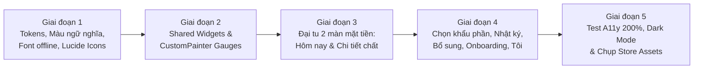

# Thiết kế UX & Hệ thống Giao diện: Nâng cấp Thẩm mỹ Toàn App

Trạng thái: Đã duyệt  <!-- Nháp | Đã duyệt -->
Thiết kế khung: [docs/design/mvp-overview.md](mvp-overview.md)
Nguyên tắc: [docs/design/README.md](README.md)

Tài liệu này là đặc tả thiết kế chi tiết cho việc nâng cấp "khung xương" thẩm mỹ (Design System, Tokens, Typography, Icon, Shared Widgets) và đại tu giao diện toàn app theo chuẩn ứng dụng sức khỏe – dinh dưỡng hiện đại. **Mọi thay đổi chỉ nâng cấp lớp trình bày; toàn bộ quy tắc tính toán, lời lẽ tham chiếu, ẩn số calo và hành vi an toàn trong `mvp-overview.md` được giữ nguyên.**

---

## Nguyên tắc bắt buộc khi triển khai

1. **Offline 100% (`README.md`, `gate2_privacy_audit_test.dart`):**
   - **Không dùng** package `google_fonts` gọi mạng lúc runtime. Phải tải sẵn bộ font `.ttf`/`.otf` giấy phép SIL OFL nhúng vào `app/assets/fonts/` và khai báo trong `app/pubspec.yaml`.
   - **Không thêm** thư viện UI/animation nặng không cần thiết (`skeletonizer`, `flutter_animate`) để giữ chuỗi cung ứng gọn (OWASP M2); hiệu ứng dùng `AnimatedSwitcher`, `TweenAnimationBuilder` và `CustomPainter` thuần Flutter.
2. **Ngôn ngữ tham chiếu, không phán xét (`README.md`, `mvp-overview.md` dòng 755 & 809):**
   - **Tuyệt đối không** hiện các chữ viết tắt chuẩn (`RDA`, `AI`, `UL`, `EER`, `AMDR`), không hiện tiếng Anh (`Protein`, `Fat`, `Carb`, `kcal` khi đã ẩn), không dùng từ `"Thiếu"` / `"bạn bị thiếu"`.
   - Dùng đúng nhãn tiếng Việt của `CautionLabels`: `"Chưa tới mức khuyến nghị"` (hoặc `"mức tham chiếu"` khi bật chế độ thận trọng), `"Trong khoảng"`, `"Vượt giới hạn an toàn"`.
   - **Không dùng màu đỏ (`error`) cho mức thấp hoặc ăn ít/nhiều calo.** Màu cảnh báo giới hạn an toàn dùng tông **vàng hổ phách / san hô dịu** (`WholeWellColors.warning*`), đỏ `colorScheme.error` chỉ dành cho lỗi hệ thống và nút xóa.
3. **Khả năng tiếp cận & Ẩn số calo:**
   - Hỗ trợ cỡ chữ hệ thống tới **200%** (`textScale >= 1.3` tự xếp dọc; không cố định chiều cao của Card hoặc nút chữ nhiều dòng).
   - Vùng chạm tối thiểu **48 × 48 dp**; độ tương phản đạt WCAG AA ở cả **Light** và **Dark Mode**.
   - Mọi số kcal đi qua `CalorieText` / kiểm tra `state.hideCalories`.

---

## Luồng triển khai theo 5 giai đoạn



---

## Giai đoạn 1: Khung xương Design System (`app/lib/ui/design_system/tokens.dart`)

### 1.1 Bảng màu Light & Dark + `WholeWellColors` (`ThemeExtension`)

Bỏ nền trắng tinh `#FFFFFF` phẳng. Dùng phân lớp tông màu (tonal layering) nhẹ nhàng kiểu xanh Sage/Emerald tự nhiên:

| Token | Light Mode | Dark Mode | Vai trò |
|---|---|---|---|
| `scaffoldBackground` | `#F7F9F8` | `#111413` | Nền trang chính (xám ngà / xám than dịu) |
| `cardSurface` | `#FFFFFF` | `#1A1F1D` | Bề mặt thẻ chính (`Card`, `SurfaceCard`) |
| `subtleSurface` | `#EFF3F1` | `#222825` | Bề mặt phụ (ô chọn nhanh, thanh nền progress) |
| `outlineSubtle` | `#DCE3DF` | `#2D3532` | Viền mảnh `1 px` tách khối |
| `primary` (Seed) | `#1B6B5C` | `#5FD4BE` | Màu chủ đạo xanh lá trầm (Sage / Emerald) |

Tạo `WholeWellColors extends ThemeExtension<WholeWellColors>` trong `tokens.dart` để mọi màn hình truy xuất đồng nhất qua `context.wwColors`:

| Thuộc tính `WholeWellColors` | Light Mode | Dark Mode | Mục đích |
|---|---|---|---|
| `foodSource` | `#1B6B5C` | `#5FD4BE` | Phân đoạn **Thực phẩm** (tự nhiên + tăng cường) |
| `supplementSource` | `#3B67B0` | `#8AB4F8` | Phân đoạn **Bổ sung** (tách biệt rõ với thực phẩm) |
| `macroProtein` | `#1B6B5C` | `#5FD4BE` | Thanh tiến độ **Đạm** |
| `macroFat` | `#B07B27` | `#E3B463` | Thanh tiến độ **Béo** |
| `macroCarb` | `#3B67B0` | `#8AB4F8` | Thanh tiến độ **Bột đường** |
| `inRange` | `#1F7A52` | `#6CD49E` | Trong khoảng / Đạt mức khuyến nghị |
| `belowTarget` | `#6F7C77` | `#8E9B96` | Chưa tới mức khuyến nghị (trung tính, không đỏ) |
| `warningContainer` | `#FFF4E0` | `#3A2B12` | Nền thẻ cảnh báo **Vượt giới hạn an toàn** & **Đường > 10 g/bữa** |
| `onWarningContainer` | `#5E3A00` | `#FFDCA8` | Chữ trên thẻ cảnh báo (đạt AA) |
| `warningBorder` | `#E6B86A` | `#8A6424` | Viền thẻ cảnh báo & vạch vượt giới hạn |

### 1.2 Typography & Font Offline

- **Font chính:** **Be Vietnam Pro** (ưu tiên vì thiết kế riêng cho dấu tiếng Việt: `ă, ơ, ư, µg`, trọng số `400 Regular`, `500 Medium`, `600 SemiBold`, `700 Bold`) hoặc **Plus Jakarta Sans**; nhúng file `.ttf` tại `app/assets/fonts/` và khai báo trong `app/pubspec.yaml`.
- **Số liệu thẳng hàng:** Mọi kiểu chữ hiển thị số đo (`kcal`, `mg`, `µg`, `%`, giờ, cân nặng) bật `fontFeatures: [FontFeature.tabularFigures()]`.
- **Cặp phân cấp số:**
  - Số chính (Hero Metric): `28 sp` / `SemiBold` + `tabularFigures`.
  - Đơn vị đi kèm: `13 sp` / `Medium` / màu `onSurfaceVariant`.
  - Nhãn phụ: `12 sp` / `Regular` / màu `onSurfaceVariant`.

### 1.3 Token khoảng cách, Bo góc & `ThemeData`

```dart
abstract final class AppSpacing {
  static const double xs = 4;
  static const double sm = 8;
  static const double md = 12;
  static const double lg = 16;
  static const double xl = 24;
  static const double xxl = 32;
}

abstract final class AppRadius {
  static const double control = 12; // nút, ô nhập
  static const double card = 16;    // card chính
  static const double sheet = 24;   // bottom sheet bo trên
  static const double pill = 999;   // chip, thanh tiến độ, nút pill
}
```

Cấu hình tập trung trong `buildWholeWellTheme(Brightness)`:
- `scaffoldBackgroundColor`: `#F7F9F8` (Light) / `#111413` (Dark).
- `cardTheme`: `elevation: 0`, `color: cardSurface`, `shape: RoundedRectangleBorder(borderRadius: AppRadius.card, side: BorderSide(color: outlineSubtle, width: 1))`.
- `filledButtonTheme` / `outlinedButtonTheme`: `minimumSize: const Size(64, 48)`, `shape: RoundedRectangleBorder(borderRadius: AppRadius.control)`.
- `inputDecorationTheme`: `filled: true`, `fillColor: subtleSurface / cardSurface`, bo góc `12`, viền mảnh `outlineSubtle`.
- `chipTheme`: `shape: StadiumBorder()`, đệm thoáng dễ chạm.
- `bottomSheetTheme`: `shape: RoundedRectangleBorder(borderRadius: BorderRadius.vertical(top: Radius.circular(24)))`, `showDragHandle: true`.
- `snackBarTheme`: `behavior: SnackBarBehavior.floating`.
- Export lại `tokens.dart` từ `common_widgets.dart` (hoặc `design_system.dart`) để các màn hình dùng 1 dòng import duy nhất.

### 1.4 Thay bộ Icon sang nét mảnh đồng nhất (`lucide_icons_flutter`)

- Thêm `lucide_icons_flutter` vào `app/pubspec.yaml` (offline 100%, đóng gói sẵn font icon).
- Thay thế toàn bộ `Icons.*` mặc định bằng `LucideIcons.*` tương ứng (`insights` → `activity`, `restaurant` → `utensils`, `medication` → `pill`, `person` → `user`, `water_drop` → `droplet`, `directions_run` → `footprints` / `dumbbell`, `warning` → `alertTriangle`, `info` → `info`, `calendar` → `calendar`, `chevron_right` → `chevronRight`, `arrow_back` → `arrowLeft`).
- **Lưu ý kiểm thử:** Cập nhật 4 điểm trong widget test hiện đang tìm trực tiếp `Icons.arrow_back` ([eligibility_caution_water_test.dart](file:///c:/CODE/wholewell-app/app/test/eligibility_caution_water_test.dart)) và `Icons.more_vert` ([schedule_reminders_test.dart](file:///c:/CODE/wholewell-app/app/test/schedule_reminders_test.dart)), đồng thời luôn gắn `tooltip` cho mọi `IconButton`.

---

## Giai đoạn 2: Nâng cấp Shared Widgets (`app/lib/ui/common/`)

1. **`TwoSegmentProgressBar` (`CustomPainter`):**
   - Thanh bo tròn 2 đầu (`AppRadius.pill`), chiều cao **`8 px`–`10 px`**, nền `subtleSurface`.
   - Vẽ hai phân đoạn **Thực phẩm** (`wwColors.foodSource`) và **Bổ sung** (`wwColors.supplementSource`) cách nhau một khoảng hở rõ **`2 px`** khi cả hai cùng > 0.
   - Khi có mục tiêu (`targetAmount > 0`): vẽ **vạch đánh dấu dọc `2 px`** ngay mốc `100% mức khuyến nghị / tham chiếu` khi tổng vượt qua mốc (thang tự co giãn mượt tới `max(target, total)`).
   - Khi có cờ vượt giới hạn an toàn (hoặc truyền `overLimit: true`): chuyển viền/đoạn vượt sang `wwColors.warningBorder` dịu, **luôn giữ nguyên chữ số & trạng thái**.

2. **`EnergyArcGauge` (`CustomPainter`):**
   - Vòng cung 240° bo tròn hai đầu (`StrokeCap.round`, nét `10 px`), animate mượt `250 ms` bằng `TweenAnimationBuilder<double>`.
   - Ở giữa vòng cung hiển thị con số calo nạp (`28 sp` `tabularFigures`) + `/ mục tiêu kcal`; tôn trọng `CalorieText` / ẩn cả card năng lượng khi `hideCalories == true`.

3. **`TargetRangeBar` (`CustomPainter` — cho Đạm / Béo / Bột đường):**
   - Hiển thị thanh tiến độ mảnh kèm **vùng nền đánh dấu khoảng khuyến nghị (`amdr.min`–`amdr.max`)** và chấm tròn vị trí `%` hiện tại, giúp người dùng nhìn một lần hiểu ngay mình đang nằm *trong khoảng*, *dưới khoảng* hay *trên khoảng*.

4. **Chuẩn hóa trạng thái & Bottom Sheet:**
   - `showAppModalSheet<T>({required BuildContext context, required WidgetBuilder builder, bool isScrollControlled = true})`: tự bọc `SafeArea`, bo trên `24 px`, drag handle chuẩn và đệm `MediaQuery.viewInsetsOf(context).bottom` để không bị bàn phím che.
   - `EmptyState`: icon nét mảnh `40–48 dp` màu mờ (`onSurfaceVariant`) + tiêu đề ngắn + mô tả 1 dòng + nút CTA tùy chọn.
   - `ErrorState`: icon cảnh báo + lời giải thích đời thường + nút `"Thử lại"`.
   - `LoadingSkeletonBox`: hộp xám nhấp nháy nhẹ (`200–300 ms`, thuần `AnimatedBuilder`, không thêm package ngoài) chỉ dùng ở nơi tải chậm (tìm kiếm DSLD / Drive).

---

## Giai đoạn 3: Đại tu 2 màn hình "mặt tiền"

### 3.1 Màn `Hôm nay` (`today_screen.dart`)

```
┌────────────────────────────────────────┐
│ Hôm nay              ‹  Hôm nay, 27/11 ›│ ← Pill DaySwitcher (chạm giữa mở lịch)
├────────────────────────────────────────┤
│ ⚠ Vượt giới hạn an toàn (nếu có)       │ ← WarningCard (hổ phách dịu, luôn trên cùng)
│ ⓘ Lưu ý thận trọng / Lưu ý lịch (nếu)  │ ← SafetyNote / CollapsibleScheduleNote
│ ┌────────────────────────────────────┐ │
│ │ 💊 Lần uống 20:00       Xem tất cả ›│ │ ← SurfaceCard tonal nổi bật
│ │ Magie · 1 viên                     │ │
│ │ [ ✓ Đã uống ]                      │ │
│ └────────────────────────────────────┘ │
│ ┌────────────────────────────────────┐ │
│ │ Năng lượng & Đa lượng              │ │ ← Ẩn phần kcal nếu bật "Ẩn số calo";
│ │   ╭───╮   1.150 / 2.000 kcal       │ │   khi ẩn calo, tự chuyển thành 3 cột
│ │   │58%│   Tập: ~180 kcal           │ │   Đạm · Béo · Bột đường gọn đẹp
│ │   ╰───╯   Mục tiêu là mức giữ cân. │ │
│ │ ────────────────────────────────── │ │
│ │ Đạm 22% [===|====|===] 10–35% · OK │ │ ← TargetRangeBar (co dọc khi >=1.3x)
│ │ Béo 30% [====|====|==] 20–35% · OK │ │
│ │ Bột 48% [=====|===|==] 45–65% · OK │ │
│ └────────────────────────────────────┘ │
│ ┌────────────────────────────────────┐ │
│ │ Đường bổ sung · 18 g (~6%)         │ │ ← Nhắc nhẹ nếu bữa > 10 g
│ └────────────────────────────────────┘ │
│ ┌────────────────────────────────────┐ │
│ │ 💧 Nước uống        [ +250 ml ]    │ │ ← Pill button ≥ 48 dp, thanh đo nhanh
│ │ 1.250 ml hôm nay                   │ │
│ └────────────────────────────────────┘ │
│ Vitamin và khoáng chất                 │
│ (Tất cả)  (Có bổ sung)  (Dưới mức KN)  │ ← Pill filter chips cuộn ngang
│ ● Thực phẩm   ● Bổ sung                │ ← Chú giải 2 màu rõ ràng
│ ┌────────────────────────────────────┐ │
│ │ Sắt                 12/18 mg · 67% │ │ ← SurfaceCard thoáng padding 14–16 dp
│ │ ██████░░░░░│░░░░░░░░░░░░░░░░░░░░░░ │ │   TwoSegmentProgressBar (8px, hở 2px)
│ ├────────────────────────────────────┤ │
│ │ Magie              180/320 mg · 56%│ │
│ │ ████ ██████│░░░░░░░░░░░░░░░░░░░░░░ │ │
│ └────────────────────────────────────┘ │
│ ┌────────────────────────────────────┐ │
│ │ 💡 Bạn có biết ...   Xem nguồn › Ẩn│ │ ← Đứng yên, không hiệu ứng tự chạy
│ └────────────────────────────────────┘ │
└────────────────────────────────────────┘
```

### 3.2 Màn `Chi tiết chất` (`nutrient_detail_screen.dart`)

```
┌────────────────────────────────────────┐
│ ← Magie                                │
├────────────────────────────────────────┤
│ [ Hôm nay ]   ( 7 ngày )               │ ← Segmented Control bo tròn
│ ┌────────────────────────────────────┐ │
│ │ Tổng mọi nguồn            180 mg   │ │ ← Tóm tắt 2 tổng rõ ràng
│ │ 56% mức khuyến nghị 320 mg         │ │
│ │ ████ ██████│░░░░░░░░░░░░░░░░░░░░░░ │ │
│ │ ● Thực phẩm 30 mg · ● Bổ sung 150mg│ │
│ │ ────────────────────────────────── │ │
│ │ Tính vào giới hạn an toàn  150/350 │ │
│ │ Chỉ tính bổ sung bạn ghi, không    │ │
│ │ tính thức ăn.                      │ │
│ └────────────────────────────────────┘ │
│ Đóng góp hôm nay (hoặc Biểu đồ 7 ngày) │
│   • Biểu đồ 7 ngày (CustomPainter):    │
│     - Không lưới dọc, bỏ viền rườm rà  │
│     - Cột bo tròn 2 góc trên           │
│     - Ngày cũ mờ (40%), Hôm nay đậm    │
│     - Đường ngang nét đứt: Mức KN      │
│       (hiện thêm đường Giới hạn an     │
│        toàn nếu maxAmount >= 70% UL)   │
│   • Danh sách nguồn: Divider mảnh      │
│     (opacity 0.5), không lồng nhiều    │
│     Card con                           │
└────────────────────────────────────────┘
```

---

## Giai đoạn 4: Luồng nhập liệu, Nhật ký, Bổ sung, Onboarding & Tôi

1. **Chọn khẩu phần (`food_portion_screen.dart`):**
   - Đặt card **Tóm tắt dinh dưỡng tức thì** cố định ở phần trên (bên trên vùng cuộn của form, tự ẩn `kcal` qua `CalorieText` khi bật `Ẩn số calo`; khi cỡ chữ ≥ `1.5x` trên màn thấp thì cho phép cuộn chung toàn trang để không che ô nhập).
   - Nút `-` / `+` và chip chọn nhanh (`1 bát`, `100 g`, `1 phần`) kích thước tối thiểu `48 dp`, dễ thao tác 1 tay.
2. **Xác nhận thành phần (`confirm_ingredients_screen.dart` & `_EditIngredientSheet`):**
   - Mở sheet sửa thành phần qua `showAppModalSheet` bo trên `24 px`, các ô nhập cách nhau `AppSpacing.md`, nút `Lưu` full-width `48 dp` ghim đáy.
3. **`Bảng Ghi` (`log_sheet.dart`) & `Nhật ký` (`diary_screen.dart`):**
   - `Bảng Ghi`: 4 ô bo `16 dp` với icon đặt trong vòng tròn nền pastel nhẹ theo nhóm (`Món ăn`, `Bổ sung`, `Nước`, `Buổi tập`).
   - `Nhật ký`: nhóm thẻ gọn theo bữa (`Sáng`, `Trưa`, `Tối`, `Phụ`, `Bổ sung`, `Nước`, `Buổi tập`) dùng `Divider` mảnh bên trong mỗi card thay vì tách rời quá nhiều khung; giữ nguyên chạm để sửa và vuốt có xác nhận khi xóa.
4. **`Bổ sung` (`supplements_screen.dart`) & `Lần uống hôm nay` (`today_doses_screen.dart`):**
   - Mỗi sản phẩm trong `Kho` hiển thị thêm thanh nhỏ lượng còn lại (tỷ lệ tương đối hộp) và pill trạng thái dịu (`Sắp hết`, `HSD`, `Hết hạn`).
   - `Lần uống hôm nay`: cột giờ bên trái dạng timeline dọc với icon ✓ / ○ / — rõ ràng.
5. **`Chào mừng`, `Onboarding` (`onboarding_flow.dart`) & `Tôi` (`me_screen.dart`):**
   - Màn `Chào mừng`: thêm huy hiệu minh họa tối giản (`CustomPainter` hình giọt + lá sage teal) ở đầu trang và gom 3 dòng cam kết vào `SurfaceCard`.
   - `StepScaffold`: thanh tiến độ 3 đoạn mảnh (`1/3`, `2/3`, `3/3`) ngay dưới AppBar.
   - Tab `Tôi`: gom các mục thành 4 nhóm thẻ (`Hồ sơ & Lịch sinh hoạt`, `Nhắc giờ & Hiển thị`, `Sao lưu`, `Quyền riêng tư & Nguồn`) với icon nền tròn tonal đồng bộ.
6. **Micro-interactions (vừa phải, không gây chậm):**
   - `HapticFeedback.selectionClick()` khi ghi nước nhanh `+ml`, tick `Đã uống`, hoặc đổi tab chính; `HapticFeedback.lightImpact()` khi lưu bữa ăn / lần uống thành công.
   - `AnimatedSwitcher` (`200 ms`) cho con số tổng hợp khi chỉnh khẩu phần hoặc đổi ngày; `TweenAnimationBuilder` (`250 ms`) cho vòng cung & thanh tiến độ (không gắn hoạt ảnh nhấp nháy hay tự chuyển cho `TipCard` theo `mvp-overview.md` dòng 742).

---

## Giai đoạn 5: Kiểm định & Đóng gói PR

1. **Checklist kiểm thử thủ công trên máy thật (Galaxy S24 Ultra):**
   - Bật **cỡ chữ hệ thống 200%** (`Settings → Display → Font size` mức tối đa): rà toàn bộ `Hôm nay`, `Chi tiết chất`, `Chọn khẩu phần`, `Nhật ký`, `Bổ sung`, `Onboarding`, `Tôi` đảm bảo **0 lỗi `RenderFlex overflowed`**.
   - Kiểm tra cả **Light Mode** và **Dark Mode** ở đủ trạng thái (trống, có dữ liệu, bật `Ẩn số calo`, bật `Chế độ thận trọng`, có cờ `Vượt giới hạn an toàn`).
   - Chụp **5–6 ảnh màn hình Store Assets** với dữ liệu mẫu tiếng Việt tự nhiên (đủ bữa ăn, nước, bổ sung, biểu đồ 7 ngày và Dark Mode).
2. **Thứ tự chia PR cho đội dev (mỗi PR nhỏ, CI xanh trước khi sang PR kế):**
   - **PR 1 (Nền móng):** Font offline + `tokens.dart` (`WholeWellColors`, `ThemeData` Light/Dark) + chuyển icon `LucideIcons` (và cập nhật 4 dòng test `byIcon`).
   - **PR 2 (Shared Widgets):** `TwoSegmentProgressBar`, `EnergyArcGauge`, `TargetRangeBar`, `showAppModalSheet`, `EmptyState`, `ErrorState`, `LoadingSkeletonBox`.
   - **PR 3 (2 màn mặt tiền):** Đại tu `TodayScreen` + `NutrientDetailScreen` (gồm biểu đồ 7 ngày mới).
   - **PR 4 (Nhập liệu & Màn phụ):** Đại tu `FoodPortionScreen`, `ConfirmIngredientsScreen`, `LogSheet`, `DiaryScreen`, `SupplementsScreen`, `TodayDosesScreen`, `OnboardingFlow`, `MeScreen` + haptic/animations.
   - **PR 5 (A11y & Polish):** Bổ sung widget test cỡ chữ 200% & Dark Mode cho mọi màn vừa sửa, chụp Store Assets.

---

## Kiểm theo nguyên tắc (`docs/design/README.md`)

- [x] Lời lẽ đúng vai tham chiếu; không hiện `RDA`/`UL`/`EER`/`AMDR`, không chữ `"Thiếu"`, không đỏ phán xét calo
- [x] Mọi số calo đi qua `CalorieText`, ẩn trọn vẹn khi bật `Ẩn số calo`
- [x] Giữ tối đa ≤ 3 chạm cho ghi món gần đây / bổ sung / nước 1 chạm
- [x] Cỡ chữ 200% không tràn (`ResponsiveStatRow`, không khóa cứng chiều cao card/button), vùng chạm ≥ 48 dp, tương phản WCAG AA cả Light & Dark
- [x] Không gọi mạng từ font hay SDK ngoài; miễn phí hoàn toàn, không quảng cáo trong MVP
