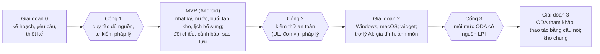
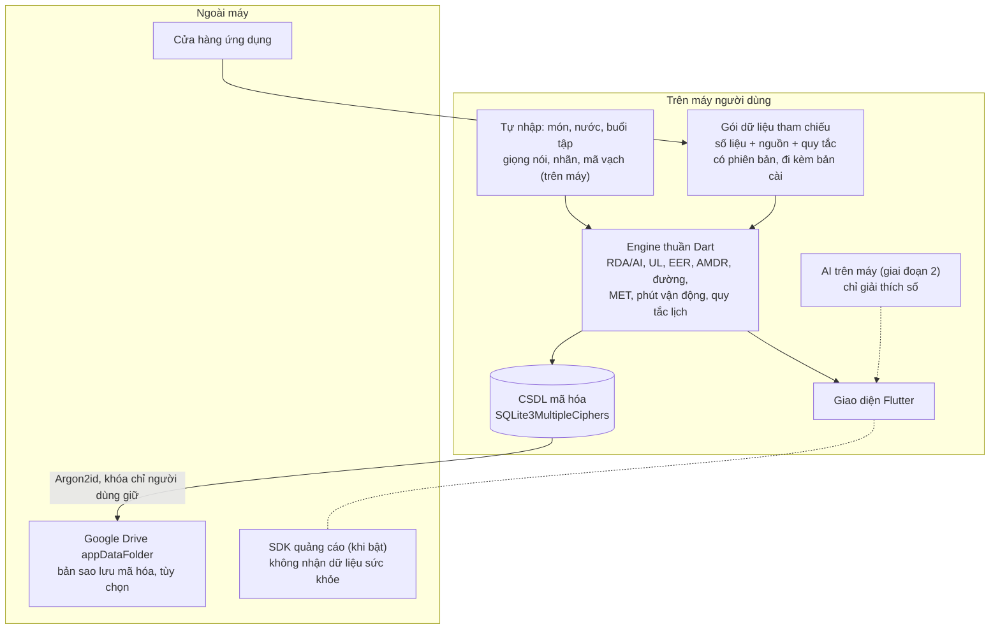

# WholeWell: plan phát triển

Cập nhật 23/11/2026 · Đặng Thế Anh

Tài liệu gốc về sản phẩm và cách làm. Quy tắc cho agent ở [AGENTS.md](../AGENTS.md), trạng thái ở [status.md](status.md), khung giao diện ở [design/mvp-overview.md](design/mvp-overview.md). Mỗi tính năng có đặc tả trong `docs/specs/` và thiết kế trong `docs/design/`.

## Tóm tắt

WholeWell giúp người Việt từ 18 tuổi biết mình nạp bao nhiêu vi chất từ thực phẩm và thực phẩm bổ sung so với chuẩn của Mỹ, quản lý kho và lịch uống, và được cảnh báo khi vượt giới hạn an toàn (UL). App miễn phí, chỉ để tham chiếu, dữ liệu nằm trên máy người dùng, chỉ dùng nguồn uy tín, miễn phí, hợp pháp. Một người làm cùng Claude Code và Gemini, Android trước.

### Quyết định đã chốt

| Chủ đề | Quyết định |
| --- | --- |
| Định vị | Công cụ tham chiếu dinh dưỡng: không chẩn đoán, không kê đơn, không gợi ý liều; không bán, gợi ý hay quảng cáo nhãn hàng bổ sung |
| Người dùng | Việt Nam trước. Hồ sơ cho người từ 18 tuổi (nhập số tuổi, app tự cộng mỗi năm); trẻ em chỉ được tính vào kho |
| Chuẩn | Vi chất: RDA (chưa có RDA thì AI, ghi "ước tính"), UL; ODA theo Linus Pauling Institute sau cổng 3. Năng lượng: EER 2023, AMDR, đường bổ sung theo Dietary Guidelines 2025–2030. Vận động: MET (2024 Compendium), phút mỗi tuần theo Physical Activity Guidelines. Đổi đơn vị nhãn theo FDA. Không chuẩn khác, không dữ liệu Việt Nam |
| Nguồn | Nhãn A: cơ quan chính phủ Mỹ và số liệu NASEM; nhãn B: LPI. Mỗi số, mỗi quy tắc có link, câu gốc ngắn, ngày tra; nguồn không nói rõ thì không có quy tắc. Không thuê chuyên gia |
| Dữ liệu người dùng | Trên máy, SQLite mã hóa. Sao lưu: tệp mã hóa; Google Drive tùy chọn. Không máy chủ, không iCloud, không thiết bị đeo hay app sức khỏe khác |
| AI | Chạy trên máy. Engine tính mọi con số; AI chỉ giải thích và gợi ý món |
| Công nghệ | Flutter. Android trước; iOS khi có Mac; Windows, macOS ở giai đoạn 2; web sau cùng |
| Doanh thu | Miễn phí toàn bộ. MVP không có quảng cáo; về sau chỉ AdMob không cá nhân hóa |
| Pháp lý | Không thuê luật sư. Tự đối chiếu văn bản gốc; chỗ không chắc thì bỏ hoặc thu hẹp tính năng |
| Không làm | Kiểm tương tác thuốc, xét nghiệm, CGM, gen, hệ vi sinh, thử nghiệm trên người dùng, hồ sơ sức khỏe trẻ em |
| Nguồn lực | 1 người cùng Claude Code và Gemini; làm lúc rảnh, không đặt hạn; tiến độ đo bằng cổng kiểm soát |

### Quy trình

| Bước | Việc chính | Đầu ra | Agent | Chủ dự án |
| --- | --- | --- | --- | --- |
| 1. Lên kế hoạch | Phạm vi, lộ trình, rủi ro | Tài liệu này | Tổng hợp, nháp | Chốt phạm vi |
| 2. Yêu cầu | Chuẩn, nguồn, an toàn, pháp lý | Đặc tả, bảng quy tắc có trích dẫn | Nháp đặc tả, ca biên | Duyệt quy tắc, tự kiểm pháp lý |
| 3. Thiết kế | Kiến trúc, UX, nguồn dữ liệu | Thiết kế UX, lược đồ, quyết định | Đề xuất, so sánh | Chọn, duyệt |
| 4. Code | Theo đặc tả và test có trước | Pull request | Viết code, test | Review, gộp |
| 5. Kiểm thử | Engine, nhãn, nhắc giờ, sao lưu, bảo mật | Kết quả cổng 2 | Ca biên, test tự động | Thử máy thật |
| 6. Triển khai | Android trước | Bản phát hành | CI dựng, ký | Nộp cửa hàng |
| 7. Bảo trì | Chuẩn, dữ liệu, thư viện | Bản vá, gói dữ liệu mới | Mở PR | Duyệt |

Mỗi tính năng đi qua: đặc tả → thiết kế UX → test → code → PR, dừng chờ duyệt sau đặc tả, sau thiết kế và ở PR (chi tiết trong AGENTS.md).

## 1. Lên kế hoạch

### Phạm vi

| Tính năng | App làm gì | Giai đoạn |
| --- | --- | --- |
| Hồ sơ và khảo sát | Tuổi, giới, chiều cao, cân nặng; mang thai (tuần thai, cân nặng trước khi mang thai) hoặc cho con bú (tháng sau sinh); giờ thức, ngủ, bữa ăn; câu hỏi có/không cho tầng an toàn | 1 |
| Nhật ký ăn uống | Nhập bằng chữ, giọng nói (trên máy), mã vạch, nhãn bao bì; thư viện món Việt với khẩu phần quen thuộc; ảnh món từ giai đoạn 2 | 1 |
| Bổ sung và kho | Chụp nhãn hoặc quét mã, lưu từng chất và dạng; số còn lại, ngày dự kiến hết, hạn dùng | 1 |
| Nước và vận động | Tự nhập nước và buổi tập; calo buổi tập theo MET; phút vận động so với Physical Activity Guidelines; gợi ý mức vận động cho mục tiêu calo | 1 |
| Đối chiếu và cảnh báo | % so với RDA/AI, tách thực phẩm và bổ sung; cảnh báo khi vượt UL (trong ngày, trung bình 7 ngày, theo lịch); calo so với EER; tỷ lệ đạm, béo, bột đường so với AMDR; đường bổ sung | 1 |
| Lịch uống và nhắc giờ | Tự đặt lịch; app gợi ý giờ và báo khi lịch trái quy tắc có nguồn; đánh dấu đã uống thì kho và tổng nạp cập nhật | 1 |
| Sao lưu | Tệp mã hóa; Google Drive; khôi phục chéo nền tảng ở giai đoạn 2 | 1–2 |
| Gia đình | Một hộp nhiều người dùng (1); nhiều hồ sơ người lớn trên một máy (2); kho chung nhiều tài khoản (3) | 1–3 |
| Widget | Lần uống sắp tới, nút "Đã uống", tên ngắn có thể ẩn | 2 |
| Trợ lý AI trên máy | Giải thích số của engine, gợi ý món Việt (2); thao tác bằng câu nói (3) | 2–3 |
| ODA tham khảo | Mức của LPI đặt cạnh RDA, không vượt UL, không thành lời khuyên | 3 |
| Quảng cáo | Banner hoặc native ở màn danh sách | Khi có người dùng |

**Không làm**, vì dễ bị coi là chẩn đoán, hỗ trợ điều trị hoặc cần dữ liệu quá nhạy cảm: tương tác thuốc (thay bằng câu hỏi có/không về thuốc kê đơn và lời nhắc hỏi bác sĩ, dược sĩ); kết quả xét nghiệm; CGM, gen, hệ vi sinh; hồ sơ sức khỏe trẻ em. **Thu hẹp:** khảo sát không hỏi tên bệnh, tên thuốc; không sàng lọc rối loạn ăn uống mà có nút "ẩn số calo"; AI không trả lời về bệnh, thuốc, liều.

**Lời lẽ:** "so với mức khuyến nghị", "vượt giới hạn an toàn", kèm nguồn; không "bạn bị thiếu", "bạn nên uống". Giao diện không hiện tên viết tắt của chuẩn (nguyên tắc ở [design/README.md](design/README.md)).

### Thị trường

Đối thủ trực tiếp là [VNeNUTRITION](https://baoquocte.vn/ra-mat-ung-dung-dinh-duong-viet-378041.html) của Viện Dinh dưỡng (5/4/2026): nhu cầu khuyến nghị và thành phần thực phẩm Việt Nam, tư vấn bằng AI. WholeWell không dùng dữ liệu của họ. Khác biệt: thực phẩm và bổ sung trên cùng một thước đo, cảnh báo UL đúng phạm vi từng chất; kho và lịch uống, đọc nhãn tiếng Việt và hàng nhập; dữ liệu ở máy, không cần tài khoản; mỗi con số có nguồn.

### Doanh thu

| Quy tắc | Nội dung |
| --- | --- |
| Thời điểm | MVP không có quảng cáo, không cài SDK, chỉ chừa chỗ trong bố cục. Bật khi app ổn định và có người dùng; trước đó sửa chính sách quyền riêng tư, Data safety, đọc lại luật quảng cáo. Mô tả trên cửa hàng ghi "miễn phí, sau này có thể có quảng cáo" |
| Mạng | AdMob qua [google\_mobile\_ads](https://pub.dev/packages/google_mobile_ads), chỉ Android và iOS |
| Chặn nội dung | Danh mục dược phẩm, vitamin, bổ sung ([AdMob](https://support.google.com/admob/answer/3150953)) và gần giảm cân; phân loại tự động có thể lọt ([AdMob](https://support.google.com/admob/answer/3150176)) nên có nút báo và rà định kỳ |
| Không cá nhân hóa | SDK mặc định cá nhân hóa ([Google](https://developers.google.com/admob/flutter/eu-consent)); app chỉ xin quảng cáo không cá nhân hóa, không đưa dữ liệu sức khỏe vào yêu cầu |
| Vị trí | Cuối danh sách Nhật ký và Kho; Hôm nay quyết định khi bật. Không ở màn cảnh báo, chi tiết chất, thông báo, widget; không chèn toàn màn hình |

### Lộ trình: bốn giai đoạn, ba cổng

Không đặt mốc thời gian. Chưa qua cổng thì chưa sang giai đoạn sau. Cần rút ngắn thì MVP chỉ sao lưu ra tệp, để Google Drive sau.

### Nguồn lực và chi phí

- **Chủ dự án:** chốt đặc tả và thiết kế, duyệt và gộp code, thử trên máy thật, nộp cửa hàng.
- **Agent:** Claude Code và Gemini có hạn mức; việc không cần agent (thử máy, duyệt) làm lúc hết hạn mức.
- **Chi phí:** Google Play 25 USD một lần; iOS thêm Apple Developer 99 USD/năm và máy Mac. Không có chi phí máy chủ, dữ liệu, tư vấn.
- **Người thử:** tài khoản Google Play cá nhân cần ít nhất 12 người thử liên tục 14 ngày ([Google Play](https://support.google.com/googleplay/android-developer/answer/14151465)); tìm từ sớm.

### Rủi ro chính

Rủi ro lớn nhất là app đưa con số hoặc gợi ý sai; biện pháp chính là tầng an toàn, quy tắc có nguồn và kiểm thử.

| Rủi ro | Biện pháp |
| --- | --- |
| Mức "tối ưu" gây hại | UL chặn trước; ODA chỉ tham khảo, sau cổng 3; không gợi ý liều, không bán bổ sung |
| Đọc nhãn sai (mg và µg, dạng vitamin, khối lượng hợp chất) | Lưu theo từng chất và dạng; kiểm hợp lý; người dùng xác nhận từng dòng; dạng chưa rõ thì tính thận trọng |
| UL sai phạm vi | Lưu phạm vi từng chất; ca test từ số liệu NASEM; 0 vi phạm |
| Nhắc giờ trễ | Xin quyền báo đúng giờ, dự phòng báo gần đúng, lịch cuộn; thử máy thật |
| Mất dữ liệu | Nhắc sao lưu; giữ 2–3 bản; mã khôi phục; xuất tệp |
| Dữ liệu rời máy qua đường ngầm | Loại CSDL khỏi sao lưu hệ điều hành; giọng nói chỉ trên máy; không SDK phân tích; SDK quảng cáo không nhận dữ liệu sức khỏe |
| Bị coi là thiết bị y tế, vi phạm luật dữ liệu hay luật AI | Giữ vai tham chiếu; bỏ tính năng nhạy cảm; bảng tự kiểm pháp lý trước mỗi lần phát hành |
| AI tính sai, vượt vai | Engine tính mọi số; bỏ câu có số không khớp; bộ câu hỏi kiểm thử tiếng Việt |
| Agent viết lỗi hoặc tự đổi quy tắc | Test trước, review chéo; số và quy tắc chỉ sửa trong `build_pack.py`, có trích dẫn, chủ dự án duyệt |
| Nguồn chặn truy cập tự động (NIH ODS) | Đọc và kiểm nguồn bằng Claude in Chrome, ghi ngày tra |
| Thiếu dữ liệu món chỉ có ở Việt Nam | Nhập theo nhãn hoặc chọn món gần nhất, ghi "ước tính" |
| Plugin lỗi, ngừng bảo trì | Bọc sau interface Dart; sẵn sàng viết cầu nối native |

### Điều kiện từng phần và kiểm sớm

Mỗi phần có một bài kiểm sớm trước khi xây tiếp; không qua thì theo cột "Nếu bế tắc". Kiểm bằng tài liệu chính thức ngày 22/11/2026; các mục "thử máy" vẫn phải làm bằng điện thoại thật.

| Phần | Rào cản | Kiểm sớm | Kết quả đến nay | Nếu bế tắc |
| --- | --- | --- | --- | --- |
| Chuẩn DRI | Nhập tay dễ sai; một số chất không có UL | Dựng bảng bằng script, đối chiếu từng ô với báo cáo NASEM | Xong: 40 chất × 16 nhóm, 102 ô đối chiếu qua | Chất thiếu số thì ghi "chưa có chuẩn" |
| ODA (LPI) | Chỉ một số chất, phần lớn trùng RDA | Lập danh sách chất LPI khác RDA | Chưa làm (giai đoạn 3) | Không hiện ODA cho chất đó |
| Thành phần thực phẩm | Tên tiếng Anh; nhiều món Việt không có | So khớp 200 thực phẩm hay ăn | Chưa làm | Nhập theo nhãn, chọn món gần nhất |
| Tìm món tiếng Việt, thư viện món | USDA không có tên Việt; công thức tốn công | Soạn 200 tên, 30 món đầu | Chưa làm | Tìm theo nhóm; người dùng lưu công thức nhà mình |
| Mã vạch | Dữ liệu miễn phí chủ yếu là hàng Mỹ | Quét 50 sản phẩm mua ở Việt Nam | Chưa kiểm được bằng tài liệu | Chụp nhãn là đường chính |
| Đọc nhãn (OCR) | Nhãn mờ, nhầm đơn vị | 30 ảnh nhãn thật | ML Kit Text Recognition v2 hỗ trợ tiếng Việt ([Google](https://developers.google.com/ml-kit/vision/text-recognition/v2/languages)); thử máy | Nhập tay từng dòng |
| Giọng nói | Nhiều máy không nhận dạng tiếng Việt trên máy | Thử vài máy phổ biến | [ML Kit Speech Recognition](https://developers.google.com/ml-kit/genai/speech-recognition/android) có vi-VN (beta) cho Android 12+; iOS có đọc chính tả trên máy; thử máy với tên món | Ẩn tính năng |
| Nhắc giờ | Android 14 từ chối báo thức chính xác mặc định; hãng tắt app nền; iOS tối đa 64 thông báo | Thử 7 ngày trên vài hãng | Chưa thử | Báo gần đúng; hướng dẫn tắt tối ưu pin |
| Nút "Đã uống" trên thông báo, widget | Callback có thể không chạy khi app ở nền | Bản thử nhỏ một nút | Chưa thử | Bấm nút thì mở app rồi ghi |
| Sao lưu Drive | Xác minh OAuth; đa nền tảng | Sao lưu Android, khôi phục nền tảng khác | appDataFolder dùng chung khi mọi client ID cùng một dự án Google Cloud ([Google](https://developers.google.com/identity/protocols/CrossClientAuth)); thử máy | Chỉ xuất, nhập tệp |
| AI trên máy | Máy đời mới; tiếng Việt chưa rõ | 30 câu hỏi tiếng Việt | Apple Intelligence có tiếng Việt từ iOS 26.1; Prompt API của Gemini Nano chưa công bố tiếng Việt | Giải thích theo mẫu (mặc định trên Android) |
| Bản iOS | Chưa có Mac | Build thử trên CI | Chưa làm | Chỉ Android |
| Phát hành Google Play | 12 người thử 14 ngày; form Health apps | Tìm người thử trước khi xong MVP | Chưa làm | Kéo dài thử nghiệm kín |
| Pháp lý | Luật đổi; chỗ không rõ | Rà bảng tự kiểm trước mỗi bản | Bảng ở mục 2 | Bỏ hoặc thu hẹp tính năng |

## 2. Yêu cầu

### Chuẩn tham chiếu

| Chuẩn | Ai đặt ra | Vai trò trong app |
| --- | --- | --- |
| RDA | NASEM | Mục tiêu cho vi chất, "mức khuyến nghị" |
| AI | NASEM | Mục tiêu khi chưa có RDA, "mức ước tính" |
| UL | NASEM | Giới hạn an toàn; cảnh báo khi vượt (lớn hơn UL, vì UL là mức cao nhất chưa gây hại), đúng phạm vi từng chất |
| EER (2023) | NASEM | Mục tiêu calo = mức giữ cân; không có mục tiêu giảm cân |
| AMDR | NASEM | Khoảng tỷ lệ đạm 10–35%, béo 20–35%, bột đường 45–65% năng lượng (người lớn) |
| Đường bổ sung | Dietary Guidelines 2025–2030 (USDA, HHS) | ≤10% năng lượng mỗi ngày, ≤10 g mỗi bữa |
| MET | 2024 Adult Compendium | Calo buổi tập |
| Phút vận động | Physical Activity Guidelines, bản 2 (HHS) | 150–300 phút vừa hoặc 75–150 phút mạnh mỗi tuần (1 phút mạnh ≈ 2 phút vừa); tập tăng cơ ≥2 ngày |
| Đổi đơn vị nhãn | FDA | IU, DFE, NE, RAE trên nhãn Nutrition Facts và Supplement Facts |
| ODA | Linus Pauling Institute | Mức tham khảo, chỉ sau cổng 3 |

Đạm dùng RDA 0,8 g/kg làm mức tối thiểu và AMDR làm khoảng; không thêm mức đạm 1,2–1,6 g/kg để tránh hai mục tiêu. Không dùng EAR, CDRR. Giới hạn đường lấy từ [Dietary Guidelines 2025–2030](https://cdn.realfood.gov/DGA.pdf) vì DRI không đặt giới hạn này.

**ODA:** không có bộ ODA chính thức. Các bảng trên mạng không thống nhất, không công bố phương pháp (vitamin C 2.000 mg ở [một nguồn](https://www.patrickholford.com/advice/supplements-optimum-daily-allowances/), 1.000 mg ở [nguồn khác](https://www.amymyersmd.com/blogs/articles/nutrition-test)), và liều cao có thể hại: trong thử nghiệm [SELECT](https://www.cancer.gov/types/prostate/research/select-trial-results-qa), vitamin E 400 IU/ngày tăng 17% (tương đối) ung thư tuyến tiền liệt. Vì vậy chỉ lấy từ [LPI](https://lpi.oregonstate.edu/mic), nơi nêu căn cứ và [ghi rõ chỗ khác RDA](https://lpi.oregonstate.edu/mic/life-stages/older-adults).

**Mô hình 3 tầng:**

| Tầng | Đầu vào | Quy tắc |
| --- | --- | --- |
| 1. An toàn | UL; mang thai, cho con bú; câu trả lời có/không; dị ứng | Chạy trước mọi gợi ý; chỉ cảnh báo hoặc khuyên hỏi bác sĩ, dược sĩ; có cờ thì ẩn ODA |
| 2. Nền tảng | RDA/AI theo tuổi, giới, sinh lý | Luôn hiện |
| 3. Tham khảo | ODA theo LPI | Kèm nguồn; không vượt UL; không gợi ý liều hay sản phẩm |

### Nguồn

| Nhãn | Nguồn | Dùng |
| --- | --- | --- |
| A | Cơ quan chính phủ Mỹ (NIH ODS, FDA, USDA, CDC, HHS); số liệu trong báo cáo DRI của NASEM; 2024 Compendium | Tính, cảnh báo, gợi ý giờ |
| B | Linus Pauling Institute | Chỉ ODA |
| Không dùng | Nguồn trả phí, giấy phép NC, dữ liệu cộng đồng, ý kiến, video, nội dung quảng cáo, trang thương mại; bài nghiên cứu (PubMed, PMC) không làm nguồn của số hay quy tắc | Không vào app |

Quy tắc nguồn thay cho chuyên gia:

- **Hợp pháp:** chỉ tác phẩm của chính phủ Mỹ, CC0, CC BY hoặc nguồn cho phép dùng thương mại. Với NASEM và LPI chỉ lưu con số (số liệu không được bảo hộ quyền tác giả theo Điều 15 [Luật Sở hữu trí tuệ](https://datafiles.chinhphu.vn/cpp/files/vbpq/2026/10/160-vbhn-vpqh.signed.pdf)), sắp theo cấu trúc riêng, tự viết lời giải thích. Không dùng tên hay nội dung NIH ODS trong quảng cáo ([ODS](https://ods.od.nih.gov/About/Disclaimer.aspx)).
- **Số liệu đối chiếu với báo cáo DRI gốc của NASEM;** fact sheet NIH ODS dùng để đối chiếu và lấy quy tắc giờ uống.
- **Không tự đặt ngưỡng,** không tự hiệu chỉnh RDA; chỉ dùng hiệu chỉnh có trong DRI (vd. sắt cho người ăn chay gấp 1,8 lần).
- **Mỗi số, mỗi quy tắc có link, câu gốc ngắn, ngày tra,** lưu cùng dữ liệu trong `tools/build_pack.py`. CI kiểm đủ các trường này.
- **Kiểm nguồn bằng Claude in Chrome:** NIH ODS chặn truy cập tự động (Cloudflare), nên agent mở trang nguồn qua trình duyệt thật khi thêm, đổi số hay quy tắc và mỗi quý, đối chiếu câu gốc và ghi ngày tra. CI không kiểm link.
- **Nguồn không nói rõ thì không gợi ý:** app ghi "chưa có hướng dẫn". Ví dụ: không có quy tắc uống canxi cách magie, vì không nguồn được phép nào nói (lời khuyên "cách 2 tiếng" chỉ có ở trang thương mại).
- **Tầng an toàn chỉ được thận trọng hơn:** cờ chỉ ẩn thông tin hoặc khuyên hỏi bác sĩ, không mở thêm gợi ý.
- Link trong tài liệu này phần lớn để giải thích quyết định; chỉ nguồn ở bảng Nguồn dữ liệu (mục 3) và trong gói dữ liệu mới vào app.

### Nhật ký và khẩu phần

App so lượng nạp thực tế với chuẩn. Cá nhân hóa thường chỉ cải thiện ít (trong [Food4Me](https://academic.oup.com/ije/article/46/2/578/2614369), nhóm được tư vấn cá nhân hóa giảm 0,65 g muối so với nhóm nhận lời khuyên chung), nên dồn sức vào nhật ký dễ ghi.

- **Chưa có nhật ký thì chỉ hiện chuẩn,** không ước tính lượng nạp.
- **Trung bình 7 ngày chia cho số ngày có ghi** (ngày có ít nhất một món hoặc một lần uống), ghi rõ số ngày, để ngày quên ghi không kéo trung bình xuống và che cảnh báo.
- **Thực phẩm chỉ có ở Việt Nam:** chỉ dùng USDA FoodData Central; món không có thì nhập theo nhãn hoặc chọn món gần nhất, ghi "ước tính". Thư viện món Việt (phở, bún chả…) tính từ công thức tự soạn với nguyên liệu USDA, khẩu phần quen thuộc (bát, đĩa, cái), ghi "ước tính"; người dùng sửa được công thức nhà mình. Script so khớp USDA lập danh sách "chỉ có ở Việt Nam" (rau ngót, mắm tôm, bánh chưng, giò lụa, bún…).
- **Đường bổ sung:** món FNDDS lấy từ USDA FPED (kiểm giấy phép trước khi dùng); món tự soạn tính từ nguyên liệu; nhãn chỉ ghi đường tổng thì không tính, ghi "chưa rõ đường bổ sung".
- **Thực phẩm tăng cường:** USDA tách sẵn axit folic và vitamin E bổ sung vào thực phẩm; niacin tăng cường không tách được nên chưa tính vào giới hạn (ghi rõ). Món nhập theo nhãn có niacin, vitamin E, axit folic thì coi là tăng cường (thận trọng).

### Năng lượng, vận động, nước

- **Mục tiêu calo** = EER theo [phương trình NASEM 2023](https://nap.nationalacademies.org/read/26818/chapter/7). EER là mức giữ cân, [không thiết kế cho tăng hay giảm cân](https://www.nationalacademies.org/read/26818/chapter/9), nên không có mục tiêu giảm cân. Mức vận động trong phương trình do người dùng chọn; app gợi ý từ buổi tập 7 ngày theo **quy tắc của app** (phút tương đương vừa mỗi ngày: ≥30 nhẹ, ≥60 vừa, ≥120 nhiều), người dùng xác nhận. Vì EER đã tính vận động, không cộng calo buổi tập vào mục tiêu.
- **Chưa tính được:** người 18 tuổi (phương trình 14–18 cần đối chiếu hệ số), mang thai dưới 19 tuổi (NASEM không có phương trình riêng), thiếu tuần thai, cân nặng trước khi mang thai hay tháng sau sinh. Engine trả "chưa tính được" kèm lý do, không đoán.
- **Tỷ lệ đạm, béo, bột đường** tính trên năng lượng đã ăn, so với AMDR.
- **Đường bổ sung** tính trên năng lượng đã ăn trong ngày. Với hôm nay chỉ ghi "đến giờ", vì ngày chưa hết; kết luận vượt giới hạn hằng ngày chỉ cho ngày đã qua và trung bình 7 ngày. Giới hạn mỗi bữa báo ngay.
- **Calo buổi tập** theo [2024 Adult Compendium](https://pmc.ncbi.nlm.nih.gov/articles/PMC10818145/) ([miễn phí cả cho mục đích thương mại](https://pacompendium.com/)): kcal ≈ MET × cân nặng (kg) × số giờ; ghi "khoảng", vì MET chỉ là điểm khởi đầu. Người dùng tự nhập buổi tập; app không đọc thiết bị đeo, Health Connect, HealthKit.
- **Phút vận động** so với [Physical Activity Guidelines, bản 2](https://odphp.health.gov/sites/default/files/2019-09/Physical_Activity_Guidelines_2nd_edition.pdf): phút tương đương vừa (1 phút mạnh ≈ 2 phút vừa) so với 150–300 phút mỗi tuần; số ngày tập tăng cơ so với từ 2 ngày.
- **Nước:** chỉ hiện lượng đã uống, không so; mức tham chiếu của Mỹ là tổng nước gồm cả nước trong thức ăn ([NAP](https://www.nationalacademies.org/read/10925/chapter/6)), và đa số người khỏe mạnh đủ nước khi uống theo cảm giác khát ([NASEM](https://www.nationalacademies.org/news/report-sets-dietary-intake-levels-for-water-salt-and-potassium-to-maintain-health-and-reduce-chronic-disease-risk)). Nhắc uống nước là tùy chọn.
- **An toàn:** không hiện "được ăn thêm vì đã tập"; có nút "ẩn số calo".

### Thực phẩm bổ sung

#### Từ nhãn tới thành phần

1. **Quét mã vạch trước,** tra trong gói dữ liệu trên máy (hàng bán ở Mỹ có trong [DSLD](https://dsldapi.od.nih.gov/), CC0).
2. **Không có mã thì chụp bảng thành phần,** OCR trên máy bằng ML Kit.
3. **Mỗi dòng một chất, một dạng:** tên chất, dạng (retinyl palmitat, beta-caroten, axit folic…), lượng mỗi khẩu phần, đơn vị, số khẩu phần mỗi hộp, hạn dùng. Một sản phẩm có nhiều chất thì nhiều dòng; mọi phép so chạy trên từng dòng rồi mới cộng theo chất.
4. **Chuẩn hóa đơn vị theo dạng,** hệ số theo [hướng dẫn đổi đơn vị của FDA](https://www.fda.gov/regulatory-information/search-fda-guidance-documents/guidance-industry-converting-units-measure-folate-niacin-and-vitamins-d-and-e-nutrition-and) (vd. vitamin D 1 IU = 0,025 µg; vitamin E 1 IU = 0,67 mg dạng tự nhiên, 0,45 mg dạng tổng hợp). Chỉ đọc hàm lượng tuyệt đối, không dùng % trên nhãn.
5. **Lượng nguyên tố:** nhãn chỉ ghi khối lượng hợp chất thì đổi bằng tỷ lệ nguyên tố trong fact sheet ODS (vd. canxi carbonat 40%, canxi citrat 21%, theo [ODS, canxi](https://ods.od.nih.gov/factsheets/Calcium-HealthProfessional/)); hợp chất không có tỷ lệ thì "chưa tính được" và báo "chưa kiểm được giới hạn an toàn".
6. **Dạng chưa rõ** (vitamin A, folate, vitamin E ghi IU): giới hạn an toàn tính theo cách thận trọng nhất (coi là retinol, là axit folic, hệ số IU dạng tự nhiên); số so với mức khuyến nghị ghi "chưa chắc". Đây là quy tắc của app.
7. **Kiểm hợp lý:** chặn nghi nhầm mg với µg, số khẩu phần bất thường, một khẩu phần đã vượt UL.
8. **Người dùng xác nhận từng dòng** trước khi lưu, kèm ảnh nhãn. Nhãn chỉ là khai báo của nhà sản xuất; độ chính xác của giá trị khai báo là vấn đề đã được [nhóm DSLD lưu ý](https://pmc.ncbi.nlm.nih.gov/articles/PMC4779548).
9. **Chất không có trong gói** (CoQ10, collagen, thảo dược): lưu để xem, ghi "không có mức tham chiếu", không tính.

#### Kho và hạn dùng

- **Sản phẩm:** thành phần theo từng chất và dạng, dạng bào chế, ảnh nhãn. **Hộp:** số đơn vị còn lại, ngày mở, hạn dùng. **Phác đồ:** ai uống, mấy đơn vị, giờ nào, kèm bữa hay không. **Lần uống:** đã uống, bỏ qua, chưa ghi.
- Ngày dự kiến hết = hôm nay + số còn lại ÷ tổng số dùng mỗi ngày, hiệu chỉnh theo tỷ lệ bỏ liều 14 ngày. Nhắc mua thêm, không link cửa hàng. Hộp hết hạn không vào lịch; nhiều hộp thì dùng hộp hết hạn sớm trước.
- Giai đoạn 1 cho một hộp nhiều người dùng để tính ngày hết; cảnh báo UL từng người cần hồ sơ riêng ở giai đoạn 2.

#### Lịch uống

Người dùng tự đặt lịch; app gợi ý giờ theo giờ thức, ngủ, bữa ăn và báo "lưu ý lịch" khi lịch trái quy tắc; người dùng quyết định. Quy tắc lịch (fact sheet Health Professional của NIH ODS, tra 23/11/2026):

| # | Quy tắc | App làm gì | Nguồn |
| --- | --- | --- | --- |
| 1 | Canxi bổ sung hấp thu cao nhất khi mỗi lần ≤500 mg; liều lớn hơn thì tỷ lệ hấp thu giảm | Lưu ý khi một lần >500 mg; gợi ý chia nhiều lần | [ODS, canxi](https://ods.od.nih.gov/factsheets/Calcium-HealthProfessional/) |
| 2 | Canxi bổ sung nói chung hấp thu tốt hơn khi uống cùng thức ăn; canxi carbonat với người ít axit dạ dày cần uống cùng bữa; canxi citrat uống lúc đói được | Gợi ý xếp canxi carbonat vào bữa ăn | [ODS, canxi](https://ods.od.nih.gov/factsheets/Calcium-HealthProfessional/) |
| 3 | Chuyên gia khuyên uống canxi và sắt bổ sung khác giờ; tác động chưa được xác lập chắc chắn | Lưu ý khi cùng giờ, ghi rõ "chưa chắc chắn" | [ODS, sắt](https://ods.od.nih.gov/factsheets/Iron-HealthProfessional/) |
| 4 | Bổ sung từ 25 mg sắt uống cùng lúc với kẽm bổ sung làm giảm hấp thu kẽm; sắt trong thực phẩm tăng cường không ảnh hưởng đáng kể | Lưu ý khi cùng giờ, chỉ với sắt từ bổ sung ≥25 mg mỗi lần | [ODS, kẽm](https://ods.od.nih.gov/factsheets/Zinc-HealthProfessional/) |
| 5 | Có chất béo trong ruột cùng lúc thì vitamin D hấp thu tốt hơn; không có vẫn hấp thu một phần | Gợi ý nhẹ xếp vitamin D vào bữa ăn | [ODS, vitamin D](https://ods.od.nih.gov/factsheets/VitaminD-HealthProfessional/) |

- **Không làm quy tắc:** canxi–magie, canxi–kẽm, mọi khoảng cách giờ cụ thể giữa hai vi chất (nguồn không nói). Vitamin C tăng hấp thu sắt không heme ([ODS](https://ods.od.nih.gov/factsheets/VitaminC-HealthProfessional/)) chỉ là thông tin ở chi tiết chất của sắt, không thành gợi ý lịch, vì nghe như khuyên dùng sắt và không hợp với người bệnh về máu.
- **Quy tắc là dữ liệu:** mỗi quy tắc một dòng trong `build_pack.py` (loại, chất A, chất B, ngưỡng, chỉ tính bổ sung hay mọi nguồn, cách báo, lời hiển thị, link, câu gốc ngắn, ngày tra). Engine có vài loại chung: hai chất cùng giờ có ngưỡng; một chất vượt mức trong một lần; nên xếp cùng bữa; lời giải thích kèm cảnh báo. Thêm quy tắc cùng loại không sửa code. Quy tắc mới đến người dùng qua bản cập nhật app; lần mở đầu sau cập nhật, app kiểm lại mọi lịch.
- **Thuốc kê đơn** chỉ nhắc theo lịch bác sĩ; app không xếp lại, không kiểm tương tác. Ai khai đang dùng thuốc kê đơn thì được nhắc hỏi bác sĩ hoặc dược sĩ trước khi dùng bổ sung.

#### Nhắc giờ và đánh dấu đã uống

- Mỗi giờ uống là một thông báo hẹn trước, liệt kê số loại; chưa đánh dấu thì nhắc lại theo số lần người dùng đặt. Màn hình khóa chỉ hiện nội dung chung ("Đến giờ uống, 2 loại").
- Đánh dấu từ thông báo, trong app, widget (giai đoạn 2): đã uống (sửa được giờ thực tế), bỏ qua; không đánh dấu thì cuối ngày là "chưa ghi".
- "Đã uống": trừ kho đúng hộp, cộng vào tổng nạp, kiểm lại UL, hủy nhắc lại, cập nhật ngày dự kiến hết. Ghi bổ sung từ nút Ghi thì tự gắn vào lần uống theo lịch chưa đánh dấu gần nhất trong ngày, để không đếm hai lần.
- Bỏ qua không trừ kho, tính vào tỷ lệ bỏ liều.

#### Cảnh báo giới hạn an toàn

- **Phạm vi từng chất:** magie chỉ tính bổ sung và thuốc ([ODS](https://ods.od.nih.gov/factsheets/Magnesium-HealthProfessional/)); niacin, vitamin E tính từ bổ sung và thực phẩm tăng cường, kể cả vitamin E tự nhiên trong viên; vitamin A chỉ retinol ([NCBI](https://www.ncbi.nlm.nih.gov/books/NBK222318/)); folate chỉ axit folic; vitamin D và các chất khác tính mọi nguồn.
- **Ba loại cờ:** trong ngày; trung bình 7 ngày (UL là ngưỡng cho lượng nạp trung bình hằng ngày, [NAP](https://nap.nationalacademies.org/resource/25353/interactive/index.html)); theo lịch (tổng mỗi ngày của mọi mục lịch, báo trước khi lưu lịch). Cảnh báo khi vượt, không có mức "sắp vượt".
- **Kiểm lại sau mọi thay đổi** có thể làm vượt: lưu, sửa lịch; sửa thành phần sản phẩm; ghi, sửa nhật ký; đổi hồ sơ làm đổi nhóm tham chiếu; tuổi, tuần thai, tháng sau sinh tự tăng.
- **Không chặn việc ghi hay lưu lịch,** chỉ cảnh báo; người dùng quyết định.
- **Lời trung tính,** nói rõ chất, lượng, giới hạn, phạm vi, mục góp vào, gợi ý hỏi bác sĩ hoặc dược sĩ; không khuyên ngừng thuốc. Lời giải thích kèm: kẽm từ 50 mg/ngày trong nhiều tuần có thể cản hấp thu đồng, 142 mg/ngày có thể cản hấp thu magie ([ODS, kẽm](https://ods.od.nih.gov/factsheets/Zinc-HealthProfessional/), [ODS, đồng](https://ods.od.nih.gov/factsheets/Copper-HealthProfessional/)); folate liều cao có thể che dấu thiếu B12 ([ODS, folate](https://ods.od.nih.gov/factsheets/Folate-HealthProfessional/)).

### An toàn người dùng

| Nhóm nguy cơ | Biện pháp |
| --- | --- |
| Dưới 18 tuổi | Không có hồ sơ; hỏi tuổi trước màn đồng ý; trẻ em chỉ tính vào kho |
| Mang thai, cho con bú | Dùng mức của nhóm này; ẩn ODA; khuyên hỏi bác sĩ |
| Đang dùng thuốc kê đơn hoặc điều trị bệnh mạn tính | Lưu ý hỏi bác sĩ trước khi dùng bổ sung (vd. thuốc chống đông và vitamin K); ẩn ODA |
| Bệnh về máu (thalassemia) | Không gợi ý gì về sắt; khuyên hỏi bác sĩ ([CDC](https://www.cdc.gov/thalassemia/communication-resources/initiating-regular-transfusions.html): bổ sung sắt có thể hại người bệnh β thalassemia) |
| Dị ứng thực phẩm | Loại khỏi gợi ý món; cảnh báo khi mã vạch khai báo chất gây dị ứng |
| Đang hoặc từng hút thuốc | Lưu ý khi dùng beta-caroten liều cao ([ODS](https://ods.od.nih.gov/factsheets/VitaminA-HealthProfessional/)) |
| Dễ bị ảnh hưởng bởi việc đếm calo | Nút "ẩn số calo"; không mục tiêu giảm cân; không chuỗi ngày, huy hiệu, lời phán xét |
| Nhập sai hàm lượng | Kiểm hợp lý đơn vị và liều; xác nhận từng dòng |

Vì sao: khoảng 13,8% dân số Việt Nam mang gen thalassemia ([Hemoglobin 2022](https://pubmed.ncbi.nlm.nih.gov/35950578/)), và thiếu máu không đồng nghĩa thiếu sắt. App đếm calo có liên quan tới rối loạn ăn uống ([Simpson và Mazzeo](https://pubmed.ncbi.nlm.nih.gov/28214452/); 73% người bệnh dùng MyFitnessPal cho rằng app góp phần gây bệnh, [nghiên cứu trên 105 người](https://pubmed.ncbi.nlm.nih.gov/28843591/); [tổng quan 2025](https://pubmed.ncbi.nlm.nih.gov/39671845/) ghi nhận liên quan, chưa chứng minh nguyên nhân).

### Pháp lý: tự kiểm theo văn bản gốc

Trước mỗi lần phát hành và trước khi bật quảng cáo, đối chiếu từng dòng với văn bản gốc, chọn cách thận trọng nhất. Dữ liệu nằm trên máy và nhóm phát triển không nhận dữ liệu nào, nên nhiều nghĩa vụ thu hẹp.

| Văn bản | Yêu cầu chính | Cách làm |
| --- | --- | --- |
| Luật Bảo vệ dữ liệu cá nhân 91/2025/QH15 ([toàn văn](https://luattri.com/library/luat/91-2025-qh15-bao-ve-du-lieu-ca-nhan)), Nghị định 356/2025/NĐ-CP ([EY](https://www.ey.com/content/dam/ey-unified-site/ey-com/vi-vn/technical/tax/documents/ey-vietnam-legal-alert-march-2026-decree-no356-2025-nd-cp-providing-detailed-guidance-for-implementation-of-personal-data-protection-law-viet.pdf)) | Sức khỏe là dữ liệu nhạy cảm; đồng ý xác minh và lưu được, riêng từng mục đích; quyền rút đồng ý, truy cập, sửa, xóa; chuyển ra nước ngoài (Điều 20) cần hồ sơ riêng | Đồng ý riêng từng mục đích, ô không đánh sẵn, lưu bằng chứng trên máy; rút đồng ý thì xóa toàn bộ; có xuất, sửa, xóa; Drive chỉ bật sau màn giải thích, khóa chỉ người dùng giữ; tự lập hồ sơ đánh giá tác động |
| [Nghị định 98/2021/NĐ-CP](https://thuvienphapluat.vn/van-ban/The-thao-Y-te/Nghi-dinh-98-2021-ND-CP-quan-ly-trang-thiet-bi-y-te-493940.aspx) về trang thiết bị y tế | Phần mềm chẩn đoán, phòng ngừa, theo dõi, điều trị bệnh là trang thiết bị y tế | Chỉ tham chiếu dinh dưỡng chung; không theo dõi bệnh, không ngưỡng chẩn đoán |
| [Luật Trí tuệ nhân tạo 134/2025/QH15](https://www.bakermckenzie.com/en/insight/publications/2026/02/vietnam-artificial-intelligence-law-foundation-and-outlook) (hiệu lực 1/3/2026) | Ba mức rủi ro; y tế chuyển tiếp đến 1/9/2027 | AI trên máy, chỉ giải thích số, ghi rõ là AI; đối chiếu danh mục rủi ro cao trước khi bật ở giai đoạn 2 |
| [Luật Quảng cáo sửa đổi 75/2025/QH15](https://thuvienphapluat.vn/van-ban/Thuong-mai/Luat-Quang-cao-sua-doi-2025-so-75-2025-QH15-555035.aspx), [Nghị định 342/2025/NĐ-CP](https://thuvienphapluat.vn/documents/law.aspx?id=Q%3DpnM05qVTTm) | Biểu tượng tắt quảng cáo từ 15/2/2026 | Khi bật: không cá nhân hóa, có biểu tượng tắt, chặn danh mục dược phẩm, vitamin, bổ sung |
| Luật Sở hữu trí tuệ, Điều 15 | Số liệu không được bảo hộ quyền tác giả | Chỉ lưu con số của NASEM, LPI, sắp theo cấu trúc riêng |
| [Hướng dẫn General Wellness của FDA](https://www.fda.gov/media/90652/download), nếu sang Mỹ | Ghi lượng ăn để quản lý cân nặng là sức khỏe chung | Giữ câu chữ trong phạm vi này |

## 3. Thiết kế

Khung giao diện, luồng, thành phần dùng chung và mọi trạng thái ở [design/mvp-overview.md](design/mvp-overview.md); nguyên tắc ở [design/README.md](design/README.md).

### Kiến trúc

Toàn bộ dữ liệu cá nhân và phép tính nằm trên máy. Engine tất định quyết định mọi số và cảnh báo. Không có máy chủ: gói dữ liệu tham chiếu đi kèm bản cài đã ký, app kiểm toàn vẹn trước khi dùng, cập nhật qua bản cập nhật app.

- **Lưu trên máy:** drift với SQLite3MultipleCiphers; khóa trong kho bảo mật của hệ điều hành qua flutter\_secure\_storage. Loại CSDL khỏi sao lưu của hệ điều hành: [Android Auto Backup](https://developer.android.com/identity/data/autobackup), iOS isExcludedFromBackup. Không SDK phân tích hay báo lỗi; giọng nói chỉ trên máy; tra cứu trong gói có sẵn, không gọi API ngoài.
- **Sao lưu:** mặc định xuất tệp mã hóa. Google Drive tùy chọn, dùng [appDataFolder](https://developers.google.com/workspace/drive/api/guides/appdata) (ẩn với người dùng và app khác, quyền drive.appdata không nhạy cảm). App tự mã hóa trước khi tải lên vì Drive [giữ khóa của nó](https://support.google.com/drive/answer/10519333): khóa sinh từ mật khẩu sao lưu qua Argon2id, kèm mã khôi phục; nhóm phát triển không giữ khóa. Giữ 2–3 bản; không sao lưu ảnh món gốc; kiểm dung lượng trước. Mọi client ID trong một dự án Google Cloud. Đăng nhập: google\_sign\_in trên di động, OAuth cho ứng dụng cài trên máy có PKCE trên desktop ([Google](https://developers.google.com/identity/protocols/oauth2/native-app)); Google chỉ để kết nối Drive, app không cần tài khoản. Chạy khi mở và khi rời app, vì iOS chỉ cho tác vụ nền khoảng 30 giây ([Apple](https://developer.apple.com/documentation/backgroundtasks/choosing-background-strategies-for-your-app)). Đã loại iCloud (App Store 5.1.3(ii) không cho lưu thông tin sức khỏe cá nhân trên iCloud), máy chủ riêng, sao lưu của hệ điều hành. Bản trên Drive có thể mất khi quá hạn mức, tài khoản không dùng 2 năm ([Google](https://support.google.com/accounts/answer/12418290)) hoặc quên cả mật khẩu lẫn mã khôi phục, nên vẫn cho xuất tệp. Kho chung giai đoạn 3 cần thiết kế riêng, vì appDataFolder không chia sẻ được giữa tài khoản.

### Engine và AI

| Việc | Ai làm |
| --- | --- |
| Tổng nạp, % so với chuẩn, cờ giới hạn, calo, tỷ lệ, đường, vận động, quy tắc lịch | Engine, quy tắc cứng, kiểm thử được |
| Đọc nhãn, hiểu câu ghi nhật ký | OCR và AI trên máy; người dùng xác nhận |
| Giải thích kết quả, gợi ý món Việt | Trợ lý AI trên máy, chỉ dùng số của engine và thư viện món |
| Duyệt quy tắc và ca kiểm thử | Chủ dự án, với kiểm nguồn qua Chrome và Gemini đối chiếu chéo |

AI không tính số vì giỏi lý thuyết nhưng yếu khi cá nhân hóa: các mô hình đạt trên 88% ở [kỳ thi chuyên gia dinh dưỡng](https://escholarship.org/content/qt9f88t1ns/qt9f88t1ns.pdf), nhưng không chatbot nào vượt 50% ở ca bệnh phức tạp ([JCM 2024](https://pmc.ncbi.nlm.nih.gov/articles/PMC11677083/)), và thực đơn do ChatGPT lập thiếu calo, lệch tỷ lệ ([PubMed](https://pubmed.ncbi.nlm.nih.gov/40111941/)).

**Trợ lý AI (giai đoạn 2–3):** trả lời câu hỏi tiếng Việt về số của chính người dùng, gợi ý món trong thư viện (2); thao tác bằng câu nói, mọi thay đổi cần xác nhận (3). Chạy trên máy: Foundation Models trên iOS, Gemini Nano qua [ML Kit GenAI](https://developers.google.com/ml-kit/genai) trên Android; máy không hỗ trợ thì dùng câu giải thích soạn sẵn. Ghi rõ là AI; không trả lời về bệnh, thuốc, liều; câu có số không khớp engine thì bỏ.

### Công nghệ: Flutter

Một bộ code Dart cho Android, iOS, Windows, macOS, web; phần lớn phụ thuộc nền tảng đã có plugin. Đánh đổi: Gemini Nano và có thể Foundation Models phải viết cầu nối native.

- **Engine:** gói Dart thuần (không I/O, không Flutter), có phiên bản; viết lại bằng Python (`tools/reference_engine.py`) để sinh ca kiểm thử.
- **Gói dữ liệu:** `tools/build_pack.py` là nguồn số liệu duy nhất; `verify_pack.py` kiểm cấu trúc và ô đối chiếu.
- **Lớp nền tảng sau interface Dart,** mỗi interface có bản giả để test (danh sách trong AGENTS.md).
- **Không việc quan trọng nào phụ thuộc chạy nền:** nhắc giờ là thông báo hẹn trước do hệ điều hành hiện; sao lưu và làm mới lịch chạy khi mở, rời app.

| Tính năng | Plugin | Giới hạn cần thử |
| --- | --- | --- |
| Nhắc giờ | flutter\_local\_notifications, timezone | Android 14 từ chối báo thức chính xác mặc định ([Android](https://developer.android.com/about/versions/14/changes/schedule-exact-alarms)): xin quyền, bị từ chối thì báo gần đúng. iOS tối đa 64 thông báo chờ ([Apple](https://developer.apple.com/forums/thread/811171)): lịch cuộn. Thử khi app tắt, khởi động lại, đổi múi giờ, tiết kiệm pin |
| Nút trên thông báo | flutter\_local\_notifications | Tối đa 3 nút; callback nền có thể không chạy, nên thử riêng; lỗi thì mở app rồi ghi |
| CSDL, khóa | drift, flutter\_secure\_storage | Không lọt vào sao lưu tự động; đo tốc độ truy vấn 30 ngày |
| Nhãn, mã vạch | google\_mlkit\_text\_recognition, google\_mlkit\_barcode\_scanning | Bộ ảnh nhãn thật |
| Giọng nói | speech\_to\_text, chế độ trên máy | Không nhận dạng được trên máy thì ẩn, không gửi âm thanh lên mạng |
| Google, Drive | google\_sign\_in, googleapis | Windows dùng OAuth loopback |
| Quảng cáo (khi bật) | google\_mobile\_ads | Chặn danh mục; ID thử khi phát triển; iOS xét App Tracking Transparency |

Phải viết native: Gemini Nano (cầu nối Kotlin, giai đoạn 2); Foundation Models (thử plugin trước, không ổn thì Swift); widget màn hình chính (home\_widget với Jetpack Glance, WidgetKit; giai đoạn 2). Chọn plugin có cả Android và iOS, nhà phát hành đã xác minh, cập nhật gần đây; ghim phiên bản; cầu nối native dùng Pigeon. Web để sau cùng hoặc chỉ là bản xem: Safari xóa dữ liệu trang sau 7 ngày không vào ([web.dev](https://web.dev/articles/storage-for-the-web)); ML Kit không có cho desktop, web.

### Nguồn dữ liệu

Mọi nguồn miễn phí, dùng được hợp pháp trong app có quảng cáo. Tất cả đóng vào gói dữ liệu có phiên bản, để việc tra cứu không cho bên ngoài biết người dùng ăn, uống gì. Mỗi giá trị lưu kèm nguồn, ngày tra, phiên bản.

| Nguồn | Nội dung | Giấy phép, cách dùng | Dùng để |
| --- | --- | --- | --- |
| Báo cáo DRI của NASEM ([bảng tóm tắt](https://nap.nationalacademies.org/read/25353/chapter/28), [năng lượng 2023](https://nap.nationalacademies.org/read/26818/chapter/7)) | RDA, AI, UL, phạm vi UL; hệ số EER; AMDR | Chỉ lưu con số | Hệ tham chiếu chính |
| [NIH ODS](https://ods.od.nih.gov/healthinformation/nutrientrecommendations/) | Fact sheet từng chất | Cơ quan chính phủ Mỹ; đọc qua Claude in Chrome | Đối chiếu số; quy tắc lịch; tỷ lệ nguyên tố |
| [FDA, hướng dẫn đổi đơn vị](https://www.fda.gov/regulatory-information/search-fda-guidance-documents/guidance-industry-converting-units-measure-folate-niacin-and-vitamins-d-and-e-nutrition-and); [21 CFR 101](https://www.ecfr.gov/current/title-21/chapter-I/subchapter-B/part-101) | Hệ số IU, DFE, NE, RAE; quy định nhãn Nutrition Facts, Supplement Facts | Chính phủ Mỹ | Chuẩn hóa đơn vị, đọc nhãn |
| [USDA FoodData Central](https://fdc.nal.usda.gov/api-guide) | Foundation, SR Legacy, FNDDS, Branded | CC0 | Thành phần thực phẩm, mã vạch hàng Mỹ |
| USDA FPED | Đường bổ sung của món FNDDS | Kiểm giấy phép trước khi dùng | Đường bổ sung |
| [NIH DSLD](https://ods.od.nih.gov/Research/Dietary_Supplement_Label_Database/) | Hơn 200.000 nhãn bổ sung | CC0; hàng bán ở Mỹ | Tra mã vạch bổ sung |
| [2024 Adult Compendium](https://pacompendium.com/) | MET của 1.114 hoạt động | Miễn phí cả cho thương mại | Calo buổi tập, phút vừa/mạnh |
| [Physical Activity Guidelines, bản 2](https://odphp.health.gov/sites/default/files/2019-09/Physical_Activity_Guidelines_2nd_edition.pdf) | Phút vận động mỗi tuần, tập tăng cơ | Chính phủ Mỹ | Đối chiếu vận động |
| [Dietary Guidelines 2025–2030](https://cdn.realfood.gov/DGA.pdf) | Giới hạn đường bổ sung | Chính phủ Mỹ | Đường bổ sung |
| [Linus Pauling Institute](https://lpi.oregonstate.edu/mic) | Khuyến nghị riêng từng vi chất | Chỉ lưu con số, nguồn, link | ODA, sau cổng 3 |

Nguồn lệch nhau về hàm lượng một chất có UL thì cảnh báo theo giá trị cao hơn.

## 4. Code

Agent viết phần lớn code theo đặc tả, thiết kế và test có trước; chủ dự án duyệt mọi thay đổi trước khi gộp. Quy trình, lệnh và quy tắc sửa code ở AGENTS.md.

| Việc | Công cụ | Đầu ra chủ dự án duyệt |
| --- | --- | --- |
| Nháp đặc tả, thiết kế, chia việc | Claude Code | Đặc tả, thiết kế |
| Code và test (Dart; Kotlin, Swift cho cầu nối) | Claude Code | Pull request |
| Ca kiểm thử biên (đơn vị lạ, nhãn mờ, liều sát UL) | Claude Code; Gemini bổ sung | Báo cáo lỗi |
| Review PR theo danh sách quyền riêng tư, an toàn, nguồn | Gemini (khác mô hình viết code) | Nhận xét; chặn gộp khi vi phạm |
| Dựng gói dữ liệu, đọc và kiểm nguồn | Claude Code, Claude in Chrome; Gemini đối chiếu chéo | Báo cáo chênh lệch, gói mới |
| Duyệt, gộp, thử máy thật, nộp cửa hàng | Chủ dự án | Không giao cho agent |

Giao mỗi lần một việc nhỏ có đặc tả và test rõ. Chỉ dùng dữ liệu giả lập.

**Thứ tự code cho MVP:**

1. Engine tham chiếu và gói dữ liệu.
2. CSDL mã hóa và lược đồ: hồ sơ, nhật ký, sản phẩm và thành phần, kho, lịch uống.
3. Hồ sơ, khảo sát, nhật ký ăn, nước, buổi tập; năng lượng, đường, vận động.
4. Chụp nhãn, mã vạch, kho, hạn dùng.
5. Lịch uống, quy tắc lịch, nhắc giờ Android, đánh dấu đã uống.
6. Đối chiếu và cảnh báo giới hạn trên giao diện.
7. Sao lưu: tệp mã hóa trước, rồi Google Drive.

## 5. Kiểm thử

Test viết trước code. Kết thúc ở cổng 2: 100% số và quy tắc có nguồn đã kiểm, 0 vi phạm UL, 0 lỗi đơn vị, khớp [DRI Calculator](https://www.nal.usda.gov/human-nutrition-and-food-safety/dri-calculator) của USDA.

| Lớp | Kiểm gì | Cách làm | Đạt |
| --- | --- | --- | --- |
| Engine | % RDA/AI, UL đúng phạm vi và theo dạng, đổi đơn vị, nhóm tuổi, thai kỳ; EER, AMDR, đường; vận động; quy tắc lịch | Ca sinh từ `reference_engine.py`; đối chiếu mẫu với DRI Calculator | 0 vi phạm UL, 0 lỗi đơn vị |
| Số và quy tắc | Đủ link, câu gốc, ngày tra; khớp nguồn; nguồn trong danh sách được phép | CI kiểm đủ trường; agent đối chiếu qua Claude in Chrome; Gemini chéo | 100% |
| Đọc nhãn | mg và µg, IU, dạng, hợp chất, khẩu phần | Bộ ảnh nhãn thật, gồm nhãn Việt và nhãn mờ | Không dòng nào vào CSDL khi chưa xác nhận |
| Nhắc giờ | Đúng giờ khi app tắt, khởi động lại, đổi múi giờ, tiết kiệm pin; nút "Đã uống" cập nhật đúng lịch, kho | Máy thật | Không mất lần nhắc nào |
| Sao lưu | Mã hóa, sai mật khẩu, Drive đầy, tệp hỏng, lược đồ cũ, khôi phục chéo | Test tự động phần mã hóa; thử tay | Khôi phục đủ; lỗi báo rõ |
| Bảo mật | Dữ liệu sức khỏe rời máy ở dạng đọc được | Danh sách dưới; xem lưu lượng mạng | Không có |
| Trợ lý AI | Đúng số, đúng vai, ca nguy cơ | Bộ câu hỏi tiếng Việt có đáp án từ engine | Không số nào khác engine |
| Người dùng | Dễ dùng, lời lẽ đúng vai | Nhóm nhỏ, rồi thử nghiệm kín | Tự ghi được không cần hướng dẫn |

**Bảo mật trước mỗi bản phát hành:** ngoài Google Drive (và SDK quảng cáo khi bật), app không gửi gì; CSDL mã hóa, khóa trong kho bảo mật, loại khỏi sao lưu tự động; ảnh nhãn chỉ trong vùng riêng của app; màn hình khóa không hiện tên chất; gói dữ liệu kiểm toàn vẹn; agent rà theo [OWASP Mobile Top 10](https://owasp.org/www-project-mobile-top-10/), chủ dự án duyệt.

**Thử nghiệm kín:** ít nhất 12 người thử liên tục 14 ngày trên Google Play; iOS qua TestFlight.

## 6. Triển khai

Android trước, iOS khi có Mac, Windows và macOS ở giai đoạn 2, web sau cùng. CI dựng, test, ký bản (khóa ký ngoài repo); đóng gói dữ liệu có phiên bản; điền khai báo cửa hàng; rà bảng pháp lý; chuyển màn đồng ý OAuth sang chế độ phát hành; thử nghiệm kín rồi phát hành từng phần.

| Quy định | Nội dung | Việc cần làm |
| --- | --- | --- |
| Google Play, Data safety | Dữ liệu chỉ xử lý trên máy không phải khai là "thu thập" ([Google Play](https://support.google.com/googleplay/answer/11416267)) | Bản đầu khai không thu thập; sao lưu Drive mã hóa đầu cuối theo [điều kiện của Google Play](https://support.google.com/googleplay/android-developer/answer/10787469); khi bật quảng cáo khai phần SDK ([Google](https://developers.google.com/admob/android/privacy/play-data-disclosure)) |
| Google Play, Health apps | Form khai báo, chính sách quyền riêng tư ([Google Play](https://support.google.com/googleplay/android-developer/answer/16555673)) | Điền form; chính sách nói rõ dữ liệu nào ở máy, nào rời máy |
| App Store, nhãn quyền riêng tư | Khai cả dữ liệu bên thứ ba thu ([Apple](https://developer.apple.com/support/app-privacy-on-the-app-store)) | Như Google Play |
| App Store 5.1.3(ii), 4.8 | Không lưu thông tin sức khỏe trên iCloud; đăng nhập bên thứ ba cần cách tương đương | Không dùng iCloud; app không cần tài khoản |
| Google API Services User Data Policy | Chính sách quyền riêng tư; quyền toàn bộ Drive là hạn chế ([Google](https://developers.google.com/terms/api-services-user-data-policy)) | Chỉ xin drive.appdata |

## 7. Bảo trì

| Việc | Khi nào | Cách làm |
| --- | --- | --- |
| Cập nhật chuẩn (NASEM, Dietary Guidelines, Physical Activity Guidelines, FDA, LPI) | Khi có bản mới | Agent dựng lại gói, báo chênh lệch; chủ dự án duyệt |
| Thêm quy tắc lịch, lời giải thích | Khi đọc được nguồn nói rõ | Agent đọc qua Claude in Chrome, đề xuất; chủ dự án duyệt; thêm dòng vào `build_pack.py` |
| Kiểm link, câu gốc, giấy phép | Mỗi quý | Agent kiểm qua Claude in Chrome, cập nhật ngày tra; nguồn đổi giấy phép thì bỏ hoặc thay |
| Dữ liệu thực phẩm, nhãn (USDA, DSLD) | Mỗi quý | Agent chạy script; chủ dự án duyệt chênh lệch |
| Pháp lý, chính sách cửa hàng, Google API | Trước mỗi bản, khi có văn bản mới | Chủ dự án rà văn bản gốc |
| Android, iOS mới | Mỗi năm, từ bản beta | Chạy lại thử nhắc giờ, sao lưu trên máy thật |
| Thư viện, vá bảo mật | Hằng tháng | Agent mở PR; chủ dự án gộp |
| Đổi lược đồ CSDL | Mỗi lần | Bước chuyển đổi; thử khôi phục bản sao lưu cũ |

Không có SDK phân tích, nên chỉ số lấy từ Play Console (giữ chân 30 ngày, đánh giá), thử nghiệm kín và khảo sát tự nguyện (tỷ lệ ghi nhật ký, uống đúng lịch, dòng nhãn phải sửa, nhắc giờ đúng lúc), và GitHub (PR của agent qua review lần đầu, lỗi lọt sau gộp). Kết quả quay về bước 1 của giai đoạn sau.

## Việc còn mở

- Thử trên máy thật: giọng nói với tên món Việt; OCR 30 nhãn; chất lượng tiếng Việt của Gemini Nano; sao lưu Android → khôi phục nền tảng khác; quét 50 mã vạch hàng mua ở Việt Nam.
- Đối chiếu phương trình EER 14–18 để bật mục tiêu calo cho người 18 tuổi.
- Lập danh sách thực phẩm Việt Nam không có trong USDA.
- Kiểm giấy phép USDA FPED.
- Khi bật quảng cáo: quyết định có đặt ở màn Hôm nay không.

Tra cứu đến 23/11/2026. Quy định và số liệu có thể đổi; phần quy định đối chiếu lại văn bản gốc trước mỗi lần phát hành.
