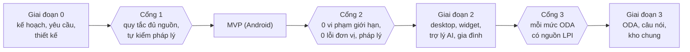
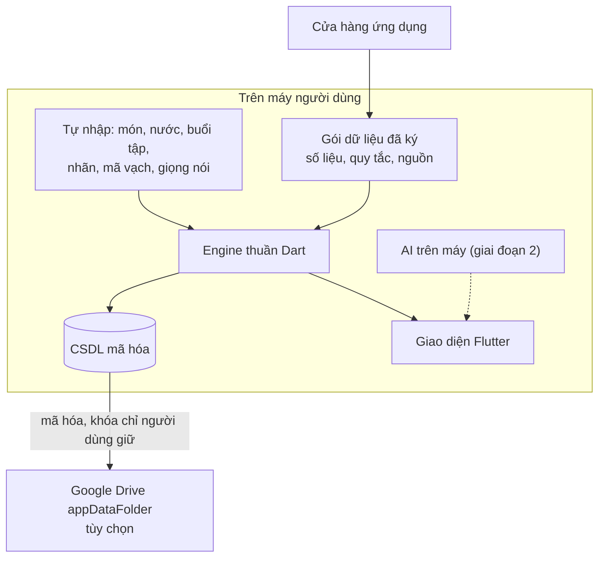

# WholeWell: plan phát triển

Cập nhật 23/11/2026 · Đặng Thế Anh

Tài liệu gốc về sản phẩm. Quy trình làm việc và quy tắc sửa code ở [AGENTS.md](../AGENTS.md); trạng thái ở [status.md](status.md); khung giao diện ở [design/mvp-overview.md](design/mvp-overview.md).

## 1. Mục tiêu và quyết định

WholeWell giúp người Việt từ 18 tuổi biết mình nạp bao nhiêu vi chất từ thực phẩm và thực phẩm bổ sung so với chuẩn của Mỹ, quản lý kho và lịch uống, và được cảnh báo khi vượt giới hạn an toàn. App miễn phí, chỉ để tham chiếu, dữ liệu nằm trên máy, mỗi con số có nguồn.

| Chủ đề | Quyết định |
| --- | --- |
| Định vị | Công cụ tham chiếu: không chẩn đoán, không kê đơn, không gợi ý liều; không bán, gợi ý, quảng cáo nhãn hàng bổ sung |
| Người dùng | Việt Nam trước; hồ sơ từ 18 tuổi (nhập số tuổi, app tự cộng mỗi năm); trẻ em chỉ được tính vào kho |
| Chuẩn | Chỉ các chuẩn ở mục 3; không chuẩn khác, không dữ liệu Việt Nam |
| Nguồn | Chính phủ Mỹ và số liệu NASEM (nhãn A), LPI chỉ cho ODA (nhãn B); nguồn không nói rõ thì không có quy tắc; không thuê chuyên gia |
| Dữ liệu người dùng | Trên máy, SQLite mã hóa; sao lưu tệp mã hóa, Google Drive tùy chọn; không máy chủ, không iCloud, không thiết bị đeo |
| Gói dữ liệu | Số liệu và quy tắc đi kèm bản cài đã ký, cập nhật qua cửa hàng ứng dụng; không tải từ máy chủ |
| AI | Chạy trên máy; engine tính mọi con số, AI chỉ giải thích và gợi ý món |
| Công nghệ | Flutter; Android trước, iOS khi có Mac, Windows và macOS ở giai đoạn 2, web sau cùng |
| Doanh thu | Miễn phí toàn bộ; MVP không có quảng cáo; về sau chỉ AdMob không cá nhân hóa |
| Pháp lý | Không thuê luật sư; tự đối chiếu văn bản gốc; chỗ không chắc thì bỏ hoặc thu hẹp |
| Nguồn lực | Một người cùng Claude Code và Gemini; làm lúc rảnh, không đặt hạn |

**Không làm:** tương tác thuốc (thay bằng câu hỏi có/không về thuốc kê đơn và lời nhắc hỏi bác sĩ, dược sĩ), xét nghiệm, CGM, gen, hệ vi sinh, hồ sơ sức khỏe trẻ em. **Thu hẹp:** khảo sát không hỏi tên bệnh, tên thuốc; không sàng lọc rối loạn ăn uống mà có nút "ẩn số calo"; AI không trả lời về bệnh, thuốc, liều.

**Khác biệt so với [VNeNUTRITION](https://baoquocte.vn/ra-mat-ung-dung-dinh-duong-viet-378041.html)** của Viện Dinh dưỡng (5/4/2026): thực phẩm và bổ sung trên cùng một thước đo, cảnh báo đúng phạm vi từng chất; kho và lịch uống, đọc nhãn tiếng Việt và hàng nhập; dữ liệu ở máy, không cần tài khoản; mỗi số có nguồn. WholeWell không dùng dữ liệu của họ.

## 2. Phạm vi và lộ trình

| Tính năng | App làm gì | Giai đoạn |
| --- | --- | --- |
| Hồ sơ, khảo sát | Tuổi, giới, chiều cao, cân nặng; mang thai (tuần thai, cân nặng trước khi mang thai) hoặc cho con bú (tháng sau sinh); giờ thức, ngủ, bữa ăn; câu hỏi có/không cho tầng an toàn | 1 |
| Nhật ký ăn | Chữ, giọng nói (trên máy), mã vạch, nhãn bao bì; thư viện món Việt; ảnh món từ giai đoạn 2 | 1 |
| Bổ sung và kho | Chụp nhãn, quét mã, lưu từng chất và dạng; số còn lại, ngày dự kiến hết, hạn dùng | 1 |
| Nước, vận động | Tự nhập; calo buổi tập theo MET; phút vận động so với chuẩn; gợi ý mức vận động | 1 |
| Đối chiếu, cảnh báo | % so với mức khuyến nghị, tách thực phẩm và bổ sung; cảnh báo vượt giới hạn; calo, tỷ lệ đạm, béo, bột đường, đường bổ sung | 1 |
| Lịch uống, nhắc giờ | Tự đặt lịch; lưu ý khi lịch trái quy tắc có nguồn; đánh dấu đã uống | 1 |
| Sao lưu | Tệp mã hóa, Google Drive; khôi phục chéo nền tảng ở giai đoạn 2 | 1–2 |
| Gia đình | Một hộp nhiều người (1); nhiều hồ sơ trên một máy (2); kho chung nhiều tài khoản (3) | 1–3 |
| Widget, trợ lý AI | Widget lần uống; AI giải thích số, gợi ý món (2); thao tác bằng câu nói (3) | 2–3 |
| ODA tham khảo | Mức của LPI cạnh mức khuyến nghị, không vượt giới hạn | 3 |
| Quảng cáo | Cuối danh sách Nhật ký, Kho | Khi có người dùng |

Không đặt mốc thời gian; chưa qua cổng thì chưa sang giai đoạn sau. **Thứ tự code MVP:** (1) engine và gói dữ liệu; (2) CSDL mã hóa; (3) hồ sơ, khảo sát, nhật ký ăn, nước, buổi tập; (4) chụp nhãn, mã vạch, kho; (5) lịch uống, nhắc giờ, đánh dấu đã uống; (6) đối chiếu và cảnh báo trên giao diện; (7) sao lưu tệp, rồi Google Drive. Cần rút ngắn thì MVP chỉ sao lưu ra tệp.

**Chi phí:** Google Play 25 USD một lần; iOS thêm 99 USD/năm và máy Mac; không chi phí máy chủ, dữ liệu, tư vấn. Google Play yêu cầu ít nhất 12 người thử liên tục 14 ngày ([Google Play](https://support.google.com/googleplay/android-developer/answer/14151465)); tìm người thử từ sớm.

## 3. Chuẩn và nguồn

| Chuẩn | Nguồn | Dùng trong app |
| --- | --- | --- |
| RDA ("mức khuyến nghị"); AI khi chưa có RDA ("mức ước tính") | NASEM | Mục tiêu vi chất |
| UL ("giới hạn an toàn") | NASEM | Cảnh báo khi **vượt** (lớn hơn), vì UL là mức cao nhất chưa gây hại; đúng phạm vi từng chất |
| EER 2023 | NASEM | Mục tiêu calo = mức giữ cân; không có mục tiêu giảm cân |
| AMDR | NASEM | Đạm 10–35%, béo 20–35%, bột đường 45–65% năng lượng |
| Đường bổ sung | [Dietary Guidelines 2025–2030](https://cdn.realfood.gov/DGA.pdf) | ≤10% năng lượng/ngày, ≤10 g/bữa |
| MET | [2024 Adult Compendium](https://pacompendium.com/) | Calo buổi tập, phút vừa/mạnh |
| Phút vận động | [Physical Activity Guidelines, bản 2](https://odphp.health.gov/sites/default/files/2019-09/Physical_Activity_Guidelines_2nd_edition.pdf) (HHS) | 150–300 phút vừa hoặc 75–150 phút mạnh/tuần (1 phút mạnh ≈ 2 phút vừa); tập tăng cơ ≥2 ngày |
| Đổi đơn vị nhãn | [FDA](https://www.fda.gov/regulatory-information/search-fda-guidance-documents/guidance-industry-converting-units-measure-folate-niacin-and-vitamins-d-and-e-nutrition-and), 21 CFR 101 | IU, DFE, NE, RAE |
| ODA | [Linus Pauling Institute](https://lpi.oregonstate.edu/mic) | Tham khảo, sau cổng 3 |

Đạm dùng RDA 0,8 g/kg làm mức tối thiểu và AMDR làm khoảng; không thêm mức 1,2–1,6 g/kg. Không dùng EAR, CDRR. ODA chỉ lấy từ LPI vì các bảng ODA khác không thống nhất, không công bố phương pháp, và liều cao có thể hại (thử nghiệm [SELECT](https://www.cancer.gov/types/prostate/research/select-trial-results-qa): vitamin E 400 IU/ngày tăng 17% tương đối ung thư tuyến tiền liệt).

**Mô hình 3 tầng:** (1) an toàn: giới hạn, thai kỳ, câu trả lời có/không, dị ứng; chạy trước mọi gợi ý, chỉ được thận trọng hơn; (2) nền tảng: mức khuyến nghị, luôn hiện; (3) tham khảo: ODA, kèm nguồn, không vượt giới hạn, ẩn khi có cờ an toàn.

**Quy tắc nguồn:**

- **Được dùng:** tác phẩm của chính phủ Mỹ, CC0, CC BY, nguồn cho phép dùng thương mại. Với NASEM và LPI chỉ lưu con số (số liệu không được bảo hộ quyền tác giả theo Điều 15 [Luật Sở hữu trí tuệ](https://datafiles.chinhphu.vn/cpp/files/vbpq/2026/10/160-vbhn-vpqh.signed.pdf)), sắp theo cấu trúc riêng, tự viết lời giải thích. Không dùng tên, nội dung NIH ODS trong quảng cáo.
- **Không dùng:** nguồn trả phí, giấy phép NC, dữ liệu cộng đồng, ý kiến, video, trang thương mại. Bài nghiên cứu (PubMed, PMC) chỉ để hiểu và giải thích quyết định, không làm nguồn của số hay quy tắc.
- **Số liệu đối chiếu với báo cáo DRI gốc của NASEM;** fact sheet NIH ODS để đối chiếu, lấy quy tắc giờ uống và tỷ lệ nguyên tố.
- **Mỗi số, mỗi quy tắc** có link, câu gốc ngắn, ngày tra, lưu trong `tools/build_pack.py`. Không tự đặt ngưỡng, không tự hiệu chỉnh mức khuyến nghị (chỉ hiệu chỉnh có trong DRI, như sắt cho người ăn chay gấp 1,8 lần).
- **Kiểm nguồn bằng Claude in Chrome** khi thêm, đổi và mỗi quý, vì NIH ODS chặn truy cập tự động. CI chỉ kiểm đủ các trường nguồn.
- **Nguồn không nói rõ thì không có quy tắc,** app ghi "chưa có hướng dẫn". Ví dụ: không có quy tắc uống canxi cách magie.

| Nguồn dữ liệu | Giấy phép | Dùng để |
| --- | --- | --- |
| Báo cáo DRI của NASEM ([tóm tắt](https://nap.nationalacademies.org/read/25353/chapter/28), [năng lượng 2023](https://nap.nationalacademies.org/read/26818/chapter/7)) | Chỉ lưu con số | Mức khuyến nghị, giới hạn, EER, AMDR |
| [NIH ODS](https://ods.od.nih.gov/healthinformation/nutrientrecommendations/) | Chính phủ Mỹ | Đối chiếu; quy tắc lịch; tỷ lệ nguyên tố |
| [USDA FoodData Central](https://fdc.nal.usda.gov/api-guide) | CC0 | Thành phần thực phẩm, mã vạch hàng Mỹ |
| USDA FPED | Kiểm giấy phép trước khi dùng | Đường bổ sung của món |
| [NIH DSLD](https://dsldapi.od.nih.gov/) | CC0 | Mã vạch bổ sung bán ở Mỹ |
| FDA, Compendium, Physical Activity Guidelines, Dietary Guidelines, LPI | Như bảng chuẩn | Như bảng chuẩn |

Tất cả đóng vào gói dữ liệu có phiên bản đi kèm bản cài, để tra cứu không cho bên ngoài biết người dùng ăn, uống gì. Nguồn lệch nhau về một chất có giới hạn thì cảnh báo theo giá trị cao hơn.

## 4. Yêu cầu chính

### Nhật ký, năng lượng, vận động

- **Chưa có nhật ký thì chỉ hiện chuẩn,** không ước tính lượng nạp. Trung bình 7 ngày chia cho số ngày có ghi, ghi rõ số ngày.
- **Món Việt:** chỉ dùng USDA; thư viện món tính từ công thức tự soạn với nguyên liệu USDA và khẩu phần quen thuộc, ghi "ước tính"; món không có thì nhập theo nhãn hoặc chọn món gần nhất. Script lập danh sách món "chỉ có ở Việt Nam".
- **Mục tiêu calo** theo EER; mức vận động người dùng chọn, app gợi ý từ buổi tập 7 ngày theo quy tắc của app (phút tương đương vừa/ngày: ≥30 nhẹ, ≥60 vừa, ≥120 nhiều). Không cộng calo buổi tập vào mục tiêu. Chưa tính được (18 tuổi, mang thai dưới 19 tuổi, thiếu thông tin thai kỳ) thì báo lý do, không đoán.
- **Đường bổ sung** tính trên năng lượng đã ăn; hôm nay chỉ ghi "đến giờ", kết luận vượt chỉ cho ngày đã qua và 7 ngày; giới hạn mỗi bữa báo ngay. Nguồn: FPED cho món FNDDS, nguyên liệu cho món tự soạn; nhãn chỉ ghi đường tổng thì "chưa rõ".
- **Vận động** do người dùng tự nhập; kcal ≈ MET × kg × giờ, ghi "khoảng"; không đọc thiết bị đeo, Health Connect, HealthKit.
- **Nước** chỉ hiện lượng đã uống, không so, vì mức tham chiếu là tổng nước gồm cả nước trong thức ăn ([NAP](https://www.nationalacademies.org/read/10925/chapter/6)).

### Thực phẩm bổ sung

- **Từ nhãn tới thành phần:** quét mã vạch trước (DSLD), không có thì chụp nhãn (OCR trên máy). Mỗi dòng một chất, một dạng; đổi đơn vị theo FDA; khối lượng hợp chất đổi ra lượng nguyên tố theo tỷ lệ của ODS (vd. canxi carbonat 40%, citrat 21%); dạng chưa rõ thì tính giới hạn theo cách thận trọng nhất. Kiểm hợp lý (nghi nhầm mg với µg, một khẩu phần đã vượt giới hạn); người dùng xác nhận từng dòng. Chất không có trong gói thì lưu để xem, không tính.
- **Thực phẩm tăng cường:** dùng trường axit folic và vitamin E bổ sung của USDA; niacin tăng cường không tách được thì ghi rõ chưa tính; món nhập theo nhãn có niacin, vitamin E, axit folic thì coi là tăng cường.
- **Kho:** số còn lại, hạn dùng; ngày dự kiến hết theo lượng dùng mỗi ngày và tỷ lệ bỏ liều 14 ngày; dùng hộp hết hạn sớm trước; không link cửa hàng.
- **Nhắc giờ:** thông báo hẹn trước; màn hình khóa chỉ hiện "Đến giờ uống, 2 loại". "Đã uống" trừ kho, cộng tổng nạp, kiểm lại giới hạn; ghi từ nút Ghi tự gắn vào lần uống theo lịch chưa đánh dấu, để không đếm hai lần.

**Quy tắc lịch** (fact sheet Health Professional của NIH ODS, tra 23/11/2026). Mỗi quy tắc là một dòng dữ liệu trong gói; thêm quy tắc cùng loại không sửa code; người dùng quyết định.

| # | Quy tắc | App làm gì | Nguồn |
| --- | --- | --- | --- |
| 1 | Canxi bổ sung hấp thu cao nhất khi mỗi lần ≤500 mg | Lưu ý khi một lần >500 mg | [ODS, canxi](https://ods.od.nih.gov/factsheets/Calcium-HealthProfessional/) |
| 2 | Canxi hấp thu tốt hơn khi uống cùng thức ăn; canxi carbonat cần bữa ăn với người ít axit dạ dày; citrat uống lúc đói được | Gợi ý xếp canxi carbonat vào bữa | [ODS, canxi](https://ods.od.nih.gov/factsheets/Calcium-HealthProfessional/) |
| 3 | Chuyên gia khuyên uống canxi và sắt bổ sung khác giờ; tác động chưa xác lập chắc chắn | Lưu ý khi cùng giờ, ghi "chưa chắc chắn" | [ODS, sắt](https://ods.od.nih.gov/factsheets/Iron-HealthProfessional/) |
| 4 | Sắt bổ sung ≥25 mg uống cùng lúc với kẽm bổ sung làm giảm hấp thu kẽm | Lưu ý khi cùng giờ | [ODS, kẽm](https://ods.od.nih.gov/factsheets/Zinc-HealthProfessional/) |
| 5 | Chất béo trong bữa giúp hấp thu vitamin D; không có vẫn hấp thu một phần | Gợi ý nhẹ xếp vào bữa | [ODS, vitamin D](https://ods.od.nih.gov/factsheets/VitaminD-HealthProfessional/) |

Không làm quy tắc: canxi–magie, canxi–kẽm, khoảng cách giờ cụ thể giữa hai vi chất (nguồn không nói). Vitamin C tăng hấp thu sắt chỉ là thông tin ở chi tiết chất, không thành gợi ý, vì không hợp với người bệnh về máu. Thuốc kê đơn: app không xếp lại, không kiểm tương tác.

### Cảnh báo giới hạn an toàn

- **Phạm vi:** magie chỉ tính bổ sung ([ODS](https://ods.od.nih.gov/factsheets/Magnesium-HealthProfessional/)); niacin, vitamin E tính từ bổ sung và thực phẩm tăng cường; vitamin A chỉ retinol ([NCBI](https://www.ncbi.nlm.nih.gov/books/NBK222318/)); folate chỉ axit folic; chất khác tính mọi nguồn.
- **Ba loại cờ:** trong ngày; trung bình 7 ngày (UL là ngưỡng cho lượng nạp trung bình hằng ngày, [NAP](https://nap.nationalacademies.org/resource/25353/interactive/index.html)); theo lịch (báo trước khi lưu lịch). Kiểm lại sau mọi thay đổi có thể làm vượt. Không chặn việc ghi hay lưu, chỉ cảnh báo.
- **Lời trung tính:** chất, lượng, giới hạn, phạm vi, mục góp vào, gợi ý hỏi bác sĩ hoặc dược sĩ. Lời giải thích kèm theo ODS: kẽm liều cao lâu dài cản hấp thu đồng, rất cao cản magie; folate liều cao có thể che dấu thiếu B12.

### An toàn người dùng

| Nhóm | Biện pháp |
| --- | --- |
| Dưới 18 tuổi | Không có hồ sơ; hỏi tuổi trước màn đồng ý |
| Mang thai, cho con bú | Mức của nhóm này; ẩn ODA; khuyên hỏi bác sĩ |
| Dùng thuốc kê đơn, bệnh mạn tính | Lưu ý hỏi bác sĩ trước khi dùng bổ sung; ẩn ODA |
| Bệnh về máu (thalassemia) | Không gợi ý gì về sắt ([CDC](https://www.cdc.gov/thalassemia/communication-resources/initiating-regular-transfusions.html)); khoảng 13,8% người Việt mang gen ([Hemoglobin 2022](https://pubmed.ncbi.nlm.nih.gov/35950578/)) |
| Hút thuốc | Lưu ý khi dùng beta-caroten liều cao ([ODS](https://ods.od.nih.gov/factsheets/VitaminA-HealthProfessional/)) |
| Dị ứng thực phẩm | Loại khỏi gợi ý món; cảnh báo khi mã vạch khai báo chất gây dị ứng |
| Dễ bị ảnh hưởng bởi đếm calo | "Ẩn số calo"; không mục tiêu giảm cân, chuỗi ngày, huy hiệu, lời phán xét ([liên quan giữa app đếm calo và rối loạn ăn uống](https://pubmed.ncbi.nlm.nih.gov/39671845/)) |

Lời lẽ: "so với mức khuyến nghị", "vượt giới hạn an toàn"; không "bạn bị thiếu", "nên uống"; giao diện không hiện tên viết tắt của chuẩn (nguyên tắc ở [design/README.md](design/README.md)).

### Pháp lý: tự kiểm trước mỗi lần phát hành

| Văn bản | Cách làm |
| --- | --- |
| Luật Bảo vệ dữ liệu cá nhân 91/2025/QH15 ([toàn văn](https://luattri.com/library/luat/91-2025-qh15-bao-ve-du-lieu-ca-nhan)), Nghị định 356/2025/NĐ-CP | Sức khỏe là dữ liệu nhạy cảm: đồng ý riêng từng mục đích, ô không đánh sẵn, lưu bằng chứng trên máy; rút đồng ý thì xóa toàn bộ; có xuất, sửa, xóa; Drive chỉ bật sau màn giải thích, khóa chỉ người dùng giữ; tự lập hồ sơ đánh giá tác động |
| [Nghị định 98/2021/NĐ-CP](https://thuvienphapluat.vn/van-ban/The-thao-Y-te/Nghi-dinh-98-2021-ND-CP-quan-ly-trang-thiet-bi-y-te-493940.aspx) (trang thiết bị y tế) | Chỉ tham chiếu dinh dưỡng chung; không theo dõi bệnh, không ngưỡng chẩn đoán |
| [Luật Trí tuệ nhân tạo 134/2025/QH15](https://www.bakermckenzie.com/en/insight/publications/2026/02/vietnam-artificial-intelligence-law-foundation-and-outlook) | AI trên máy, chỉ giải thích số, ghi rõ là AI; đối chiếu danh mục rủi ro cao trước giai đoạn 2 |
| [Luật Quảng cáo 75/2025/QH15](https://thuvienphapluat.vn/van-ban/Thuong-mai/Luat-Quang-cao-sua-doi-2025-so-75-2025-QH15-555035.aspx), [Nghị định 342/2025/NĐ-CP](https://thuvienphapluat.vn/documents/law.aspx?id=Q%3DpnM05qVTTm) | Khi bật: không cá nhân hóa, có biểu tượng tắt, chặn danh mục dược phẩm, vitamin, bổ sung ([AdMob](https://support.google.com/admob/answer/3150953)) |
| Luật Sở hữu trí tuệ, Điều 15 | Chỉ lưu con số của NASEM, LPI |
| [FDA General Wellness](https://www.fda.gov/media/90652/download), nếu sang Mỹ | Giữ câu chữ trong phạm vi sức khỏe chung |

## 5. Thiết kế kỹ thuật

- **Engine:** gói Dart thuần, không I/O; bản Python (`tools/reference_engine.py`) sinh ca kiểm thử. Engine quyết định mọi số và cảnh báo. AI không tính số vì yếu khi cá nhân hóa (không chatbot nào vượt 50% ở ca phức tạp, [JCM 2024](https://pmc.ncbi.nlm.nih.gov/articles/PMC11677083/)); câu trả lời có số không khớp engine thì bỏ.
- **Gói dữ liệu:** `tools/build_pack.py` là nguồn số liệu duy nhất; đi kèm bản cài đã ký, app kiểm toàn vẹn trước khi dùng.
- **Lưu trữ:** drift với SQLite3MultipleCiphers, khóa qua flutter\_secure\_storage; loại khỏi sao lưu của hệ điều hành ([Android](https://developer.android.com/identity/data/autobackup), iOS isExcludedFromBackup). Không SDK phân tích, báo lỗi; giọng nói chỉ trên máy.
- **Sao lưu:** mặc định xuất tệp mã hóa. Drive dùng [appDataFolder](https://developers.google.com/workspace/drive/api/guides/appdata); app tự mã hóa (Argon2id, mã khôi phục) vì Drive [giữ khóa của nó](https://support.google.com/drive/answer/10519333); giữ 2–3 bản; mọi client ID trong [một dự án Google Cloud](https://developers.google.com/identity/protocols/CrossClientAuth); chạy khi mở, rời app. Không iCloud (App Store 5.1.3(ii)).
- **Lớp nền tảng sau interface Dart,** mỗi interface có bản giả để test (danh sách ở AGENTS.md). Không việc quan trọng nào phụ thuộc chạy nền.
- **Plugin chính:** flutter\_local\_notifications (Android 14 từ chối báo thức chính xác mặc định, [Android](https://developer.android.com/about/versions/14/changes/schedule-exact-alarms); iOS tối đa 64 thông báo chờ), google\_mlkit (OCR, mã vạch), speech\_to\_text (chỉ trên máy), google\_sign\_in, googleapis. Viết native: Gemini Nano, Foundation Models, widget (giai đoạn 2).
- **Đa nền tảng:** engine, mã hóa, sao lưu dùng chung; OCR, mã vạch chỉ di động; web chỉ là bản xem vì Safari xóa dữ liệu sau 7 ngày không vào ([web.dev](https://web.dev/articles/storage-for-the-web)).

## 6. Rủi ro và kiểm sớm

| Rủi ro | Biện pháp |
| --- | --- |
| Con số hoặc gợi ý sai | Tầng an toàn; quy tắc có nguồn; test so với bản Python; 0 vi phạm giới hạn, 0 lỗi đơn vị |
| Đọc nhãn sai (đơn vị, dạng, hợp chất) | Lưu từng chất và dạng; kiểm hợp lý; xác nhận từng dòng; dạng chưa rõ tính thận trọng |
| Nhắc giờ trễ | Xin quyền báo đúng giờ, dự phòng gần đúng, lịch cuộn; thử máy thật |
| Mất dữ liệu | Nhắc sao lưu; 2–3 bản; mã khôi phục; xuất tệp |
| Dữ liệu rời máy qua đường ngầm | Loại khỏi sao lưu hệ điều hành; không SDK phân tích; quảng cáo không nhận dữ liệu sức khỏe |
| Bị coi là thiết bị y tế, vi phạm luật | Giữ vai tham chiếu; bảng pháp lý trước mỗi bản |
| Agent viết lỗi, tự đổi quy tắc | Test trước, review chéo; số và quy tắc chỉ sửa trong `build_pack.py`, chủ dự án duyệt |
| Nguồn chặn truy cập tự động | Đọc, kiểm qua Claude in Chrome |

| Kiểm sớm (trước khi xây phần đó) | Kết quả đến nay | Nếu bế tắc |
| --- | --- | --- |
| Bảng DRI đối chiếu báo cáo NASEM | Xong: 40 chất × 16 nhóm, 102 ô | Chất thiếu số ghi "chưa có chuẩn" |
| So khớp 200 thực phẩm với USDA; 30 món Việt đầu | Chưa làm | Nhập theo nhãn, món gần nhất |
| OCR 30 nhãn thật | ML Kit v2 hỗ trợ tiếng Việt; thử máy | Nhập tay từng dòng |
| Quét 50 mã vạch hàng mua ở Việt Nam | Chưa làm | Chụp nhãn là đường chính |
| Giọng nói tiếng Việt trên máy | ML Kit có vi-VN (beta) cho Android 12+; thử máy với tên món | Ẩn tính năng |
| Nhắc giờ 7 ngày trên vài hãng; nút "Đã uống" khi app nền | Chưa thử | Báo gần đúng; bấm nút thì mở app |
| Sao lưu Android, khôi phục nền tảng khác | Chưa thử | Chỉ xuất, nhập tệp |
| AI tiếng Việt trên máy (30 câu) | Gemini Nano chưa công bố tiếng Việt; Apple có từ iOS 26.1 | Giải thích theo mẫu |

## 7. Kiểm thử, phát hành, bảo trì

**Kiểm thử** (cổng 2): engine so với `reference_engine.py` và mẫu của [DRI Calculator](https://www.nal.usda.gov/human-nutrition-and-food-safety/dri-calculator); mọi số và quy tắc có nguồn đã kiểm; bộ ảnh nhãn thật (không dòng nào vào CSDL khi chưa xác nhận); nhắc giờ trên máy thật (app tắt, khởi động lại, đổi múi giờ, tiết kiệm pin); sao lưu (sai mật khẩu, tệp hỏng, lược đồ cũ); bảo mật (ngoài Drive app không gửi gì, màn hình khóa không hiện tên chất, rà theo [OWASP Mobile Top 10](https://owasp.org/www-project-mobile-top-10/)); người dùng tự ghi được không cần hướng dẫn.

**Phát hành:** CI dựng, test, ký; thử nghiệm kín rồi phát hành từng phần.

| Quy định | Việc cần làm |
| --- | --- |
| Google Play Data safety | Dữ liệu chỉ xử lý trên máy không phải khai "thu thập" ([Google Play](https://support.google.com/googleplay/answer/11416267)); Drive mã hóa đầu cuối theo [điều kiện](https://support.google.com/googleplay/android-developer/answer/10787469); khi bật quảng cáo khai phần SDK |
| Google Play Health apps | Điền form, đăng chính sách quyền riêng tư ([Google Play](https://support.google.com/googleplay/android-developer/answer/16555673)) |
| App Store | Nhãn quyền riêng tư; không iCloud; app không cần tài khoản |
| Google API User Data Policy | Chỉ xin quyền drive.appdata; có trang chính sách quyền riêng tư |

**Bảo trì:**

| Việc | Khi nào |
| --- | --- |
| Cập nhật chuẩn khi NASEM, HHS, USDA, FDA, LPI ra bản mới; dựng lại gói, báo chênh lệch, chủ dự án duyệt | Khi có bản mới |
| Thêm quy tắc lịch khi đọc được nguồn nói rõ | Khi có |
| Kiểm link, câu gốc, giấy phép qua Claude in Chrome | Mỗi quý |
| Cập nhật dữ liệu USDA, DSLD | Mỗi quý |
| Rà pháp lý, chính sách cửa hàng | Trước mỗi bản |
| Thử lại nhắc giờ, sao lưu trên Android, iOS mới | Mỗi năm |
| Thư viện, vá bảo mật | Hằng tháng |

Không có SDK phân tích; chỉ số lấy từ Play Console, thử nghiệm kín và khảo sát tự nguyện.

## 8. Việc còn mở

- Thử trên máy thật: giọng nói, OCR, Gemini Nano, sao lưu chéo nền tảng, mã vạch.
- Đối chiếu phương trình EER 14–18 để bật mục tiêu calo cho người 18 tuổi.
- Danh sách thực phẩm Việt Nam không có trong USDA.
- Kiểm giấy phép USDA FPED; kiểm link eCFR và Physical Activity Guidelines qua Claude in Chrome.
- Khi bật quảng cáo: có đặt ở màn Hôm nay không.

Tra cứu đến 23/11/2026; quy định và số liệu có thể đổi, đối chiếu lại trước mỗi lần phát hành.
