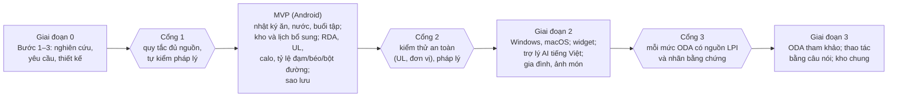
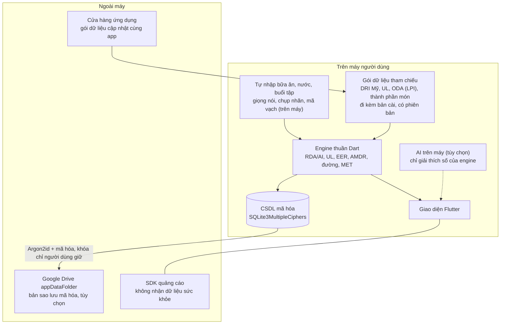

# App sức khỏe cá nhân hóa (RDA & ODA): hướng tiếp cận và lộ trình phát triển

Cập nhật 22/11/2026 · Đặng Thế Anh

## Tóm tắt

App giúp người Việt từ 18 tuổi biết mình nạp bao nhiêu vi chất từ thực phẩm và thực phẩm bổ sung so với chuẩn của Mỹ, quản lý kho và lịch uống, và được cảnh báo khi vượt mức tối đa an toàn (UL). App miễn phí, chỉ để tham chiếu, dữ liệu nằm trên máy người dùng, và chỉ dùng nguồn uy tín, miễn phí, dùng được hợp pháp. Một người làm cùng Claude Code Pro và Gemini Pro theo quy trình 7 bước, Android trước.

### Các quyết định đã chốt

| Chủ đề | Quyết định |
| --- | --- |
| Định vị | Công cụ tham chiếu dinh dưỡng: không chẩn đoán, không kê đơn, không gợi ý liều. Không bán, không gợi ý hay quảng cáo nhãn hàng thực phẩm bổ sung |
| Người dùng, thị trường | Việt Nam trước. Hồ sơ chỉ cho người từ 18 tuổi; trẻ em chỉ được tính vào kho |
| Chuẩn tham chiếu | Vi chất: RDA (chất chưa có RDA thì dùng AI, ghi là ước tính), UL và ODA (theo Linus Pauling Institute). Năng lượng: mục tiêu calo theo EER, tỷ lệ đạm, béo, bột đường theo AMDR (cùng hệ DRI của NASEM), đường bổ sung theo Dietary Guidelines 2025–2030. Không dùng chuẩn khác, không dùng dữ liệu Việt Nam |
| Nguồn | Chỉ nguồn uy tín, miễn phí, dùng được hợp pháp trong app có quảng cáo (quy tắc ở bước 2). Không thuê chuyên gia; mỗi quy tắc có trích dẫn kiểm được |
| Dữ liệu người dùng | Ở trên máy, SQLite mã hóa. Sao lưu ra tệp mã hóa; Google Drive của người dùng là tùy chọn. Không máy chủ, không iCloud, không đọc dữ liệu từ thiết bị đeo hay app sức khỏe khác |
| AI | Chạy trên máy. Engine tính mọi con số; trợ lý AI chỉ giải thích số và gợi ý món |
| Công nghệ | Flutter. Android trước; iOS khi có máy Mac; Windows, macOS ở giai đoạn 2; web sau cùng |
| Doanh thu | Mọi tính năng miễn phí; chỉ thu từ quảng cáo, bật khi app đã có lượng người dùng nhất định |
| Pháp lý | Không thuê luật sư. Tự đối chiếu văn bản gốc; chỗ không chắc thì bỏ hoặc thu hẹp tính năng |
| Không làm | Kiểm tra tương tác thuốc, kết quả xét nghiệm, CGM, gen, hệ vi sinh, thử nghiệm trên người dùng, hồ sơ sức khỏe trẻ em |
| Nguồn lực | 1 người cùng Claude Code Pro và Gemini Pro; làm lúc rảnh, không đặt hạn; tiến độ đo bằng cổng kiểm soát |

### Quy trình 7 bước

| Bước | Việc chính | Đầu ra | AI agent làm | Bạn làm |
| --- | --- | --- | --- | --- |
| 1. Lên kế hoạch | Phạm vi, thị trường, lộ trình, rủi ro, nguồn lực | Phạm vi theo giai đoạn, lộ trình có cổng, danh sách rủi ro | Tổng hợp nghiên cứu, nháp kế hoạch | Chốt phạm vi |
| 2. Phân tích yêu cầu | Chuẩn và nguồn, khẩu phần, thực phẩm bổ sung, an toàn, pháp lý | Đặc tả từng tính năng, bảng quy tắc có trích dẫn | Nháp đặc tả, liệt kê ca biên | Duyệt quy tắc; tự kiểm tra pháp lý theo văn bản gốc |
| 3. Thiết kế | Kiến trúc, lưu trữ, sao lưu, công nghệ, nguồn dữ liệu | Sơ đồ kiến trúc, lược đồ CSDL, tệp ghi quyết định | Đề xuất phương án, so sánh đánh đổi | Chọn phương án |
| 4. Code | Engine, CSDL, giao diện, nhắc giờ, sao lưu | Pull request kèm kiểm thử | Viết code theo đặc tả và kiểm thử có sẵn | Review và gộp |
| 5. Kiểm thử | Engine, đọc nhãn, nhắc giờ, sao lưu, bảo mật, người dùng | Báo cáo kiểm thử, kết quả cổng 2 | Sinh ca biên, chạy kiểm thử tự động | Thử trên máy thật |
| 6. Triển khai | Android trước, iOS khi có Mac, rồi desktop, web | Bản phát hành, khai báo cửa hàng | Chạy CI dựng và ký bản, nháp ghi chú phát hành | Nộp cửa hàng |
| 7. Bảo trì | Cập nhật chuẩn và dữ liệu, sửa lỗi, theo phiên bản hệ điều hành | Bản vá, gói tham chiếu mới, việc cho giai đoạn sau | Mở PR cập nhật, phân loại báo lỗi | Duyệt thay đổi quy tắc |

Giai đoạn 0 làm bước 1–3 cho cả app. MVP, giai đoạn 2 và giai đoạn 3 mỗi giai đoạn chạy lại đủ 7 bước cho phần việc của mình. Ba cổng kiểm soát: cổng 1 trước bước 4 của MVP, cổng 2 cuối bước 5 trước khi phát hành công khai, cổng 3 trước khi bật ODA ở giai đoạn 3.

## 1. Lên kế hoạch

### Phạm vi

| Tính năng | App làm gì | Giai đoạn |
| --- | --- | --- |
| Hồ sơ và khảo sát | Tuổi, giới, chiều cao, cân nặng, mang thai hoặc cho con bú; giờ thức, ngủ, bữa ăn; thói quen ăn; vài câu hỏi có/không cho tầng an toàn | 1 |
| Nhật ký ăn uống | Nhập bằng chữ, giọng nói (nhận dạng trên máy), mã vạch; thư viện món Việt với khẩu phần quen thuộc; ảnh món ăn từ giai đoạn 2 | 1 |
| Thực phẩm bổ sung và kho | Chụp nhãn hoặc quét mã; phác đồ từng người; số còn lại, ngày dự kiến hết, nhắc mua thêm, hạn dùng | 1 |
| Nước và vận động | Người dùng tự nhập nước và buổi tập; app suy ra calo tiêu hao theo MET, mức vận động cho mục tiêu calo và số phút vận động mỗi tuần | 1 |
| Đối chiếu và cảnh báo UL | % so với RDA, tách thực phẩm và bổ sung; cảnh báo khi vượt UL trong ngày hoặc trung bình 7 ngày, đúng phạm vi từng chất; calo so với mục tiêu EER, tỷ lệ đạm, béo, bột đường so với AMDR, đường bổ sung so với giới hạn; mức ODA theo LPI hiện thêm từ giai đoạn 3 | 1 |
| Lịch uống và nhắc giờ | Người dùng tự đặt lịch từng vi chất và nước; app gợi ý giờ và cảnh báo khi lịch trái quy tắc có nguồn; đánh dấu đã uống từng loại thì lịch, kho và tổng nạp cập nhật | 1 |
| Sao lưu | Tệp mã hóa và Google Drive trên Android; khôi phục chéo sang Windows, macOS ở giai đoạn 2 | 1–2 |
| Gia đình | Một hộp nhiều người dùng (giai đoạn 1); hồ sơ nhiều người lớn trên một máy (2); kho chung nhiều tài khoản Google (3) | 1–3 |
| Widget màn hình chính | Các lần uống sắp tới với nút “Đã uống” cho từng loại; số lần còn lại trong ngày; tên ngắn do người dùng đặt, có thể ẩn | 2 |
| Trợ lý AI trên máy | Giải thích số của engine, gợi ý món Việt giàu chất đang thấp (giai đoạn 2); thao tác bằng câu nói (3) | 2–3 |
| Quảng cáo | Banner hoặc native ở màn hình danh sách, thống kê | Khi có lượng người dùng nhất định |

**Không làm,** vì dễ bị coi là chẩn đoán, hỗ trợ điều trị hoặc cần dữ liệu sức khỏe quá nhạy cảm:

- **Kiểm tra tương tác giữa thuốc và bổ sung:** gần với phần mềm thiết bị y tế. Thay bằng câu hỏi có/không về thuốc kê đơn và lời nhắc hỏi bác sĩ, dược sĩ.
- **Kết quả xét nghiệm,** kéo theo ODA tính theo xét nghiệm.
- **CGM, gen, hệ vi sinh; thử nghiệm kiểm chứng trên người dùng.**
- **Hồ sơ sức khỏe trẻ em.**
- **Thu hẹp:** khảo sát chỉ hỏi có/không, không hỏi tên bệnh hay tên thuốc; không sàng lọc rối loạn ăn uống mà có nút “ẩn số calo”; trợ lý AI không trả lời về bệnh, thuốc hay liều bổ sung.

Lời lẽ trong app giữ vai tham chiếu: “đạt 60% RDA”, “vượt UL”, “mức tham khảo”, kèm nguồn; tránh “bạn bị thiếu” hay “bạn nên uống”, vì nghe như chẩn đoán hoặc kê đơn.

### Thị trường

Đối thủ trực tiếp là [VNeNUTRITION](https://baoquocte.vn/ra-mat-ung-dung-dinh-duong-viet-378041.html) của Viện Dinh dưỡng (ra mắt 5/4/2026): bảng nhu cầu khuyến nghị và thành phần thực phẩm Việt Nam, món Việt, tư vấn bằng AI. App này không dùng dữ liệu của VNeNUTRITION hay Viện Dinh dưỡng. Điểm khác biệt nhắm tới:

- **Thực phẩm và bổ sung trên cùng một thước đo** chuẩn Mỹ, cảnh báo UL đúng phạm vi từng chất.
- **Kho và lịch uống:** đọc nhãn tiếng Việt và hàng nhập khẩu, một hộp nhiều người dùng, nhắc giờ, ngày dự kiến hết.
- **Dữ liệu ở máy,** không cần tài khoản.
- **Mỗi con số có nguồn.**

### Doanh thu: miễn phí, thu từ quảng cáo

| Quy tắc | Nội dung |
| --- | --- |
| Thời điểm | Bản đầu không có quảng cáo. Bật khi app đã ổn định và có lượng người dùng nhất định; trước bản đó sửa Data safety, mục khai quảng cáo, chính sách quyền riêng tư và đọc lại luật quảng cáo. Mô tả trên store ghi sẵn “miễn phí, sau này có thể có quảng cáo” |
| Mạng quảng cáo | AdMob qua [google\_mobile\_ads](https://pub.dev/packages/google_mobile_ads), chỉ có cho Android và iOS; bản desktop, web không có quảng cáo |
| Nội dung bị chặn | Danh mục nhạy cảm gồm dược phẩm, vitamin, thực phẩm bổ sung ([AdMob](https://support.google.com/admob/answer/3150953)) và các danh mục gần như giảm cân. AdMob phân loại tự động nên có thể lọt ([AdMob](https://support.google.com/admob/answer/3150176)): có nút báo quảng cáo không phù hợp, rà báo cáo định kỳ |
| Không cá nhân hóa | SDK mặc định hiện quảng cáo cá nhân hóa ([Google](https://developers.google.com/admob/flutter/eu-consent)); app chỉ xin quảng cáo không cá nhân hóa, không đưa hồ sơ, nhật ký hay bổ sung vào yêu cầu quảng cáo |
| Vị trí | Màn hình danh sách, thống kê. Không ở màn hình cảnh báo UL hay cờ đỏ, thông báo, widget; không chèn toàn màn hình lúc bấm “Đã uống” |

### Lộ trình: bốn giai đoạn, ba cổng kiểm soát

Không đặt mốc thời gian; tiến độ đo bằng việc qua từng cổng và xong từng mục trong thứ tự code MVP (bước 4). Nếu cần rút ngắn, MVP chỉ sao lưu ra tệp, để Google Drive sau.

*Bốn giai đoạn, ba cổng; độ dài các khối không theo tỉ lệ thời gian.*

Chưa qua cổng thì chưa sang giai đoạn sau. Cổng 1 và 2 chặn việc xây và phát hành khi quy tắc thiếu nguồn, chưa qua bảng tự kiểm tra pháp lý hoặc chưa qua kiểm thử an toàn (UL, đơn vị). Cổng 3 giữ ODA tắt cho tới khi mỗi mức có nguồn LPI.

### Nguồn lực và chi phí

- **Người:** bạn làm chủ sản phẩm: chốt đặc tả, duyệt và gộp code, thử trên máy thật, nộp cửa hàng.
- **AI:** Claude Code Pro và Gemini Pro (phân công ở bước 4). Cả hai có hạn mức, nên việc không cần agent (thử máy, duyệt) xếp vào lúc hết hạn mức.
- **Chi phí bắt buộc:** Google Play 25 USD một lần; khi làm iOS thêm Apple Developer Program 99 USD mỗi năm và máy Mac. Không có chi phí máy chủ, dữ liệu hay tư vấn.
- **Người thử:** tài khoản Google Play cá nhân cần ít nhất 12 người thử liên tục 14 ngày trước khi phát hành chính thức; nhờ gia đình, bạn bè, đồng nghiệp từ sớm.

### Rủi ro chính

Rủi ro lớn nhất là app đưa ra con số hoặc gợi ý sai, nên biện pháp chính là tầng an toàn, quy tắc có nguồn và kiểm thử.

| Rủi ro | Biện pháp |
| --- | --- |
| Mức “tối ưu” gây hại | Mô hình 3 tầng: UL chặn cứng; ODA chỉ là mức tham khảo, không gợi ý liều; app không bán bổ sung |
| Đọc nhãn sai, nhất là nhầm mg với µg hoặc sai dạng vitamin A | OCR trên máy, kiểm tra hợp lý, người dùng xác nhận từng dòng; kiểm thử bằng nhãn thật |
| Cảnh báo UL sai phạm vi (tính cả thực phẩm cho chất chỉ giới hạn phần bổ sung, hoặc ngược lại) | Lưu phạm vi UL từng chất; ca kiểm thử từ số liệu NASEM; 0 vi phạm |
| Nhắc giờ đến trễ | Xin quyền báo đúng giờ, dự phòng báo gần đúng, lịch cuộn; thử trên máy thật |
| Mất dữ liệu: mất máy, gỡ app, Drive đầy, quên mật khẩu | Nhắc sao lưu và nhắc khi lâu chưa sao lưu; giữ 2–3 bản; kiểm dung lượng; mã khôi phục; xuất tệp |
| Dữ liệu rời máy qua đường ngầm: sao lưu hệ điều hành, báo lỗi, nhận dạng giọng nói, SDK | Loại CSDL khỏi sao lưu hệ điều hành; chỉ nhận dạng giọng nói trên máy; không nhúng SDK phân tích; SDK quảng cáo không nhận dữ liệu sức khỏe |
| Bị coi là thiết bị y tế, vi phạm luật dữ liệu cá nhân hay luật AI | Giữ vai tham chiếu; bỏ tính năng nhạy cảm; qua bảng tự kiểm tra pháp lý trước mỗi lần phát hành |
| AI tính sai hoặc vượt vai tham chiếu | Engine tính mọi con số; bỏ câu có số không khớp; bộ câu hỏi kiểm thử tiếng Việt |
| Code do agent viết có lỗi khó thấy, hoặc agent tự đổi quy tắc | Kiểm thử trước, review chéo; vùng quy tắc chỉ gộp khi có trích dẫn và bạn duyệt |
| Thiếu dữ liệu cho thực phẩm chỉ có ở Việt Nam | Nhập theo nhãn bao bì hoặc chọn thực phẩm gần nhất trong USDA; ghi là ước tính |
| Một người làm, chưa có máy Mac | Android trước; giao agent việc nhỏ có đặc tả; chọn plugin có bản iOS; build thử iOS trên máy macOS của CI |
| Plugin lỗi hoặc ngừng bảo trì | Chọn plugin có nhà phát hành đã xác minh; bọc sau interface Dart; sẵn sàng viết cầu nối native |

### Điều kiện và rào cản từng phần

Mỗi phần dưới đây có một bài kiểm sớm, làm ở giai đoạn 0 hoặc ngay đầu phần đó, trước khi xây tiếp. Bài kiểm không qua thì đi theo cột “Nếu bế tắc”, không cố làm tiếp. Cổng 1 chỉ mở khi các bài kiểm của MVP đã có kết quả.

| Phần | Cần có | Rào cản | Kiểm sớm | Nếu bế tắc |
| --- | --- | --- | --- | --- |
| Chuẩn DRI | RDA (hoặc AI khi chưa có RDA) và UL cho mọi chất có chuẩn, mọi nhóm tuổi, giới, thai kỳ; phạm vi UL từng chất; hệ số phương trình EER 2023, khoảng AMDR, giới hạn đường bổ sung | Fact sheet ODS mỗi chất một trang, nhập tay dễ sai; một số chất không có UL | Script dựng bảng từ ODS, so từng ô với bảng tóm tắt NASEM và DRI Calculator | Chất nào thiếu số thì app ghi “chưa có chuẩn”, không tự điền |
| ODA (LPI) | Mức khuyến nghị LPI cho người lớn | LPI chỉ có cho một số chất, phần lớn trùng RDA; có thể đổi khuyến nghị | Lập danh sách chất LPI ghi khác RDA | Chất nào LPI không có thì không hiện ODA |
| Thành phần thực phẩm | Foundation Foods, SR Legacy, FNDDS của USDA | Tên tiếng Anh; nhiều thực phẩm Việt không có | So khớp 200 thực phẩm người Việt hay ăn, đo tỷ lệ tìm thấy | Người dùng nhập theo nhãn hoặc chọn thực phẩm gần nhất, ghi là ước tính |
| Tìm món bằng tiếng Việt | Bảng tên tiếng Việt, tên địa phương, từ không dấu cho thực phẩm USDA | USDA không có tên tiếng Việt; phải tự soạn | Soạn thử 200 thực phẩm, đo tỷ lệ tìm đúng | Tìm theo nhóm thực phẩm và danh sách hay dùng |
| Thư viện món Việt | Công thức tự soạn từ nguyên liệu USDA, khẩu phần quen thuộc | Tốn công; mỗi nhà nấu một kiểu | Soạn 30 món đầu, xem mất bao lâu mỗi món | Bắt đầu 100–200 món; người dùng tự lưu công thức nhà mình |
| Mã vạch | Gói mã vạch trên máy | Dữ liệu miễn phí (USDA Branded, DSLD) chủ yếu là hàng bán ở Mỹ; Branded quá lớn để đóng hết | Quét 50 sản phẩm mua ở Việt Nam, đo tỷ lệ tra trúng | Chụp nhãn là đường chính; mã vạch chỉ là phần thêm |
| Đọc nhãn (OCR) | ML Kit đọc được nhãn tiếng Việt và nhãn nhập khẩu | Nhãn mờ, chữ nhỏ, bố cục lạ, nhầm đơn vị | Chạy thử trên 30 ảnh nhãn thật trước khi làm giao diện | Người dùng nhập tay từng dòng, app chỉ gợi ý |
| Nhập bằng giọng nói | Nhận dạng tiếng Việt chạy trên máy | Nhiều máy không có nhận dạng tiếng Việt trên máy | Thử trên vài máy Android phổ biến ở Việt Nam | Ẩn tính năng; nhập bằng chữ |
| Nhắc giờ | Thông báo hẹn trước đúng giờ | Android 14 từ chối báo thức chính xác mặc định; một số hãng tắt app chạy nền; iOS tối đa 64 thông báo chờ | Thử 7 ngày trên máy thật của vài hãng | Báo gần đúng; hướng dẫn tắt tối ưu pin cho app |
| Nút “Đã uống” trên thông báo và widget | Ghi được khi app đã tắt | Đã có báo lỗi callback không chạy khi app ở nền | Bản thử nhỏ chỉ có thông báo và một nút | Bấm nút thì mở app rồi mới ghi |
| Sao lưu Google Drive | OAuth, quyền drive.appdata, một dự án Google Cloud | Phải xác minh màn hình đồng ý OAuth; chưa chắc mọi nền tảng thấy chung appDataFolder | Sao lưu trên Android, khôi phục trên Windows | Chỉ xuất và nhập tệp mã hóa |
| AI trên máy | Gemini Nano (Android), Foundation Models (iOS) | Chỉ máy đời mới; Prompt API còn thử nghiệm; tiếng Việt chưa rõ | Bộ 30 câu hỏi tiếng Việt trên một máy được hỗ trợ | Câu giải thích soạn sẵn từ engine |
| Bản iOS | Máy Mac, Apple Developer Program 99 USD/năm | Chưa có Mac | Build thử iOS trên CI | Chỉ phát hành Android |
| Phát hành Google Play | 12 người thử liên tục 14 ngày; form Health apps; chính sách quyền riêng tư | Thiếu người thử; bị từ chối vì khai báo | Tìm đủ người thử trước khi xong MVP | Sửa khai báo theo phản hồi; kéo dài thử nghiệm kín |
| Quảng cáo | Tài khoản AdMob được duyệt | Duyệt chậm; quảng cáo bổ sung lọt bộ lọc; doanh thu thấp | Bật thử trên bản thử nghiệm kín | App vẫn chạy đủ khi không có quảng cáo |
| Pháp lý | Văn bản gốc của từng luật trong bảng tự kiểm tra | Luật và nghị định đổi; chỗ không rõ | Rà bảng tự kiểm tra trước mỗi bản phát hành | Bỏ hoặc thu hẹp tính năng gây vướng |
| Người và agent | Thời gian rảnh; hạn mức Claude Code Pro, Gemini Pro | Hết hạn mức giữa chừng; agent đi sai hướng | Đo một tính năng nhỏ làm hết bao nhiêu hạn mức | Chia việc nhỏ hơn; việc không cần agent làm lúc hết hạn mức |

## 2. Phân tích yêu cầu

Bước này biến mục tiêu thành yêu cầu đo được: chuẩn nào, nguồn nào, khẩu phần lấy từ đâu, phần bổ sung làm gì, luật nào ràng buộc. Đầu ra là đặc tả từng tính năng và bảng quy tắc có trích dẫn.

### Chuẩn tham chiếu

| Chuẩn | Ai đặt ra | Ý nghĩa | Vai trò trong app |
| --- | --- | --- | --- |
| RDA | NASEM, số liệu qua NIH ODS | Đủ cho 97–98% người khỏe mạnh cùng nhóm | Mục tiêu nền cho vi chất (tầng 2) |
| AI | NASEM | Mức đủ ước tính khi chưa đủ dữ liệu đặt RDA | Mục tiêu nền cho chất chưa có RDA |
| UL | NASEM | Mức cao nhất trung bình mỗi ngày ít gây hại cho hầu hết mọi người | Giới hạn cứng (tầng 1) |
| EER | NASEM, bản 2023 | Năng lượng giữ cân nặng ổn định theo tuổi, giới, chiều cao, cân nặng, mức vận động | Mục tiêu calo mỗi ngày |
| AMDR | NASEM | Người lớn: đạm 10–35%, béo 20–35%, bột đường 45–65% năng lượng | Khoảng tỷ lệ đạm, béo, bột đường |
| Giới hạn đường bổ sung | Dietary Guidelines 2025–2030 (USDA, HHS) | Không quá 10% năng lượng mỗi ngày, không quá 10 g mỗi bữa | Cảnh báo đường bổ sung |
| ODA | Không có cơ quan chuẩn | Mức “tối ưu”, thường cao hơn RDA | Mức tham khảo (tầng 3), theo Linus Pauling Institute |

Người dùng chỉ thấy hai nhóm. **Vi chất:** RDA để biết đủ hay chưa, UL để cảnh báo quá liều, ODA để tham khảo. **Năng lượng:** một mục tiêu calo, ba khoảng tỷ lệ và một giới hạn đường; app hiện bằng lời thường (“mục tiêu calo”, “tỷ lệ đạm”), không hiện tên viết tắt. RDA, AI, UL, EER, AMDR đều thuộc hệ DRI của NASEM nên không mâu thuẫn nhau; giới hạn đường lấy từ [Dietary Guidelines 2025–2030](https://cdn.realfood.gov/DGA.pdf) vì DRI không đặt giới hạn này. Đạm dùng RDA 0,8 g/kg làm mức tối thiểu và AMDR làm khoảng; không lấy thêm mức đạm 1,2–1,6 g/kg của Dietary Guidelines để tránh hai mục tiêu đạm. Không dùng EAR, CDRR.

**ODA:** không có bộ ODA chính thức. Các bảng ODA trên mạng không thống nhất và không công bố phương pháp (vitamin C 2.000 mg ở [Institute for Optimum Nutrition](https://www.patrickholford.com/advice/supplements-optimum-daily-allowances/), 1.000 mg ở [một trang y học chức năng](https://www.amymyersmd.com/blogs/articles/nutrition-test) dẫn tới sản phẩm của chính tác giả), và liều cao có thể gây hại: trong thử nghiệm [SELECT](https://www.cancer.gov/types/prostate/research/select-trial-results-qa), vitamin E 400 IU/ngày làm tăng 17% (tương đối) ung thư tuyến tiền liệt. Vì vậy app chỉ lấy ODA từ [Linus Pauling Institute](https://lpi.oregonstate.edu/mic) (Đại học Oregon State), nơi nêu căn cứ cho từng khuyến nghị và [ghi rõ chỗ khác RDA](https://lpi.oregonstate.edu/mic/life-stages/older-adults). Mức của LPI chỉ hiện sau cổng 3, đặt cạnh RDA, không vượt UL, không thành lời khuyên uống.

#### Mô hình 3 tầng

| Tầng | Dữ liệu đầu vào | Quy tắc hiển thị |
| --- | --- | --- |
| 1. An toàn | UL; mang thai, cho con bú; câu trả lời có/không về thuốc, bệnh; dị ứng | Chặn cứng. Vượt UL hoặc có cờ đỏ thì ẩn mức ODA và khuyên hỏi bác sĩ |
| 2. Nền tảng | RDA/AI theo tuổi, giới, sinh lý | Luôn hiển thị |
| 3. Tham khảo | ODA theo LPI, sau cổng 3 | Mức tham khảo kèm nguồn; ưu tiên thực phẩm; không vượt UL; không gợi ý liều hay sản phẩm |

#### Nhãn nguồn

| Nhãn | Nguồn | Dùng trong app |
| --- | --- | --- |
| A | Cơ quan chính phủ Mỹ: NIH ODS (kèm số liệu RDA, UL của NASEM), FDA, USDA, CDC, HHS (gồm Dietary Guidelines); số liệu EER, AMDR của NASEM; bảng MET của 2024 Adult Compendium | Engine dùng để tính, cảnh báo, chặn và gợi ý giờ uống |
| B | Linus Pauling Institute | Chỉ cho mức ODA tham khảo |
| Không dùng | Nguồn tính phí, giấy phép cấm dùng thương mại (NC), dữ liệu cộng đồng, ý kiến cá nhân, video (ví dụ [kênh của bác sĩ Trần Văn Phúc](https://www.youtube.com/@BacsiTranVanPhucOfficial)), bài quảng cáo | Không đưa vào app |

#### Quy tắc nguồn thay cho chuyên gia

- **Miễn phí và hợp pháp:** chỉ dùng tác phẩm của chính phủ Mỹ, nguồn CC0, CC BY hoặc nguồn ghi rõ cho phép dùng thương mại; nguồn tính phí hoặc giấy phép NC thì bỏ. Với NASEM và LPI, app chỉ lưu con số (số liệu không được bảo hộ quyền tác giả theo Điều 15 Luật Sở hữu trí tuệ), sắp theo cấu trúc riêng, ghi nguồn và link, tự viết lời giải thích; không chép bảng hay lời văn. Không dùng tên hay nội dung của NIH ODS trong quảng cáo, vì ODS cấm việc này.
- **Không tự đặt ngưỡng, không tự hiệu chỉnh RDA:** chỉ cảnh báo khi vượt UL (UL là mức cao nhất chưa gây hại, nên đúng bằng UL chưa phải vượt); hiệu chỉnh chỉ dùng loại có trong DRI, như nhu cầu sắt của người ăn chay gấp 1,8 lần RDA.
- **Mỗi quy tắc có trích dẫn kiểm được:** URL, đoạn trích ngắn và ngày tra, lưu cùng quy tắc trong repo. CI chặn quy tắc thiếu trích dẫn hoặc link hỏng; Gemini đối chiếu chéo với nguồn; bạn duyệt trước khi gộp.
- **Nguồn không nói rõ thì không gợi ý:** app ghi “chưa có hướng dẫn”. Ví dụ: chưa nguồn được phép nào khuyên uống canxi cách magie (lời khuyên “cách 2 tiếng” chỉ có ở trang thương mại), nên app không có quy tắc này.
- **Bài nghiên cứu (PubMed, PMC) không phải nguồn của quy tắc hay con số trong app:** chỉ dùng để hiểu và giải thích quyết định, hoặc lần ngược tới căn cứ của NASEM, ODS. App chỉ đổi khi chuẩn đổi.
- **Tầng an toàn chỉ được thận trọng hơn:** cờ đỏ chỉ ẩn thông tin hoặc khuyên hỏi bác sĩ, dược sĩ, không bao giờ mở thêm gợi ý.
- **Link trong tài liệu này:** phần lớn chỉ để giải thích quyết định; chỉ nguồn trong bảng Nguồn dữ liệu (bước 3) và bảng quy tắc mới đi vào app.

### Khẩu phần từng người

App so lượng nạp thực tế với chuẩn Mỹ, dựa vào hai lớp dữ liệu. Nên dồn sức vào nhật ký, vì cá nhân hóa thường chỉ cải thiện ít: trong [Food4Me](https://academic.oup.com/ije/article/46/2/578/2614369) (7 nước châu Âu, 1.269 người, 6 tháng), nhóm được tư vấn cá nhân hóa giảm 0,65 g muối và 1,14% năng lượng từ chất béo bão hòa so với nhóm nhận lời khuyên chung.

| Lớp | Nguồn | Cách hiển thị |
| --- | --- | --- |
| Nhật ký | Món đã ghi, lần uống đã đánh dấu, nước, buổi tập | Số đo của chính người dùng |
| Khai báo | Khảo sát tần suất nhóm thực phẩm, chế độ ăn | Khoảng ước tính; nhắc ghi nhật ký |

Chưa có nhật ký hay khai báo thì app chỉ hiện chuẩn, không ước tính lượng nạp.

| Nhóm | Dữ liệu | Dùng để | Giai đoạn |
| --- | --- | --- | --- |
| Hồ sơ | Tuổi, giới, chiều cao, cân nặng; mang thai, cho con bú | Chọn nhóm RDA, UL | 1 |
| Câu hỏi an toàn | Có/không: đang dùng thuốc kê đơn, đang điều trị bệnh mạn tính, có bệnh về máu (như thalassemia), hút thuốc; dị ứng thực phẩm. Không hỏi tên bệnh, tên thuốc | Tầng 1 | 1 |
| Lối sống | Giờ thức, ngủ, bữa ăn; tần suất nhóm thực phẩm | Lớp khai báo, gợi ý giờ uống | 1 |
| Khẩu phần | Nhật ký bằng chữ, giọng nói, mã vạch; ảnh món ăn | Lượng nạp | 1 (ảnh: 2) |
| Thực phẩm bổ sung | Ảnh nhãn, mã vạch, phác đồ, kho | Tổng nạp, UL, lịch uống, ngày hết | 1 |
| Nước và vận động | Lượng nước; buổi tập (hoạt động, giờ, thời lượng, cường độ) | Calo tiêu hao, mức vận động cho EER, phút vận động, nhắc uống nước | 1 |

Quy trình đối chiếu:

1. Chọn nhóm theo tuổi, giới, mang thai hoặc cho con bú; lấy RDA (hoặc AI) và UL.
2. Cộng lượng nạp mỗi ngày: thực phẩm từ nhật ký, bổ sung từ các lần đã uống (đã chuẩn hóa đơn vị).
3. Lấp chỗ thiếu bằng lớp khai báo, ghi độ tin cậy từng con số.
4. Hiện % so với RDA/AI, tách thực phẩm và bổ sung, theo trung bình 7 và 30 ngày.
5. Chạy tầng 1: UL đúng phạm vi và cờ đỏ.
6. Hiện mức ODA (sau cổng 3) kèm nguồn.

#### Thực phẩm chỉ có ở Việt Nam

- **Chỉ dùng USDA FoodData Central.** Thực phẩm không có trong USDA thì người dùng nhập theo nhãn dinh dưỡng trên bao bì, hoặc chọn thực phẩm gần nhất và app ghi là ước tính.
- **Lập danh sách:** script so khớp với USDA theo tên khoa học và tên tiếng Anh; phần không khớp vào danh sách “chỉ có ở Việt Nam”; bạn duyệt. Nhóm dễ rơi vào: rau ngót, rau đay; mắm tôm, mắm nêm; bánh chưng, giò lụa, bún, bánh cuốn.
- **Thư viện món Việt:** phở, bún chả… tính từ công thức do nhóm tự soạn, nguyên liệu lấy từ USDA, với khẩu phần quen thuộc (bát, đĩa, cái); ghi là ước tính; người dùng sửa được công thức nhà mình. Trợ lý AI dùng thư viện này để gợi ý món.

### Năng lượng và vận động

Mục tiêu calo mỗi ngày là EER theo [phương trình NASEM 2023](https://nap.nationalacademies.org/read/26818/chapter/7) (lưu hệ số thành cấu trúc riêng, không chép bảng). Mức vận động (PAL) trong phương trình được suy ra từ buổi tập người dùng nhập trong 7 ngày gần nhất. Vì EER đã tính vận động, app không cộng thêm calo buổi tập vào mục tiêu. EER là mức giữ cân, [không thiết kế cho mục tiêu tăng hay giảm cân](https://www.nationalacademies.org/read/26818/chapter/9), nên app không đặt mục tiêu giảm cân. Calo tiêu hao của từng buổi tập tính theo MET trong [2024 Adult Compendium of Physical Activities](https://pmc.ncbi.nlm.nih.gov/articles/PMC10818145/) (1.114 hoạt động, người 19–59 tuổi; người từ 60 tuổi có bảng riêng; [miễn phí cả cho mục đích thương mại](https://pacompendium.com/)): kcal ≈ MET × cân nặng (kg) × số giờ. Ví dụ người 60 kg chạy 9,7 km/h (MET 9,3) trong 30 phút tiêu khoảng 279 kcal. Tỷ lệ đạm, béo, bột đường tính trên calo nạp, so với AMDR theo trung bình 7 ngày.

| Hoạt động | MET |
| --- | --- |
| Đi bộ nhanh 5,6–6,3 km/h | 4,8 |
| Chạy bộ, tốc độ tự chọn | 7,5 |
| Chạy 8,0–8,4 km/h | 8,5 |
| Chạy 9,7–10,1 km/h | 9,3 |
| Chạy 11,3 km/h | 11,0 |
| Chạy 12,9 km/h | 12,0 |
| HIIT mức vừa | 7,0 |
| HIIT mạnh (burpee, mountain climber, Tabata) | 11,0 |
| Tập kháng lực nhiều bài, 8–15 lần | 3,5 |
| Đạp xe tại chỗ | 6,8 |
| Bơi thư thả | 6,0 |
| Yoga | 2,3 |
| Cầu lông, chơi vui | 5,5 |
| Bóng đá, chơi vui | 7,0 |

- **Nhập liệu:** người dùng tự nhập từng buổi: hoạt động (theo mã Compendium), giờ bắt đầu, thời lượng, cường độ. App không đọc dữ liệu từ thiết bị đeo, Health Connect, HealthKit hay Samsung Health.
- **App suy ra:** calo tiêu hao từng buổi và mỗi ngày; số phút vận động vừa (3–5,9 MET) và mạnh (từ 6 MET) mỗi tuần, số ngày tập tăng cơ, đối chiếu với [Physical Activity Guidelines for Americans, bản 2](https://health.gov/sites/default/files/2019-09/Physical_Activity_Guidelines_2nd_edition.pdf) của HHS: người lớn 150–300 phút vận động vừa hoặc 75–150 phút vận động mạnh mỗi tuần, cộng bài tập tăng cơ từ 2 ngày mỗi tuần.
- **Độ chính xác:** Compendium nói MET chỉ là điểm khởi đầu, dành cho người lớn không có bệnh ảnh hưởng chuyển hóa; app ghi là ước tính, làm tròn.
- **An toàn:** không hiện kiểu “đốt bù” hay “được ăn thêm vì đã tập”; có nút “ẩn số calo”.
- **Nước:** mức tham chiếu của Mỹ cho người 19–30 tuổi là 3,7 L tổng nước/ngày với nam và 2,7 L với nữ, gồm cả nước trong thức ăn ([NAP](https://www.nationalacademies.org/read/10925/chapter/6)); đa số người khỏe mạnh đủ nước khi uống theo cảm giác khát ([NASEM](https://www.nationalacademies.org/news/report-sets-dietary-intake-levels-for-water-salt-and-potassium-to-maintain-health-and-reduce-chronic-disease-risk)), nên nhắc uống nước là tùy chọn.

### Thực phẩm bổ sung

#### Chụp nhãn thành hồ sơ sản phẩm

1. **Quét mã vạch trước,** tra trong gói dữ liệu trên máy; hàng bán ở Mỹ có trong [DSLD](https://dsldapi.od.nih.gov/) của NIH (CC0).
2. **Không có mã thì chụp bảng thành phần:** OCR trên máy bằng [ML Kit Text Recognition v2](https://developers.google.com/ml-kit/vision/text-recognition/v2/languages), có tiếng Việt.
3. **Tách dòng:** tên chất, lượng, đơn vị, khẩu phần, số khẩu phần mỗi hộp, hạn dùng (EXP, HSD), dạng chất (cholecalciferol, retinyl palmitate, beta-carotene…).
4. **Chuẩn hóa đơn vị theo dạng:** ví dụ 1 µg RAE bằng 1 µg retinol, 2 µg beta-carotene dạng bổ sung hoặc 12 µg beta-carotene từ thực phẩm ([ODS](https://ods.od.nih.gov/factsheets/vitaminA-HealthProfessional/)). Chỉ đọc hàm lượng tuyệt đối, không dùng phần trăm in trên nhãn.
5. **Kiểm tra hợp lý:** chặn nghi nhầm mg với µg (chênh 1.000 lần), số khẩu phần bất thường, hoặc một khẩu phần đã vượt UL.
6. **Người dùng xác nhận từng dòng** trước khi lưu, kèm ảnh nhãn. Nhãn chỉ là khai báo của nhà sản xuất; nhóm phát triển DSLD [lưu ý](https://pmc.ncbi.nlm.nih.gov/articles/PMC4779548) độ chính xác của giá trị khai báo là một vấn đề.
7. **AI trên máy cho nhãn khó đọc (tùy chọn):** [Foundation Models](https://www.apple.com/uk/newsroom/2025/09/apples-foundation-models-framework-unlocks-new-intelligent-app-experiences/) trên iOS 26 trở lên; [ML Kit GenAI](https://developers.google.com/ml-kit/genai) với Gemini Nano trên một số máy Android. Kết quả vẫn qua bước 5 và 6.

#### Kho, ngày dự kiến hết và hạn dùng

| Dữ liệu | Nội dung |
| --- | --- |
| Sản phẩm | Thành phần mỗi khẩu phần (đã chuẩn hóa), dạng bào chế, ảnh nhãn |
| Hộp trong kho | Số đơn vị còn lại, ngày mở, hạn dùng |
| Phác đồ theo người | Ai uống, mấy đơn vị mỗi lần, giờ nào, kèm bữa hay không |
| Lần uống | Đã uống, bỏ qua hoặc uống muộn |

Ngày dự kiến hết = hôm nay + số đơn vị còn lại ÷ tổng số đơn vị mọi người dùng mỗi ngày, hiệu chỉnh theo tỷ lệ bỏ liều 14 ngày gần nhất. App nhắc mua thêm trước số ngày người dùng đặt, không kèm link cửa hàng. Hạn dùng đọc từ nhãn hoặc nhập tay; nhắc trước khi hết hạn; hộp hết hạn không còn vào lịch; nhiều hộp cùng sản phẩm thì dùng hộp hết hạn sớm trước. Giai đoạn 1 cho một hộp nhiều người dùng để tính ngày hết; cảnh báo UL cho từng người cần hồ sơ riêng ở giai đoạn 2.

#### Lịch uống

Người dùng tự đặt lịch cho từng loại bổ sung và cho nước. App gợi ý giờ theo giờ thức, ngủ, bữa ăn và các quy tắc dưới đây, cảnh báo khi lịch trái quy tắc (ví dụ canxi và sắt cùng một giờ, hoặc canxi quá 500 mg một lần); người dùng quyết định. Mỗi gợi ý kèm lý do và nguồn.

| Quy tắc | Nguồn |
| --- | --- |
| Vitamin D xếp cùng bữa có chút chất béo | [ODS, vitamin D](https://ods.od.nih.gov/factsheets/Vitamind-Consumer/) |
| Canxi mỗi lần không quá 500 mg; 1.000 mg/ngày từ bổ sung thì chia hai lần. Canxi carbonate uống cùng bữa, canxi citrate lúc nào cũng được | [ODS, canxi](https://ods.od.nih.gov/factsheets/calcium-consumer/) |
| Vitamin C tăng hấp thu sắt không heme; canxi có thể giảm hấp thu sắt, nên xếp canxi và sắt vào hai thời điểm khác nhau | [ODS, sắt](https://ods.od.nih.gov/factsheets/Iron-HealthProfessional) |
| Kẽm liều rất cao (142 mg/ngày trong một nghiên cứu) có thể cản hấp thu magiê: cảnh báo, không chỉ xếp lại giờ | [ODS, magiê](https://ods.od.nih.gov/factsheets/Magnesium-healthprofessional/) |

Thuốc kê đơn chỉ được nhắc theo đúng lịch bác sĩ; app không tự xếp lại và không kiểm tra tương tác. Ai khai đang dùng thuốc kê đơn thì app nhắc hỏi bác sĩ hoặc dược sĩ trước khi dùng bổ sung.

#### Nhắc giờ và đánh dấu đã uống

- **Mỗi mục trong lịch:** một loại bổ sung (hoặc nước), liều, giờ hoặc khoảng cách nhắc, kèm bữa hay không, cho người nào trong nhà.
- **Nhắc:** mỗi giờ uống là một thông báo hẹn trước, liệt kê các loại cần uống lúc đó; chưa đánh dấu thì nhắc lại theo số lần và khoảng cách người dùng đặt.
- **Đánh dấu từng loại** từ thông báo, widget (giai đoạn 2) hoặc trong app, với ba trạng thái: đã uống, bỏ qua, uống muộn (ghi giờ thực tế).
- **Khi bấm “Đã uống”:** trừ kho đúng hộp (hộp hết hạn sớm trước); cộng vào tổng nạp và kiểm lại UL; hủy nhắc lại; cập nhật lịch hôm nay, widget và ngày dự kiến hết. Với nước, mỗi lần bấm cộng lượng nước người dùng đặt.
- **Uống muộn:** nếu một quy tắc có khoảng cách ghi rõ trong nguồn, app đề xuất dời các lần còn lại trong ngày và chờ người dùng xác nhận.
- **Bỏ qua hoặc không đánh dấu:** không trừ kho; tính vào tỷ lệ bỏ liều; cuối ngày ghi là “chưa ghi”.
- **Tên hiển thị:** mỗi loại có tên ngắn do người dùng đặt. Trên màn hình khóa, thông báo chỉ hiện nội dung chung (“Đến giờ uống, 2 loại”); widget hiện tên ngắn, có thể ẩn tên và thay bằng màu, số thứ tự.

#### Cảnh báo UL

- **Phạm vi UL từng chất:** UL của magiê chỉ tính phần từ bổ sung và thuốc ([ODS](https://ods.od.nih.gov/factsheets/Magnesium-Consumer/)); UL của vitamin D tính mọi nguồn ([ODS](https://ods.od.nih.gov/factsheets/vitaminD-Consumer/)); UL vitamin A của người lớn là 3.000 µg/ngày, chỉ tính retinol ([NCBI](https://www.ncbi.nlm.nih.gov/books/NBK222318/)).
- **Beta-carotene:** liều cao ở người đang hoặc từng hút thuốc có thể làm tăng nguy cơ ung thư phổi ([ODS](https://ods.od.nih.gov/factsheets/VitaminA-consumer)).
- **Hai mức cảnh báo:** vượt UL trong ngày và trung bình 7 ngày vượt UL, vì UL là ngưỡng cho lượng nạp trung bình hằng ngày ([NAP](https://nap.nationalacademies.org/resource/25353/interactive/index.html)).
- **Lời cảnh báo trung tính,** kèm nguồn và gợi ý hỏi bác sĩ hoặc dược sĩ; không khuyên ngừng thuốc kê đơn.

### An toàn người dùng

Tầng an toàn chạy trước mọi gợi ý. Quy tắc dựa trên cảnh báo trong fact sheet của NIH ODS và CDC, chỉ chặn hoặc khuyên hỏi bác sĩ, nên nếu sai thì sai về phía thận trọng.

| Nhóm nguy cơ | Biện pháp trong app |
| --- | --- |
| Dưới 18 tuổi | Không có hồ sơ; trẻ em chỉ được tính vào kho |
| Mang thai, cho con bú | Chỉ dùng RDA của nhóm này; ẩn mức ODA; khuyên hỏi bác sĩ |
| Đang dùng thuốc kê đơn hoặc điều trị bệnh mạn tính | Cờ đỏ: ẩn mức ODA, nhắc hỏi bác sĩ trước khi dùng bổ sung (ví dụ thuốc chống đông tương tác với vitamin K) |
| Bệnh về máu, như thalassemia | Không gợi ý sắt; khuyên hỏi bác sĩ ([CDC](https://www.cdc.gov/thalassemia/communication-resources/initiating-regular-transfusions.html): bổ sung sắt có thể gây hại cho người bệnh β thalassemia) |
| Dị ứng thực phẩm | Loại khỏi gợi ý món; cảnh báo khi mã vạch khai báo chất gây dị ứng |
| Đang hoặc từng hút thuốc | Cảnh báo khi dùng beta-carotene liều cao |
| Người dễ bị ảnh hưởng bởi việc đếm calo | Nút “ẩn số calo”; không đặt mục tiêu giảm cân; bỏ chuỗi ngày liên tiếp và lời lẽ phán xét |
| Nhập sai hàm lượng | Kiểm tra hợp lý đơn vị và liều; xác nhận từng dòng nhãn |

Vì sao các nhóm này: khoảng 13,8% dân số Việt Nam mang gen thalassemia ([tổng quan trên Hemoglobin 2022](https://pubmed.ncbi.nlm.nih.gov/35950578/)), và thiếu máu không đồng nghĩa thiếu sắt. App đếm calo có liên quan tới rối loạn ăn uống: người dùng có mức lo ngại về ăn uống cao hơn ([Simpson và Mazzeo](https://pubmed.ncbi.nlm.nih.gov/28214452/)); 73% người bệnh dùng MyFitnessPal cho rằng app góp phần gây bệnh ([nghiên cứu trên 105 người](https://pubmed.ncbi.nlm.nih.gov/28843591/)); [tổng quan hệ thống 2025](https://pubmed.ncbi.nlm.nih.gov/39671845/) ghi nhận mối liên quan nhưng chưa chứng minh nguyên nhân.

### Pháp lý: tự kiểm tra theo văn bản gốc

Không thuê luật sư. Trước mỗi lần phát hành và trước khi bật quảng cáo, đối chiếu từng dòng dưới đây với văn bản gốc và chọn cách làm thận trọng nhất; chỗ nào không chắc thì bỏ hoặc thu hẹp tính năng, như đã làm ở phần “Không làm”. Dữ liệu nằm trên máy và nhóm phát triển không nhận dữ liệu nào, nên nhiều nghĩa vụ có thể thu hẹp.

| Văn bản | Yêu cầu chính | Cách làm thận trọng |
| --- | --- | --- |
| Luật Bảo vệ dữ liệu cá nhân 91/2025/QH15 (hiệu lực 1/1/2026), Nghị định 356/2025/NĐ-CP | Tình trạng sức khỏe là dữ liệu nhạy cảm; đồng ý phải xác minh và lưu được, riêng cho từng mục đích ([EY](https://www.ey.com/content/dam/ey-unified-site/ey-com/vi-vn/technical/tax/documents/ey-vietnam-legal-alert-march-2026-decree-no356-2025-nd-cp-providing-detailed-guidance-for-implementation-of-personal-data-protection-law-viet.pdf); [toàn văn](https://luattri.com/library/luat/91-2025-qh15-bao-ve-du-lieu-ca-nhan)); quyền rút đồng ý, truy cập, sửa, xóa; chuyển dữ liệu ra nước ngoài (Điều 20) cần hồ sơ đánh giá riêng | Màn đồng ý riêng cho từng mục đích, lưu bằng chứng trên máy; có xuất, sửa, xóa; sao lưu mặc định là tệp trên máy, Drive chỉ bật sau màn giải thích và mã hóa bằng khóa nhóm phát triển không giữ; không chia sẻ cho bên thứ ba; vẫn tự lập và lưu hồ sơ đánh giá tác động |
| [Nghị định 98/2021/NĐ-CP](https://thuvienphapluat.vn/van-ban/The-thao-Y-te/Nghi-dinh-98-2021-ND-CP-quan-ly-trang-thiet-bi-y-te-493940.aspx) về trang thiết bị y tế | Phần mềm dùng để chẩn đoán, phòng ngừa, theo dõi hoặc điều trị bệnh là trang thiết bị y tế; loại C, D cần đăng ký lưu hành | Chỉ tham chiếu dinh dưỡng chung; không theo dõi hay quản lý bệnh, không đặt ngưỡng chẩn đoán; lời lẽ theo quy tắc ở phần phạm vi |
| [Luật Trí tuệ nhân tạo 134/2025/QH15](https://www.bakermckenzie.com/en/insight/publications/2026/02/vietnam-artificial-intelligence-law-foundation-and-outlook) (hiệu lực 1/3/2026) | Ba mức rủi ro; danh mục rủi ro cao do Thủ tướng ban hành; lĩnh vực y tế được chuyển tiếp đến 1/9/2027 | AI chạy trên máy, chỉ giải thích số của engine, ghi rõ là AI; đối chiếu danh mục rủi ro cao trước khi bật ở giai đoạn 2 |
| [Luật Quảng cáo sửa đổi 75/2025/QH15](https://thuvienphapluat.vn/van-ban/Thuong-mai/Luat-Quang-cao-sua-doi-2025-so-75-2025-QH15-555035.aspx) (hiệu lực 1/1/2026), [Nghị định 342/2025/NĐ-CP](https://thuvienphapluat.vn/documents/law.aspx?id=Q%3DpnM05qVTTm) | Quy định chi tiết, gồm biểu tượng tắt quảng cáo từ 15/2/2026 | Chỉ quảng cáo không cá nhân hóa, có biểu tượng tắt, chặn danh mục dược phẩm, vitamin, bổ sung; tên sản phẩm người dùng nhập chỉ hiện cho chính họ, không link cửa hàng |
| [Luật Sở hữu trí tuệ](https://datafiles.chinhphu.vn/cpp/files/vbpq/2026/10/160-vbhn-vpqh.signed.pdf), Điều 15 | Số liệu không thuộc phạm vi bảo hộ quyền tác giả | Chỉ lưu con số của NASEM, LPI kèm nguồn, sắp theo cấu trúc riêng; không chép bảng, lời văn |
| [Hướng dẫn General Wellness của FDA](https://www.fda.gov/media/90652/download), nếu sau này sang Mỹ | Phần mềm ghi lượng ăn để quản lý cân nặng là ví dụ sức khỏe chung; tuyên bố chẩn đoán, điều trị nằm ngoài | Giữ câu chữ và tính năng trong phạm vi này |

## 3. Thiết kế

Bước này chọn cách xây. Mỗi quyết định ghi thành một tệp ngắn trong repo (bối cảnh, lựa chọn, phương án đã loại) để agent và người làm sau đọc được.

### Kiến trúc: dữ liệu trên máy, sao lưu mã hóa tùy chọn

Toàn bộ dữ liệu cá nhân và phép tính nằm trên thiết bị. Engine tất định quyết định mọi con số và cảnh báo; AI trên máy, nếu bật, chỉ hỗ trợ đọc nhãn và giải thích. Không có máy chủ: gói dữ liệu tham chiếu đi kèm bản cài và được cập nhật qua bản cập nhật app.

*Kiến trúc dữ liệu ở máy; sao lưu Drive tùy chọn; gói dữ liệu cập nhật cùng app.*

Đường ra ngoài máy duy nhất là bản sao lưu đã mã hóa lên Google Drive khi người dùng bật. Khi bật quảng cáo có thêm SDK quảng cáo, không nhận dữ liệu sức khỏe.

#### Lưu dữ liệu trên máy

- **Mã hóa:** SQLite qua drift với SQLite3MultipleCiphers; khóa giữ trong kho bảo mật của hệ điều hành (Android Keystore, Keychain, Windows Credential Manager); khóa app bằng sinh trắc học là tùy chọn.
- **Loại khỏi sao lưu của hệ điều hành:** Android tự sao lưu dữ liệu app lên Google Drive trừ khi app loại trừ bằng cấu hình ([Android Developers](https://developer.android.com/identity/data/autobackup)); iOS sao lưu thư mục của app lên iCloud, loại trừ bằng thuộc tính isExcludedFromBackup ([Apple Developer Forums](https://developer.apple.com/forums/thread/14334)).
- **Không gửi dữ liệu sức khỏe ra ngoài:** không SDK phân tích; báo lỗi tắt mặc định và không chứa dữ liệu sức khỏe; nhận dạng giọng nói chỉ chạy trên máy; mã vạch, chuẩn tham chiếu và thành phần thực phẩm tra trong gói có sẵn, không gọi API bên ngoài.

#### Sao lưu

Mặc định là xuất tệp mã hóa. Google Drive là tùy chọn, dùng thư mục riêng của app (appDataFolder): dùng được trên mọi nền tảng, ẩn với người dùng và app khác ([Google](https://developers.google.com/drive/appdata)), quyền drive.appdata thuộc nhóm không nhạy cảm ([Google](https://developers.google.com/workspace/drive/api/guides/api-specific-auth)), mỗi tài khoản có 15 GB miễn phí dùng chung với Gmail và Photos ([Google](https://support.google.com/drive/answer/9312312)). Đã loại: iCloud (App Store 5.1.3(ii) không cho lưu thông tin sức khỏe cá nhân trên iCloud, theo [Apple Developer Forums](https://developer.apple.com/forums/thread/838493)), máy chủ riêng, sao lưu của hệ điều hành.

- **Tự mã hóa trước khi tải lên:** Drive có mã hóa nhưng Google giữ khóa ([Google](https://support.google.com/drive/answer/10519333)). App mã hóa bằng khóa sinh từ mật khẩu sao lưu qua hàm dẫn xuất khóa chậm (ví dụ Argon2id), kèm mã khôi phục người dùng cất riêng; nhóm phát triển không giữ khóa.
- **Giữ 2–3 bản gần nhất;** không sao lưu ảnh món ăn gốc; kiểm tra dung lượng trống trước mỗi lần. Ước tính: nhật ký một người khoảng 2 MB/năm sau nén, ảnh nhãn 50 sản phẩm khoảng 15 MB.
- **Mọi client ID trong một dự án Google Cloud,** vì Google coi các client trong một dự án là một ứng dụng ([Google](https://developers.google.com/identity/protocols/CrossClientAuth)); thử sớm sao lưu trên Android rồi khôi phục trên iOS và Windows.
- **Đăng nhập:** google\_sign\_in trên Android, iOS; Windows, macOS dùng luồng OAuth cho ứng dụng desktop qua trình duyệt, có PKCE ([Google](https://developers.google.com/accounts/docs/OAuth2InstalledApp)). Google chỉ để kết nối Drive; app không cần tài khoản.
- **Thời điểm:** khi mở và khi rời app, vì trên iOS hệ thống tự quyết lúc chạy tác vụ nền và chỉ cho tối đa 30 giây ([Apple](https://developer.apple.com/documentation/backgroundtasks/choosing-background-strategies-for-your-app)).
- **Giới hạn:** tệp trong appDataFolder không chia sẻ được giữa các tài khoản ([Google](https://developers.google.com/workspace/drive/api/guides/appdata)), nên kho chung ở giai đoạn 3 cần thiết kế riêng (thư mục chia sẻ với quyền drive.file, trao khóa bằng mã QR). Bản sao lưu có thể mất khi tài khoản vượt hạn mức hoặc không dùng 2 năm ([Google](https://support.google.com/accounts/answer/12418290)), hoặc khi quên cả mật khẩu lẫn mã khôi phục; vì vậy Drive chỉ là bản sao, app vẫn cho xuất tệp.

### Engine và AI

| Việc | Ai làm | Lý do |
| --- | --- | --- |
| Tổng nạp, % so với tham chiếu, UL, mục tiêu calo, tỷ lệ đạm, béo, bột đường, cờ đỏ, calo vận động | Engine, quy tắc cứng | Chính xác, lặp lại và kiểm thử được |
| Gợi ý và kiểm tra lịch uống | Bộ lập lịch theo quy tắc có nguồn | Mỗi gợi ý có lý do và nguồn |
| Đọc nhãn, hiểu câu ghi nhật ký tự do | OCR và AI trên máy; người dùng xác nhận | Ảnh và ngôn ngữ là điểm mạnh của AI, nhưng sai đơn vị thì nguy hiểm |
| Giải thích kết quả, gợi ý món Việt | Trợ lý AI trên máy, dùng số của engine và thư viện món | Không để AI tự nghĩ ra con số |
| Duyệt quy tắc và ca kiểm thử | Bạn, với kiểm tra trích dẫn tự động và Gemini đối chiếu chéo | Mỗi quy tắc phải truy được về nguồn |

AI không tính con số vì đáng tin ở câu hỏi lý thuyết nhưng yếu khi cá nhân hóa: các mô hình đạt trên 88% ở [kỳ thi chuyên gia dinh dưỡng](https://escholarship.org/content/qt9f88t1ns/qt9f88t1ns.pdf), nhưng không chatbot nào vượt 50% ở ca bệnh phức tạp trong [nghiên cứu JCM 2024](https://pmc.ncbi.nlm.nih.gov/articles/PMC11677083/), và thực đơn do ChatGPT lập thiếu calo, lệch macro ([PubMed](https://pubmed.ncbi.nlm.nih.gov/40111941/)).

#### Trợ lý AI trên máy (giai đoạn 2–3)

- **Giai đoạn 2, trả lời câu hỏi:** người dùng hỏi bằng tiếng Việt về số liệu của chính mình (vì sao tuần này canxi thấp, nên ăn món Việt nào). Trợ lý lấy số từ engine và gợi ý món trong thư viện, xếp theo hàm lượng chất đang thấp.
- **Giai đoạn 3, thao tác:** agent nhận câu như “tôi vừa mua hộp canxi mới” rồi gọi các công cụ: đọc nhãn, chuẩn hóa, thêm vào kho, xếp lại lịch, kiểm UL. Mọi thay đổi cần người dùng xác nhận.
- **Chạy trên máy:** Foundation Models trên iOS gọi được công cụ của Vision như OCR, mã vạch ([Apple Developer](https://developer.apple.com/news/?id=892rul8r)); trên Android, ML Kit GenAI có Prompt API với Gemini Nano trên máy được hỗ trợ, không tốn phí mỗi lần gọi ([Google](https://developers.google.com/ml-kit/genai)). Máy không hỗ trợ thì dùng câu giải thích soạn sẵn từ engine.
- **Đúng vai tham chiếu:** ghi rõ là AI; không chẩn đoán, không kê đơn, không gợi ý liều, không trả lời về bệnh hay thuốc; ca nguy cơ thì nhắc hỏi bác sĩ.
- **Kiểm soát đầu ra:** mọi con số trong câu trả lời phải khớp engine; câu nào có số không khớp thì bỏ.

### Công nghệ: Flutter

Đã chọn Flutter (sau khi so với Kotlin Multiplatform và React Native): một bộ code Dart cho Android, iOS, Windows, macOS và web; phần phụ thuộc nền tảng phần lớn đã có plugin cho cả Android và iOS; Dart dễ học với người đã quen TypeScript hoặc C#. Đánh đổi: Gemini Nano và có thể cả Foundation Models phải tự viết cầu nối native.

- **Engine:** gói Dart thuần, không phụ thuộc Flutter, thuần hàm, có phiên bản; kiểm thử bằng dart test mỗi lần đổi quy tắc.
- **CSDL:** drift (từ bản 2.32 mã hóa bằng SQLite3MultipleCiphers); khóa giữ bằng flutter\_secure\_storage.
- **Gói dữ liệu tham chiếu:** script Python dựng từ các nguồn ở bảng Nguồn dữ liệu, xuất SQLite có số phiên bản, đóng vào bản cài.
- **Lớp nền tảng sau interface Dart:** NotificationScheduler, BackgroundJobs, SecureKeyStore, OcrEngine, BarcodeScanner, SpeechInput, GoogleAuth, BackupProvider, OnDeviceAi, HomeWidgetBridge, AdService. Engine và giao diện chỉ gọi interface; mỗi interface có bản giả lập để kiểm thử không cần máy thật. Quy tắc này ghi vào AGENTS.md.

#### Dùng plugin hay viết code native

Các giới hạn khó chịu (chạy nền trên iOS, hãng điện thoại chặn app chạy nền, giới hạn số thông báo) là do hệ điều hành, viết native cũng không vượt qua được. Vì vậy không việc quan trọng nào phụ thuộc vào chạy nền: nhắc giờ dùng thông báo hẹn trước do hệ điều hành tự hiện; sao lưu và làm mới lịch nhắc chạy khi mở hoặc rời app.

| Tính năng | Plugin | Android | iOS | Cần làm và cần thử |
| --- | --- | --- | --- | --- |
| Nhắc giờ uống, uống nước | flutter\_local\_notifications, timezone | Từ Android 14, quyền báo thức chính xác mặc định bị từ chối với đa số app mới ([Android Developers](https://developer.android.com/about/versions/14/changes/schedule-exact-alarms)): xin quyền kèm giải thích, bị từ chối thì báo gần đúng | Tối đa 64 thông báo đang chờ ([Apple Developer Forums](https://developer.apple.com/forums/thread/811171)): xếp lịch cuộn vài ngày, làm mới khi mở app | Thử khi app đã tắt, sau khi khởi động lại máy, khi đổi múi giờ, khi bật tiết kiệm pin |
| Nút “Đã uống”, “Bỏ qua” trên thông báo | flutter\_local\_notifications | Tối đa 3 nút mỗi thông báo: giờ có nhiều loại thì dùng “Đã uống tất cả” và nút mở danh sách | Như Android | Hàm xử lý đánh dấu @pragma('vm:entry-point'), tự mở CSDL để cập nhật lịch và trừ kho. Đã có báo lỗi callback không chạy khi app ở nền, nên kiểm thử riêng; nếu lỗi thì bấm nút sẽ mở app rồi mới ghi |
| Tác vụ nền định kỳ | workmanager | WorkManager, ổn định | BGTaskScheduler: hệ thống tự quyết lúc chạy, tối đa khoảng 30 giây | Chỉ là phần thêm |
| Khóa và CSDL mã hóa | flutter\_secure\_storage, drift | Kho khóa của hệ điều hành | Keychain | Khóa và CSDL không lọt vào sao lưu tự động; đo tốc độ truy vấn 30 ngày nhật ký |
| Đọc nhãn, quét mã vạch | google\_mlkit\_text\_recognition, google\_mlkit\_barcode\_scanning | Có | Có | Thử bằng bộ ảnh nhãn thật |
| Nhập bằng giọng nói | speech\_to\_text, chế độ trên máy | Nhận dạng trên máy tùy máy và ngôn ngữ | Như Android | Máy không nhận dạng được tiếng Việt trên máy thì ẩn tính năng, không gửi âm thanh lên mạng |
| Đăng nhập Google, Drive | google\_sign\_in, googleapis | Có | Có, khai báo URL scheme | Windows dùng OAuth loopback viết bằng Dart |
| Quyền hệ thống | permission\_handler | Có | Có | Giải thích lý do trước khi xin quyền |
| Quảng cáo (khi bật) | google\_mobile\_ads | Có | Có; xét App Tracking Transparency | Chặn danh mục dược phẩm, vitamin, bổ sung; dùng ID quảng cáo thử khi phát triển |

| Phải viết native | Lý do | Cách làm | Giai đoạn |
| --- | --- | --- | --- |
| Gemini Nano (ML Kit GenAI) | Chưa khảo sát plugin | Cầu nối Kotlin; chỉ trên máy được hỗ trợ, khi app đang mở | 2 |
| Foundation Models (iOS) | Plugin cộng đồng còn sớm | Thử plugin trước; không ổn thì viết cầu nối Swift | Khi có Mac |
| Widget màn hình chính | Flutter không vẽ được giao diện widget | home\_widget đẩy dữ liệu từ Dart; giao diện bằng Jetpack Glance trên Android, WidgetKit và SwiftUI trên iOS (cần App Group). Nút “Đã uống” gọi về Dart qua callback tương tác: Android có sẵn, iOS từ bản 17 (App Intent); có báo lỗi widget không cập nhật khi app đã tắt, cần thử riêng | 2 |

- **Chọn plugin:** có cả Android và iOS, nhà phát hành đã xác minh trên pub.dev, cập nhật gần đây, giấy phép mã nguồn mở; ghi lý do chọn vào tệp quyết định kiến trúc.
- **Cầu nối native:** dùng Pigeon để có kiểu dữ liệu ở cả hai phía; mỗi cầu nối có kiểm thử riêng.
- **Phiên bản:** ghim phiên bản plugin; agent mở PR cập nhật hằng tháng; cập nhật plugin thông báo, tác vụ nền hay CSDL thì chạy lại bài thử trên máy thật.
- **iOS khi chưa có Mac:** viết sẵn cấu hình iOS theo tài liệu plugin; build thử trên máy macOS của CI.

#### Đa nền tảng

| Phần | Dùng chung | Ghi chú |
| --- | --- | --- |
| Engine, cảnh báo UL, lịch uống, mã hóa, sao lưu | Toàn bộ | Dart |
| Giao diện | Phần lớn | Bố cục riêng cho màn hình lớn |
| CSDL | Cấu trúc bảng | Web cần SQLite Wasm trong Web Worker với OPFS |
| OCR, quét mã | Không | ML Kit chỉ có cho Android và iOS ([ML Kit](https://developers.google.com/ml-kit/guides)); desktop, web nhập tay |
| Nhắc giờ, quảng cáo | Không | Quyền và giới hạn khác nhau theo hệ điều hành |

Web để sau cùng hoặc chỉ làm bản xem dữ liệu: Safari xóa dữ liệu trang tự ghi sau 7 ngày người dùng không vào trang, trừ web app đã thêm ra màn hình chính ([web.dev](https://web.dev/articles/storage-for-the-web)); API hẹn giờ thông báo trên web chưa phát hành ([Chrome](https://developer.chrome.com/docs/web-platform/notification-triggers)).

### Nguồn dữ liệu

Mọi nguồn đều miễn phí và dùng được hợp pháp trong app có quảng cáo (quy tắc ở bước 2). Tất cả đóng thành gói SQLite có phiên bản, đi kèm bản cài, để việc tra cứu không cho bên ngoài biết người dùng ăn hay uống gì. Mỗi giá trị lưu kèm nguồn, năm và phiên bản.

| Nguồn | Nội dung | Giấy phép, cách dùng | Dùng để |
| --- | --- | --- | --- |
| [NIH ODS](https://ods.od.nih.gov/healthinformation/nutrientrecommendations/), số liệu DRI của NASEM ([bảng tóm tắt của NAP](https://nap.nationalacademies.org/read/25353/chapter/28) để đối chiếu) | RDA (hoặc AI), UL theo tuổi, giới, thai kỳ; hệ số EER, khoảng AMDR | ODS là cơ quan chính phủ Mỹ; chỉ lưu con số, không chép bảng hay lời văn của NASEM | Hệ tham chiếu chính |
| [Linus Pauling Institute](https://lpi.oregonstate.edu/mic) | Khuyến nghị riêng cho từng vi chất | Chỉ lưu con số, nguồn, link | Mức ODA tham khảo, sau cổng 3 |
| [USDA FoodData Central](https://fdc.nal.usda.gov/api-guide) | SR Legacy, Foundation, FNDDS, Branded | CC0 | Thành phần thực phẩm; mã vạch thực phẩm bán ở Mỹ |
| [NIH Dietary Supplement Label Database](https://ods.od.nih.gov/Research/Dietary_Supplement_Label_Database/) | Hơn 200.000 nhãn bổ sung | CC0; chỉ sản phẩm bán ở Mỹ | Tra mã vạch bổ sung |
| [2024 Adult Compendium](https://pmc.ncbi.nlm.nih.gov/articles/PMC10818145/) | MET của 1.114 hoạt động | [Miễn phí cả cho mục đích thương mại](https://pacompendium.com/) | Calo vận động |
| [Physical Activity Guidelines for Americans](https://health.gov/sites/default/files/2019-09/Physical_Activity_Guidelines_2nd_edition.pdf) | Phút vận động khuyến nghị mỗi tuần | Chính phủ Mỹ | Đối chiếu vận động |

Khi các nguồn lệch nhau về hàm lượng một chất có UL thì cảnh báo theo giá trị cao hơn; món nấu lâu cần hệ số hao hụt hoặc ghi chú, vì vitamin C hao hụt khi nấu.

## 4. Code

AI agent viết phần lớn code theo đặc tả và kiểm thử có trước; bạn duyệt mọi thay đổi trước khi gộp.

### Vòng lặp cho mỗi tính năng

1. **Đặc tả trước:** mỗi tính năng một tệp ngắn trong repo: mục tiêu, ràng buộc, nguồn, tiêu chí đạt.
2. **Kiểm thử trước:** chuyển tiêu chí thành ca kiểm thử; với engine, ca sinh từ số liệu NASEM (đúng phạm vi UL, đúng quy đổi đơn vị, 0 vi phạm UL).
3. **Agent làm trên nhánh riêng:** lập kế hoạch, viết code và kiểm thử, chạy tới khi qua.
4. **Agent khác review** theo danh sách cố định: đúng đặc tả, không có dữ liệu sức khỏe rời máy, AI không tính con số, quy tắc có nguồn. Hệ thống review PR tự động bạn đang làm dùng lại được cho bước này.
5. **Bạn duyệt và gộp:** CI chạy toàn bộ kiểm thử; nhắc giờ và OCR thử thêm trên máy thật trước mỗi bản phát hành.

### Vai trò agent và công cụ

| Việc | Công cụ | Đầu ra bạn duyệt |
| --- | --- | --- |
| Lập kế hoạch, nháp đặc tả, chia việc | Claude Code, chế độ lập kế hoạch | Đặc tả, kế hoạch, quyết định kiến trúc |
| Viết code và kiểm thử (Dart; Kotlin, Swift cho cầu nối native) | Claude Code | Pull request |
| Sinh ca kiểm thử biên (đơn vị lạ, nhãn mờ, liều sát UL) | Claude Code; Gemini bổ sung | Báo cáo lỗi |
| Review PR theo danh sách quyền riêng tư, an toàn, đúng nguồn | Gemini CLI, mô hình khác với mô hình viết code nên ít trùng điểm mù | Nhận xét; chặn gộp khi vi phạm |
| Dựng gói dữ liệu tham chiếu, kiểm trích dẫn | Claude Code viết script Python; Gemini đối chiếu chéo với nguồn | Báo cáo chênh lệch, gói có phiên bản |
| Đọc tài liệu dài, tra văn bản luật | Gemini | Tóm tắt kèm nguồn |
| Duyệt, gộp, thử trên máy thật, nộp cửa hàng | Bạn | Không giao cho agent |

Giao mỗi lần một việc nhỏ có đặc tả và kiểm thử rõ, thay vì để agent tự chạy dài; vừa dễ review vừa đỡ tốn hạn mức.

### Ngữ cảnh và giới hạn cho agent

- **AGENTS.md** (CLAUDE.md và GEMINI.md chỉ trỏ tới): kiến trúc, quy ước, lệnh build và test, quy tắc interface, quy tắc nguồn, các điều cấm. Đặt tài liệu này và bảng nguồn vào repo để agent đọc.
- **Công cụ qua MCP:** GitHub, trình chạy kiểm thử, máy ảo Android (iOS khi có Mac).
- **Vùng cấm tự sửa:** quy tắc dinh dưỡng, ngưỡng UL và nguồn nằm trong thư mục riêng; mọi thay đổi ở đó cần trích dẫn kiểm được và bạn duyệt (ví dụ bằng CODEOWNERS).
- **Chỉ dùng dữ liệu giả lập,** không dùng dữ liệu người dùng thật.

### Thứ tự code cho MVP

1. Engine tham chiếu và gói dữ liệu: thuần hàm, chạy được bằng kiểm thử trước khi có giao diện.
2. CSDL mã hóa và lược đồ dữ liệu: hồ sơ, nhật ký, sản phẩm, kho, lịch uống.
3. Hồ sơ, khảo sát, nhật ký ăn, nước và buổi tập; calo nạp so với mục tiêu EER, tỷ lệ đạm, béo, bột đường, đường bổ sung, calo tiêu hao.
4. Chụp nhãn, quét mã vạch, kho và hạn dùng.
5. Lịch uống do người dùng đặt, nhắc giờ trên Android, đánh dấu đã uống từng loại từ thông báo và trong app.
6. Bảng đối chiếu và cảnh báo UL trên giao diện.
7. Sao lưu: xuất tệp mã hóa trước, rồi Google Drive.

Engine đi trước vì mọi màn hình đều dựa vào nó; có thể đưa mục 3 lên sớm nếu muốn có bản cho người dùng thử sớm.

## 5. Kiểm thử

Kiểm thử chạy song song với bước 4, vì được viết trước code. Bước này kết thúc ở cổng 2: 100% quy tắc có trích dẫn đã kiểm, 0 vi phạm UL, 0 lỗi đơn vị, khớp với DRI Calculator của USDA.

| Lớp | Kiểm gì | Cách làm | Tiêu chí đạt |
| --- | --- | --- | --- |
| Engine | % RDA/AI, UL đúng phạm vi, đổi đơn vị, nhóm tuổi, thai kỳ; EER theo PAL, % năng lượng theo AMDR, đường bổ sung; calo và phút vận động từ buổi tập người dùng nhập | Ca sinh từ số liệu NASEM, đối chiếu mẫu với [DRI Calculator](https://www.nal.usda.gov/human-nutrition-and-food-safety/dri-calculator); chạy mỗi lần đổi quy tắc | 0 vi phạm UL, 0 lỗi đơn vị |
| Quy tắc và nguồn | Mỗi quy tắc có trích dẫn, link còn sống, giá trị khớp nguồn, nguồn nằm trong danh sách được phép | Script trong CI; Gemini đối chiếu chéo | 100% quy tắc qua |
| Đọc nhãn | mg và µg, IU, dạng vitamin A, hàm lượng mỗi khẩu phần | Bộ ảnh nhãn thật, gồm nhãn tiếng Việt và nhãn mờ | Không dòng nào vào CSDL khi chưa xác nhận; đo tỷ lệ đọc đúng |
| Nhắc giờ và đánh dấu | Đúng giờ khi app đã tắt, sau khởi động lại, khi đổi múi giờ, khi tiết kiệm pin; bấm “Đã uống” trên thông báo, widget và trong app cập nhật đúng lịch, kho, widget | Máy thật: Android khi quyền báo thức chính xác bị từ chối; iOS với giới hạn 64 thông báo | Không mất lần nhắc nào |
| Sao lưu và khôi phục | Mã hóa, sai mật khẩu, Drive đầy, tệp hỏng, bản cũ vào lược đồ mới, khôi phục chéo nền tảng | Kiểm thử tự động phần mã hóa; thử tay với tài khoản Google thật | Khôi phục đủ; lỗi báo rõ |
| Bảo mật | Dữ liệu sức khỏe có rời máy ở dạng đọc được không | Danh sách bên dưới; xem lưu lượng mạng của bản phát hành | Không có |
| Trợ lý AI | Đúng số, đúng vai, ca nguy cơ | Bộ câu hỏi tiếng Việt có đáp án sinh từ engine, bạn duyệt | Không số nào khác engine; ca nguy cơ đều được nhắc hỏi bác sĩ |
| Người dùng | Dễ dùng, lời lẽ đúng vai tham chiếu | Nhóm nhỏ người dùng Việt, rồi thử nghiệm kín | Tự nhập nhật ký và nhãn được mà không cần hướng dẫn |

### Danh sách bảo mật trước mỗi bản phát hành

1. Lưu lượng mạng: ngoài Google Drive (và SDK quảng cáo khi đã bật), app không gửi gì; yêu cầu quảng cáo không chứa dữ liệu sức khỏe; nhận dạng giọng nói không gửi âm thanh ra ngoài.
2. CSDL mã hóa, khóa trong kho bảo mật của hệ điều hành, đã loại khỏi sao lưu tự động.
3. Ảnh nhãn chỉ lưu trong vùng riêng của app; thông báo trên màn hình khóa không hiện tên chất.
4. Gói dữ liệu tham chiếu nằm trong bản cài đã ký, app kiểm tra toàn vẹn trước khi dùng, để không ai tráo được ngưỡng UL.
5. Agent rà mã theo [OWASP Mobile Top 10](https://owasp.org/www-project-mobile-top-10/); bạn duyệt kết quả.

### Thử nghiệm kín

Tài khoản Google Play cá nhân tạo sau ngày 13/11/2023 phải chạy thử nghiệm kín với ít nhất 12 người thử, tham gia liên tục 14 ngày, rồi mới được xin phát hành chính thức ([Google Play](https://support.google.com/googleplay/android-developer/answer/14151465)). Trên iOS, bản thử phát qua TestFlight.

## 6. Triển khai

Thứ tự nền tảng: Android trước, iOS khi có máy Mac, Windows và macOS ở giai đoạn 2, web sau cùng hoặc chỉ làm bản xem dữ liệu.

1. CI dựng bản, chạy toàn bộ kiểm thử rồi ký bản; khóa ký giữ ngoài repo.
2. Dựng gói dữ liệu tham chiếu, ghi phiên bản và đóng vào bản cài.
3. Điền các mục khai báo của cửa hàng theo bảng dưới; rà lại bảng tự kiểm tra pháp lý.
4. Chuyển màn hình đồng ý OAuth của Google sang chế độ phát hành chính thức.
5. Thử nghiệm kín, rồi phát hành từng phần: Google Play cho chọn tỷ lệ người dùng nhận bản mới; App Store có [phát hành theo giai đoạn](https://developer.apple.com/help/app-store-connect/update-your-app/release-a-version-update-in-phases) cho bản cập nhật.

| Quy định | Nội dung chính | Việc cần làm |
| --- | --- | --- |
| Google Play, mục Data safety | Dữ liệu chỉ xử lý trên máy thì không phải khai là “thu thập” ([Google Play](https://support.google.com/googleplay/answer/11416267)); mọi app vẫn phải điền mục này ([Google Play](https://support.google.com/googleplay/android-developer/answer/10144311)) | Bản đầu khai không thu thập. Bản sao lưu Drive mã hóa trên máy, chỉ người dùng có khóa, khớp điều kiện mã hóa đầu cuối của [Google Play](https://support.google.com/googleplay/android-developer/answer/10787469); nếu điều kiện đó đổi thì khai là có thu thập, tùy chọn. Khi bật quảng cáo, khai phần SDK thu thập theo [hướng dẫn của Google](https://developers.google.com/admob/android/privacy/play-data-disclosure) |
| Google Play, Health apps | App có tính năng sức khỏe phải điền form khai báo Health apps và đăng chính sách quyền riêng tư ([Google Play](https://support.google.com/googleplay/android-developer/answer/16555673)) | Điền form; chính sách quyền riêng tư nói rõ dữ liệu nào ở trên máy, dữ liệu nào rời máy |
| App Store, nhãn quyền riêng tư | “Thu thập” là truyền dữ liệu ra khỏi máy để nhà phát triển hoặc đối tác truy cập lâu hơn mức cần để xử lý yêu cầu; phải khai cả dữ liệu do bên thứ ba thu ([Apple](https://developer.apple.com/support/app-privacy-on-the-app-store)) | Như Google Play; khi có quảng cáo, xét App Tracking Transparency |
| App Store 5.1.3(ii) | Không lưu thông tin sức khỏe cá nhân trên iCloud ([Apple Developer Forums](https://developer.apple.com/forums/thread/844150)) | Không dùng iCloud hay CloudKit |
| App Store 4.8 | App dùng đăng nhập bên thứ ba để tạo tài khoản chính phải có thêm cách đăng nhập tương đương ([Apple Developer Forums](https://developer.apple.com/forums/thread/757631)) | Google chỉ để kết nối Drive; app không cần tài khoản |
| Google API Services User Data Policy | Phải công bố chính sách quyền riêng tư và ghi URL trong cấu hình OAuth ([Google](https://developers.google.com/terms/api-services-user-data-policy)); quyền toàn bộ Drive thuộc nhóm hạn chế ([Google](https://developers.google.com/identity/protocols/oauth2/production-readiness/restricted-scope-verification)) | Chỉ xin quyền drive.appdata; có trang chính sách quyền riêng tư |

## 7. Bảo trì

Bảo trì giữ app đúng và an toàn sau khi phát hành, và gom đầu vào cho giai đoạn sau.

| Việc | Khi nào | Cách làm |
| --- | --- | --- |
| Cập nhật gói tham chiếu khi NASEM ra RDA, UL, EER, AMDR mới, khi có Dietary Guidelines bản mới hoặc LPI đổi khuyến nghị | Khi có bản mới | Agent dựng lại gói và báo chênh lệch; bạn duyệt; app ghi phiên bản đang dùng |
| Cập nhật dữ liệu thực phẩm và nhãn (USDA, DSLD) | Mỗi quý | Agent chạy script; bạn duyệt báo cáo chênh lệch |
| Kiểm lại link, trích dẫn và giấy phép của nguồn | Mỗi quý | Script trong CI; nguồn đổi giấy phép thì bỏ hoặc thay |
| Rà bảng tự kiểm tra pháp lý, chính sách cửa hàng và Google API | Trước mỗi lần phát hành, khi có văn bản mới | Bạn rà theo văn bản gốc |
| Theo phiên bản Android, iOS mới (báo thức, thông báo, sao lưu) | Mỗi năm, từ bản beta | Chạy lại kiểm thử nhắc giờ và sao lưu trên máy thật |
| Cập nhật thư viện, vá bảo mật | Hằng tháng hoặc khi có lỗ hổng | Agent mở PR; kiểm thử tự động; bạn gộp |
| Đổi lược đồ CSDL | Mỗi lần đổi | Viết bước chuyển đổi; thử khôi phục bản sao lưu cũ vào lược đồ mới |
| Phản hồi và báo lỗi | Liên tục | Agent phân loại; bạn chọn thứ tự xử lý |

App không có SDK phân tích, nên chỉ số lấy từ Play Console, thử nghiệm kín và khảo sát tự nguyện.

| Chỉ số | Cách đo | Vì sao đo |
| --- | --- | --- |
| Giữ chân sau 30 ngày, đánh giá trên store | Play Console | Biết app có được dùng đều không |
| Tỷ lệ hoàn thành nhật ký, uống đúng lịch | Người thử tự gửi số liệu xuất từ app; khảo sát | Nhật ký và lịch đều đặn thì đối chiếu mới có ý nghĩa |
| Tỷ lệ dòng nhãn phải sửa, số lỗi đơn vị bị chặn | Bộ ảnh nhãn thật trong kiểm thử | Đo chất lượng OCR và bước kiểm tra hợp lý |
| Tỷ lệ nhắc giờ đến đúng lúc | Thử trên máy thật, phản hồi của người thử | Nhắc trễ làm hỏng phần còn lại |
| Tỷ lệ PR của agent qua review lần đầu, lỗi lọt sau khi gộp | GitHub | Biết agent giúp tới đâu |

Kết quả bảo trì và các chỉ số quay về bước 1 của giai đoạn sau: tính năng nào giữ, bỏ hay làm tiếp.

## Việc còn mở

Kết quả kiểm sớm bằng tài liệu chính thức (22/11/2026); các mục ghi "thử trên máy" vẫn phải làm bằng điện thoại thật:

- **Giọng nói tiếng Việt trên máy:** Android dùng [ML Kit Speech Recognition](https://developers.google.com/ml-kit/genai/speech-recognition/android), có vi-VN (beta) ở chế độ Basic cho máy Android 12 trở lên và chế độ Advanced cho Pixel 10, 11 và một số chip đầu bảng; iOS có đọc chính tả trên máy cho tiếng Việt ([Apple](https://www.apple.com/ios/feature-availability/)). Thử trên máy: độ chính xác với tên món Việt.
- **OCR nhãn tiếng Việt:** ML Kit Text Recognition v2 xếp tiếng Việt vào nhóm hỗ trợ chính thức ([Google](https://developers.google.com/ml-kit/vision/text-recognition/v2/languages)); Live Text của iOS có tiếng Việt. Thử trên máy: 30 nhãn thật, đo tỷ lệ đọc đúng số.
- **AI trên máy:** Apple Intelligence hỗ trợ tiếng Việt từ iOS 26.1; Foundation Models cần ngôn ngữ máy là ngôn ngữ được hỗ trợ. Prompt API của Gemini Nano chưa công bố tiếng Việt trong danh sách ngôn ngữ đã kiểm (trang tài liệu các bản dịch chỉ ghi tiếng Anh, tiếng Hàn), nên trên Android giữ lời giải thích theo mẫu làm mặc định. Thử trên máy: chất lượng tiếng Việt của Gemini Nano.
- **Sao lưu Drive đa nền tảng:** appDataFolder chỉ app tạo ra mới đọc được; Google coi các client ID trong cùng một dự án là cùng một ứng dụng ([Cross-client Identity](https://developers.google.com/identity/protocols/CrossClientAuth)). Vì vậy mọi bản Android, iOS, desktop phải dùng client ID trong cùng một dự án Google Cloud. Thử trên máy: sao lưu trên Android, khôi phục trên iOS.
- **Mã vạch:** chưa kiểm được bằng tài liệu; vẫn cần quét 50 sản phẩm mua ở Việt Nam.
- **Mục tiêu calo cho người 18 tuổi:** phương trình 14–18 của NASEM 2023 còn hệ số cần đối chiếu; engine chưa tính calo cho nhóm này (RDA, UL vẫn có). Mang thai dưới 19 tuổi: NASEM không có phương trình riêng.
- **Gợi ý mức vận động** từ buổi tập là quy tắc của app (phút tương đương vừa mỗi ngày: từ 30 là nhẹ, từ 60 là vừa, từ 120 là nhiều), không phải chuẩn; người dùng tự xác nhận.
- Danh sách thực phẩm Việt Nam không có trong USDA chưa lập.

## Nguồn tham khảo

Tra cứu đến ngày 22/11/2026. Quy định và số liệu có thể thay đổi; phần quy định đối chiếu lại với văn bản gốc trước mỗi lần phát hành.

- **Chuẩn tham chiếu:** [NIH ODS về RDA và UL](https://ods.od.nih.gov/healthinformation/nutrientrecommendations/); [bảng tóm tắt của NAP](https://nap.nationalacademies.org/read/25353/chapter/28); [định nghĩa UL của NAP](https://nap.nationalacademies.org/resource/25353/interactive/index.html); [DRI cho năng lượng 2023 (EER)](https://nap.nationalacademies.org/read/26818/chapter/7); [Dietary Guidelines 2025–2030](https://cdn.realfood.gov/DGA.pdf); [DRI Calculator của USDA](https://www.nal.usda.gov/human-nutrition-and-food-safety/dri-calculator).
- **ODA:** [Linus Pauling Institute, Micronutrient Information Center](https://lpi.oregonstate.edu/mic); [so sánh khuyến nghị LPI với Food and Nutrition Board](https://lpi.oregonstate.edu/mic/life-stages/older-adults); [Rx for Health của LPI](https://lpi.oregonstate.edu/rx-health); [Institute for Optimum Nutrition](https://www.patrickholford.com/advice/supplements-optimum-daily-allowances/); [Amy Myers MD](https://www.amymyersmd.com/blogs/articles/nutrition-test); [NCI về SELECT](https://www.cancer.gov/types/prostate/research/select-trial-results-qa); [Fred Hutch về vitamin E, selen](https://fredhutch.org/en/news/center-news/2014/02/vitamin-e-selenium-prostate-cancer-risk.html).
- **Fact sheet của NIH ODS và CDC:** [magiê](https://ods.od.nih.gov/factsheets/Magnesium-Consumer/), [magiê cho chuyên gia](https://ods.od.nih.gov/factsheets/Magnesium-healthprofessional/), [canxi](https://ods.od.nih.gov/factsheets/calcium-consumer/), [sắt](https://ods.od.nih.gov/factsheets/Iron-HealthProfessional), [vitamin D](https://ods.od.nih.gov/factsheets/Vitamind-Consumer/), [vitamin A](https://ods.od.nih.gov/factsheets/vitaminA-HealthProfessional/), [vitamin A cho người dùng](https://ods.od.nih.gov/factsheets/VitaminA-consumer); [UL vitamin A trên NCBI](https://www.ncbi.nlm.nih.gov/books/NBK222318/); [CDC về thalassemia và sắt](https://www.cdc.gov/thalassemia/communication-resources/initiating-regular-transfusions.html).
- **Vận động và nước:** [2024 Adult Compendium](https://pmc.ncbi.nlm.nih.gov/articles/PMC10818145/), [bảng MET đầy đủ](https://pacompendium.com/wp-content/uploads/2024/01/2024-adult-compendium_1_2024.pdf) và [điều kiện sử dụng](https://pacompendium.com/); [Physical Activity Guidelines for Americans, bản 2](https://health.gov/sites/default/files/2019-09/Physical_Activity_Guidelines_2nd_edition.pdf); [IOM về nước](https://www.nationalacademies.org/read/10925/chapter/6); [NASEM về nước](https://www.nationalacademies.org/news/report-sets-dietary-intake-levels-for-water-salt-and-potassium-to-maintain-health-and-reduce-chronic-disease-risk).
- **Dữ liệu thực phẩm và nhãn:** [USDA FoodData Central](https://fdc.nal.usda.gov/api-guide); [NIH Dietary Supplement Label Database](https://ods.od.nih.gov/Research/Dietary_Supplement_Label_Database/); [DSLD API](https://dsldapi.od.nih.gov/); [bài về DSLD](https://pmc.ncbi.nlm.nih.gov/articles/PMC4779548).
- **Giấy phép nguồn:** [Luật Sở hữu trí tuệ, văn bản hợp nhất](https://datafiles.chinhphu.vn/cpp/files/vbpq/2026/10/160-vbhn-vpqh.signed.pdf); [Feist v. Rural](https://supreme.justia.com/cases/federal/us/499/340/); [NAP về dùng lại nội dung](https://nap.edu/catalog/11537); [điều khoản của NIH ODS](https://ods.od.nih.gov/About/Disclaimer.aspx).
- **Cá nhân hóa và AI:** [Food4Me](https://academic.oup.com/ije/article/46/2/578/2614369); [JCM 2024 về chatbot và khẩu phần](https://pmc.ncbi.nlm.nih.gov/articles/PMC11677083/); [thực đơn do ChatGPT lập](https://pubmed.ncbi.nlm.nih.gov/40111941/); [nghiên cứu kỳ thi chuyên gia dinh dưỡng](https://escholarship.org/content/qt9f88t1ns/qt9f88t1ns.pdf).
- **An toàn:** [thalassemia ở Việt Nam](https://pubmed.ncbi.nlm.nih.gov/35950578/); [Simpson và Mazzeo](https://pubmed.ncbi.nlm.nih.gov/28214452/); [MyFitnessPal ở người rối loạn ăn uống](https://pubmed.ncbi.nlm.nih.gov/28843591/); [tổng quan hệ thống 2025](https://pubmed.ncbi.nlm.nih.gov/39671845/).
- **Quy định Việt Nam và Mỹ:** [EY về Nghị định 356/2025/NĐ-CP](https://www.ey.com/content/dam/ey-unified-site/ey-com/vi-vn/technical/tax/documents/ey-vietnam-legal-alert-march-2026-decree-no356-2025-nd-cp-providing-detailed-guidance-for-implementation-of-personal-data-protection-law-viet.pdf); [toàn văn Luật 91/2025/QH15](https://luattri.com/library/luat/91-2025-qh15-bao-ve-du-lieu-ca-nhan); [Baker McKenzie về Luật Trí tuệ nhân tạo](https://www.bakermckenzie.com/en/insight/publications/2026/02/vietnam-artificial-intelligence-law-foundation-and-outlook); [Nghị định 98/2021/NĐ-CP](https://thuvienphapluat.vn/van-ban/The-thao-Y-te/Nghi-dinh-98-2021-ND-CP-quan-ly-trang-thiet-bi-y-te-493940.aspx); [Luật Quảng cáo sửa đổi 75/2025/QH15](https://thuvienphapluat.vn/van-ban/Thuong-mai/Luat-Quang-cao-sua-doi-2025-so-75-2025-QH15-555035.aspx); [Nghị định 342/2025/NĐ-CP](https://thuvienphapluat.vn/documents/law.aspx?id=Q%3DpnM05qVTTm); [hướng dẫn General Wellness của FDA](https://www.fda.gov/media/90652/download).
- **Quảng cáo:** [danh mục nhạy cảm của AdMob](https://support.google.com/admob/answer/3150953); [chặn theo danh mục](https://support.google.com/admob/answer/3150176); [dữ liệu Google Mobile Ads SDK thu thập](https://developers.google.com/admob/android/privacy/play-data-disclosure); [đồng ý và quảng cáo cá nhân hóa trong Flutter](https://developers.google.com/admob/flutter/eu-consent); [google\_mobile\_ads](https://pub.dev/packages/google_mobile_ads).
- **Cửa hàng ứng dụng:** [thử nghiệm kín của Google Play](https://support.google.com/googleplay/android-developer/answer/14151465); [Data safety của Google Play](https://support.google.com/googleplay/android-developer/answer/10787469); [Health apps trên Google Play](https://support.google.com/googleplay/android-developer/answer/16555673); [App Store Review Guidelines](https://developer.apple.com/app-store/review/guidelines/); [App privacy details](https://developer.apple.com/app-store/app-privacy-details/).
- **Google Drive và đăng nhập:** [appDataFolder và scope drive.appdata](https://developers.google.com/workspace/drive/api/guides/appdata); [dung lượng và chính sách quá hạn mức](https://support.google.com/googleone/answer/9312312); [tài khoản không hoạt động](https://support.google.com/accounts/answer/12418290); [mã hóa trên Drive](https://support.google.com/drive/answer/10519333); [OAuth cho ứng dụng cài trên máy](https://developers.google.com/identity/protocols/oauth2/native-app); [client trong cùng dự án](https://developers.google.com/identity/protocols/CrossClientAuth).
- **Nền tảng:** [ML Kit Text Recognition v2](https://developers.google.com/ml-kit/vision/text-recognition/v2/languages); [ML Kit GenAI](https://developers.google.com/ml-kit/genai); [Apple Foundation Models](https://www.apple.com/uk/newsroom/2025/09/apples-foundation-models-framework-unlocks-new-intelligent-app-experiences/); [báo thức chính xác trên Android 14](https://developer.android.com/about/versions/14/changes/schedule-exact-alarms); [giới hạn 64 thông báo trên iOS](https://developer.apple.com/forums/thread/811171); [Auto Backup trên Android](https://developer.android.com/identity/data/autobackup); [tác vụ nền trên iOS](https://developer.apple.com/documentation/backgroundtasks/choosing-background-strategies-for-your-app); [lưu trữ trên web](https://web.dev/articles/storage-for-the-web).
- **Flutter và plugin:** [cài Flutter cho iOS](https://docs.flutter.dev/get-started/install/macos/mobile-ios); [drift: mã hóa](https://drift.simonbinder.eu/platforms/encryption); [flutter\_local\_notifications](https://pub.dev/packages/flutter_local_notifications) và [danh sách lỗi](https://github.com/MaikuB/flutter_local_notifications/issues); [flutter\_secure\_storage](https://pub.dev/documentation/flutter_secure_storage/latest/); [speech\_to\_text](https://pub.dev/packages/speech_to_text); [flutter\_foundation\_models](https://pub.dev/packages/flutter_foundation_models); [workmanager](https://github.com/fluttercommunity/flutter_workmanager); [home\_widget](https://github.com/ABausG/home_widget); [codelab widget màn hình chính của Google](https://codelabs.developers.google.com/flutter-home-screen-widgets).
- **Bảo mật:** [OWASP Mobile Top 10](https://owasp.org/www-project-mobile-top-10/).
